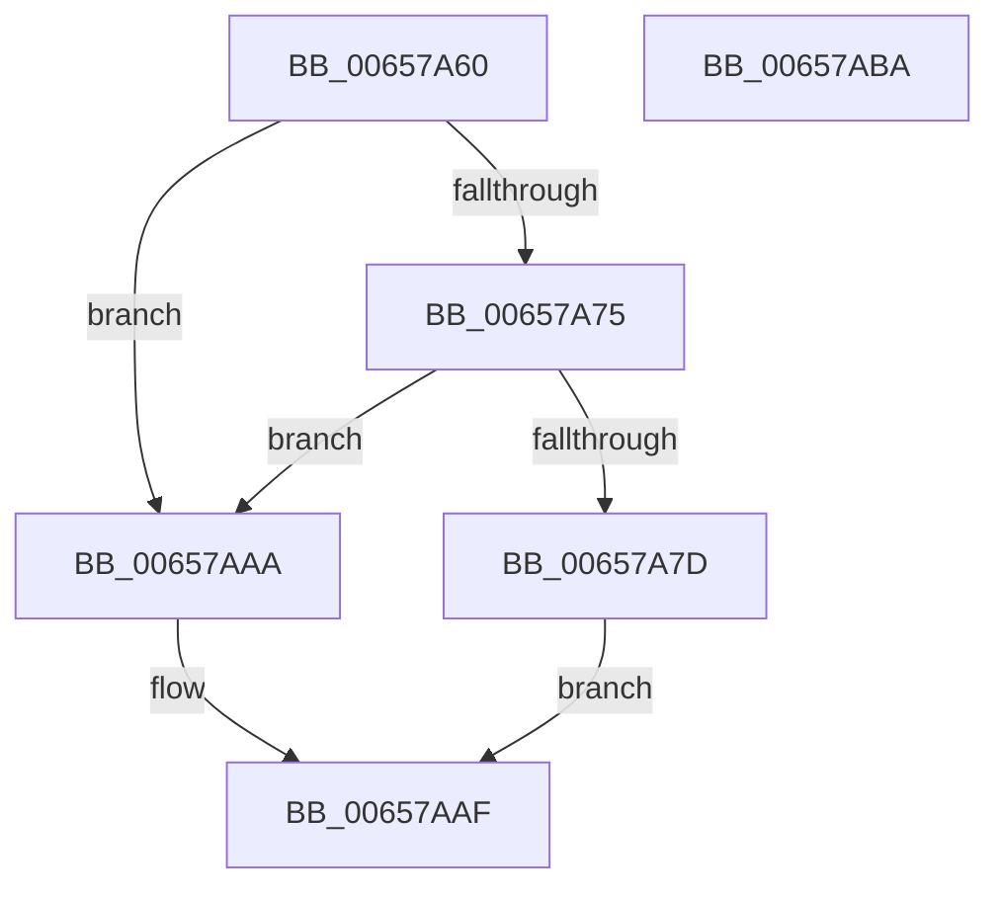

# ExpQueryRegistryRoutine

- RVA: `0x00657A60`–`0x00657ABB` (길이 `91` bytes)
- VA: `0x0000000140657A60`
- 실행 섹션: `.text`
- PDB 이름 있음: `예`; PDB Function 태그: `아니요`
- unwind 정보 RVA: `0x0005CAAC`
- 디코드: `26`개 명령, `91/91` bytes 표시
- 미해석 바이트: `0` (있으면 어셈블리에 `.byte`로 보존)

> 이 문서는 커널 이미지의 기계어와 PDB 기호를 분석해 생성했습니다. 4번과 5번은 함수 원형과 자료형을 바이너리 사용 방식에서 추정한 C 해석이며 원본 소스 복구 결과는 아닙니다.

## 1. Dependencies

- 직접 호출 지점: **1**; 고유 호출 대상: **1**
- 직접 호출자로 확인된 함수: **0**
- RIP 상대 이미지 참조: **0**

### Outgoing calls
- `0x00657A8B` → [memcpy](../6C/memcpy_function_006C6840.md) (function, `0x006C6840`)

### Direct callers
- 이 함수 시작 RVA로 연결되는 직접 call은 확인되지 않았습니다. 간접 호출은 완전히 역산할 수 없습니다.

### Static image references
- 디코드된 RIP-relative 메모리 참조가 없습니다.

## 2. Other-region calls and transfers

- 다른 실행 섹션으로 향하는 call: **0**
- 별도 외부 분기/꼬리 이동을 확인하지 못했습니다.

## 3. Assembly (complete function range)

```asm
00657A60  48 89 5C 24 08                  mov qword ptr [rsp + 8], rbx
00657A65  57                              push rdi
00657A66  48 83 EC 20                     sub rsp, 0x20
00657A6A  41 8B F9                        mov edi, r9d
00657A6D  49 8B C0                        mov rax, r8
00657A70  83 FA 03                        cmp edx, 3
00657A73  75 35                           jne 0x140657aaa
00657A75  81 FF 00 40 01 00               cmp edi, 0x14000
00657A7B  77 2D                           ja 0x140657aaa
00657A7D  48 8B 5C 24 58                  mov rbx, qword ptr [rsp + 0x58]
00657A82  44 8B C7                        mov r8d, edi
00657A85  48 8B D0                        mov rdx, rax
00657A88  48 8B 0B                        mov rcx, qword ptr [rbx]
00657A8B  E8 B0 ED 06 00                  call 0x1406c6840
00657A90  48 8B 03                        mov rax, qword ptr [rbx]
00657A93  89 B8 00 40 01 00               mov dword ptr [rax + 0x14000], edi
00657A99  48 8B 03                        mov rax, qword ptr [rbx]
00657A9C  C7 80 04 40 01 00 03 00 00 00   mov dword ptr [rax + 0x14004], 3
00657AA6  33 C0                           xor eax, eax
00657AA8  EB 05                           jmp 0x140657aaf
00657AAA  B8 4C 01 00 C0                  mov eax, 0xc000014c
00657AAF  48 8B 5C 24 30                  mov rbx, qword ptr [rsp + 0x30]
00657AB4  48 83 C4 20                     add rsp, 0x20
00657AB8  5F                              pop rdi
00657AB9  C3                              ret
00657ABA  CC                              int3
```

## 4. C-style interpretation (structured pseudocode)

```c
__int64 __fastcall ExpQueryRegistryRoutine(__int64 a1, int a2, __int64 a3, int a4, __int64 a5, __int64 a6)
{
    __int64 result;
    __int64 v_rsp;
    unsigned __int64 v_stack_p8;

    v_stack_p8 = v_rbx;
    v_rsp = (v_rsp) - (32);
    if (a2 != 3) goto loc_00657AAA;
    if (((unsigned int)((unsigned int)(a4))) > 0x14000ULL) goto loc_00657AAA;
    result = memcpy(*(unsigned __int64 *)(a6), a3, (unsigned int)((unsigned int)((unsigned int)(a4))), a4);
    *(unsigned int *)(*(unsigned __int64 *)(a6) + 81920) = (unsigned int)((unsigned int)(a4));
    *(unsigned int *)(*(unsigned __int64 *)(a6) + 81924) = 3;
    result = 0;
    goto loc_00657AAF;
loc_00657AAA:
loc_00657AAF:
    v_rsp = (v_rsp) + (32);
    return (unsigned int)(0xC000014CULL);
}
```

## 5. (Beta) C Style

```c
int64_t ExpQueryRegistryRoutine(int64_t Arg1, int32_t Arg2, int64_t Arg3, int32_t Arg4, uint64_t Arg5, void *Arg6)
{
    uint8_t *arg6 = (uint8_t *)Arg6;

    int64_t result;
    int64_t local_rsp;
    uint64_t v_stack_p8;

    v_stack_p8 = local_rbx;
    local_rsp = (local_rsp) - (32);
    if (Arg2 != 3) goto loc_00657AAA;
    if (((uint32_t)((uint32_t)(Arg4))) > 0x14000ULL) goto loc_00657AAA;
    result = memcpy(*(uint64_t *)(arg6), Arg3, (uint32_t)((uint32_t)((uint32_t)(Arg4))), Arg4);
    *(uint32_t *)(*(uint64_t *)(arg6) + 0x14000) = (uint32_t)((uint32_t)(Arg4));
    *(uint32_t *)(*(uint64_t *)(arg6) + 0x14004) = 3;
    result = 0;
    goto loc_00657AAF;
loc_00657AAA:
loc_00657AAF:
    local_rsp = (local_rsp) + (32);
    return (uint32_t)(0xC000014CULL);
}
```

### 관측된 메모리 오프셋

구조체 형식이 확인되지 않은 접근은 인자 기준의 오프셋으로만 기록했습니다.

| 기준 인자 | 오프셋 표현 | 폭 (bit) | 접근 |
|---|---:|---:|---|
| `Arg6` | `+ 0x0` | `64` | `R` |

## 6. Execution-region graph

[열기: 2D/3D 그래프와 함수 탐색 컨트롤 패널](../../../control-panel.html?section=text&rva=0x00657A60&view=graph)

- 2D 그래프는 위에서 아래로 흐르고, 3D 그래프는 빈 공간을 드래그해 회전합니다. Shift+드래그는 이동, 휠은 확대·축소, 함수 노드 선택은 대상 보고서 이동입니다.

### Static fallback


