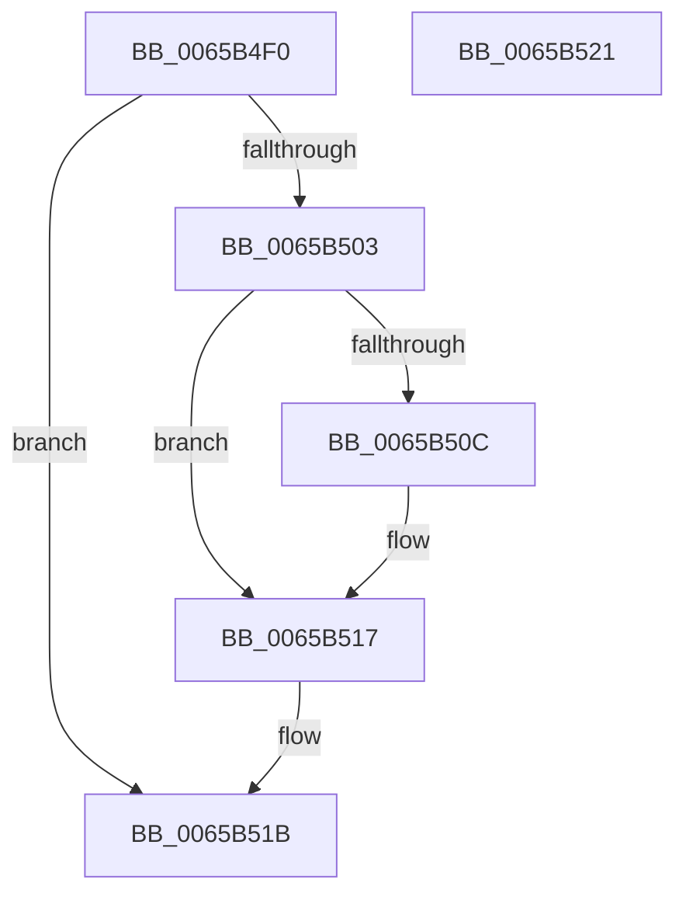

# ExpReleaseSvmAgentsLock

- RVA: `0x0065B4F0`–`0x0065B522` (길이 `50` bytes)
- VA: `0x000000014065B4F0`
- 실행 섹션: `.text`
- PDB 이름 있음: `예`; PDB Function 태그: `아니요`
- unwind 정보 RVA: `0x0005CF00`
- 디코드: `16`개 명령, `50/50` bytes 표시
- 미해석 바이트: `0` (있으면 어셈블리에 `.byte`로 보존)

> 이 문서는 커널 이미지의 기계어와 PDB 기호를 분석해 생성했습니다. 4번과 5번은 함수 원형과 자료형을 바이너리 사용 방식에서 추정한 C 해석이며 원본 소스 복구 결과는 아닙니다.

## 1. Dependencies

- 직접 호출 지점: **2**; 고유 호출 대상: **2**
- 직접 호출자로 확인된 함수: **5**
- RIP 상대 이미지 참조: **1**

### Outgoing calls
- `0x0065B4F9` → [KeReleaseInStackQueuedSpinLockFromDpcLevel](../21/KeReleaseInStackQueuedSpinLockFromDpcLevel_function_002171B0.md) (function, `0x002171B0`)
- `0x0065B512` → [KiLowerIrqlProcessIrqlFlags](../4F/KiLowerIrqlProcessIrqlFlags_function_004F5698.md) (function, `0x004F5698`)

### Direct callers
- [ExpAllocateAsid](ExpAllocateAsid_function_0065AF68.md) at `0x0065AFC4`
- [ExpAllocateAsid](ExpAllocateAsid_function_0065AF68.md) at `0x0065B097`
- [ExpAllocateAsid](ExpAllocateAsid_function_0065AF68.md) at `0x0065B0AB`
- [ExpAllocateAsid](ExpAllocateAsid_function_0065AF68.md) at `0x0065B0FC`
- [ExpFreeAsid](ExpFreeAsid_function_0065B1E8.md) at `0x0065B258`
- [ExpSvmDereferenceAsid](ExpSvmDereferenceAsid_function_0065BB40.md) at `0x0065BBB3`
- [ExpSvmReferenceAsid](ExpSvmReferenceAsid_function_0065BDF0.md) at `0x0065BE72`
- [ExpSvmServicePageFault](ExpSvmServicePageFault_function_0065BEC0.md) at `0x0065BF47`

### Static image references
- `0x0065B503` → RVA `0x00FC6D20` (`ALMOSTRO`; read)

## 2. Other-region calls and transfers

- 다른 실행 섹션으로 향하는 call: **0**
- 별도 외부 분기/꼬리 이동을 확인하지 못했습니다.

## 3. Assembly (complete function range)

```asm
0065B4F0  40 53                           push rbx
0065B4F2  48 83 EC 20                     sub rsp, 0x20
0065B4F6  0F B6 DA                        movzx ebx, dl
0065B4F9  E8 B2 BC BB FF                  call 0x1402171b0
0065B4FE  80 FB 0F                        cmp bl, 0xf
0065B501  74 18                           je 0x14065b51b
0065B503  83 3D 16 B8 96 00 00            cmp dword ptr [rip + 0x96b816], 0
0065B50A  74 0B                           je 0x14065b517
0065B50C  44 0F 20 C1                     mov rcx, cr8
0065B510  8A D3                           mov dl, bl
0065B512  E8 81 A1 E9 FF                  call 0x1404f5698
0065B517  44 0F 22 C3                     mov cr8, rbx
0065B51B  48 83 C4 20                     add rsp, 0x20
0065B51F  5B                              pop rbx
0065B520  C3                              ret
0065B521  CC                              int3
```

## 4. C-style interpretation (structured pseudocode)

```c
__int64 __fastcall ExpReleaseSvmAgentsLock(__int64 a1, unsigned __int8 a2)
{
    __int64 result;
    __int64 v_rsp;

    v_rsp = (v_rsp) - (32);
    result = KeReleaseInStackQueuedSpinLockFromDpcLevel(a1, a2, a3, a4);
    if (a2 == 15) goto loc_0065B51B;
    if ((*(unsigned int *)(v_rip + 9877526)) != 0) {
        a1 = v_cr8;
        a2 = a2;
        result = KiLowerIrqlProcessIrqlFlags(a1, a2, a3, a4);
    }
loc_0065B51B:
    v_rsp = (v_rsp) + (32);
    return result;
}
```

## 5. (Beta) C Style

```c
int64_t ExpReleaseSvmAgentsLock(int64_t Arg1, uint8_t Arg2)
{
    int64_t result;
    int64_t local_rsp;

    local_rsp = (local_rsp) - (32);
    result = KeReleaseInStackQueuedSpinLockFromDpcLevel(Arg1, Arg2, a3, a4);
    if (Arg2 == 15) goto loc_0065B51B;
    if ((*(uint32_t *)(v_rip + 0x96B816)) != 0) {
        Arg1 = v_cr8;
        Arg2 = Arg2;
        result = KiLowerIrqlProcessIrqlFlags(Arg1, Arg2, a3, a4);
    }
loc_0065B51B:
    local_rsp = (local_rsp) + (32);
    return result;
}
```

## 6. Execution-region graph

[열기: 2D/3D 그래프와 함수 탐색 컨트롤 패널](../../../control-panel.html?section=text&rva=0x0065B4F0&view=graph)

- 2D 그래프는 위에서 아래로 흐르고, 3D 그래프는 빈 공간을 드래그해 회전합니다. Shift+드래그는 이동, 휠은 확대·축소, 함수 노드 선택은 대상 보고서 이동입니다.

### Static fallback


