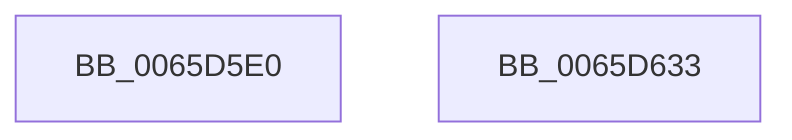

# ExpResourceTimeoutCaptureLiveDump

- RVA: `0x0065D5E0`–`0x0065D634` (길이 `84` bytes)
- VA: `0x000000014065D5E0`
- 실행 섹션: `.text`
- PDB 이름 있음: `예`; PDB Function 태그: `아니요`
- unwind 정보 RVA: `0x000AF0B0`
- 디코드: `24`개 명령, `84/84` bytes 표시
- 미해석 바이트: `0` (있으면 어셈블리에 `.byte`로 보존)

> 이 문서는 커널 이미지의 기계어와 PDB 기호를 분석해 생성했습니다. 4번과 5번은 함수 원형과 자료형을 바이너리 사용 방식에서 추정한 C 해석이며 원본 소스 복구 결과는 아닙니다.

## 1. Dependencies

- 직접 호출 지점: **2**; 고유 호출 대상: **2**
- 직접 호출자로 확인된 함수: **0**
- RIP 상대 이미지 참조: **1**

### Outgoing calls
- `0x0065D61B` → [DbgkWerCaptureLiveKernelDump](../../page/AC/DbgkWerCaptureLiveKernelDump_function_00AC1E90.md) (function, `0x00AC1E90`)
- `0x0065D628` → [ExFreePoolWithTag](../../poolcode/B8/ExFreePoolWithTag_function_00B82870.md) (function, `0x00B82870`)

### Direct callers
- 이 함수 시작 RVA로 연결되는 직접 call은 확인되지 않았습니다. 간접 호출은 완전히 역산할 수 없습니다.

### Static image references
- `0x0065D5F9` → RVA `0x006D0660` (` ?? ::FNODOBFM::`string'`; read)

## 2. Other-region calls and transfers

- 다른 실행 섹션으로 향하는 call: **2**
  - `0x0065D61B` → [DbgkWerCaptureLiveKernelDump](../../page/AC/DbgkWerCaptureLiveKernelDump_function_00AC1E90.md) (`.text` → `PAGE`)
  - `0x0065D628` → [ExFreePoolWithTag](../../poolcode/B8/ExFreePoolWithTag_function_00B82870.md) (`.text` → `POOLCODE`)
- 별도 외부 분기/꼬리 이동을 확인하지 못했습니다.

## 3. Assembly (complete function range)

```asm
0065D5E0  4C 8B DC                        mov r11, rsp
0065D5E3  53                              push rbx
0065D5E4  48 83 EC 50                     sub rsp, 0x50
0065D5E8  48 8B D9                        mov rbx, rcx
0065D5EB  33 C9                           xor ecx, ecx
0065D5ED  89 4C 24 40                     mov dword ptr [rsp + 0x40], ecx
0065D5F1  49 89 4B E0                     mov qword ptr [r11 - 0x20], rcx
0065D5F5  49 89 4B D8                     mov qword ptr [r11 - 0x28], rcx
0065D5F9  48 8D 0D 60 30 07 00            lea rcx, [rip + 0x73060]
0065D600  8B 53 30                        mov edx, dword ptr [rbx + 0x30]
0065D603  8B 43 34                        mov eax, dword ptr [rbx + 0x34]
0065D606  4C 8B 4B 20                     mov r9, qword ptr [rbx + 0x20]
0065D60A  4C 8B 43 28                     mov r8, qword ptr [rbx + 0x28]
0065D60E  49 89 43 D0                     mov qword ptr [r11 - 0x30], rax
0065D612  49 89 53 C8                     mov qword ptr [r11 - 0x38], rdx
0065D616  BA CC 01 00 00                  mov edx, 0x1cc
0065D61B  E8 70 48 46 00                  call 0x140ac1e90
0065D620  BA 52 65 54 6F                  mov edx, 0x6f546552
0065D625  48 8B CB                        mov rcx, rbx
0065D628  E8 43 52 52 00                  call 0x140b82870
0065D62D  48 83 C4 50                     add rsp, 0x50
0065D631  5B                              pop rbx
0065D632  C3                              ret
0065D633  CC                              int3
```

## 4. C-style interpretation (structured pseudocode)

```c
__int64 __fastcall ExpResourceTimeoutCaptureLiveDump(__int64 a1)
{
    __int64 result;
    __int64 v_rsp;
    unsigned int v_stack_m18;

    v_rsp = (v_rsp) - (80);
    a1 = 0;
    v_stack_m18 = 0;
    *(unsigned __int64 *)(v_rsp - 32) = 0;
    *(unsigned __int64 *)(v_rsp - 40) = 0;
    *(unsigned __int64 *)(v_rsp - 48) = (unsigned int)(*(unsigned int *)(a1 + 52));
    *(unsigned __int64 *)(v_rsp - 56) = (unsigned int)(*(unsigned int *)(a1 + 48));
    result = DbgkWerCaptureLiveKernelDump(v_rip + 471136, 460, *(unsigned __int64 *)(a1 + 40), *(unsigned __int64 *)(a1 + 32));
    result = ExFreePoolWithTag(0, (unsigned int)(0x6F546552ULL), *(unsigned __int64 *)(a1 + 40), *(unsigned __int64 *)(a1 + 32));
    v_rsp = (v_rsp) + (80);
    return result;
}
```

## 5. (Beta) C Style

```c
int64_t ExpResourceTimeoutCaptureLiveDump(void *Arg1)
{
    uint8_t *arg1 = (uint8_t *)Arg1;

    int64_t result;
    int64_t local_rsp;
    uint32_t v_stack_m18;

    local_rsp = (local_rsp) - (80);
    Arg1 = 0;
    v_stack_m18 = 0;
    *(uint64_t *)(local_rsp - 0x20) = 0;
    *(uint64_t *)(local_rsp - 0x28) = 0;
    *(uint64_t *)(local_rsp - 0x30) = (uint32_t)(*(uint32_t *)(arg1 + 0x34));
    *(uint64_t *)(local_rsp - 0x38) = (uint32_t)(*(uint32_t *)(arg1 + 0x30));
    result = DbgkWerCaptureLiveKernelDump(v_rip + 471136, 460, *(uint64_t *)(arg1 + 0x28), *(uint64_t *)(arg1 + 0x20));
    result = ExFreePoolWithTag(0, (uint32_t)(0x6F546552ULL), *(uint64_t *)(arg1 + 0x28), *(uint64_t *)(arg1 + 0x20));
    local_rsp = (local_rsp) + (80);
    return result;
}
```

### 관측된 메모리 오프셋

구조체 형식이 확인되지 않은 접근은 인자 기준의 오프셋으로만 기록했습니다.

| 기준 인자 | 오프셋 표현 | 폭 (bit) | 접근 |
|---|---:|---:|---|
| `Arg1` | `+ 0x20` | `64` | `R` |
| `Arg1` | `+ 0x28` | `64` | `R` |
| `Arg1` | `+ 0x30` | `32` | `R` |
| `Arg1` | `+ 0x34` | `32` | `R` |

## 6. Execution-region graph

[열기: 2D/3D 그래프와 함수 탐색 컨트롤 패널](../../../control-panel.html?section=text&rva=0x0065D5E0&view=graph)

- 2D 그래프는 위에서 아래로 흐르고, 3D 그래프는 빈 공간을 드래그해 회전합니다. Shift+드래그는 이동, 휠은 확대·축소, 함수 노드 선택은 대상 보고서 이동입니다.

### Static fallback


