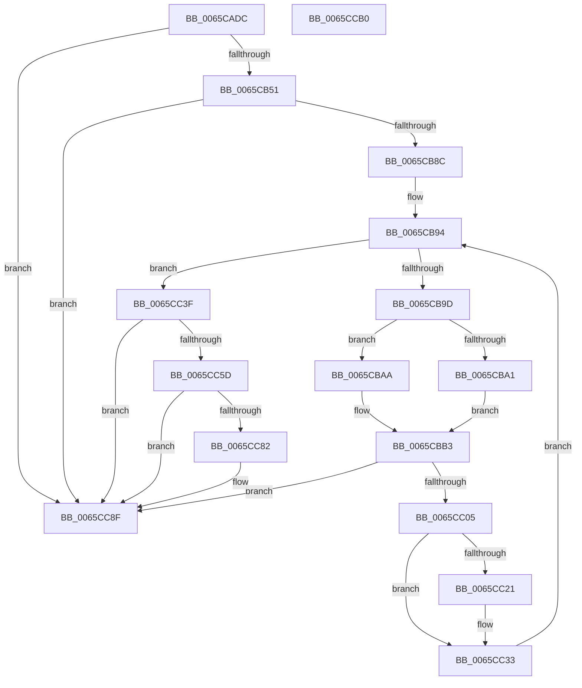

# ExpSaInitialize

- RVA: `0x0065CADC`–`0x0065CCB1` (길이 `469` bytes)
- VA: `0x000000014065CADC`
- 실행 섹션: `.text`
- PDB 이름 있음: `예`; PDB Function 태그: `아니요`
- unwind 정보 RVA: `0x000D5880`
- 디코드: `117`개 명령, `469/469` bytes 표시
- 미해석 바이트: `0` (있으면 어셈블리에 `.byte`로 보존)

> 이 문서는 커널 이미지의 기계어와 PDB 기호를 분석해 생성했습니다. 4번과 5번은 함수 원형과 자료형을 바이너리 사용 방식에서 추정한 C 해석이며 원본 소스 복구 결과는 아닙니다.

## 1. Dependencies

- 직접 호출 지점: **12**; 고유 호출 대상: **6**
- 직접 호출자로 확인된 함수: **1**
- RIP 상대 이미지 참조: **7**

### Outgoing calls
- `0x0065CB3C` → [ExAllocatePool2](../../poolcode/B8/ExAllocatePool2_function_00B820F0.md) (function, `0x00B820F0`)
- `0x0065CB59` → [memset](../6C/memset_function_006C6C40.md) (function, `0x006C6C40`)
- `0x0065CB63` → [KeQueryMaximumProcessorCountEx](../26/KeQueryMaximumProcessorCountEx_function_00264D60.md) (function, `0x00264D60`)
- `0x0065CB77` → [ExAllocatePool2](../../poolcode/B8/ExAllocatePool2_function_00B820F0.md) (function, `0x00B820F0`)
- `0x0065CBA3` → [KeGetPrcb](../2D/KeGetPrcb_function_002D85D0.md) (function, `0x002D85D0`)
- `0x0065CBE7` → [ExAllocatePool3](../../poolcode/B8/ExAllocatePool3_function_00B84270.md) (function, `0x00B84270`)
- `0x0065CC0D` → [memset](../6C/memset_function_006C6C40.md) (function, `0x006C6C40`)
- `0x0065CC14` → [KeGetPrcb](../2D/KeGetPrcb_function_002D85D0.md) (function, `0x002D85D0`)
- `0x0065CC4C` → [ExAllocatePool2](../../poolcode/B8/ExAllocatePool2_function_00B820F0.md) (function, `0x00B820F0`)
- `0x0065CC62` → [ExpSaAllocatorInitialize](ExpSaAllocatorInitialize_function_0065CA74.md) (function, `0x0065CA74`)
- `0x0065CC71` → [ExAllocatePool2](../../poolcode/B8/ExAllocatePool2_function_00B820F0.md) (function, `0x00B820F0`)
- `0x0065CC88` → [ExpSaAllocatorInitialize](ExpSaAllocatorInitialize_function_0065CA74.md) (function, `0x0065CA74`)

### Direct callers
- [ExpInitSystemPhase1](../../init/C5/ExpInitSystemPhase1_function_00C51508.md) at `0x00C515F9`

### Static image references
- `0x0065CB04` → RVA `0x00EFA280` (`.data`; write)
- `0x0065CB10` → RVA `0x00EFA278` (`.data`; write)
- `0x0065CB1A` → RVA `0x00EFA290` (`.data`; write)
- `0x0065CB25` → RVA `0x00EFA298` (`.data`; write)
- `0x0065CB2F` → RVA `0x00EFA288` (`.data`; write)
- `0x0065CB8C` → RVA `0x00FC6A80` (`ALMOSTRO`; read)
- `0x0065CBF1` → RVA `0x00EFA278` (`.data`; read)

## 2. Other-region calls and transfers

- 다른 실행 섹션으로 향하는 call: **5**
  - `0x0065CB3C` → [ExAllocatePool2](../../poolcode/B8/ExAllocatePool2_function_00B820F0.md) (`.text` → `POOLCODE`)
  - `0x0065CB77` → [ExAllocatePool2](../../poolcode/B8/ExAllocatePool2_function_00B820F0.md) (`.text` → `POOLCODE`)
  - `0x0065CBE7` → [ExAllocatePool3](../../poolcode/B8/ExAllocatePool3_function_00B84270.md) (`.text` → `POOLCODE`)
  - `0x0065CC4C` → [ExAllocatePool2](../../poolcode/B8/ExAllocatePool2_function_00B820F0.md) (`.text` → `POOLCODE`)
  - `0x0065CC71` → [ExAllocatePool2](../../poolcode/B8/ExAllocatePool2_function_00B820F0.md) (`.text` → `POOLCODE`)
- 별도 외부 분기/꼬리 이동을 확인하지 못했습니다.

## 3. Assembly (complete function range)

```asm
0065CADC  48 8B C4                        mov rax, rsp
0065CADF  48 89 58 08                     mov qword ptr [rax + 8], rbx
0065CAE3  48 89 68 10                     mov qword ptr [rax + 0x10], rbp
0065CAE7  48 89 70 18                     mov qword ptr [rax + 0x18], rsi
0065CAEB  48 89 78 20                     mov qword ptr [rax + 0x20], rdi
0065CAEF  41 54                           push r12
0065CAF1  41 55                           push r13
0065CAF3  41 56                           push r14
0065CAF5  48 83 EC 40                     sub rsp, 0x40
0065CAF9  33 DB                           xor ebx, ebx
0065CAFB  0F 57 C0                        xorps xmm0, xmm0
0065CAFE  41 BC 45 78 53 61               mov r12d, 0x61537845
0065CB04  48 89 1D 75 D7 89 00            mov qword ptr [rip + 0x89d775], rbx
0065CB0B  BD 80 00 00 00                  mov ebp, 0x80
0065CB10  48 89 1D 61 D7 89 00            mov qword ptr [rip + 0x89d761], rbx
0065CB17  45 8B C4                        mov r8d, r12d
0065CB1A  48 89 1D 6F D7 89 00            mov qword ptr [rip + 0x89d76f], rbx
0065CB21  44 8D 6B 40                     lea r13d, [rbx + 0x40]
0065CB25  48 89 1D 6C D7 89 00            mov qword ptr [rip + 0x89d76c], rbx
0065CB2C  41 8B CD                        mov ecx, r13d
0065CB2F  48 89 1D 52 D7 89 00            mov qword ptr [rip + 0x89d752], rbx
0065CB36  8B D5                           mov edx, ebp
0065CB38  0F 11 40 D8                     movups xmmword ptr [rax - 0x28], xmm0
0065CB3C  E8 AF 55 52 00                  call 0x140b820f0
0065CB41  48 89 05 38 D7 89 00            mov qword ptr [rip + 0x89d738], rax
0065CB48  48 85 C0                        test rax, rax
0065CB4B  0F 84 3E 01 00 00               je 0x14065cc8f
0065CB51  44 8B C5                        mov r8d, ebp
0065CB54  33 D2                           xor edx, edx
0065CB56  48 8B C8                        mov rcx, rax
0065CB59  E8 E2 A0 06 00                  call 0x1406c6c40
0065CB5E  B9 FF FF 00 00                  mov ecx, 0xffff
0065CB63  E8 F8 81 C0 FF                  call 0x140264d60
0065CB68  8B D0                           mov edx, eax
0065CB6A  45 8B C4                        mov r8d, r12d
0065CB6D  48 C1 E2 03                     shl rdx, 3
0065CB71  41 8B CD                        mov ecx, r13d
0065CB74  44 8B F0                        mov r14d, eax
0065CB77  E8 74 55 52 00                  call 0x140b820f0
0065CB7C  48 89 05 F5 D6 89 00            mov qword ptr [rip + 0x89d6f5], rax
0065CB83  48 85 C0                        test rax, rax
0065CB86  0F 84 03 01 00 00               je 0x14065cc8f
0065CB8C  8B 35 EE 9E 96 00               mov esi, dword ptr [rip + 0x969eee]
0065CB92  8B FB                           mov edi, ebx
0065CB94  41 3B FE                        cmp edi, r14d
0065CB97  0F 83 A2 00 00 00               jae 0x14065cc3f
0065CB9D  3B FE                           cmp edi, esi
0065CB9F  73 09                           jae 0x14065cbaa
0065CBA1  8B CF                           mov ecx, edi
0065CBA3  E8 28 BA C7 FF                  call 0x1402d85d0
0065CBA8  EB 09                           jmp 0x14065cbb3
0065CBAA  65 48 8B 04 25 20 00 00 00      mov rax, qword ptr gs:[0x20]
0065CBB3  48 8B 88 C0 00 00 00            mov rcx, qword ptr [rax + 0xc0]
0065CBBA  4C 8D 4C 24 30                  lea r9, [rsp + 0x30]
0065CBBF  45 8B C4                        mov r8d, r12d
0065CBC2  C6 44 24 30 03                  mov byte ptr [rsp + 0x30], 3
0065CBC7  48 8B D5                        mov rdx, rbp
0065CBCA  C7 44 24 20 01 00 00 00         mov dword ptr [rsp + 0x20], 1
0065CBD2  0F B7 81 8A 00 00 00            movzx eax, word ptr [rcx + 0x8a]
0065CBD9  49 8B CD                        mov rcx, r13
0065CBDC  0F B7 C0                        movzx eax, ax
0065CBDF  0F BA E8 1F                     bts eax, 0x1f
0065CBE3  89 44 24 38                     mov dword ptr [rsp + 0x38], eax
0065CBE7  E8 84 76 52 00                  call 0x140b84270
0065CBEC  48 8B C8                        mov rcx, rax
0065CBEF  8B EF                           mov ebp, edi
0065CBF1  48 8B 05 80 D6 89 00            mov rax, qword ptr [rip + 0x89d680]
0065CBF8  48 89 0C E8                     mov qword ptr [rax + rbp*8], rcx
0065CBFC  48 85 C9                        test rcx, rcx
0065CBFF  0F 84 8A 00 00 00               je 0x14065cc8f
0065CC05  33 D2                           xor edx, edx
0065CC07  41 B8 80 00 00 00               mov r8d, 0x80
0065CC0D  E8 2E A0 06 00                  call 0x1406c6c40
0065CC12  8B CF                           mov ecx, edi
0065CC14  E8 B7 B9 C7 FF                  call 0x1402d85d0
0065CC19  48 8B D0                        mov rdx, rax
0065CC1C  48 85 C0                        test rax, rax
0065CC1F  74 12                           je 0x14065cc33
0065CC21  48 8B 05 50 D6 89 00            mov rax, qword ptr [rip + 0x89d650]
0065CC28  48 8B 0C E8                     mov rcx, qword ptr [rax + rbp*8]
0065CC2C  48 89 8A B0 8B 00 00            mov qword ptr [rdx + 0x8bb0], rcx
0065CC33  FF C7                           inc edi
0065CC35  BD 80 00 00 00                  mov ebp, 0x80
0065CC3A  E9 55 FF FF FF                  jmp 0x14065cb94
0065CC3F  BF 48 00 00 00                  mov edi, 0x48
0065CC44  45 8B C4                        mov r8d, r12d
0065CC47  8B D7                           mov edx, edi
0065CC49  49 8B CD                        mov rcx, r13
0065CC4C  E8 9F 54 52 00                  call 0x140b820f0
0065CC51  48 89 05 38 D6 89 00            mov qword ptr [rip + 0x89d638], rax
0065CC58  48 85 C0                        test rax, rax
0065CC5B  74 32                           je 0x14065cc8f
0065CC5D  33 D2                           xor edx, edx
0065CC5F  48 8B C8                        mov rcx, rax
0065CC62  E8 0D FE FF FF                  call 0x14065ca74
0065CC67  45 8B C4                        mov r8d, r12d
0065CC6A  8B D7                           mov edx, edi
0065CC6C  B9 00 01 00 00                  mov ecx, 0x100
0065CC71  E8 7A 54 52 00                  call 0x140b820f0
0065CC76  48 89 05 1B D6 89 00            mov qword ptr [rip + 0x89d61b], rax
0065CC7D  48 85 C0                        test rax, rax
0065CC80  74 0D                           je 0x14065cc8f
0065CC82  8D 57 B9                        lea edx, [rdi - 0x47]
0065CC85  48 8B C8                        mov rcx, rax
0065CC88  E8 E7 FD FF FF                  call 0x14065ca74
0065CC8D  B3 01                           mov bl, 1
0065CC8F  48 8B 6C 24 68                  mov rbp, qword ptr [rsp + 0x68]
0065CC94  8A C3                           mov al, bl
0065CC96  48 8B 5C 24 60                  mov rbx, qword ptr [rsp + 0x60]
0065CC9B  48 8B 74 24 70                  mov rsi, qword ptr [rsp + 0x70]
0065CCA0  48 8B 7C 24 78                  mov rdi, qword ptr [rsp + 0x78]
0065CCA5  48 83 C4 40                     add rsp, 0x40
0065CCA9  41 5E                           pop r14
0065CCAB  41 5D                           pop r13
0065CCAD  41 5C                           pop r12
0065CCAF  C3                              ret
0065CCB0  CC                              int3
```

## 4. C-style interpretation (structured pseudocode)

```c
__int64 __fastcall ExpSaInitialize(void)
{
    __int64 result;
    __int64 v_rbx;
    __int64 v_rdi;
    __int64 v_rsp;
    unsigned int v_stack_m20;
    unsigned __int64 v_stack_m28;
    unsigned int v_stack_m38;
    unsigned __int64 v_stack_p10;
    unsigned __int64 v_stack_p18;
    unsigned __int64 v_stack_p20;
    unsigned __int64 v_stack_p8;

    *(unsigned __int64 *)(v_rsp + 8) = v_rbx;
    *(unsigned __int64 *)(v_rsp + 16) = v_rbp;
    *(unsigned __int64 *)(v_rsp + 24) = v_rsi;
    *(unsigned __int64 *)(v_rsp + 32) = v_rdi;
    v_rsp = (v_rsp) - (64);
    v_rbx = 0;
    *(unsigned __int64 *)(v_rip + 9033589) = 0;
    *(unsigned __int64 *)(v_rip + 9033569) = 0;
    *(unsigned __int64 *)(v_rip + 9033583) = 0;
    *(unsigned __int64 *)(v_rip + 9033580) = 0;
    *(unsigned __int64 *)(v_rip + 9033554) = 0;
    *(unsigned __int64 *)(v_rsp - 40) = v_xmm0;
    result = ExAllocatePool2((unsigned int)((unsigned int)(v_rbx + 64)), 128, (unsigned int)((unsigned int)((unsigned int)(0x61537845ULL))), a4);
    *(unsigned __int64 *)(v_rip + 9033528) = result;
    if (result == 0) goto loc_0065CC8F;
    a2 = 0;
    result = memset(result, a2, 128, a4);
    result = KeQueryMaximumProcessorCountEx((unsigned int)(0xFFFFULL), a2, 128, a4);
    a2 = ((unsigned int)((unsigned int)(result))) << (3);
    result = ExAllocatePool2((unsigned int)((unsigned int)(v_rbx + 64)), a2, (unsigned int)((unsigned int)((unsigned int)(0x61537845ULL))), a4);
    *(unsigned __int64 *)(v_rip + 9033461) = result;
    if (result == 0) goto loc_0065CC8F;
loc_0065CB94:
    if (0 >= ((unsigned int)((unsigned int)((unsigned int)(result))))) goto loc_0065CC3F;
    if (0 >= ((unsigned int)((unsigned int)(*(unsigned int *)(v_rip + 9871086))))) goto loc_0065CBAA;
    result = KeGetPrcb(0, a2, (unsigned int)((unsigned int)((unsigned int)(0x61537845ULL))), a4);
    goto loc_0065CBB3;
loc_0065CBAA:
loc_0065CBB3:
    v_stack_m28 = 3;
    v_stack_m38 = 1;
    v_stack_m20 = (unsigned int)((unsigned __int16)(*(unsigned __int16 *)(*(unsigned __int64 *)(*(unsigned __int64 *)(gs_base + (0 + 32)) + 192) + 138)));
    result = ExAllocatePool3(v_rbx + 64, 128, (unsigned int)((unsigned int)((unsigned int)(0x61537845ULL))), v_stack_m28);
    *(unsigned __int64 *)(*(unsigned __int64 *)(v_rip + 9033344) + 0 * 8) = result;
    if (result == 0) goto loc_0065CC8F;
    a2 = 0;
    result = memset(result, a2, 128, v_stack_m28);
    result = KeGetPrcb(0, a2, 128, v_stack_m28);
    if (result != 0) {
        result = *(unsigned __int64 *)(v_rip + 9033296);
        a1 = *(unsigned __int64 *)(result + 0 * 8);
        *(unsigned __int64 *)(result + 35760) = a1;
    }
    v_rdi = (unsigned int)((0) + 1);
    goto loc_0065CB94;
loc_0065CC3F:
    result = ExAllocatePool2(v_rbx + 64, 72, (unsigned int)((unsigned int)((unsigned int)(0x61537845ULL))), v_stack_m28);
    *(unsigned __int64 *)(v_rip + 9033272) = result;
    if (result == 0) goto loc_0065CC8F;
    a2 = 0;
    result = ExpSaAllocatorInitialize(result, a2, (unsigned int)((unsigned int)((unsigned int)(0x61537845ULL))), v_stack_m28);
    result = ExAllocatePool2(256, 72, (unsigned int)((unsigned int)((unsigned int)(0x61537845ULL))), v_stack_m28);
    *(unsigned __int64 *)(v_rip + 9033243) = result;
    if (result != 0) {
        a2 = 72 - 71;
        a1 = result;
        result = ExpSaAllocatorInitialize(a1, a2, (unsigned int)((unsigned int)((unsigned int)(0x61537845ULL))), v_stack_m28);
        v_rbx = 1;
    }
    v_rsp = (v_rsp) + (64);
    return (unsigned __int8)(v_rbx);
}
```

## 5. (Beta) C Style

```c
void ExpSaInitialize(void)
{
    int64_t result;
    int64_t local_rbx;
    int64_t local_rdi;
    int64_t local_rsp;
    uint32_t v_stack_m20;
    uint64_t v_stack_m28;
    uint32_t v_stack_m38;
    uint64_t v_stack_p10;
    uint64_t v_stack_p18;
    uint64_t v_stack_p20;
    uint64_t v_stack_p8;

    *(uint64_t *)(local_rsp + 0x8) = local_rbx;
    *(uint64_t *)(local_rsp + 0x10) = local_rbp;
    *(uint64_t *)(local_rsp + 0x18) = local_rsi;
    *(uint64_t *)(local_rsp + 0x20) = local_rdi;
    local_rsp = (local_rsp) - (64);
    local_rbx = 0;
    *(uint64_t *)(v_rip + 0x89D775) = 0;
    *(uint64_t *)(v_rip + 0x89D761) = 0;
    *(uint64_t *)(v_rip + 0x89D76F) = 0;
    *(uint64_t *)(v_rip + 0x89D76C) = 0;
    *(uint64_t *)(v_rip + 0x89D752) = 0;
    *(uint64_t *)(local_rsp - 0x28) = v_xmm0;
    result = ExAllocatePool2((uint32_t)((uint32_t)(local_rbx + 64)), 128, (uint32_t)((uint32_t)((uint32_t)(0x61537845ULL))), a4);
    *(uint64_t *)(v_rip + 0x89D738) = result;
    if (result == 0) goto loc_0065CC8F;
    a2 = 0;
    result = memset(result, a2, 128, a4);
    result = KeQueryMaximumProcessorCountEx((uint32_t)(0xFFFFULL), a2, 128, a4);
    a2 = ((uint32_t)((uint32_t)(result))) << (3);
    result = ExAllocatePool2((uint32_t)((uint32_t)(local_rbx + 64)), a2, (uint32_t)((uint32_t)((uint32_t)(0x61537845ULL))), a4);
    *(uint64_t *)(v_rip + 0x89D6F5) = result;
    if (result == 0) goto loc_0065CC8F;
loc_0065CB94:
    if (0 >= ((uint32_t)((uint32_t)((uint32_t)(result))))) goto loc_0065CC3F;
    if (0 >= ((uint32_t)((uint32_t)(*(uint32_t *)(v_rip + 0x969EEE))))) goto loc_0065CBAA;
    result = KeGetPrcb(0, a2, (uint32_t)((uint32_t)((uint32_t)(0x61537845ULL))), a4);
    goto loc_0065CBB3;
loc_0065CBAA:
loc_0065CBB3:
    v_stack_m28 = 3;
    v_stack_m38 = 1;
    v_stack_m20 = (uint32_t)((uint16_t)(*(uint16_t *)(*(uint64_t *)(*(uint64_t *)(gs_base + (0 + 0x20)) + 0xC0) + 0x8A)));
    result = ExAllocatePool3(local_rbx + 64, 128, (uint32_t)((uint32_t)((uint32_t)(0x61537845ULL))), v_stack_m28);
    *(uint64_t *)(*(uint64_t *)(v_rip + 0x89D680) + 0x0 * 8) = result;
    if (result == 0) goto loc_0065CC8F;
    a2 = 0;
    result = memset(result, a2, 128, v_stack_m28);
    result = KeGetPrcb(0, a2, 128, v_stack_m28);
    if (result != 0) {
        result = *(uint64_t *)(v_rip + 0x89D650);
        a1 = *(uint64_t *)(result + 0x0 * 8);
        *(uint64_t *)(result + 0x8BB0) = a1;
    }
    local_rdi = (uint32_t)((0) + 1);
    goto loc_0065CB94;
loc_0065CC3F:
    result = ExAllocatePool2(local_rbx + 64, 72, (uint32_t)((uint32_t)((uint32_t)(0x61537845ULL))), v_stack_m28);
    *(uint64_t *)(v_rip + 0x89D638) = result;
    if (result == 0) goto loc_0065CC8F;
    a2 = 0;
    result = ExpSaAllocatorInitialize(result, a2, (uint32_t)((uint32_t)((uint32_t)(0x61537845ULL))), v_stack_m28);
    result = ExAllocatePool2(256, 72, (uint32_t)((uint32_t)((uint32_t)(0x61537845ULL))), v_stack_m28);
    *(uint64_t *)(v_rip + 0x89D61B) = result;
    if (result != 0) {
        a2 = 72 - 71;
        a1 = result;
        result = ExpSaAllocatorInitialize(a1, a2, (uint32_t)((uint32_t)((uint32_t)(0x61537845ULL))), v_stack_m28);
        local_rbx = 1;
    }
    local_rsp = (local_rsp) + (64);
    return (uint8_t)(local_rbx);
}
```

## 6. Execution-region graph

[열기: 2D/3D 그래프와 함수 탐색 컨트롤 패널](../../../control-panel.html?section=text&rva=0x0065CADC&view=graph)

- 2D 그래프는 위에서 아래로 흐르고, 3D 그래프는 빈 공간을 드래그해 회전합니다. Shift+드래그는 이동, 휠은 확대·축소, 함수 노드 선택은 대상 보고서 이동입니다.

### Static fallback


