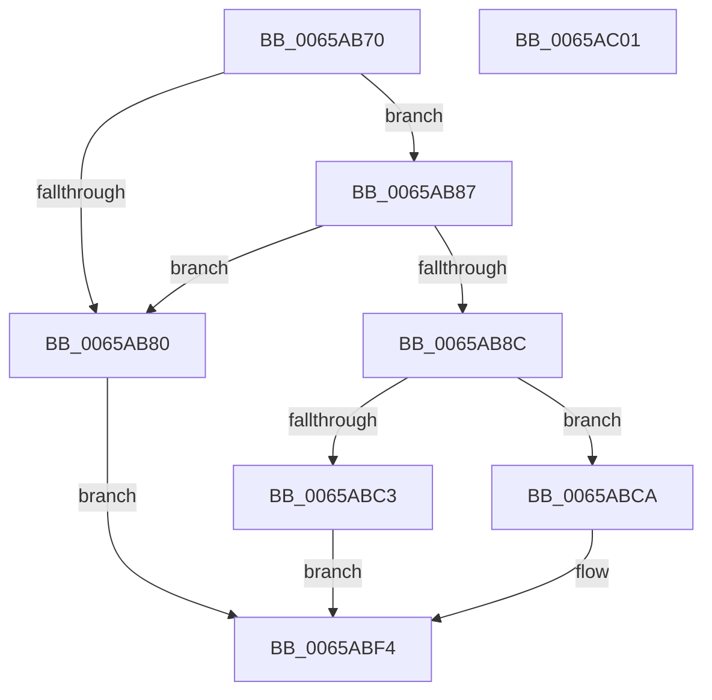

# ExpSecurePoolCreate

- RVA: `0x0065AB70`–`0x0065AC02` (길이 `146` bytes)
- VA: `0x000000014065AB70`
- 실행 섹션: `.text`
- PDB 이름 있음: `예`; PDB Function 태그: `아니요`
- unwind 정보 RVA: `0x000D5624`
- 디코드: `38`개 명령, `146/146` bytes 표시
- 미해석 바이트: `0` (있으면 어셈블리에 `.byte`로 보존)

> 이 문서는 커널 이미지의 기계어와 PDB 기호를 분석해 생성했습니다. 4번과 5번은 함수 원형과 자료형을 바이너리 사용 방식에서 추정한 C 해석이며 원본 소스 복구 결과는 아닙니다.

## 1. Dependencies

- 직접 호출 지점: **2**; 고유 호출 대상: **2**
- 직접 호출자로 확인된 함수: **1**
- RIP 상대 이미지 참조: **0**

### Outgoing calls
- `0x0065ABB9` → [RtlpHpMetadataAlloc](../2E/RtlpHpMetadataAlloc_function_002EC180.md) (function, `0x002EC180`)
- `0x0065ABEF` → [RtlpHpMetadataFree](../2E/RtlpHpMetadataFree_function_002ECA64.md) (function, `0x002ECA64`)

### Direct callers
- [ExCreatePool](ExCreatePool_function_00655E80.md) at `0x00655F53`

### Static image references
- 디코드된 RIP-relative 메모리 참조가 없습니다.

## 2. Other-region calls and transfers

- 다른 실행 섹션으로 향하는 call: **0**
- 별도 외부 분기/꼬리 이동을 확인하지 못했습니다.

## 3. Assembly (complete function range)

```asm
0065AB70  40 53                           push rbx
0065AB72  48 83 EC 40                     sub rsp, 0x40
0065AB76  0F 29 74 24 30                  movaps xmmword ptr [rsp + 0x30], xmm6
0065AB7B  83 F9 02                        cmp ecx, 2
0065AB7E  74 07                           je 0x14065ab87
0065AB80  BB 0D 00 00 C0                  mov ebx, 0xc000000d
0065AB85  EB 6D                           jmp 0x14065abf4
0065AB87  48 85 D2                        test rdx, rdx
0065AB8A  74 F4                           je 0x14065ab80
0065AB8C  45 33 C0                        xor r8d, r8d
0065AB8F  4C 8D 4C 24 20                  lea r9, [rsp + 0x20]
0065AB94  0F 57 C0                        xorps xmm0, xmm0
0065AB97  0F 11 44 24 20                  movups xmmword ptr [rsp + 0x20], xmm0
0065AB9C  66 C7 44 24 21 01 00            mov word ptr [rsp + 0x21], 1
0065ABA3  C6 44 24 20 03                  mov byte ptr [rsp + 0x20], 3
0065ABA8  41 8D 48 10                     lea ecx, [r8 + 0x10]
0065ABAC  0F 28 74 24 20                  movaps xmm6, xmmword ptr [rsp + 0x20]
0065ABB1  8B D1                           mov edx, ecx
0065ABB3  66 0F 7F 74 24 20               movdqa xmmword ptr [rsp + 0x20], xmm6
0065ABB9  E8 C2 15 C9 FF                  call 0x1402ec180
0065ABBE  48 85 C0                        test rax, rax
0065ABC1  75 07                           jne 0x14065abca
0065ABC3  BB 9A 00 00 C0                  mov ebx, 0xc000009a
0065ABC8  EB 2A                           jmp 0x14065abf4
0065ABCA  48 83 60 08 00                  and qword ptr [rax + 8], 0
0065ABCF  BB BB 00 00 C0                  mov ebx, 0xc00000bb
0065ABD4  C7 00 BD BD AF AF               mov dword ptr [rax], 0xafafbdbd
0065ABDA  C7 40 04 02 00 00 00            mov dword ptr [rax + 4], 2
0065ABE1  48 8D 54 24 20                  lea rdx, [rsp + 0x20]
0065ABE6  66 0F 7F 74 24 20               movdqa xmmword ptr [rsp + 0x20], xmm6
0065ABEC  48 8B C8                        mov rcx, rax
0065ABEF  E8 70 1E C9 FF                  call 0x1402eca64
0065ABF4  0F 28 74 24 30                  movaps xmm6, xmmword ptr [rsp + 0x30]
0065ABF9  8B C3                           mov eax, ebx
0065ABFB  48 83 C4 40                     add rsp, 0x40
0065ABFF  5B                              pop rbx
0065AC00  C3                              ret
0065AC01  CC                              int3
```

## 4. C-style interpretation (structured pseudocode)

```c
__int64 __fastcall ExpSecurePoolCreate(int a1, __int64 a2, int a3)
{
    __int64 result;
    __int64 v_rsp;
    unsigned __int64 v_stack_m18;
    unsigned __int16 v_stack_m27;
    unsigned __int64 v_stack_m28;

    v_rsp = (v_rsp) - (64);
    v_stack_m18 = v_xmm6;
    if (a1 == 2) goto loc_0065AB87;
loc_0065AB80:
    goto loc_0065ABF4;
loc_0065AB87:
    if (a2 == 0) goto loc_0065AB80;
    a3 = 0;
    v_stack_m28 = v_xmm0;
    v_stack_m27 = 1;
    v_stack_m28 = 3;
    v_stack_m28 = v_xmm6;
    result = RtlpHpMetadataAlloc(a3 + 16, (unsigned int)((unsigned int)(a3 + 16)), a3, v_stack_m28);
    if (result != 0) goto loc_0065ABCA;
    goto loc_0065ABF4;
loc_0065ABCA:
    *(unsigned int *)(result) = 0xAFAFBDBDULL;
    *(unsigned int *)(result + 4) = 2;
    v_stack_m28 = v_xmm6;
    result = RtlpHpMetadataFree(result, v_stack_m28, a3, v_stack_m28);
loc_0065ABF4:
    v_rsp = (v_rsp) + (64);
    return (unsigned int)((unsigned int)((unsigned int)(0xC00000BBULL)));
}
```

## 5. (Beta) C Style

```c
int64_t ExpSecurePoolCreate(int32_t Arg1, int64_t Arg2, int32_t Arg3)
{
    int64_t result;
    int64_t local_rsp;
    uint64_t v_stack_m18;
    uint16_t v_stack_m27;
    uint64_t v_stack_m28;

    local_rsp = (local_rsp) - (64);
    v_stack_m18 = v_xmm6;
    if (Arg1 == 2) goto loc_0065AB87;
loc_0065AB80:
    goto loc_0065ABF4;
loc_0065AB87:
    if (Arg2 == 0) goto loc_0065AB80;
    Arg3 = 0;
    v_stack_m28 = v_xmm0;
    v_stack_m27 = 1;
    v_stack_m28 = 3;
    v_stack_m28 = v_xmm6;
    result = RtlpHpMetadataAlloc(Arg3 + 16, (uint32_t)((uint32_t)(Arg3 + 16)), Arg3, v_stack_m28);
    if (result != 0) goto loc_0065ABCA;
    goto loc_0065ABF4;
loc_0065ABCA:
    *(uint32_t *)(result) = 0xAFAFBDBDULL;
    *(uint32_t *)(result + 0x4) = 2;
    v_stack_m28 = v_xmm6;
    result = RtlpHpMetadataFree(result, v_stack_m28, Arg3, v_stack_m28);
loc_0065ABF4:
    local_rsp = (local_rsp) + (64);
    return (uint32_t)((uint32_t)((uint32_t)(0xC00000BBULL)));
}
```

## 6. Execution-region graph

[열기: 2D/3D 그래프와 함수 탐색 컨트롤 패널](../../../control-panel.html?section=text&rva=0x0065AB70&view=graph)

- 2D 그래프는 위에서 아래로 흐르고, 3D 그래프는 빈 공간을 드래그해 회전합니다. Shift+드래그는 이동, 휠은 확대·축소, 함수 노드 선택은 대상 보고서 이동입니다.

### Static fallback


