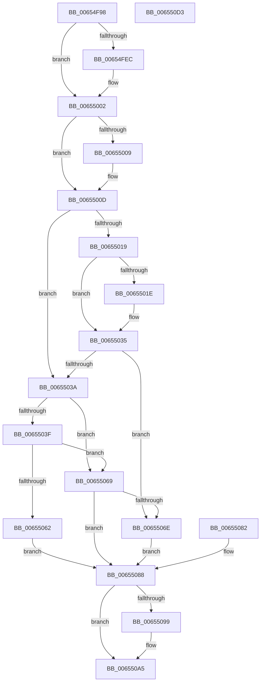

# ExpSetBootLoaderMetadata

- RVA: `0x00654F98`–`0x006550D4` (길이 `316` bytes)
- VA: `0x0000000140654F98`
- 실행 섹션: `.text`
- PDB 이름 있음: `예`; PDB Function 태그: `아니요`
- unwind 정보 RVA: `0x000D4890`
- 디코드: `80`개 명령, `316/316` bytes 표시
- 미해석 바이트: `0` (있으면 어셈블리에 `.byte`로 보존)

> 이 문서는 커널 이미지의 기계어와 PDB 기호를 분석해 생성했습니다. 4번과 5번은 함수 원형과 자료형을 바이너리 사용 방식에서 추정한 C 해석이며 원본 소스 복구 결과는 아닙니다.

## 1. Dependencies

- 직접 호출 지점: **8**; 고유 호출 대상: **8**
- 직접 호출자로 확인된 함수: **1**
- RIP 상대 이미지 참조: **4**

### Outgoing calls
- `0x00654FD8` → [KeAbPreAcquire](../21/KeAbPreAcquire_function_00210230.md) (function, `0x00210230`)
- `0x00654FFD` → [ExfAcquirePushLockExclusiveEx](../20/ExfAcquirePushLockExclusiveEx_function_0020FC90.md) (function, `0x0020FC90`)
- `0x00655026` → [ExFreePoolWithTag](../../poolcode/B8/ExFreePoolWithTag_function_00B82870.md) (function, `0x00B82870`)
- `0x0065504E` → [ExAllocatePool2](../../poolcode/B8/ExAllocatePool2_function_00B820F0.md) (function, `0x00B820F0`)
- `0x00655078` → [memcpy](../6C/memcpy_function_006C6840.md) (function, `0x006C6840`)
- `0x006550A0` → [ExfTryToWakePushLock](../26/ExfTryToWakePushLock_function_00265DD0.md) (function, `0x00265DD0`)
- `0x006550AC` → [KeAbPostRelease](../2E/KeAbPostRelease_function_002E1600.md) (function, `0x002E1600`)
- `0x006550B1` → [KeLeaveCriticalRegion](../25/KeLeaveCriticalRegion_function_0025D8B0.md) (function, `0x0025D8B0`)

### Direct callers
- [NtSetSystemInformation](../../page/AF/NtSetSystemInformation_function_00AF4A60.md) at `0x00AF5E8C`

### Static image references
- `0x00654FD1` → RVA `0x00EFF018` (`.data`; read)
- `0x00654FE0` → RVA `0x00EFF018` (`.data`; read/write)
- `0x0065500D` → RVA `0x00E68560` (`.data`; read)
- `0x0065502E` → RVA `0x00E68560` (`.data`; write)

## 2. Other-region calls and transfers

- 다른 실행 섹션으로 향하는 call: **2**
  - `0x00655026` → [ExFreePoolWithTag](../../poolcode/B8/ExFreePoolWithTag_function_00B82870.md) (`.text` → `POOLCODE`)
  - `0x0065504E` → [ExAllocatePool2](../../poolcode/B8/ExAllocatePool2_function_00B820F0.md) (`.text` → `POOLCODE`)
- 별도 외부 분기/꼬리 이동을 확인하지 못했습니다.

## 3. Assembly (complete function range)

```asm
00654F98  48 8B C4                        mov rax, rsp
00654F9B  48 89 58 08                     mov qword ptr [rax + 8], rbx
00654F9F  48 89 70 10                     mov qword ptr [rax + 0x10], rsi
00654FA3  48 89 78 18                     mov qword ptr [rax + 0x18], rdi
00654FA7  4C 89 60 20                     mov qword ptr [rax + 0x20], r12
00654FAB  41 57                           push r15
00654FAD  48 83 EC 20                     sub rsp, 0x20
00654FB1  44 8B FA                        mov r15d, edx
00654FB4  4C 8B E1                        mov r12, rcx
00654FB7  65 48 8B 04 25 88 01 00 00      mov rax, qword ptr gs:[0x188]
00654FC0  48 83 CB FF                     or rbx, 0xffffffffffffffff
00654FC4  66 01 98 E4 01 00 00            add word ptr [rax + 0x1e4], bx
00654FCB  90                              nop
00654FCC  45 33 C0                        xor r8d, r8d
00654FCF  33 D2                           xor edx, edx
00654FD1  48 8D 0D 40 A0 8A 00            lea rcx, [rip + 0x8aa040]
00654FD8  E8 53 B2 BB FF                  call 0x140210230
00654FDD  48 8B F0                        mov rsi, rax
00654FE0  F0 48 0F BA 2D 2E A0 8A 00 00   lock bts qword ptr [rip + 0x8aa02e], 0
00654FEA  73 16                           jae 0x140655002
00654FEC  4C 8D 05 25 A0 8A 00            lea r8, [rip + 0x8aa025]
00654FF3  48 8B D0                        mov rdx, rax
00654FF6  48 8D 0D 1B A0 8A 00            lea rcx, [rip + 0x8aa01b]
00654FFD  E8 8E AC BB FF                  call 0x14020fc90
00655002  33 FF                           xor edi, edi
00655004  48 85 F6                        test rsi, rsi
00655007  74 04                           je 0x14065500d
00655009  C6 46 0A 01                     mov byte ptr [rsi + 0xa], 1
0065500D  48 8B 35 4C 35 81 00            mov rsi, qword ptr [rip + 0x81354c]
00655014  48 85 F6                        test rsi, rsi
00655017  74 21                           je 0x14065503a
00655019  44 3B 3E                        cmp r15d, dword ptr [rsi]
0065501C  74 17                           je 0x140655035
0065501E  BA 42 61 50 64                  mov edx, 0x64506142
00655023  48 8B CE                        mov rcx, rsi
00655026  E8 45 D8 52 00                  call 0x140b82870
0065502B  48 8B F7                        mov rsi, rdi
0065502E  48 89 3D 2B 35 81 00            mov qword ptr [rip + 0x81352b], rdi
00655035  48 85 F6                        test rsi, rsi
00655038  75 34                           jne 0x14065506e
0065503A  45 85 FF                        test r15d, r15d
0065503D  74 2A                           je 0x140655069
0065503F  49 8D 57 04                     lea rdx, [r15 + 4]
00655043  B9 00 01 00 00                  mov ecx, 0x100
00655048  41 B8 42 61 50 64               mov r8d, 0x64506142
0065504E  E8 9D D0 52 00                  call 0x140b820f0
00655053  48 8B F0                        mov rsi, rax
00655056  48 89 05 03 35 81 00            mov qword ptr [rip + 0x813503], rax
0065505D  48 85 C0                        test rax, rax
00655060  75 07                           jne 0x140655069
00655062  BF 9A 00 00 C0                  mov edi, 0xc000009a
00655067  EB 1F                           jmp 0x140655088
00655069  48 85 F6                        test rsi, rsi
0065506C  74 1A                           je 0x140655088
0065506E  4D 8B C7                        mov r8, r15
00655071  48 8D 4E 04                     lea rcx, [rsi + 4]
00655075  49 8B D4                        mov rdx, r12
00655078  E8 C3 17 07 00                  call 0x1406c6840
0065507D  44 89 3E                        mov dword ptr [rsi], r15d
00655080  EB 06                           jmp 0x140655088
00655082  8B F8                           mov edi, eax
00655084  48 83 CB FF                     or rbx, 0xffffffffffffffff
00655088  F0 48 0F C1 1D 87 9F 8A 00      lock xadd qword ptr [rip + 0x8a9f87], rbx
00655091  80 E3 06                        and bl, 6
00655094  80 FB 02                        cmp bl, 2
00655097  75 0C                           jne 0x1406550a5
00655099  48 8D 0D 78 9F 8A 00            lea rcx, [rip + 0x8a9f78]
006550A0  E8 2B 0D C1 FF                  call 0x140265dd0
006550A5  48 8D 0D 6C 9F 8A 00            lea rcx, [rip + 0x8a9f6c]
006550AC  E8 4F C5 C8 FF                  call 0x1402e1600
006550B1  E8 FA 87 C0 FF                  call 0x14025d8b0
006550B6  8B C7                           mov eax, edi
006550B8  48 8B 5C 24 30                  mov rbx, qword ptr [rsp + 0x30]
006550BD  48 8B 74 24 38                  mov rsi, qword ptr [rsp + 0x38]
006550C2  48 8B 7C 24 40                  mov rdi, qword ptr [rsp + 0x40]
006550C7  4C 8B 64 24 48                  mov r12, qword ptr [rsp + 0x48]
006550CC  48 83 C4 20                     add rsp, 0x20
006550D0  41 5F                           pop r15
006550D2  C3                              ret
006550D3  CC                              int3
```

## 4. C-style interpretation (structured pseudocode)

```c
__int64 __fastcall ExpSetBootLoaderMetadata(__int64 a1, int a2, int a3)
{
    __int64 result;
    __int64 v_rbx;
    __int64 v_rdi;
    __int64 v_rsi;
    __int64 v_rsp;
    unsigned __int64 v_stack_p10;
    unsigned __int64 v_stack_p18;
    unsigned __int64 v_stack_p20;
    unsigned __int64 v_stack_p8;

    *(unsigned __int64 *)(v_rsp + 8) = v_rbx;
    *(unsigned __int64 *)(v_rsp + 16) = v_rsi;
    *(unsigned __int64 *)(v_rsp + 24) = v_rdi;
    *(unsigned __int64 *)(v_rsp + 32) = v_r12;
    v_rsp = (v_rsp) - (32);
    v_rbx = (v_rbx) | (-1);
    a3 = 0;
    a2 = 0;
    result = KeAbPreAcquire(v_rip + 9084992, a2, a3, a4);
    if (!(condition_is_above_or_equal)) {
        a3 = v_rip + 9084965;
        a2 = result;
        a1 = v_rip + 9084955;
        result = ExfAcquirePushLockExclusiveEx(a1, a2, a3, a4);
    }
    v_rdi = 0;
    if (result != 0) {
        *(unsigned __int8 *)(result + 10) = 1;
    }
    if (*(unsigned __int64 *)(v_rip + 8467788) == 0) goto loc_0065503A;
    v_rsi = *(unsigned __int64 *)(v_rip + 8467788);
    if (((unsigned int)((unsigned int)(a2))) != (*(unsigned int *)(*(unsigned __int64 *)(v_rip + 8467788)))) {
        a2 = 0x64506142ULL;
        a1 = *(unsigned __int64 *)(v_rip + 8467788);
        result = ExFreePoolWithTag(a1, a2, a3, a4);
        v_rsi = 0;
        *(unsigned __int64 *)(v_rip + 8467755) = 0;
    }
    if (v_rsi != 0) goto loc_0065506E;
loc_0065503A:
    if ((unsigned int)((unsigned int)(a2)) == 0) goto loc_00655069;
    result = ExAllocatePool2(256, (unsigned int)(a2) + 4, (unsigned int)(0x64506142ULL), a4);
    *(unsigned __int64 *)(v_rip + 8467715) = result;
    if (result != 0) goto loc_00655069;
    goto loc_00655088;
loc_00655069:
    if (result == 0) goto loc_00655088;
loc_0065506E:
    result = memcpy(result + 4, a1, (unsigned int)(a2), a4);
    *(unsigned int *)(result) = (unsigned int)((unsigned int)(a2));
    goto loc_00655088;
loc_00655088:
    v_rbx = (unsigned __int8)((v_rbx) & (6));
    if (((unsigned __int8)(v_rbx)) == 2) {
        a1 = v_rip + 9084792;
        result = ExfTryToWakePushLock(a1, a1, (unsigned int)(a2), a4);
    }
    result = KeAbPostRelease(v_rip + 9084780, a1, (unsigned int)(a2), a4);
    result = KeLeaveCriticalRegion(v_rip + 9084780, a1, (unsigned int)(a2), a4);
    v_rsp = (v_rsp) + (32);
    return (unsigned int)((unsigned int)((unsigned int)(0xC000009AULL)));
}
```

## 5. (Beta) C Style

```c
int64_t ExpSetBootLoaderMetadata(int64_t Arg1, int32_t Arg2, int32_t Arg3)
{
    int64_t result;
    int64_t local_rbx;
    int64_t local_rdi;
    int64_t local_rsi;
    int64_t local_rsp;
    uint64_t v_stack_p10;
    uint64_t v_stack_p18;
    uint64_t v_stack_p20;
    uint64_t v_stack_p8;

    *(uint64_t *)(local_rsp + 0x8) = local_rbx;
    *(uint64_t *)(local_rsp + 0x10) = local_rsi;
    *(uint64_t *)(local_rsp + 0x18) = local_rdi;
    *(uint64_t *)(local_rsp + 0x20) = local_r12;
    local_rsp = (local_rsp) - (32);
    local_rbx = (local_rbx) | (-1);
    Arg3 = 0;
    Arg2 = 0;
    result = KeAbPreAcquire(v_rip + 9084992, Arg2, Arg3, a4);
    if (!(condition_is_above_or_equal)) {
        Arg3 = v_rip + 9084965;
        Arg2 = result;
        Arg1 = v_rip + 9084955;
        result = ExfAcquirePushLockExclusiveEx(Arg1, Arg2, Arg3, a4);
    }
    local_rdi = 0;
    if (result != 0) {
        *(uint8_t *)(result + 0xA) = 1;
    }
    if (*(uint64_t *)(v_rip + 0x81354C) == 0) goto loc_0065503A;
    local_rsi = *(uint64_t *)(v_rip + 0x81354C);
    if (((uint32_t)((uint32_t)(Arg2))) != (*(uint32_t *)(*(uint64_t *)(v_rip + 0x81354C)))) {
        Arg2 = 0x64506142ULL;
        Arg1 = *(uint64_t *)(v_rip + 0x81354C);
        result = ExFreePoolWithTag(Arg1, Arg2, Arg3, a4);
        local_rsi = 0;
        *(uint64_t *)(v_rip + 0x81352B) = 0;
    }
    if (local_rsi != 0) goto loc_0065506E;
loc_0065503A:
    if ((uint32_t)((uint32_t)(Arg2)) == 0) goto loc_00655069;
    result = ExAllocatePool2(256, (uint32_t)(Arg2) + 4, (uint32_t)(0x64506142ULL), a4);
    *(uint64_t *)(v_rip + 0x813503) = result;
    if (result != 0) goto loc_00655069;
    goto loc_00655088;
loc_00655069:
    if (result == 0) goto loc_00655088;
loc_0065506E:
    result = memcpy(result + 4, Arg1, (uint32_t)(Arg2), a4);
    *(uint32_t *)(result) = (uint32_t)((uint32_t)(Arg2));
    goto loc_00655088;
loc_00655088:
    local_rbx = (uint8_t)((local_rbx) & (6));
    if (((uint8_t)(local_rbx)) == 2) {
        Arg1 = v_rip + 9084792;
        result = ExfTryToWakePushLock(Arg1, Arg1, (uint32_t)(Arg2), a4);
    }
    result = KeAbPostRelease(v_rip + 9084780, Arg1, (uint32_t)(Arg2), a4);
    result = KeLeaveCriticalRegion(v_rip + 9084780, Arg1, (uint32_t)(Arg2), a4);
    local_rsp = (local_rsp) + (32);
    return (uint32_t)((uint32_t)((uint32_t)(0xC000009AULL)));
}
```

## 6. Execution-region graph

[열기: 2D/3D 그래프와 함수 탐색 컨트롤 패널](../../../control-panel.html?section=text&rva=0x00654F98&view=graph)

- 2D 그래프는 위에서 아래로 흐르고, 3D 그래프는 빈 공간을 드래그해 회전합니다. Shift+드래그는 이동, 휠은 확대·축소, 함수 노드 선택은 대상 보고서 이동입니다.

### Static fallback


