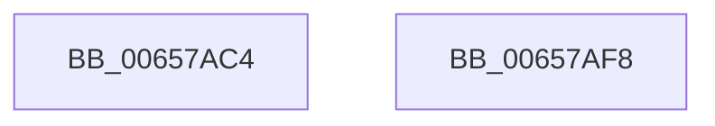

# ExpSetLicenseTamperState

- RVA: `0x00657AC4`–`0x00657AF9` (길이 `53` bytes)
- VA: `0x0000000140657AC4`
- 실행 섹션: `.text`
- PDB 이름 있음: `예`; PDB Function 태그: `아니요`
- unwind 정보 RVA: `0x0005CC98`
- 디코드: `15`개 명령, `53/53` bytes 표시
- 미해석 바이트: `0` (있으면 어셈블리에 `.byte`로 보존)

> 이 문서는 커널 이미지의 기계어와 PDB 기호를 분석해 생성했습니다. 4번과 5번은 함수 원형과 자료형을 바이너리 사용 방식에서 추정한 C 해석이며 원본 소스 복구 결과는 아닙니다.

## 1. Dependencies

- 직접 호출 지점: **1**; 고유 호출 대상: **1**
- 직접 호출자로 확인된 함수: **4**
- RIP 상대 이미지 참조: **0**

### Outgoing calls
- `0x00657AEE` → [sub_00966DF0](../../page/96/Unknown_function_00966DF0.md) (function, `0x00966DF0`)

### Direct callers
- [ExSetLicenseTamperState](../../page/7C/ExSetLicenseTamperState_function_007C7B60.md) at `0x007C7C10`
- [sub_007C7FB0](../../page/7C/Unknown_function_007C7FB0.md) at `0x007C8179`
- [sub_007C7FB0](../../page/7C/Unknown_function_007C7FB0.md) at `0x007C82EE`
- [sub_007C87A4](../../page/7C/Unknown_function_007C87A4.md) at `0x007C8951`
- [SLUpdateLicenseDataInternal](../../page/7C/SLUpdateLicenseDataInternal_function_007C9C04.md) at `0x007CA79A`
- [SLUpdateLicenseDataInternal](../../page/7C/SLUpdateLicenseDataInternal_function_007C9C04.md) at `0x007CAA4B`

### Static image references
- 디코드된 RIP-relative 메모리 참조가 없습니다.

## 2. Other-region calls and transfers

- 다른 실행 섹션으로 향하는 call: **1**
  - `0x00657AEE` → [sub_00966DF0](../../page/96/Unknown_function_00966DF0.md) (`.text` → `PAGE`)
- 별도 외부 분기/꼬리 이동을 확인하지 못했습니다.

## 3. Assembly (complete function range)

```asm
00657AC4  48 8B C4                        mov rax, rsp
00657AC7  48 83 EC 58                     sub rsp, 0x58
00657ACB  0F 57 C0                        xorps xmm0, xmm0
00657ACE  89 91 8C B7 00 00               mov dword ptr [rcx + 0xb78c], edx
00657AD4  45 33 C9                        xor r9d, r9d
00657AD7  0F 11 40 C8                     movups xmmword ptr [rax - 0x38], xmm0
00657ADB  89 50 D0                        mov dword ptr [rax - 0x30], edx
00657ADE  48 8D 50 C8                     lea rdx, [rax - 0x38]
00657AE2  0F 11 40 D8                     movups xmmword ptr [rax - 0x28], xmm0
00657AE6  45 8D 41 02                     lea r8d, [r9 + 2]
00657AEA  0F 11 40 E8                     movups xmmword ptr [rax - 0x18], xmm0
00657AEE  E8 FD F2 30 00                  call 0x140966df0
00657AF3  48 83 C4 58                     add rsp, 0x58
00657AF7  C3                              ret
00657AF8  CC                              int3
```

## 4. C-style interpretation (structured pseudocode)

```c
__int64 __fastcall ExpSetLicenseTamperState(__int64 a1, int a2, __int64 a3, int a4)
{
    __int64 result;
    __int64 v_rsp;

    v_rsp = (v_rsp) - (88);
    *(unsigned int *)(a1 + 46988) = a2;
    a4 = 0;
    *(unsigned __int64 *)(v_rsp - 56) = v_xmm0;
    *(unsigned int *)(v_rsp - 48) = a2;
    *(unsigned __int64 *)(v_rsp - 40) = v_xmm0;
    *(unsigned __int64 *)(v_rsp - 24) = v_xmm0;
    result = sub_00966DF0(a1, v_rsp - 56, a4 + 2, a4);
    v_rsp = (v_rsp) + (88);
    return result;
}
```

## 5. (Beta) C Style

```c
int64_t ExpSetLicenseTamperState(void *Arg1, int32_t Arg2, int64_t Arg3, int32_t Arg4)
{
    uint8_t *arg1 = (uint8_t *)Arg1;

    int64_t result;
    int64_t local_rsp;

    local_rsp = (local_rsp) - (88);
    *(uint32_t *)(arg1 + 0xB78C) = Arg2;
    Arg4 = 0;
    *(uint64_t *)(local_rsp - 0x38) = v_xmm0;
    *(uint32_t *)(local_rsp - 0x30) = Arg2;
    *(uint64_t *)(local_rsp - 0x28) = v_xmm0;
    *(uint64_t *)(local_rsp - 0x18) = v_xmm0;
    result = sub_00966DF0(Arg1, local_rsp - 56, Arg4 + 2, Arg4);
    local_rsp = (local_rsp) + (88);
    return result;
}
```

### 관측된 메모리 오프셋

구조체 형식이 확인되지 않은 접근은 인자 기준의 오프셋으로만 기록했습니다.

| 기준 인자 | 오프셋 표현 | 폭 (bit) | 접근 |
|---|---:|---:|---|
| `Arg1` | `+ 0xB78C` | `32` | `W` |

## 6. Execution-region graph

[열기: 2D/3D 그래프와 함수 탐색 컨트롤 패널](../../../control-panel.html?section=text&rva=0x00657AC4&view=graph)

- 2D 그래프는 위에서 아래로 흐르고, 3D 그래프는 빈 공간을 드래그해 회전합니다. Shift+드래그는 이동, 휠은 확대·축소, 함수 노드 선택은 대상 보고서 이동입니다.

### Static fallback


