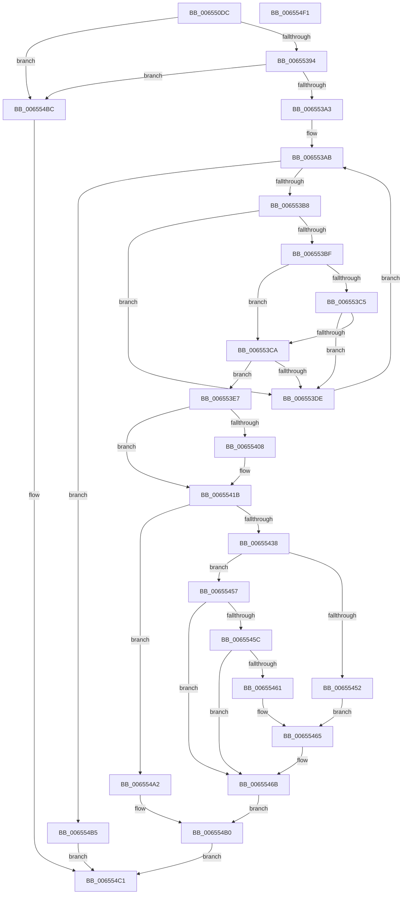

# ExpSetSoftRebootFlags

- RVA: `0x006550DC`–`0x006554F2` (길이 `1,046` bytes)
- VA: `0x00000001406550DC`
- 실행 섹션: `.text`
- PDB 이름 있음: `예`; PDB Function 태그: `아니요`
- unwind 정보 RVA: `0x000CC2A4`
- 디코드: `231`개 명령, `1,046/1,046` bytes 표시
- 미해석 바이트: `0` (있으면 어셈블리에 `.byte`로 보존)

> 이 문서는 커널 이미지의 기계어와 PDB 기호를 분석해 생성했습니다. 4번과 5번은 함수 원형과 자료형을 바이너리 사용 방식에서 추정한 C 해석이며 원본 소스 복구 결과는 아닙니다.

## 1. Dependencies

- 직접 호출 지점: **3**; 고유 호출 대상: **3**
- 직접 호출자로 확인된 함수: **1**
- RIP 상대 이미지 참조: **12**

### Outgoing calls
- `0x0065540D` → [guard_dispatch_icall](../6B/guard_dispatch_icall_function_006BAAD0.md) (function, `0x006BAAD0`)
- `0x0065549B` → [ZwUpdateWnfStateData](../6B/ZwUpdateWnfStateData_function_006B0D10.md) (function, `0x006B0D10`)
- `0x006554CB` → [_security_check_cookie](../6A/_security_check_cookie_function_006AC640.md) (function, `0x006AC640`)

### Direct callers
- [NtSetSystemInformation](../../page/AF/NtSetSystemInformation_function_00AF4A60.md) at `0x00AF5E60`

### Static image references
- `0x00655102` → RVA `0x00E0A740` (`.data`; read)
- `0x00655116` → RVA `0x00654810` (`BapdpKsrInitiateScenarioPhase0`; read)
- `0x00655122` → RVA `0x00654860` (`BapdpKsrpInitiateScenario`; read)
- `0x0065516D` → RVA `0x006547D0` (`BapdpKsrCompleteScenarioPhase0`; read)
- `0x0065517D` → RVA `0x006546F0` (`BapdpKsrCancelScenario`; read)
- `0x0065518C` → RVA `0x00654790` (`BapdpKsrCompleteScenario`; read)
- `0x00655299` → RVA `0x00654740` (`BapdpKsrComplete`; read)
- `0x006553D2` → RVA `0x00E68558` (`.data`; read)
- `0x006553E7` → RVA `0x00E68544` (`.data`; read)
- `0x00655447` → RVA `0x00E68544` (`.data`; write)
- `0x0065546F` → RVA `0x00029170` (`.rdata`; read)
- `0x00655484` → RVA `0x00E68558` (`.data`; read/write)

## 2. Other-region calls and transfers

- 다른 실행 섹션으로 향하는 call: **0**
- 별도 외부 분기/꼬리 이동을 확인하지 못했습니다.

## 3. Assembly (complete function range)

```asm
006550DC  48 8B C4                        mov rax, rsp
006550DF  48 89 58 10                     mov qword ptr [rax + 0x10], rbx
006550E3  48 89 70 18                     mov qword ptr [rax + 0x18], rsi
006550E7  48 89 78 20                     mov qword ptr [rax + 0x20], rdi
006550EB  55                              push rbp
006550EC  41 54                           push r12
006550EE  41 55                           push r13
006550F0  41 56                           push r14
006550F2  41 57                           push r15
006550F4  48 8D A8 08 FE FF FF            lea rbp, [rax - 0x1f8]
006550FB  48 81 EC D0 02 00 00            sub rsp, 0x2d0
00655102  48 8B 05 37 56 7B 00            mov rax, qword ptr [rip + 0x7b5637]
00655109  48 33 C4                        xor rax, rsp
0065510C  48 89 85 C0 01 00 00            mov qword ptr [rbp + 0x1c0], rax
00655113  45 33 F6                        xor r14d, r14d
00655116  4C 8D 1D F3 F6 FF FF            lea r11, [rip - 0x90d]
0065511D  4C 89 74 24 40                  mov qword ptr [rsp + 0x40], r14
00655122  4C 8D 05 37 F7 FF FF            lea r8, [rip - 0x8c9]
00655129  65 48 8B 04 25 88 01 00 00      mov rax, qword ptr gs:[0x188]
00655132  44 8B F9                        mov r15d, ecx
00655135  4C 89 74 24 50                  mov qword ptr [rsp + 0x50], r14
0065513A  45 8D 4E 10                     lea r9d, [r14 + 0x10]
0065513E  4C 89 74 24 58                  mov qword ptr [rsp + 0x58], r14
00655143  41 8D 7E 20                     lea edi, [r14 + 0x20]
00655147  44 88 74 24 60                  mov byte ptr [rsp + 0x60], r14b
0065514C  44 8A 90 32 02 00 00            mov r10b, byte ptr [rax + 0x232]
00655153  8D 77 E8                        lea esi, [rdi - 0x18]
00655156  8D 4F 70                        lea ecx, [rdi + 0x70]
00655159  44 89 74 24 68                  mov dword ptr [rsp + 0x68], r14d
0065515E  8D 57 E2                        lea edx, [rdi - 0x1e]
00655161  89 7C 24 6C                     mov dword ptr [rsp + 0x6c], edi
00655165  8D 5F E1                        lea ebx, [rdi - 0x1f]
00655168  4C 89 74 24 70                  mov qword ptr [rsp + 0x70], r14
0065516D  48 8D 05 5C F6 FF FF            lea rax, [rip - 0x9a4]
00655174  44 88 74 24 78                  mov byte ptr [rsp + 0x78], r14b
00655179  48 89 45 B8                     mov qword ptr [rbp - 0x48], rax
0065517D  48 8D 05 6C F5 FF FF            lea rax, [rip - 0xa94]
00655184  48 89 45 D0                     mov qword ptr [rbp - 0x30], rax
00655188  48 89 45 18                     mov qword ptr [rbp + 0x18], rax
0065518C  48 8D 05 FD F5 FF FF            lea rax, [rip - 0xa03]
00655193  48 89 45 30                     mov qword ptr [rbp + 0x30], rax
00655197  8D 47 30                        lea eax, [rdi + 0x30]
0065519A  89 45 5C                        mov dword ptr [rbp + 0x5c], eax
0065519D  89 45 70                        mov dword ptr [rbp + 0x70], eax
006551A0  48 89 7D 80                     mov qword ptr [rbp - 0x80], rdi
006551A4  4C 89 75 88                     mov qword ptr [rbp - 0x78], r14
006551A8  44 88 75 90                     mov byte ptr [rbp - 0x70], r14b
006551AC  44 89 75 98                     mov dword ptr [rbp - 0x68], r14d
006551B0  89 75 9C                        mov dword ptr [rbp - 0x64], esi
006551B3  4C 89 5D A0                     mov qword ptr [rbp - 0x60], r11
006551B7  44 88 75 A8                     mov byte ptr [rbp - 0x58], r14b
006551BB  89 75 B0                        mov dword ptr [rbp - 0x50], esi
006551BE  44 89 4D B4                     mov dword ptr [rbp - 0x4c], r9d
006551C2  44 88 75 C0                     mov byte ptr [rbp - 0x40], r14b
006551C6  48 89 75 C8                     mov qword ptr [rbp - 0x38], rsi
006551CA  44 88 75 D8                     mov byte ptr [rbp - 0x28], r14b
006551CE  44 89 75 E0                     mov dword ptr [rbp - 0x20], r14d
006551D2  44 89 4D E4                     mov dword ptr [rbp - 0x1c], r9d
006551D6  4C 89 45 E8                     mov qword ptr [rbp - 0x18], r8
006551DA  44 88 75 F0                     mov byte ptr [rbp - 0x10], r14b
006551DE  44 89 4D F8                     mov dword ptr [rbp - 8], r9d
006551E2  44 89 4D FC                     mov dword ptr [rbp - 4], r9d
006551E6  4C 89 75 00                     mov qword ptr [rbp], r14
006551EA  44 88 75 08                     mov byte ptr [rbp + 8], r14b
006551EE  4C 89 4D 10                     mov qword ptr [rbp + 0x10], r9
006551F2  44 88 75 20                     mov byte ptr [rbp + 0x20], r14b
006551F6  44 89 4D 28                     mov dword ptr [rbp + 0x28], r9d
006551FA  89 55 2C                        mov dword ptr [rbp + 0x2c], edx
006551FD  44 88 75 38                     mov byte ptr [rbp + 0x38], r14b
00655201  44 89 75 40                     mov dword ptr [rbp + 0x40], r14d
00655205  89 5D 44                        mov dword ptr [rbp + 0x44], ebx
00655208  4C 89 75 48                     mov qword ptr [rbp + 0x48], r14
0065520C  44 88 75 50                     mov byte ptr [rbp + 0x50], r14b
00655210  44 89 4D 58                     mov dword ptr [rbp + 0x58], r9d
00655214  4C 89 75 60                     mov qword ptr [rbp + 0x60], r14
00655218  88 5D 68                        mov byte ptr [rbp + 0x68], bl
0065521B  44 89 4D 74                     mov dword ptr [rbp + 0x74], r9d
0065521F  4C 89 75 78                     mov qword ptr [rbp + 0x78], r14
00655223  88 9D 80 00 00 00               mov byte ptr [rbp + 0x80], bl
00655229  44 89 B5 88 00 00 00            mov dword ptr [rbp + 0x88], r14d
00655230  89 8D 8C 00 00 00               mov dword ptr [rbp + 0x8c], ecx
00655236  4C 89 B5 90 00 00 00            mov qword ptr [rbp + 0x90], r14
0065523D  44 88 B5 98 00 00 00            mov byte ptr [rbp + 0x98], r14b
00655244  89 8D A0 00 00 00               mov dword ptr [rbp + 0xa0], ecx
0065524A  89 8D A4 00 00 00               mov dword ptr [rbp + 0xa4], ecx
00655250  4C 89 B5 A8 00 00 00            mov qword ptr [rbp + 0xa8], r14
00655257  44 88 B5 B0 00 00 00            mov byte ptr [rbp + 0xb0], r14b
0065525E  48 89 8D B8 00 00 00            mov qword ptr [rbp + 0xb8], rcx
00655265  4C 89 B5 C0 00 00 00            mov qword ptr [rbp + 0xc0], r14
0065526C  44 88 B5 C8 00 00 00            mov byte ptr [rbp + 0xc8], r14b
00655273  89 95 D0 00 00 00               mov dword ptr [rbp + 0xd0], edx
00655279  89 B5 D4 00 00 00               mov dword ptr [rbp + 0xd4], esi
0065527F  4C 89 9D D8 00 00 00            mov qword ptr [rbp + 0xd8], r11
00655286  44 88 B5 E0 00 00 00            mov byte ptr [rbp + 0xe0], r14b
0065528D  89 95 E8 00 00 00               mov dword ptr [rbp + 0xe8], edx
00655293  89 BD 7C 01 00 00               mov dword ptr [rbp + 0x17c], edi
00655299  48 8D 05 A0 F4 FF FF            lea rax, [rip - 0xb60]
006552A0  45 8B EF                        mov r13d, r15d
006552A3  44 89 8D EC 00 00 00            mov dword ptr [rbp + 0xec], r9d
006552AA  41 81 E5 00 00 00 20            and r13d, 0x20000000
006552B1  4C 89 85 F0 00 00 00            mov qword ptr [rbp + 0xf0], r8
006552B8  41 8B FF                        mov edi, r15d
006552BB  44 88 B5 F8 00 00 00            mov byte ptr [rbp + 0xf8], r14b
006552C2  89 95 00 01 00 00               mov dword ptr [rbp + 0x100], edx
006552C8  89 9D 04 01 00 00               mov dword ptr [rbp + 0x104], ebx
006552CE  48 89 85 08 01 00 00            mov qword ptr [rbp + 0x108], rax
006552D5  44 88 B5 10 01 00 00            mov byte ptr [rbp + 0x110], r14b
006552DC  89 9D 18 01 00 00               mov dword ptr [rbp + 0x118], ebx
006552E2  89 9D 1C 01 00 00               mov dword ptr [rbp + 0x11c], ebx
006552E8  4C 89 B5 20 01 00 00            mov qword ptr [rbp + 0x120], r14
006552EF  44 88 B5 28 01 00 00            mov byte ptr [rbp + 0x128], r14b
006552F6  89 9D 30 01 00 00               mov dword ptr [rbp + 0x130], ebx
006552FC  89 B5 34 01 00 00               mov dword ptr [rbp + 0x134], esi
00655302  4C 89 9D 38 01 00 00            mov qword ptr [rbp + 0x138], r11
00655309  44 88 B5 40 01 00 00            mov byte ptr [rbp + 0x140], r14b
00655310  89 9D 48 01 00 00               mov dword ptr [rbp + 0x148], ebx
00655316  44 89 8D 4C 01 00 00            mov dword ptr [rbp + 0x14c], r9d
0065531D  4C 89 85 50 01 00 00            mov qword ptr [rbp + 0x150], r8
00655324  44 88 B5 58 01 00 00            mov byte ptr [rbp + 0x158], r14b
0065532B  48 89 9D 60 01 00 00            mov qword ptr [rbp + 0x160], rbx
00655332  4C 89 B5 68 01 00 00            mov qword ptr [rbp + 0x168], r14
00655339  44 88 B5 70 01 00 00            mov byte ptr [rbp + 0x170], r14b
00655340  89 9D 78 01 00 00               mov dword ptr [rbp + 0x178], ebx
00655346  4C 89 B5 80 01 00 00            mov qword ptr [rbp + 0x180], r14
0065534D  44 88 B5 88 01 00 00            mov byte ptr [rbp + 0x188], r14b
00655354  89 95 90 01 00 00               mov dword ptr [rbp + 0x190], edx
0065535A  89 8D 94 01 00 00               mov dword ptr [rbp + 0x194], ecx
00655360  4C 89 B5 98 01 00 00            mov qword ptr [rbp + 0x198], r14
00655367  44 88 B5 A0 01 00 00            mov byte ptr [rbp + 0x1a0], r14b
0065536E  89 9D A8 01 00 00               mov dword ptr [rbp + 0x1a8], ebx
00655374  89 8D AC 01 00 00               mov dword ptr [rbp + 0x1ac], ecx
0065537A  4C 89 B5 B0 01 00 00            mov qword ptr [rbp + 0x1b0], r14
00655381  44 88 B5 B8 01 00 00            mov byte ptr [rbp + 0x1b8], r14b
00655388  81 E7 BB 00 00 C0               and edi, 0xc00000bb
0065538E  0F 8C 28 01 00 00               jl 0x1406554bc
00655394  41 BB 00 00 00 40               mov r11d, 0x40000000
0065539A  41 85 FB                        test r11d, edi
0065539D  0F 85 19 01 00 00               jne 0x1406554bc
006553A3  45 8B C6                        mov r8d, r14d
006553A6  48 8D 54 24 54                  lea rdx, [rsp + 0x54]
006553AB  4D 63 C8                        movsxd r9, r8d
006553AE  49 83 F9 1A                     cmp r9, 0x1a
006553B2  0F 83 FD 00 00 00               jae 0x1406554b5
006553B8  8B 42 FC                        mov eax, dword ptr [rdx - 4]
006553BB  3B 3A                           cmp edi, dword ptr [rdx]
006553BD  75 1F                           jne 0x1406553de
006553BF  44 38 72 0C                     cmp byte ptr [rdx + 0xc], r14b
006553C3  74 05                           je 0x1406553ca
006553C5  45 84 D2                        test r10b, r10b
006553C8  75 14                           jne 0x1406553de
006553CA  8B CF                           mov ecx, edi
006553CC  81 C9 00 00 00 80               or ecx, 0x80000000
006553D2  F0 0F B1 0D 7E 31 81 00         lock cmpxchg dword ptr [rip + 0x81317e], ecx
006553DA  8B F0                           mov esi, eax
006553DC  74 09                           je 0x1406553e7
006553DE  44 03 C3                        add r8d, ebx
006553E1  48 83 C2 18                     add rdx, 0x18
006553E5  EB C4                           jmp 0x1406553ab
006553E7  0F 0D 0D 56 31 81 00            prefetchw byte ptr [rip + 0x813156]
006553EE  8B 1D 50 31 81 00               mov ebx, dword ptr [rip + 0x813150]
006553F4  4B 8D 04 49                     lea rax, [r9 + r9*2]
006553F8  48 8B 44 C4 58                  mov rax, qword ptr [rsp + rax*8 + 0x58]
006553FD  44 8B E3                        mov r12d, ebx
00655400  45 23 E3                        and r12d, r11d
00655403  48 85 C0                        test rax, rax
00655406  74 13                           je 0x14065541b
00655408  41 8B D7                        mov edx, r15d
0065540B  8B CB                           mov ecx, ebx
0065540D  E8 BE 56 06 00                  call 0x1406baad0
00655412  44 8B F0                        mov r14d, eax
00655415  41 BB 00 00 00 40               mov r11d, 0x40000000
0065541B  8B 0D 23 31 81 00               mov ecx, dword ptr [rip + 0x813123]
00655421  B8 BB 00 00 C5                  mov eax, 0xc50000bb
00655426  81 E1 44 FF FF 3A               and ecx, 0x3affff44
0065542C  44 23 F8                        and r15d, eax
0065542F  23 D8                           and ebx, eax
00655431  33 D2                           xor edx, edx
00655433  45 85 F6                        test r14d, r14d
00655436  78 6A                           js 0x1406554a2
00655438  41 8B C7                        mov eax, r15d
0065543B  41 0B C3                        or eax, r11d
0065543E  45 85 E4                        test r12d, r12d
00655441  41 0F 44 C7                     cmove eax, r15d
00655445  0B C1                           or eax, ecx
00655447  89 05 F7 30 81 00               mov dword ptr [rip + 0x8130f7], eax
0065544D  83 FF 20                        cmp edi, 0x20
00655450  75 05                           jne 0x140655457
00655452  41 0B C3                        or eax, r11d
00655455  EB 0E                           jmp 0x140655465
00655457  83 FE 20                        cmp esi, 0x20
0065545A  75 0F                           jne 0x14065546b
0065545C  45 85 ED                        test r13d, r13d
0065545F  74 0A                           je 0x14065546b
00655461  0F BA F0 1E                     btr eax, 0x1e
00655465  89 05 D9 30 81 00               mov dword ptr [rip + 0x8130d9], eax
0065546B  89 54 24 30                     mov dword ptr [rsp + 0x30], edx
0065546F  48 8D 0D FA 3C 9D FF            lea rcx, [rip - 0x62c306]
00655476  89 54 24 28                     mov dword ptr [rsp + 0x28], edx
0065547A  45 33 C9                        xor r9d, r9d
0065547D  8B C7                           mov eax, edi
0065547F  48 89 54 24 20                  mov qword ptr [rsp + 0x20], rdx
00655484  87 05 CE 30 81 00               xchg dword ptr [rip + 0x8130ce], eax
0065548A  48 8D 54 24 40                  lea rdx, [rsp + 0x40]
0065548F  89 74 24 40                     mov dword ptr [rsp + 0x40], esi
00655493  45 8D 41 08                     lea r8d, [r9 + 8]
00655497  89 7C 24 44                     mov dword ptr [rsp + 0x44], edi
0065549B  E8 70 B8 05 00                  call 0x1406b0d10
006554A0  EB 0E                           jmp 0x1406554b0
006554A2  0B D9                           or ebx, ecx
006554A4  89 1D 9A 30 81 00               mov dword ptr [rip + 0x81309a], ebx
006554AA  87 35 A8 30 81 00               xchg dword ptr [rip + 0x8130a8], esi
006554B0  41 8B C6                        mov eax, r14d
006554B3  EB 0C                           jmp 0x1406554c1
006554B5  B8 03 A0 00 C0                  mov eax, 0xc000a003
006554BA  EB 05                           jmp 0x1406554c1
006554BC  B8 0D 00 00 C0                  mov eax, 0xc000000d
006554C1  48 8B 8D C0 01 00 00            mov rcx, qword ptr [rbp + 0x1c0]
006554C8  48 33 CC                        xor rcx, rsp
006554CB  E8 70 71 05 00                  call 0x1406ac640
006554D0  4C 8D 9C 24 D0 02 00 00         lea r11, [rsp + 0x2d0]
006554D8  49 8B 5B 38                     mov rbx, qword ptr [r11 + 0x38]
006554DC  49 8B 73 40                     mov rsi, qword ptr [r11 + 0x40]
006554E0  49 8B 7B 48                     mov rdi, qword ptr [r11 + 0x48]
006554E4  49 8B E3                        mov rsp, r11
006554E7  41 5F                           pop r15
006554E9  41 5E                           pop r14
006554EB  41 5D                           pop r13
006554ED  41 5C                           pop r12
006554EF  5D                              pop rbp
006554F0  C3                              ret
006554F1  CC                              int3
```

## 4. C-style interpretation (structured pseudocode)

```c
__int64 __fastcall ExpSetSoftRebootFlags(int a1)
{
    __int64 result;
    __int64 v_r11;
    __int64 v_r12;
    __int64 v_r13;
    __int64 v_r14;
    __int64 v_r15;
    __int64 v_rbx;
    __int64 v_rdi;
    __int64 v_rsp;
    unsigned __int64 v_stack_m28;
    unsigned __int8 v_stack_m280;
    unsigned __int64 v_stack_m288;
    unsigned int v_stack_m28C;
    unsigned int v_stack_m290;
    unsigned __int8 v_stack_m298;
    unsigned __int64 v_stack_m2A0;
    unsigned __int64 v_stack_m2A4;
    unsigned __int64 v_stack_m2A8;
    unsigned int v_stack_m2B4;
    unsigned __int64 v_stack_m2B8;
    unsigned int v_stack_m2C8;
    unsigned int v_stack_m2D0;
    unsigned __int64 v_stack_m2D8;

    *(unsigned __int64 *)(v_rsp + 16) = v_rbx;
    *(unsigned __int64 *)(v_rsp + 24) = v_rsi;
    *(unsigned __int64 *)(v_rsp + 32) = v_rdi;
    v_rsp = (v_rsp) - (720);
    result = (*(unsigned __int64 *)(v_rip + 8082999)) ^ (v_rsp);
    *(unsigned __int64 *)(v_rsp - 504 + 448) = result;
    v_r14 = 0;
    v_stack_m2B8 = 0;
    v_stack_m2A8 = 0;
    v_stack_m2A0 = 0;
    v_stack_m298 = 0;
    v_stack_m290 = 0;
    v_stack_m28C = (unsigned int)(v_r14 + 32);
    v_stack_m288 = 0;
    v_stack_m280 = 0;
    *(unsigned __int64 *)(v_rsp - 504 - 72) = v_rip - 2468;
    *(unsigned __int64 *)(v_rsp - 504 - 48) = v_rip - 2708;
    *(unsigned __int64 *)(v_rsp - 504 + 24) = v_rip - 2708;
    *(unsigned __int64 *)(v_rsp - 504 + 48) = v_rip - 2563;
    *(unsigned int *)(v_rsp - 504 + 92) = (unsigned int)(v_r14 + 32 + 48);
    *(unsigned int *)(v_rsp - 504 + 112) = (unsigned int)(v_r14 + 32 + 48);
    *(unsigned __int64 *)(v_rsp - 504 - 128) = v_r14 + 32;
    *(unsigned __int64 *)(v_rsp - 504 - 120) = 0;
    *(unsigned __int8 *)(v_rsp - 504 - 112) = 0;
    *(unsigned int *)(v_rsp - 504 - 104) = 0;
    *(unsigned int *)(v_rsp - 504 - 100) = (unsigned int)(v_r14 + 32 - 24);
    *(unsigned __int64 *)(v_rsp - 504 - 96) = v_rip - 2317;
    *(unsigned __int8 *)(v_rsp - 504 - 88) = 0;
    *(unsigned int *)(v_rsp - 504 - 80) = (unsigned int)(v_r14 + 32 - 24);
    *(unsigned int *)(v_rsp - 504 - 76) = (unsigned int)(v_r14 + 16);
    *(unsigned __int8 *)(v_rsp - 504 - 64) = 0;
    *(unsigned __int64 *)(v_rsp - 504 - 56) = v_r14 + 32 - 24;
    *(unsigned __int8 *)(v_rsp - 504 - 40) = 0;
    *(unsigned int *)(v_rsp - 504 - 32) = 0;
    *(unsigned int *)(v_rsp - 504 - 28) = (unsigned int)(v_r14 + 16);
    *(unsigned __int64 *)(v_rsp - 504 - 24) = v_rip - 2249;
    *(unsigned __int8 *)(v_rsp - 504 - 16) = 0;
    *(unsigned int *)(v_rsp - 504 - 8) = (unsigned int)(v_r14 + 16);
    *(unsigned int *)(v_rsp - 504 - 4) = (unsigned int)(v_r14 + 16);
    *(unsigned __int64 *)(v_rsp - 504) = 0;
    *(unsigned __int8 *)(v_rsp - 504 + 8) = 0;
    *(unsigned __int64 *)(v_rsp - 504 + 16) = v_r14 + 16;
    *(unsigned __int8 *)(v_rsp - 504 + 32) = 0;
    *(unsigned int *)(v_rsp - 504 + 40) = (unsigned int)(v_r14 + 16);
    *(unsigned int *)(v_rsp - 504 + 44) = (unsigned int)(v_r14 + 32 - 30);
    *(unsigned __int8 *)(v_rsp - 504 + 56) = 0;
    *(unsigned int *)(v_rsp - 504 + 64) = 0;
    *(unsigned int *)(v_rsp - 504 + 68) = (unsigned int)(v_r14 + 32 - 31);
    *(unsigned __int64 *)(v_rsp - 504 + 72) = 0;
    *(unsigned __int8 *)(v_rsp - 504 + 80) = 0;
    *(unsigned int *)(v_rsp - 504 + 88) = (unsigned int)(v_r14 + 16);
    *(unsigned __int64 *)(v_rsp - 504 + 96) = 0;
    *(unsigned __int8 *)(v_rsp - 504 + 104) = (unsigned __int8)(v_r14 + 32 - 31);
    *(unsigned int *)(v_rsp - 504 + 116) = (unsigned int)(v_r14 + 16);
    *(unsigned __int64 *)(v_rsp - 504 + 120) = 0;
    *(unsigned __int8 *)(v_rsp - 504 + 128) = (unsigned __int8)(v_r14 + 32 - 31);
    *(unsigned int *)(v_rsp - 504 + 136) = 0;
    *(unsigned int *)(v_rsp - 504 + 140) = (unsigned int)(v_r14 + 32 + 112);
    *(unsigned __int64 *)(v_rsp - 504 + 144) = 0;
    *(unsigned __int8 *)(v_rsp - 504 + 152) = 0;
    *(unsigned int *)(v_rsp - 504 + 160) = (unsigned int)(v_r14 + 32 + 112);
    *(unsigned int *)(v_rsp - 504 + 164) = (unsigned int)(v_r14 + 32 + 112);
    *(unsigned __int64 *)(v_rsp - 504 + 168) = 0;
    *(unsigned __int8 *)(v_rsp - 504 + 176) = 0;
    *(unsigned __int64 *)(v_rsp - 504 + 184) = v_r14 + 32 + 112;
    *(unsigned __int64 *)(v_rsp - 504 + 192) = 0;
    *(unsigned __int8 *)(v_rsp - 504 + 200) = 0;
    *(unsigned int *)(v_rsp - 504 + 208) = (unsigned int)(v_r14 + 32 - 30);
    *(unsigned int *)(v_rsp - 504 + 212) = (unsigned int)(v_r14 + 32 - 24);
    *(unsigned __int64 *)(v_rsp - 504 + 216) = v_rip - 2317;
    *(unsigned __int8 *)(v_rsp - 504 + 224) = 0;
    *(unsigned int *)(v_rsp - 504 + 232) = (unsigned int)(v_r14 + 32 - 30);
    *(unsigned int *)(v_rsp - 504 + 380) = (unsigned int)(v_r14 + 32);
    *(unsigned int *)(v_rsp - 504 + 236) = (unsigned int)(v_r14 + 16);
    v_r13 = (unsigned int)(((unsigned int)((unsigned int)((unsigned int)(a1)))) & (0x20000000ULL));
    *(unsigned __int64 *)(v_rsp - 504 + 240) = v_rip - 2249;
    *(unsigned __int8 *)(v_rsp - 504 + 248) = 0;
    *(unsigned int *)(v_rsp - 504 + 256) = (unsigned int)(v_r14 + 32 - 30);
    *(unsigned int *)(v_rsp - 504 + 260) = (unsigned int)(v_r14 + 32 - 31);
    *(unsigned __int64 *)(v_rsp - 504 + 264) = v_rip - 2912;
    *(unsigned __int8 *)(v_rsp - 504 + 272) = 0;
    *(unsigned int *)(v_rsp - 504 + 280) = (unsigned int)(v_r14 + 32 - 31);
    *(unsigned int *)(v_rsp - 504 + 284) = (unsigned int)(v_r14 + 32 - 31);
    *(unsigned __int64 *)(v_rsp - 504 + 288) = 0;
    *(unsigned __int8 *)(v_rsp - 504 + 296) = 0;
    *(unsigned int *)(v_rsp - 504 + 304) = (unsigned int)(v_r14 + 32 - 31);
    *(unsigned int *)(v_rsp - 504 + 308) = (unsigned int)(v_r14 + 32 - 24);
    *(unsigned __int64 *)(v_rsp - 504 + 312) = v_rip - 2317;
    *(unsigned __int8 *)(v_rsp - 504 + 320) = 0;
    *(unsigned int *)(v_rsp - 504 + 328) = (unsigned int)(v_r14 + 32 - 31);
    *(unsigned int *)(v_rsp - 504 + 332) = (unsigned int)(v_r14 + 16);
    *(unsigned __int64 *)(v_rsp - 504 + 336) = v_rip - 2249;
    *(unsigned __int8 *)(v_rsp - 504 + 344) = 0;
    *(unsigned __int64 *)(v_rsp - 504 + 352) = v_r14 + 32 - 31;
    *(unsigned __int64 *)(v_rsp - 504 + 360) = 0;
    *(unsigned __int8 *)(v_rsp - 504 + 368) = 0;
    *(unsigned int *)(v_rsp - 504 + 376) = (unsigned int)(v_r14 + 32 - 31);
    *(unsigned __int64 *)(v_rsp - 504 + 384) = 0;
    *(unsigned __int8 *)(v_rsp - 504 + 392) = 0;
    *(unsigned int *)(v_rsp - 504 + 400) = (unsigned int)(v_r14 + 32 - 30);
    *(unsigned int *)(v_rsp - 504 + 404) = (unsigned int)(v_r14 + 32 + 112);
    *(unsigned __int64 *)(v_rsp - 504 + 408) = 0;
    *(unsigned __int8 *)(v_rsp - 504 + 416) = 0;
    *(unsigned int *)(v_rsp - 504 + 424) = (unsigned int)(v_r14 + 32 - 31);
    *(unsigned int *)(v_rsp - 504 + 428) = (unsigned int)(v_r14 + 32 + 112);
    *(unsigned __int64 *)(v_rsp - 504 + 432) = 0;
    *(unsigned __int8 *)(v_rsp - 504 + 440) = 0;
    v_rdi = (unsigned int)(((unsigned int)((unsigned int)((unsigned int)(a1)))) & (0xC00000BBULL));
    if (condition_is_less) goto loc_006554BC;
    if ((((unsigned int)((unsigned int)(0x40000000ULL))) & ((unsigned int)(v_rdi))) != 0) goto loc_006554BC;
loc_006553AB:
    if (((int)(0)) >= 26) goto loc_006554B5;
    if (((unsigned int)(v_rdi)) != (*(unsigned int *)(v_stack_m2A4))) goto loc_006553DE;
    if ((*(unsigned __int8 *)(v_stack_m2A4 + 12)) == 0) goto loc_006553CA;
    if ((unsigned __int8)(*(unsigned __int8 *)(*(unsigned __int64 *)(gs_base + (0 + 392)) + 562)) != 0) goto loc_006553DE;
loc_006553CA:
    a1 = (unsigned int)(((unsigned int)((unsigned int)(v_rdi))) | (0x80000000ULL));
    if (condition_is_equal) goto loc_006553E7;
loc_006553DE:
    a3 = (unsigned int)((0) + ((unsigned int)(v_r14 + 32 - 31)));
    a2 = (v_stack_m2A4) + (24);
    goto loc_006553AB;
loc_006553E7:
    v_r12 = (unsigned int)(((unsigned int)((unsigned int)((unsigned int)(*(unsigned int *)(v_rip + 8466768))))) & ((unsigned int)((unsigned int)(0x40000000ULL))));
    result = *(unsigned __int64 *)(v_rsp + (int)(0) + (int)(0) * 2 * 8 + 88);
    v_r11 = (unsigned int)(0x40000000ULL);
    if (*(unsigned __int64 *)(v_rsp + (int)(0) + (int)(0) * 2 * 8 + 88) != 0) {
        a2 = (unsigned int)((unsigned int)(a1));
        a1 = (unsigned int)((unsigned int)(*(unsigned int *)(v_rip + 8466768)));
        result = guard_dispatch_icall(a1, a2, a3, (int)(0));
        v_r14 = (unsigned int)(result);
        v_r11 = 0x40000000ULL;
    }
    a1 = (unsigned int)(((unsigned int)(*(unsigned int *)(v_rip + 8466723))) & (0x3AFFFF44ULL));
    v_r15 = (unsigned int)(((unsigned int)(a1)) & ((unsigned int)((unsigned int)(0xC50000BBULL))));
    v_rbx = (unsigned int)(((unsigned int)(*(unsigned int *)(v_rip + 8466768))) & ((unsigned int)((unsigned int)(0xC50000BBULL))));
    a2 = 0;
    if (sign_flag) goto loc_006554A2;
    result = (unsigned int)(((unsigned int)((unsigned int)(v_r15))) | ((unsigned int)(v_r11)));
    if ((unsigned int)(v_r12) == 0) { result = (unsigned int)(v_r15); }
    result = (unsigned int)((result) | (a1));
    *(unsigned int *)(v_rip + 8466679) = (unsigned int)(result);
    if (((unsigned int)(v_rdi)) != 32) goto loc_00655457;
    result = (unsigned int)((result) | ((unsigned int)(v_r11)));
    goto loc_00655465;
loc_00655457:
    if (((unsigned int)((unsigned int)((unsigned int)((unsigned int)(*(unsigned int *)(v_stack_m2A4 - 4)))))) != 32) goto loc_0065546B;
    if ((unsigned int)(v_r13) == 0) goto loc_0065546B;
loc_00655465:
    *(unsigned int *)(v_rip + 8466649) = (unsigned int)(result);
loc_0065546B:
    v_stack_m2C8 = 0;
    v_stack_m2D0 = 0;
    a4 = 0;
    v_stack_m2D8 = 0;
    v_stack_m2B8 = (unsigned int)((unsigned int)((unsigned int)((unsigned int)(*(unsigned int *)(v_stack_m2A4 - 4)))));
    v_stack_m2B4 = (unsigned int)(v_rdi);
    result = ZwUpdateWnfStateData(v_rip - 6472454, v_stack_m2B8, a4 + 8, a4);
    goto loc_006554B0;
loc_006554A2:
    v_rbx = (unsigned int)((v_rbx) | ((unsigned int)(v_rip - 6472454)));
    *(unsigned int *)(v_rip + 8466586) = (unsigned int)(v_rbx);
loc_006554B0:
    goto loc_006554C1;
loc_006554B5:
    goto loc_006554C1;
loc_006554BC:
loc_006554C1:
    a1 = (*(unsigned __int64 *)(v_rsp - 504 + 448)) ^ (v_rsp);
    result = _security_check_cookie(a1, v_stack_m2B8, a4 + 8, a4);
    return result;
}
```

## 5. (Beta) C Style

```c
int64_t ExpSetSoftRebootFlags(int32_t Arg1)
{
    int64_t result;
    int64_t local_r11;
    int64_t local_r12;
    int64_t local_r13;
    int64_t local_r14;
    int64_t local_r15;
    int64_t local_rbx;
    int64_t local_rdi;
    int64_t local_rsp;
    uint64_t v_stack_m28;
    uint8_t v_stack_m280;
    uint64_t v_stack_m288;
    uint32_t v_stack_m28C;
    uint32_t v_stack_m290;
    uint8_t v_stack_m298;
    uint64_t v_stack_m2A0;
    uint64_t v_stack_m2A4;
    uint64_t v_stack_m2A8;
    uint32_t v_stack_m2B4;
    uint64_t v_stack_m2B8;
    uint32_t v_stack_m2C8;
    uint32_t v_stack_m2D0;
    uint64_t v_stack_m2D8;

    *(uint64_t *)(local_rsp + 0x10) = local_rbx;
    *(uint64_t *)(local_rsp + 0x18) = local_rsi;
    *(uint64_t *)(local_rsp + 0x20) = local_rdi;
    local_rsp = (local_rsp) - (720);
    result = (*(uint64_t *)(v_rip + 0x7B5637)) ^ (local_rsp);
    *(uint64_t *)(local_rsp - 0x1F8 + 0x1C0) = result;
    local_r14 = 0;
    v_stack_m2B8 = 0;
    v_stack_m2A8 = 0;
    v_stack_m2A0 = 0;
    v_stack_m298 = 0;
    v_stack_m290 = 0;
    v_stack_m28C = (uint32_t)(local_r14 + 32);
    v_stack_m288 = 0;
    v_stack_m280 = 0;
    *(uint64_t *)(local_rsp - 0x1F8 - 0x48) = v_rip - 2468;
    *(uint64_t *)(local_rsp - 0x1F8 - 0x30) = v_rip - 2708;
    *(uint64_t *)(local_rsp - 0x1F8 + 0x18) = v_rip - 2708;
    *(uint64_t *)(local_rsp - 0x1F8 + 0x30) = v_rip - 2563;
    *(uint32_t *)(local_rsp - 0x1F8 + 0x5C) = (uint32_t)(local_r14 + 32 + 48);
    *(uint32_t *)(local_rsp - 0x1F8 + 0x70) = (uint32_t)(local_r14 + 32 + 48);
    *(uint64_t *)(local_rsp - 0x1F8 - 0x80) = local_r14 + 32;
    *(uint64_t *)(local_rsp - 0x1F8 - 0x78) = 0;
    *(uint8_t *)(local_rsp - 0x1F8 - 0x70) = 0;
    *(uint32_t *)(local_rsp - 0x1F8 - 0x68) = 0;
    *(uint32_t *)(local_rsp - 0x1F8 - 0x64) = (uint32_t)(local_r14 + 32 - 24);
    *(uint64_t *)(local_rsp - 0x1F8 - 0x60) = v_rip - 2317;
    *(uint8_t *)(local_rsp - 0x1F8 - 0x58) = 0;
    *(uint32_t *)(local_rsp - 0x1F8 - 0x50) = (uint32_t)(local_r14 + 32 - 24);
    *(uint32_t *)(local_rsp - 0x1F8 - 0x4C) = (uint32_t)(local_r14 + 16);
    *(uint8_t *)(local_rsp - 0x1F8 - 0x40) = 0;
    *(uint64_t *)(local_rsp - 0x1F8 - 0x38) = local_r14 + 32 - 24;
    *(uint8_t *)(local_rsp - 0x1F8 - 0x28) = 0;
    *(uint32_t *)(local_rsp - 0x1F8 - 0x20) = 0;
    *(uint32_t *)(local_rsp - 0x1F8 - 0x1C) = (uint32_t)(local_r14 + 16);
    *(uint64_t *)(local_rsp - 0x1F8 - 0x18) = v_rip - 2249;
    *(uint8_t *)(local_rsp - 0x1F8 - 0x10) = 0;
    *(uint32_t *)(local_rsp - 0x1F8 - 0x8) = (uint32_t)(local_r14 + 16);
    *(uint32_t *)(local_rsp - 0x1F8 - 0x4) = (uint32_t)(local_r14 + 16);
    *(uint64_t *)(local_rsp - 0x1F8) = 0;
    *(uint8_t *)(local_rsp - 0x1F8 + 0x8) = 0;
    *(uint64_t *)(local_rsp - 0x1F8 + 0x10) = local_r14 + 16;
    *(uint8_t *)(local_rsp - 0x1F8 + 0x20) = 0;
    *(uint32_t *)(local_rsp - 0x1F8 + 0x28) = (uint32_t)(local_r14 + 16);
    *(uint32_t *)(local_rsp - 0x1F8 + 0x2C) = (uint32_t)(local_r14 + 32 - 30);
    *(uint8_t *)(local_rsp - 0x1F8 + 0x38) = 0;
    *(uint32_t *)(local_rsp - 0x1F8 + 0x40) = 0;
    *(uint32_t *)(local_rsp - 0x1F8 + 0x44) = (uint32_t)(local_r14 + 32 - 31);
    *(uint64_t *)(local_rsp - 0x1F8 + 0x48) = 0;
    *(uint8_t *)(local_rsp - 0x1F8 + 0x50) = 0;
    *(uint32_t *)(local_rsp - 0x1F8 + 0x58) = (uint32_t)(local_r14 + 16);
    *(uint64_t *)(local_rsp - 0x1F8 + 0x60) = 0;
    *(uint8_t *)(local_rsp - 0x1F8 + 0x68) = (uint8_t)(local_r14 + 32 - 31);
    *(uint32_t *)(local_rsp - 0x1F8 + 0x74) = (uint32_t)(local_r14 + 16);
    *(uint64_t *)(local_rsp - 0x1F8 + 0x78) = 0;
    *(uint8_t *)(local_rsp - 0x1F8 + 0x80) = (uint8_t)(local_r14 + 32 - 31);
    *(uint32_t *)(local_rsp - 0x1F8 + 0x88) = 0;
    *(uint32_t *)(local_rsp - 0x1F8 + 0x8C) = (uint32_t)(local_r14 + 32 + 112);
    *(uint64_t *)(local_rsp - 0x1F8 + 0x90) = 0;
    *(uint8_t *)(local_rsp - 0x1F8 + 0x98) = 0;
    *(uint32_t *)(local_rsp - 0x1F8 + 0xA0) = (uint32_t)(local_r14 + 32 + 112);
    *(uint32_t *)(local_rsp - 0x1F8 + 0xA4) = (uint32_t)(local_r14 + 32 + 112);
    *(uint64_t *)(local_rsp - 0x1F8 + 0xA8) = 0;
    *(uint8_t *)(local_rsp - 0x1F8 + 0xB0) = 0;
    *(uint64_t *)(local_rsp - 0x1F8 + 0xB8) = local_r14 + 32 + 112;
    *(uint64_t *)(local_rsp - 0x1F8 + 0xC0) = 0;
    *(uint8_t *)(local_rsp - 0x1F8 + 0xC8) = 0;
    *(uint32_t *)(local_rsp - 0x1F8 + 0xD0) = (uint32_t)(local_r14 + 32 - 30);
    *(uint32_t *)(local_rsp - 0x1F8 + 0xD4) = (uint32_t)(local_r14 + 32 - 24);
    *(uint64_t *)(local_rsp - 0x1F8 + 0xD8) = v_rip - 2317;
    *(uint8_t *)(local_rsp - 0x1F8 + 0xE0) = 0;
    *(uint32_t *)(local_rsp - 0x1F8 + 0xE8) = (uint32_t)(local_r14 + 32 - 30);
    *(uint32_t *)(local_rsp - 0x1F8 + 0x17C) = (uint32_t)(local_r14 + 32);
    *(uint32_t *)(local_rsp - 0x1F8 + 0xEC) = (uint32_t)(local_r14 + 16);
    local_r13 = (uint32_t)(((uint32_t)((uint32_t)((uint32_t)(Arg1)))) & (0x20000000ULL));
    *(uint64_t *)(local_rsp - 0x1F8 + 0xF0) = v_rip - 2249;
    *(uint8_t *)(local_rsp - 0x1F8 + 0xF8) = 0;
    *(uint32_t *)(local_rsp - 0x1F8 + 0x100) = (uint32_t)(local_r14 + 32 - 30);
    *(uint32_t *)(local_rsp - 0x1F8 + 0x104) = (uint32_t)(local_r14 + 32 - 31);
    *(uint64_t *)(local_rsp - 0x1F8 + 0x108) = v_rip - 2912;
    *(uint8_t *)(local_rsp - 0x1F8 + 0x110) = 0;
    *(uint32_t *)(local_rsp - 0x1F8 + 0x118) = (uint32_t)(local_r14 + 32 - 31);
    *(uint32_t *)(local_rsp - 0x1F8 + 0x11C) = (uint32_t)(local_r14 + 32 - 31);
    *(uint64_t *)(local_rsp - 0x1F8 + 0x120) = 0;
    *(uint8_t *)(local_rsp - 0x1F8 + 0x128) = 0;
    *(uint32_t *)(local_rsp - 0x1F8 + 0x130) = (uint32_t)(local_r14 + 32 - 31);
    *(uint32_t *)(local_rsp - 0x1F8 + 0x134) = (uint32_t)(local_r14 + 32 - 24);
    *(uint64_t *)(local_rsp - 0x1F8 + 0x138) = v_rip - 2317;
    *(uint8_t *)(local_rsp - 0x1F8 + 0x140) = 0;
    *(uint32_t *)(local_rsp - 0x1F8 + 0x148) = (uint32_t)(local_r14 + 32 - 31);
    *(uint32_t *)(local_rsp - 0x1F8 + 0x14C) = (uint32_t)(local_r14 + 16);
    *(uint64_t *)(local_rsp - 0x1F8 + 0x150) = v_rip - 2249;
    *(uint8_t *)(local_rsp - 0x1F8 + 0x158) = 0;
    *(uint64_t *)(local_rsp - 0x1F8 + 0x160) = local_r14 + 32 - 31;
    *(uint64_t *)(local_rsp - 0x1F8 + 0x168) = 0;
    *(uint8_t *)(local_rsp - 0x1F8 + 0x170) = 0;
    *(uint32_t *)(local_rsp - 0x1F8 + 0x178) = (uint32_t)(local_r14 + 32 - 31);
    *(uint64_t *)(local_rsp - 0x1F8 + 0x180) = 0;
    *(uint8_t *)(local_rsp - 0x1F8 + 0x188) = 0;
    *(uint32_t *)(local_rsp - 0x1F8 + 0x190) = (uint32_t)(local_r14 + 32 - 30);
    *(uint32_t *)(local_rsp - 0x1F8 + 0x194) = (uint32_t)(local_r14 + 32 + 112);
    *(uint64_t *)(local_rsp - 0x1F8 + 0x198) = 0;
    *(uint8_t *)(local_rsp - 0x1F8 + 0x1A0) = 0;
    *(uint32_t *)(local_rsp - 0x1F8 + 0x1A8) = (uint32_t)(local_r14 + 32 - 31);
    *(uint32_t *)(local_rsp - 0x1F8 + 0x1AC) = (uint32_t)(local_r14 + 32 + 112);
    *(uint64_t *)(local_rsp - 0x1F8 + 0x1B0) = 0;
    *(uint8_t *)(local_rsp - 0x1F8 + 0x1B8) = 0;
    local_rdi = (uint32_t)(((uint32_t)((uint32_t)((uint32_t)(Arg1)))) & (0xC00000BBULL));
    if (condition_is_less) goto loc_006554BC;
    if ((((uint32_t)((uint32_t)(0x40000000ULL))) & ((uint32_t)(local_rdi))) != 0) goto loc_006554BC;
loc_006553AB:
    if (((int32_t)(0)) >= 26) goto loc_006554B5;
    if (((uint32_t)(local_rdi)) != (*(uint32_t *)(v_stack_m2A4))) goto loc_006553DE;
    if ((*(uint8_t *)(v_stack_m2A4 + 0xC)) == 0) goto loc_006553CA;
    if ((uint8_t)(*(uint8_t *)(*(uint64_t *)(gs_base + (0 + 0x188)) + 0x232)) != 0) goto loc_006553DE;
loc_006553CA:
    Arg1 = (uint32_t)(((uint32_t)((uint32_t)(local_rdi))) | (0x80000000ULL));
    if (condition_is_equal) goto loc_006553E7;
loc_006553DE:
    a3 = (uint32_t)((0) + ((uint32_t)(local_r14 + 32 - 31)));
    a2 = (v_stack_m2A4) + (24);
    goto loc_006553AB;
loc_006553E7:
    local_r12 = (uint32_t)(((uint32_t)((uint32_t)((uint32_t)(*(uint32_t *)(v_rip + 0x813150))))) & ((uint32_t)((uint32_t)(0x40000000ULL))));
    result = *(uint64_t *)(local_rsp + (int32_t)(0) + (int32_t)(0) * 2 * 8 + 0x58);
    local_r11 = (uint32_t)(0x40000000ULL);
    if (*(uint64_t *)(local_rsp + (int32_t)(0) + (int32_t)(0) * 2 * 8 + 0x58) != 0) {
        a2 = (uint32_t)((uint32_t)(Arg1));
        Arg1 = (uint32_t)((uint32_t)(*(uint32_t *)(v_rip + 0x813150)));
        result = guard_dispatch_icall(Arg1, a2, a3, (int32_t)(0));
        local_r14 = (uint32_t)(result);
        local_r11 = 0x40000000ULL;
    }
    Arg1 = (uint32_t)(((uint32_t)(*(uint32_t *)(v_rip + 0x813123))) & (0x3AFFFF44ULL));
    local_r15 = (uint32_t)(((uint32_t)(Arg1)) & ((uint32_t)((uint32_t)(0xC50000BBULL))));
    local_rbx = (uint32_t)(((uint32_t)(*(uint32_t *)(v_rip + 0x813150))) & ((uint32_t)((uint32_t)(0xC50000BBULL))));
    a2 = 0;
    if (sign_flag) goto loc_006554A2;
    result = (uint32_t)(((uint32_t)((uint32_t)(local_r15))) | ((uint32_t)(local_r11)));
    if ((uint32_t)(local_r12) == 0) { result = (uint32_t)(local_r15); }
    result = (uint32_t)((result) | (Arg1));
    *(uint32_t *)(v_rip + 0x8130F7) = (uint32_t)(result);
    if (((uint32_t)(local_rdi)) != 32) goto loc_00655457;
    result = (uint32_t)((result) | ((uint32_t)(local_r11)));
    goto loc_00655465;
loc_00655457:
    if (((uint32_t)((uint32_t)((uint32_t)((uint32_t)(*(uint32_t *)(v_stack_m2A4 - 0x4)))))) != 32) goto loc_0065546B;
    if ((uint32_t)(local_r13) == 0) goto loc_0065546B;
loc_00655465:
    *(uint32_t *)(v_rip + 0x8130D9) = (uint32_t)(result);
loc_0065546B:
    v_stack_m2C8 = 0;
    v_stack_m2D0 = 0;
    a4 = 0;
    v_stack_m2D8 = 0;
    v_stack_m2B8 = (uint32_t)((uint32_t)((uint32_t)((uint32_t)(*(uint32_t *)(v_stack_m2A4 - 0x4)))));
    v_stack_m2B4 = (uint32_t)(local_rdi);
    result = ZwUpdateWnfStateData(v_rip - 6472454, v_stack_m2B8, a4 + 8, a4);
    goto loc_006554B0;
loc_006554A2:
    local_rbx = (uint32_t)((local_rbx) | ((uint32_t)(v_rip - 6472454)));
    *(uint32_t *)(v_rip + 0x81309A) = (uint32_t)(local_rbx);
loc_006554B0:
    goto loc_006554C1;
loc_006554B5:
    goto loc_006554C1;
loc_006554BC:
loc_006554C1:
    Arg1 = (*(uint64_t *)(local_rsp - 0x1F8 + 0x1C0)) ^ (local_rsp);
    result = _security_check_cookie(Arg1, v_stack_m2B8, a4 + 8, a4);
    return result;
}
```

## 6. Execution-region graph

[열기: 2D/3D 그래프와 함수 탐색 컨트롤 패널](../../../control-panel.html?section=text&rva=0x006550DC&view=graph)

- 2D 그래프는 위에서 아래로 흐르고, 3D 그래프는 빈 공간을 드래그해 회전합니다. Shift+드래그는 이동, 휠은 확대·축소, 함수 노드 선택은 대상 보고서 이동입니다.

### Static fallback


