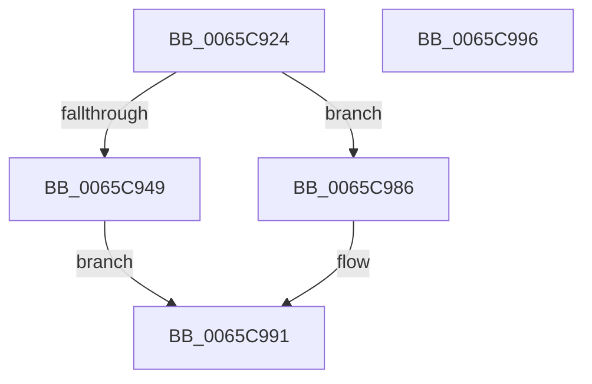

# ExpSizeHeapPool

- RVA: `0x0065C924`–`0x0065C997` (길이 `115` bytes)
- VA: `0x000000014065C924`
- 실행 섹션: `.text`
- PDB 이름 있음: `예`; PDB Function 태그: `아니요`
- unwind 정보 RVA: `0x00063458`
- 디코드: `29`개 명령, `115/115` bytes 표시
- 미해석 바이트: `0` (있으면 어셈블리에 `.byte`로 보존)

> 이 문서는 커널 이미지의 기계어와 PDB 기호를 분석해 생성했습니다. 4번과 5번은 함수 원형과 자료형을 바이너리 사용 방식에서 추정한 C 해석이며 원본 소스 복구 결과는 아닙니다.

## 1. Dependencies

- 직접 호출 지점: **2**; 고유 호출 대상: **2**
- 직접 호출자로 확인된 함수: **1**
- RIP 상대 이미지 참조: **0**

### Outgoing calls
- `0x0065C949` → [MmDeterminePoolType](../35/MmDeterminePoolType_function_0035F5B0.md) (function, `0x0035F5B0`)
- `0x0065C97A` → [ExpRemoveTagForBigPages](../41/ExpRemoveTagForBigPages_function_00411980.md) (function, `0x00411980`)

### Direct callers
- [ViPostPoolAllocation](../../pagevrfy/BA/ViPostPoolAllocation_function_00BA18E0.md) at `0x00BA1937`

### Static image references
- 디코드된 RIP-relative 메모리 참조가 없습니다.

## 2. Other-region calls and transfers

- 다른 실행 섹션으로 향하는 call: **0**
- 별도 외부 분기/꼬리 이동을 확인하지 못했습니다.

## 3. Assembly (complete function range)

```asm
0065C924  48 83 EC 48                     sub rsp, 0x48
0065C928  33 C0                           xor eax, eax
0065C92A  4C 8B D1                        mov r10, rcx
0065C92D  48 89 44 24 58                  mov qword ptr [rsp + 0x58], rax
0065C932  89 44 24 50                     mov dword ptr [rsp + 0x50], eax
0065C936  48 89 44 24 68                  mov qword ptr [rsp + 0x68], rax
0065C93B  48 89 44 24 60                  mov qword ptr [rsp + 0x60], rax
0065C940  48 F7 C1 FF 0F 00 00            test rcx, 0xfff
0065C947  75 3D                           jne 0x14065c986
0065C949  E8 62 2C D0 FF                  call 0x14035f5b0
0065C94E  48 8D 4C 24 60                  lea rcx, [rsp + 0x60]
0065C953  45 33 C0                        xor r8d, r8d
0065C956  48 89 4C 24 30                  mov qword ptr [rsp + 0x30], rcx
0065C95B  4C 8D 4C 24 50                  lea r9, [rsp + 0x50]
0065C960  48 8D 4C 24 58                  lea rcx, [rsp + 0x58]
0065C965  48 8B D0                        mov rdx, rax
0065C968  48 89 4C 24 28                  mov qword ptr [rsp + 0x28], rcx
0065C96D  48 8D 4C 24 68                  lea rcx, [rsp + 0x68]
0065C972  48 89 4C 24 20                  mov qword ptr [rsp + 0x20], rcx
0065C977  49 8B CA                        mov rcx, r10
0065C97A  E8 01 50 DB FF                  call 0x140411980
0065C97F  48 8B 44 24 58                  mov rax, qword ptr [rsp + 0x58]
0065C984  EB 0B                           jmp 0x14065c991
0065C986  0F B7 41 F2                     movzx eax, word ptr [rcx - 0xe]
0065C98A  0F B6 C0                        movzx eax, al
0065C98D  48 C1 E0 04                     shl rax, 4
0065C991  48 83 C4 48                     add rsp, 0x48
0065C995  C3                              ret
0065C996  CC                              int3
```

## 4. C-style interpretation (structured pseudocode)

```c
__int64 __fastcall ExpSizeHeapPool(__int64 a1, __int64 a2, int a3)
{
    __int64 result;
    __int64 v_rsp;
    unsigned __int64 v_stack_m18;
    unsigned __int64 v_stack_m20;
    unsigned __int64 v_stack_m28;
    unsigned __int64 v_stack_p10;
    unsigned __int64 v_stack_p18;
    unsigned __int64 v_stack_p20;
    unsigned int v_stack_p8;

    v_rsp = (v_rsp) - (72);
    result = 0;
    v_stack_p10 = 0;
    v_stack_p8 = 0;
    v_stack_p20 = 0;
    v_stack_p18 = 0;
    if (((a1) & (0xFFFULL)) != 0) goto loc_0065C986;
    result = MmDeterminePoolType(a1, a2, a3, a4);
    a3 = 0;
    v_stack_m18 = v_stack_p18;
    v_stack_m20 = v_stack_p10;
    v_stack_m28 = v_stack_p20;
    result = ExpRemoveTagForBigPages(a1, result, a3, v_stack_p8);
    goto loc_0065C991;
loc_0065C986:
    result = ((unsigned __int8)(*(unsigned __int16 *)(a1 - 14))) << (4);
loc_0065C991:
    v_rsp = (v_rsp) + (72);
    return result;
}
```

## 5. (Beta) C Style

```c
int64_t ExpSizeHeapPool(int64_t Arg1, int64_t Arg2, int32_t Arg3)
{
    int64_t result;
    int64_t local_rsp;
    uint64_t v_stack_m18;
    uint64_t v_stack_m20;
    uint64_t v_stack_m28;
    uint64_t v_stack_p10;
    uint64_t v_stack_p18;
    uint64_t v_stack_p20;
    uint32_t v_stack_p8;

    local_rsp = (local_rsp) - (72);
    result = 0;
    v_stack_p10 = 0;
    v_stack_p8 = 0;
    v_stack_p20 = 0;
    v_stack_p18 = 0;
    if (((Arg1) & (0xFFFULL)) != 0) goto loc_0065C986;
    result = MmDeterminePoolType(Arg1, Arg2, Arg3, a4);
    Arg3 = 0;
    v_stack_m18 = v_stack_p18;
    v_stack_m20 = v_stack_p10;
    v_stack_m28 = v_stack_p20;
    result = ExpRemoveTagForBigPages(Arg1, result, Arg3, v_stack_p8);
    goto loc_0065C991;
loc_0065C986:
    result = ((uint8_t)(*(uint16_t *)(Arg1 - 0xE))) << (4);
loc_0065C991:
    local_rsp = (local_rsp) + (72);
    return result;
}
```

## 6. Execution-region graph

[열기: 2D/3D 그래프와 함수 탐색 컨트롤 패널](../../../control-panel.html?section=text&rva=0x0065C924&view=graph)

- 2D 그래프는 위에서 아래로 흐르고, 3D 그래프는 빈 공간을 드래그해 회전합니다. Shift+드래그는 이동, 휠은 확대·축소, 함수 노드 선택은 대상 보고서 이동입니다.

### Static fallback


