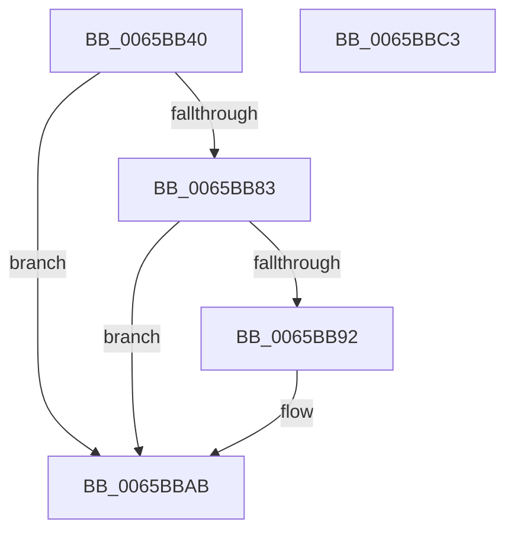

# ExpSvmDereferenceAsid

- RVA: `0x0065BB40`–`0x0065BBC4` (길이 `132` bytes)
- VA: `0x000000014065BB40`
- 실행 섹션: `.text`
- PDB 이름 있음: `예`; PDB Function 태그: `아니요`
- unwind 정보 RVA: `0x00065960`
- 디코드: `33`개 명령, `132/132` bytes 표시
- 미해석 바이트: `0` (있으면 어셈블리에 `.byte`로 보존)

> 이 문서는 커널 이미지의 기계어와 PDB 기호를 분석해 생성했습니다. 4번과 5번은 함수 원형과 자료형을 바이너리 사용 방식에서 추정한 C 해석이며 원본 소스 복구 결과는 아닙니다.

## 1. Dependencies

- 직접 호출 지점: **3**; 고유 호출 대상: **3**
- 직접 호출자로 확인된 함수: **0**
- RIP 상대 이미지 참조: **2**

### Outgoing calls
- `0x0065BB60` → [ExpAcquireSvmAgentsLock](ExpAcquireSvmAgentsLock_function_0065AF0C.md) (function, `0x0065AF0C`)
- `0x0065BBA6` → [ObfDereferenceObjectWithTag](../2F/ObfDereferenceObjectWithTag_function_002F78E0.md) (function, `0x002F78E0`)
- `0x0065BBB3` → [ExpReleaseSvmAgentsLock](ExpReleaseSvmAgentsLock_function_0065B4F0.md) (function, `0x0065B4F0`)

### Direct callers
- 이 함수 시작 RVA로 연결되는 직접 call은 확인되지 않았습니다. 간접 호출은 완전히 역산할 수 없습니다.

### Static image references
- `0x0065BB65` → RVA `0x00EFA8D0` (`.data`; read)
- `0x0065BBA0` → RVA `0x00EFA8C8` (`.data`; read/write)

## 2. Other-region calls and transfers

- 다른 실행 섹션으로 향하는 call: **0**
- 별도 외부 분기/꼬리 이동을 확인하지 못했습니다.

## 3. Assembly (complete function range)

```asm
0065BB40  48 89 5C 24 08                  mov qword ptr [rsp + 8], rbx
0065BB45  57                              push rdi
0065BB46  48 83 EC 40                     sub rsp, 0x40
0065BB4A  8B D9                           mov ebx, ecx
0065BB4C  0F 57 C0                        xorps xmm0, xmm0
0065BB4F  33 C0                           xor eax, eax
0065BB51  48 8D 4C 24 20                  lea rcx, [rsp + 0x20]
0065BB56  0F 11 44 24 20                  movups xmmword ptr [rsp + 0x20], xmm0
0065BB5B  48 89 44 24 30                  mov qword ptr [rsp + 0x30], rax
0065BB60  E8 A7 F3 FF FF                  call 0x14065af0c
0065BB65  4C 8B 05 64 ED 89 00            mov r8, qword ptr [rip + 0x89ed64]
0065BB6C  48 8D 14 5B                     lea rdx, [rbx + rbx*2]
0065BB70  40 8A F8                        mov dil, al
0065BB73  49 8B 4C D0 08                  mov rcx, qword ptr [r8 + rdx*8 + 8]
0065BB78  48 83 E9 01                     sub rcx, 1
0065BB7C  49 89 4C D0 08                  mov qword ptr [r8 + rdx*8 + 8], rcx
0065BB81  79 28                           jns 0x14065bbab
0065BB83  48 B8 FF FF FF FF FF FF FF 7F   movabs rax, 0x7fffffffffffffff
0065BB8D  48 85 C8                        test rax, rcx
0065BB90  75 19                           jne 0x14065bbab
0065BB92  49 8B 0C D0                     mov rcx, qword ptr [r8 + rdx*8]
0065BB96  49 83 24 D0 00                  and qword ptr [r8 + rdx*8], 0
0065BB9B  BA 44 66 6C 74                  mov edx, 0x746c6644
0065BBA0  FF 0D 22 ED 89 00               dec dword ptr [rip + 0x89ed22]
0065BBA6  E8 35 BD C9 FF                  call 0x1402f78e0
0065BBAB  40 8A D7                        mov dl, dil
0065BBAE  48 8D 4C 24 20                  lea rcx, [rsp + 0x20]
0065BBB3  E8 38 F9 FF FF                  call 0x14065b4f0
0065BBB8  48 8B 5C 24 50                  mov rbx, qword ptr [rsp + 0x50]
0065BBBD  48 83 C4 40                     add rsp, 0x40
0065BBC1  5F                              pop rdi
0065BBC2  C3                              ret
0065BBC3  CC                              int3
```

## 4. C-style interpretation (structured pseudocode)

```c
__int64 __fastcall ExpSvmDereferenceAsid(int a1)
{
    __int64 result;
    __int64 v_rsp;
    unsigned __int64 v_stack_m18;
    unsigned __int64 v_stack_m28;
    unsigned __int64 v_stack_p8;

    v_stack_p8 = v_rbx;
    v_rsp = (v_rsp) - (64);
    result = 0;
    v_stack_m28 = v_xmm0;
    v_stack_m18 = 0;
    result = ExpAcquireSvmAgentsLock(v_stack_m28, a2, a3, a4);
    a1 = (*(unsigned __int64 *)(*(unsigned __int64 *)(v_rip + 9039204) + (unsigned int)(a1) + (unsigned int)(a1) * 2 * 8 + 8)) - (1);
    *(unsigned __int64 *)(*(unsigned __int64 *)(v_rip + 9039204) + (unsigned int)(a1) + (unsigned int)(a1) * 2 * 8 + 8) = a1;
    if (!sign_flag) goto loc_0065BBAB;
    if (((result) & (a1)) == 0) {
        a1 = *(unsigned __int64 *)(*(unsigned __int64 *)(v_rip + 9039204) + (unsigned int)(a1) + (unsigned int)(a1) * 2 * 8);
        a2 = 0x746C6644ULL;
        result = ObfDereferenceObjectWithTag(a1, a2, *(unsigned __int64 *)(v_rip + 9039204), a4);
    }
    result = ExpReleaseSvmAgentsLock(v_stack_m28, (unsigned __int8)((unsigned __int8)(result)), *(unsigned __int64 *)(v_rip + 9039204), a4);
    v_rsp = (v_rsp) + (64);
    return result;
}
```

## 5. (Beta) C Style

```c
int64_t ExpSvmDereferenceAsid(void *Arg1)
{
    uint8_t *arg1 = (uint8_t *)Arg1;

    int64_t result;
    int64_t local_rsp;
    uint64_t v_stack_m18;
    uint64_t v_stack_m28;
    uint64_t v_stack_p8;

    v_stack_p8 = local_rbx;
    local_rsp = (local_rsp) - (64);
    result = 0;
    v_stack_m28 = v_xmm0;
    v_stack_m18 = 0;
    result = ExpAcquireSvmAgentsLock(v_stack_m28, a2, a3, a4);
    Arg1 = (*(uint64_t *)(*(uint64_t *)(v_rip + 0x89ED64) + (uint32_t)(arg1) + (uint32_t)(arg1) * 2 * 8 + 0x8)) - (1);
    *(void **)(*(uint64_t *)(v_rip + 0x89ED64) + (uint32_t)(arg1) + (uint32_t)(arg1) * 2 * 8 + 0x8) = Arg1;
    if (!sign_flag) goto loc_0065BBAB;
    if (((result) & (Arg1)) == 0) {
        Arg1 = *(uint64_t *)(*(uint64_t *)(v_rip + 0x89ED64) + (uint32_t)(arg1) + (uint32_t)(arg1) * 2 * 8);
        a2 = 0x746C6644ULL;
        result = ObfDereferenceObjectWithTag(Arg1, a2, *(uint64_t *)(v_rip + 0x89ED64), a4);
    }
    result = ExpReleaseSvmAgentsLock(v_stack_m28, (uint8_t)((uint8_t)(result)), *(uint64_t *)(v_rip + 0x89ED64), a4);
    local_rsp = (local_rsp) + (64);
    return result;
}
```

### 관측된 메모리 오프셋

구조체 형식이 확인되지 않은 접근은 인자 기준의 오프셋으로만 기록했습니다.

| 기준 인자 | 오프셋 표현 | 폭 (bit) | 접근 |
|---|---:|---:|---|
| `Arg1` | `+ 0x0 + rbx*2` | `64` | `R` |

## 6. Execution-region graph

[열기: 2D/3D 그래프와 함수 탐색 컨트롤 패널](../../../control-panel.html?section=text&rva=0x0065BB40&view=graph)

- 2D 그래프는 위에서 아래로 흐르고, 3D 그래프는 빈 공간을 드래그해 회전합니다. Shift+드래그는 이동, 휠은 확대·축소, 함수 노드 선택은 대상 보고서 이동입니다.

### Static fallback


