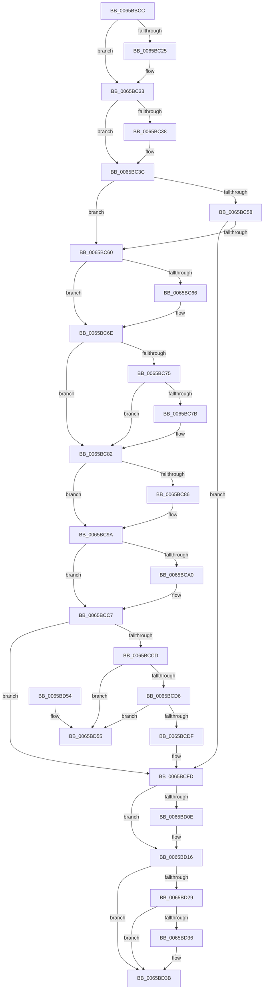

# ExpSvmDereferenceDevice

- RVA: `0x0065BBCC`–`0x0065BD5C` (길이 `400` bytes)
- VA: `0x000000014065BBCC`
- 실행 섹션: `.text`
- PDB 이름 있음: `예`; PDB Function 태그: `아니요`
- unwind 정보 RVA: `0x000D5668`
- 디코드: `116`개 명령, `400/400` bytes 표시
- 미해석 바이트: `0` (있으면 어셈블리에 `.byte`로 보존)

> 이 문서는 커널 이미지의 기계어와 PDB 기호를 분석해 생성했습니다. 4번과 5번은 함수 원형과 자료형을 바이너리 사용 방식에서 추정한 C 해석이며 원본 소스 복구 결과는 아닙니다.

## 1. Dependencies

- 직접 호출 지점: **9**; 고유 호출 대상: **7**
- 직접 호출자로 확인된 함수: **2**
- RIP 상대 이미지 참조: **4**

### Outgoing calls
- `0x0065BC14` → [KeAbPreAcquire](../21/KeAbPreAcquire_function_00210230.md) (function, `0x00210230`)
- `0x0065BC2E` → [ExfAcquirePushLockExclusiveEx](../20/ExfAcquirePushLockExclusiveEx_function_0020FC90.md) (function, `0x0020FC90`)
- `0x0065BC93` → [guard_dispatch_icall](../6B/guard_dispatch_icall_function_006BAAD0.md) (function, `0x006BAAD0`)
- `0x0065BCB5` → [guard_dispatch_icall](../6B/guard_dispatch_icall_function_006BAAD0.md) (function, `0x006BAAD0`)
- `0x0065BCEE` → [guard_dispatch_icall](../6B/guard_dispatch_icall_function_006BAAD0.md) (function, `0x006BAAD0`)
- `0x0065BCF8` → [ExFreePoolWithTag](../../poolcode/B8/ExFreePoolWithTag_function_00B82870.md) (function, `0x00B82870`)
- `0x0065BD11` → [ExfTryToWakePushLock](../26/ExfTryToWakePushLock_function_00265DD0.md) (function, `0x00265DD0`)
- `0x0065BD19` → [KeAbPostRelease](../2E/KeAbPostRelease_function_002E1600.md) (function, `0x002E1600`)
- `0x0065BD36` → [KiCheckForKernelApcDelivery](../2E/KiCheckForKernelApcDelivery_function_002E2C80.md) (function, `0x002E2C80`)

### Direct callers
- [ExpShareAddressSpaceWithDevice](ExpShareAddressSpaceWithDevice_function_0065B528.md) at `0x0065BA26`
- [sub_006F7EE2](../6F/Unknown_function_006F7EE2.md) at `0x006F7F43`
- [sub_006F7EE2](../6F/Unknown_function_006F7EE2.md) at `0x006F7F6C`

### Static image references
- `0x0065BBE7` → RVA `0x00EFA8E8` (`.data`; read)
- `0x0065BCA0` → RVA `0x00E06D28` (`.data`; read)
- `0x0065BCBC` → RVA `0x00E685D4` (`.data`; read/write)
- `0x0065BCFD` → RVA `0x00EFA8E8` (`.data`; read/write)

## 2. Other-region calls and transfers

- 다른 실행 섹션으로 향하는 call: **1**
  - `0x0065BCF8` → [ExFreePoolWithTag](../../poolcode/B8/ExFreePoolWithTag_function_00B82870.md) (`.text` → `POOLCODE`)
- 별도 외부 분기/꼬리 이동을 확인하지 못했습니다.

## 3. Assembly (complete function range)

```asm
0065BBCC  48 89 5C 24 08                  mov qword ptr [rsp + 8], rbx
0065BBD1  48 89 6C 24 10                  mov qword ptr [rsp + 0x10], rbp
0065BBD6  56                              push rsi
0065BBD7  57                              push rdi
0065BBD8  41 54                           push r12
0065BBDA  41 55                           push r13
0065BBDC  41 56                           push r14
0065BBDE  48 83 EC 20                     sub rsp, 0x20
0065BBE2  83 64 24 60 00                  and dword ptr [rsp + 0x60], 0
0065BBE7  4C 8D 25 FA EC 89 00            lea r12, [rip + 0x89ecfa]
0065BBEE  65 48 8B 34 25 88 01 00 00      mov rsi, qword ptr gs:[0x188]
0065BBF7  4C 8B F2                        mov r14, rdx
0065BBFA  48 8B F9                        mov rdi, rcx
0065BBFD  33 ED                           xor ebp, ebp
0065BBFF  45 33 C0                        xor r8d, r8d
0065BC02  33 D2                           xor edx, edx
0065BC04  49 8B CC                        mov rcx, r12
0065BC07  44 8D 6D 01                     lea r13d, [rbp + 1]
0065BC0B  66 44 29 AE E6 01 00 00         sub word ptr [rsi + 0x1e6], r13w
0065BC13  90                              nop
0065BC14  E8 17 46 BB FF                  call 0x140210230
0065BC19  F0 49 0F BA 2C 24 00            lock bts qword ptr [r12], 0
0065BC20  48 8B D8                        mov rbx, rax
0065BC23  73 0E                           jae 0x14065bc33
0065BC25  4D 8B C4                        mov r8, r12
0065BC28  48 8B D0                        mov rdx, rax
0065BC2B  49 8B CC                        mov rcx, r12
0065BC2E  E8 5D 40 BB FF                  call 0x14020fc90
0065BC33  48 85 DB                        test rbx, rbx
0065BC36  74 04                           je 0x14065bc3c
0065BC38  44 88 6B 0A                     mov byte ptr [rbx + 0xa], r13b
0065BC3C  8B 57 20                        mov edx, dword ptr [rdi + 0x20]
0065BC3F  48 83 CB FF                     or rbx, 0xffffffffffffffff
0065BC43  44 8B 47 24                     mov r8d, dword ptr [rdi + 0x24]
0065BC47  FF CA                           dec edx
0065BC49  41 FF C8                        dec r8d
0065BC4C  89 57 20                        mov dword ptr [rdi + 0x20], edx
0065BC4F  44 89 47 24                     mov dword ptr [rdi + 0x24], r8d
0065BC53  45 85 C0                        test r8d, r8d
0065BC56  74 08                           je 0x14065bc60
0065BC58  85 D2                           test edx, edx
0065BC5A  0F 85 9D 00 00 00               jne 0x14065bcfd
0065BC60  33 C9                           xor ecx, ecx
0065BC62  85 D2                           test edx, edx
0065BC64  75 08                           jne 0x14065bc6e
0065BC66  44 89 6C 24 60                  mov dword ptr [rsp + 0x60], r13d
0065BC6B  41 8B CD                        mov ecx, r13d
0065BC6E  8B C1                           mov eax, ecx
0065BC70  45 85 C0                        test r8d, r8d
0065BC73  75 0D                           jne 0x14065bc82
0065BC75  40 38 6F 12                     cmp byte ptr [rdi + 0x12], bpl
0065BC79  75 07                           jne 0x14065bc82
0065BC7B  83 C8 06                        or eax, 6
0065BC7E  89 44 24 60                     mov dword ptr [rsp + 0x60], eax
0065BC82  85 C0                           test eax, eax
0065BC84  74 14                           je 0x14065bc9a
0065BC86  48 8B 47 58                     mov rax, qword ptr [rdi + 0x58]
0065BC8A  48 8D 54 24 60                  lea rdx, [rsp + 0x60]
0065BC8F  48 8B 4F 30                     mov rcx, qword ptr [rdi + 0x30]
0065BC93  E8 38 EE 05 00                  call 0x1406baad0
0065BC98  8B E8                           mov ebp, eax
0065BC9A  83 7F 24 00                     cmp dword ptr [rdi + 0x24], 0
0065BC9E  75 27                           jne 0x14065bcc7
0065BCA0  48 8B 05 81 B0 7A 00            mov rax, qword ptr [rip + 0x7ab081]
0065BCA7  49 8B CE                        mov rcx, r14
0065BCAA  48 8B 97 B0 00 00 00            mov rdx, qword ptr [rdi + 0xb0]
0065BCB1  48 8B 40 38                     mov rax, qword ptr [rax + 0x38]
0065BCB5  E8 16 EE 05 00                  call 0x1406baad0
0065BCBA  8B E8                           mov ebp, eax
0065BCBC  F0 01 1D 11 C9 80 00            lock add dword ptr [rip + 0x80c911], ebx
0065BCC3  44 88 6F 10                     mov byte ptr [rdi + 0x10], r13b
0065BCC7  83 7F 20 00                     cmp dword ptr [rdi + 0x20], 0
0065BCCB  75 30                           jne 0x14065bcfd
0065BCCD  48 8B 0F                        mov rcx, qword ptr [rdi]
0065BCD0  48 39 79 08                     cmp qword ptr [rcx + 8], rdi
0065BCD4  75 7F                           jne 0x14065bd55
0065BCD6  48 8B 47 08                     mov rax, qword ptr [rdi + 8]
0065BCDA  48 39 38                        cmp qword ptr [rax], rdi
0065BCDD  75 76                           jne 0x14065bd55
0065BCDF  48 89 08                        mov qword ptr [rax], rcx
0065BCE2  48 89 41 08                     mov qword ptr [rcx + 8], rax
0065BCE6  48 8B 47 40                     mov rax, qword ptr [rdi + 0x40]
0065BCEA  48 8B 4F 30                     mov rcx, qword ptr [rdi + 0x30]
0065BCEE  E8 DD ED 05 00                  call 0x1406baad0
0065BCF3  33 D2                           xor edx, edx
0065BCF5  48 8B CF                        mov rcx, rdi
0065BCF8  E8 73 6B 52 00                  call 0x140b82870
0065BCFD  F0 48 0F C1 1D E2 EB 89 00      lock xadd qword ptr [rip + 0x89ebe2], rbx
0065BD06  80 E3 06                        and bl, 6
0065BD09  80 FB 02                        cmp bl, 2
0065BD0C  75 08                           jne 0x14065bd16
0065BD0E  49 8B CC                        mov rcx, r12
0065BD11  E8 BA A0 C0 FF                  call 0x140265dd0
0065BD16  49 8B CC                        mov rcx, r12
0065BD19  E8 E2 58 C8 FF                  call 0x1402e1600
0065BD1E  90                              nop
0065BD1F  66 44 01 AE E6 01 00 00         add word ptr [rsi + 0x1e6], r13w
0065BD27  75 12                           jne 0x14065bd3b
0065BD29  48 8D 86 98 00 00 00            lea rax, [rsi + 0x98]
0065BD30  90                              nop
0065BD31  48 39 00                        cmp qword ptr [rax], rax
0065BD34  74 05                           je 0x14065bd3b
0065BD36  E8 45 6F C8 FF                  call 0x1402e2c80
0065BD3B  48 8B 5C 24 50                  mov rbx, qword ptr [rsp + 0x50]
0065BD40  8B C5                           mov eax, ebp
0065BD42  48 8B 6C 24 58                  mov rbp, qword ptr [rsp + 0x58]
0065BD47  48 83 C4 20                     add rsp, 0x20
0065BD4B  41 5E                           pop r14
0065BD4D  41 5D                           pop r13
0065BD4F  41 5C                           pop r12
0065BD51  5F                              pop rdi
0065BD52  5E                              pop rsi
0065BD53  C3                              ret
0065BD54  CC                              int3
0065BD55  B9 03 00 00 00                  mov ecx, 3
0065BD5A  CD 29                           int 0x29
```

## 4. C-style interpretation (structured pseudocode)

```c
__int64 __fastcall ExpSvmDereferenceDevice(__int64 a1, __int64 a2, int a3)
{
    __int64 result;
    __int64 v_rbp;
    __int64 v_rbx;
    __int64 v_rsp;
    unsigned __int64 v_stack_p10;
    unsigned int v_stack_p18;
    unsigned __int64 v_stack_p8;

    v_stack_p8 = v_rbx;
    v_stack_p10 = v_rbp;
    v_rsp = (v_rsp) - (32);
    v_rbp = 0;
    a3 = 0;
    a2 = 0;
    result = KeAbPreAcquire(v_rip + 9039098, a2, a3, a4);
    if (!(condition_is_above_or_equal)) {
        a3 = v_rip + 9039098;
        a2 = result;
        a1 = v_rip + 9039098;
        result = ExfAcquirePushLockExclusiveEx(a1, a2, a3, a4);
    }
    if (result != 0) {
        *(unsigned __int8 *)(result + 10) = (unsigned __int8)(v_rbp + 1);
    }
    v_rbx = (result) | (-1);
    a2 = (unsigned int)(((unsigned int)(*(unsigned int *)(a1 + 32))) - 1);
    a3 = (unsigned int)(((unsigned int)(*(unsigned int *)(a1 + 36))) - 1);
    *(unsigned int *)(a1 + 32) = (unsigned int)(a2);
    *(unsigned int *)(a1 + 36) = a3;
    if (a3 == 0) goto loc_0065BC60;
    if ((unsigned int)(a2) != 0) goto loc_0065BCFD;
loc_0065BC60:
    a1 = 0;
    if ((unsigned int)(a2) == 0) {
        v_stack_p18 = (unsigned int)(v_rbp + 1);
        a1 = (unsigned int)(v_rbp + 1);
    }
    if (a3 != 0) goto loc_0065BC82;
    result = (unsigned int)((unsigned int)(a1));
    if ((*(unsigned __int8 *)(a1 + 18)) == 0) {
        result = (unsigned int)(((unsigned int)((unsigned int)(a1))) | (6));
        v_stack_p18 = (unsigned int)(result);
    }
    if ((unsigned int)(result) != 0) {
        result = *(unsigned __int64 *)(a1 + 88);
        a2 = v_stack_p18;
        a1 = *(unsigned __int64 *)(a1 + 48);
        result = guard_dispatch_icall(a1, a2, a3, a4);
        v_rbp = (unsigned int)(result);
    }
    if ((*(unsigned int *)(a1 + 36)) == 0) {
        result = *(unsigned __int64 *)(v_rip + 8040577);
        a1 = a2;
        a2 = *(unsigned __int64 *)(a1 + 176);
        result = *(unsigned __int64 *)(result + 56);
        result = guard_dispatch_icall(a1, a2, a3, a4);
        v_rbp = (unsigned int)(result);
        *(unsigned __int8 *)(a1 + 16) = (unsigned __int8)(v_rbp + 1);
    }
    if ((*(unsigned int *)(a1 + 32)) != 0) goto loc_0065BCFD;
    if ((*(unsigned __int64 *)(*(unsigned __int64 *)(a1) + 8)) != a1) goto loc_0065BD55;
    if ((*(unsigned __int64 *)(*(unsigned __int64 *)(a1 + 8))) != a1) goto loc_0065BD55;
    *(unsigned __int64 *)(*(unsigned __int64 *)(a1 + 8)) = *(unsigned __int64 *)(a1);
    *(unsigned __int64 *)(*(unsigned __int64 *)(a1) + 8) = *(unsigned __int64 *)(a1 + 8);
    result = guard_dispatch_icall(*(unsigned __int64 *)(a1 + 48), a2, a3, a4);
    a2 = 0;
    result = ExFreePoolWithTag(a1, a2, a3, a4);
loc_0065BCFD:
    v_rbx = (unsigned __int8)((v_rbx) & (6));
    if (((unsigned __int8)(v_rbx)) == 2) {
        a1 = v_rip + 9039098;
        result = ExfTryToWakePushLock(a1, a2, a3, a4);
    }
    result = KeAbPostRelease(v_rip + 9039098, a2, a3, a4);
    if (((unsigned __int8)(v_rbx)) != 2) goto loc_0065BD3B;
    result = *(unsigned __int64 *)(gs_base + (0 + 392)) + 152;
    if ((*(unsigned __int64 *)(*(unsigned __int64 *)(gs_base + (0 + 392)) + 152)) != (*(unsigned __int64 *)(gs_base + (0 + 392)) + 152)) {
        result = KiCheckForKernelApcDelivery(v_rip + 9039098, a2, a3, a4);
    }
    v_rsp = (v_rsp) + (32);
    return (unsigned int)((unsigned int)(v_rbp));
loc_0065BD55:
    return (unsigned int)((unsigned int)(v_rbp));
}
```

## 5. (Beta) C Style

```c
int64_t ExpSvmDereferenceDevice(void *Arg1, int64_t Arg2, int32_t Arg3)
{
    uint8_t *arg1 = (uint8_t *)Arg1;

    int64_t result;
    int64_t local_rbp;
    int64_t local_rbx;
    int64_t local_rsp;
    uint64_t v_stack_p10;
    uint32_t v_stack_p18;
    uint64_t v_stack_p8;

    v_stack_p8 = local_rbx;
    v_stack_p10 = local_rbp;
    local_rsp = (local_rsp) - (32);
    local_rbp = 0;
    Arg3 = 0;
    Arg2 = 0;
    result = KeAbPreAcquire(v_rip + 9039098, Arg2, Arg3, a4);
    if (!(condition_is_above_or_equal)) {
        Arg3 = v_rip + 9039098;
        Arg2 = result;
        Arg1 = v_rip + 9039098;
        result = ExfAcquirePushLockExclusiveEx(Arg1, Arg2, Arg3, a4);
    }
    if (result != 0) {
        *(uint8_t *)(result + 0xA) = (uint8_t)(local_rbp + 1);
    }
    local_rbx = (result) | (-1);
    Arg2 = (uint32_t)(((uint32_t)(*(uint32_t *)(arg1 + 0x20))) - 1);
    Arg3 = (uint32_t)(((uint32_t)(*(uint32_t *)(arg1 + 0x24))) - 1);
    *(uint32_t *)(arg1 + 0x20) = (uint32_t)(Arg2);
    *(uint32_t *)(arg1 + 0x24) = Arg3;
    if (Arg3 == 0) goto loc_0065BC60;
    if ((uint32_t)(Arg2) != 0) goto loc_0065BCFD;
loc_0065BC60:
    Arg1 = 0;
    if ((uint32_t)(Arg2) == 0) {
        v_stack_p18 = (uint32_t)(local_rbp + 1);
        Arg1 = (uint32_t)(local_rbp + 1);
    }
    if (Arg3 != 0) goto loc_0065BC82;
    result = (uint32_t)((uint32_t)(Arg1));
    if ((*(uint8_t *)(arg1 + 0x12)) == 0) {
        result = (uint32_t)(((uint32_t)((uint32_t)(Arg1))) | (6));
        v_stack_p18 = (uint32_t)(result);
    }
    if ((uint32_t)(result) != 0) {
        result = *(uint64_t *)(arg1 + 0x58);
        Arg2 = v_stack_p18;
        Arg1 = *(uint64_t *)(arg1 + 0x30);
        result = guard_dispatch_icall(Arg1, Arg2, Arg3, a4);
        local_rbp = (uint32_t)(result);
    }
    if ((*(uint32_t *)(arg1 + 0x24)) == 0) {
        result = *(uint64_t *)(v_rip + 0x7AB081);
        Arg1 = Arg2;
        Arg2 = *(uint64_t *)(arg1 + 0xB0);
        result = *(uint64_t *)(result + 0x38);
        result = guard_dispatch_icall(Arg1, Arg2, Arg3, a4);
        local_rbp = (uint32_t)(result);
        *(uint8_t *)(arg1 + 0x10) = (uint8_t)(local_rbp + 1);
    }
    if ((*(uint32_t *)(arg1 + 0x20)) != 0) goto loc_0065BCFD;
    if ((*(uint64_t *)(*(uint64_t *)(arg1) + 0x8)) != Arg1) goto loc_0065BD55;
    if ((*(uint64_t *)(*(uint64_t *)(arg1 + 0x8))) != Arg1) goto loc_0065BD55;
    *(uint64_t *)(*(uint64_t *)(arg1 + 0x8)) = *(uint64_t *)(arg1);
    *(uint64_t *)(*(uint64_t *)(arg1) + 0x8) = *(uint64_t *)(arg1 + 0x8);
    result = guard_dispatch_icall(*(uint64_t *)(arg1 + 0x30), Arg2, Arg3, a4);
    Arg2 = 0;
    result = ExFreePoolWithTag(Arg1, Arg2, Arg3, a4);
loc_0065BCFD:
    local_rbx = (uint8_t)((local_rbx) & (6));
    if (((uint8_t)(local_rbx)) == 2) {
        Arg1 = v_rip + 9039098;
        result = ExfTryToWakePushLock(Arg1, Arg2, Arg3, a4);
    }
    result = KeAbPostRelease(v_rip + 9039098, Arg2, Arg3, a4);
    if (((uint8_t)(local_rbx)) != 2) goto loc_0065BD3B;
    result = *(uint64_t *)(gs_base + (0 + 0x188)) + 152;
    if ((*(uint64_t *)(*(uint64_t *)(gs_base + (0 + 0x188)) + 0x98)) != (*(uint64_t *)(gs_base + (0 + 0x188)) + 152)) {
        result = KiCheckForKernelApcDelivery(v_rip + 9039098, Arg2, Arg3, a4);
    }
    local_rsp = (local_rsp) + (32);
    return (uint32_t)((uint32_t)(local_rbp));
loc_0065BD55:
    return (uint32_t)((uint32_t)(local_rbp));
}
```

### 관측된 메모리 오프셋

구조체 형식이 확인되지 않은 접근은 인자 기준의 오프셋으로만 기록했습니다.

| 기준 인자 | 오프셋 표현 | 폭 (bit) | 접근 |
|---|---:|---:|---|
| `Arg1` | `+ 0x0` | `64` | `R` |
| `Arg1` | `+ 0x8` | `64` | `R` |
| `Arg1` | `+ 0x10` | `8` | `W` |
| `Arg1` | `+ 0x12` | `8` | `R` |
| `Arg1` | `+ 0x20` | `32` | `R` |
| `Arg1` | `+ 0x20` | `32` | `W` |
| `Arg1` | `+ 0x24` | `32` | `R` |
| `Arg1` | `+ 0x24` | `32` | `W` |
| `Arg1` | `+ 0x30` | `64` | `R` |
| `Arg1` | `+ 0x40` | `64` | `R` |
| `Arg1` | `+ 0x58` | `64` | `R` |
| `Arg1` | `+ 0xB0` | `64` | `R` |

## 6. Execution-region graph

[열기: 2D/3D 그래프와 함수 탐색 컨트롤 패널](../../../control-panel.html?section=text&rva=0x0065BBCC&view=graph)

- 2D 그래프는 위에서 아래로 흐르고, 3D 그래프는 빈 공간을 드래그해 회전합니다. Shift+드래그는 이동, 휠은 확대·축소, 함수 노드 선택은 대상 보고서 이동입니다.

### Static fallback


