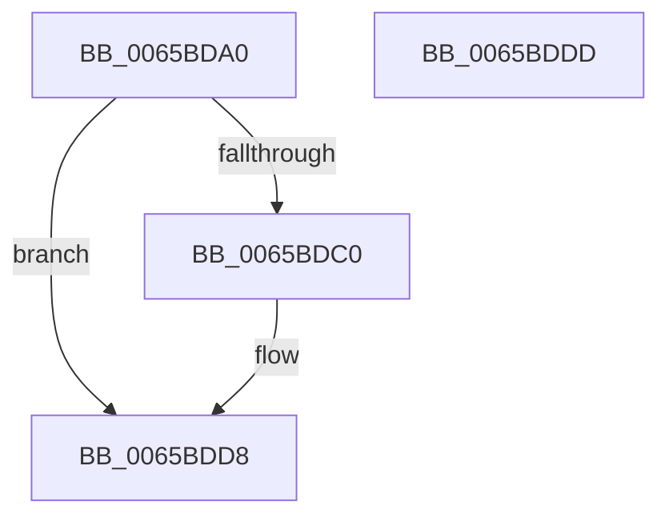

# ExpSvmFaultRoutine

- RVA: `0x0065BDA0`–`0x0065BDDE` (길이 `62` bytes)
- VA: `0x000000014065BDA0`
- 실행 섹션: `.text`
- PDB 이름 있음: `예`; PDB Function 태그: `아니요`
- unwind 정보 RVA: `0x0005C788`
- 디코드: `17`개 명령, `62/62` bytes 표시
- 미해석 바이트: `0` (있으면 어셈블리에 `.byte`로 보존)

> 이 문서는 커널 이미지의 기계어와 PDB 기호를 분석해 생성했습니다. 4번과 5번은 함수 원형과 자료형을 바이너리 사용 방식에서 추정한 C 해석이며 원본 소스 복구 결과는 아닙니다.

## 1. Dependencies

- 직접 호출 지점: **1**; 고유 호출 대상: **1**
- 직접 호출자로 확인된 함수: **0**
- RIP 상대 이미지 참조: **1**

### Outgoing calls
- `0x0065BDD3` → [KeInsertQueueDpc](../20/KeInsertQueueDpc_function_00207C50.md) (function, `0x00207C50`)

### Direct callers
- 이 함수 시작 RVA로 연결되는 직접 call은 확인되지 않았습니다. 간접 호출은 완전히 역산할 수 없습니다.

### Static image references
- `0x0065BDA6` → RVA `0x00EFA838` (`.data`; read)

## 2. Other-region calls and transfers

- 다른 실행 섹션으로 향하는 call: **0**
- 별도 외부 분기/꼬리 이동을 확인하지 못했습니다.

## 3. Assembly (complete function range)

```asm
0065BDA0  48 83 EC 28                     sub rsp, 0x28
0065BDA4  8B C1                           mov eax, ecx
0065BDA6  48 8B 0D 8B EA 89 00            mov rcx, qword ptr [rip + 0x89ea8b]
0065BDAD  48 6B D0 68                     imul rdx, rax, 0x68
0065BDB1  33 C0                           xor eax, eax
0065BDB3  44 8D 40 01                     lea r8d, [rax + 1]
0065BDB7  F0 44 0F B1 44 0A 60            lock cmpxchg dword ptr [rdx + rcx + 0x60], r8d
0065BDBE  75 18                           jne 0x14065bdd8
0065BDC0  48 8B 0D 71 EA 89 00            mov rcx, qword ptr [rip + 0x89ea71]
0065BDC7  45 33 C0                        xor r8d, r8d
0065BDCA  48 83 C1 20                     add rcx, 0x20
0065BDCE  48 03 CA                        add rcx, rdx
0065BDD1  33 D2                           xor edx, edx
0065BDD3  E8 78 BE BA FF                  call 0x140207c50
0065BDD8  48 83 C4 28                     add rsp, 0x28
0065BDDC  C3                              ret
0065BDDD  CC                              int3
```

## 4. C-style interpretation (structured pseudocode)

```c
__int64 __fastcall ExpSvmFaultRoutine(int a1)
{
    __int64 result;
    __int64 v_rsp;

    v_rsp = (v_rsp) - (40);
    a2 = (a2) * ((unsigned int)(a1));
    result = 0;
    if (!(condition_is_not_equal)) {
        a1 = *(unsigned __int64 *)(v_rip + 9038449);
        a3 = 0;
        a1 = (a1) + (32);
        a1 = (a1) + (a2);
        a2 = 0;
        result = KeInsertQueueDpc(a1, a2, a3, a4);
    }
    v_rsp = (v_rsp) + (40);
    return result;
}
```

## 5. (Beta) C Style

```c
int64_t ExpSvmFaultRoutine(int32_t Arg1)
{
    int64_t result;
    int64_t local_rsp;

    local_rsp = (local_rsp) - (40);
    a2 = (a2) * ((uint32_t)(Arg1));
    result = 0;
    if (!(condition_is_not_equal)) {
        Arg1 = *(uint64_t *)(v_rip + 0x89EA71);
        a3 = 0;
        Arg1 = (Arg1) + (32);
        Arg1 = (Arg1) + (a2);
        a2 = 0;
        result = KeInsertQueueDpc(Arg1, a2, a3, a4);
    }
    local_rsp = (local_rsp) + (40);
    return result;
}
```

## 6. Execution-region graph

[열기: 2D/3D 그래프와 함수 탐색 컨트롤 패널](../../../control-panel.html?section=text&rva=0x0065BDA0&view=graph)

- 2D 그래프는 위에서 아래로 흐르고, 3D 그래프는 빈 공간을 드래그해 회전합니다. Shift+드래그는 이동, 휠은 확대·축소, 함수 노드 선택은 대상 보고서 이동입니다.

### Static fallback


