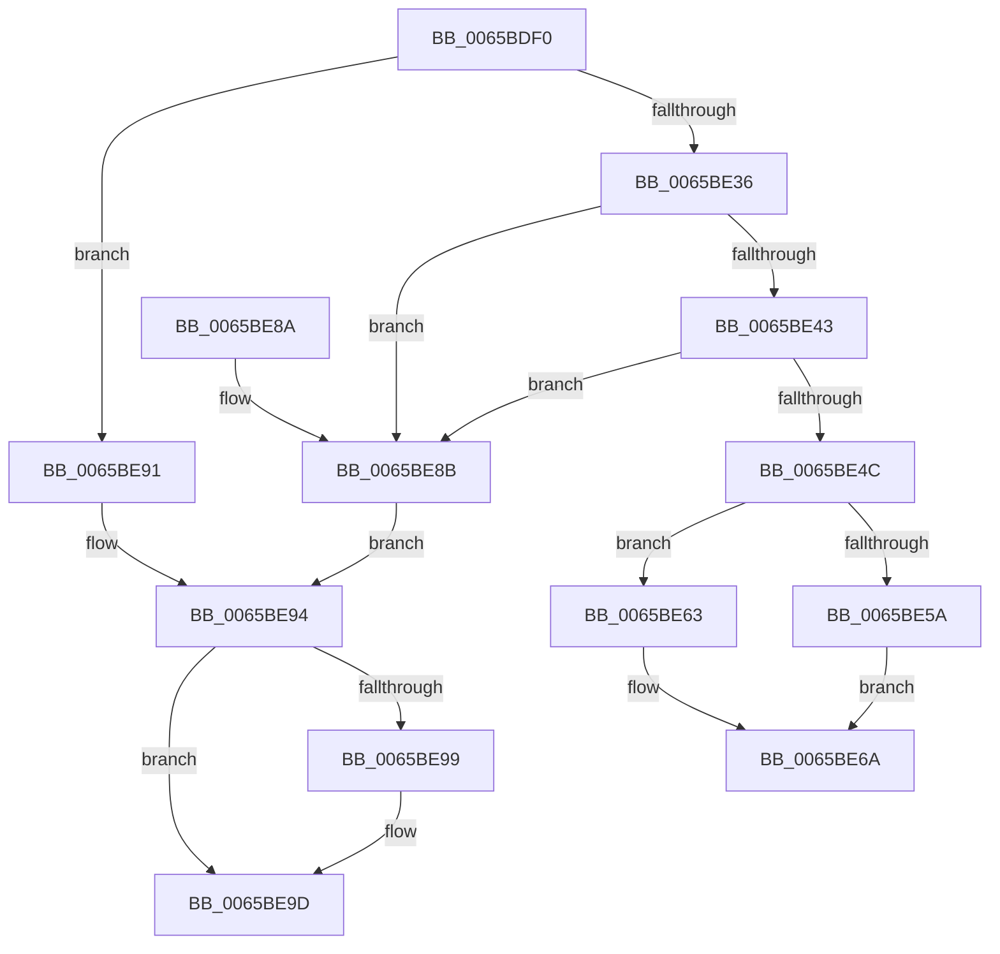

# ExpSvmReferenceAsid

- RVA: `0x0065BDF0`–`0x0065BEB3` (길이 `195` bytes)
- VA: `0x000000014065BDF0`
- 실행 섹션: `.text`
- PDB 이름 있음: `예`; PDB Function 태그: `아니요`
- unwind 정보 RVA: `0x000D5654`
- 디코드: `55`개 명령, `195/195` bytes 표시
- 미해석 바이트: `0` (있으면 어셈블리에 `.byte`로 보존)

> 이 문서는 커널 이미지의 기계어와 PDB 기호를 분석해 생성했습니다. 4번과 5번은 함수 원형과 자료형을 바이너리 사용 방식에서 추정한 C 해석이며 원본 소스 복구 결과는 아닙니다.

## 1. Dependencies

- 직접 호출 지점: **3**; 고유 호출 대상: **3**
- 직접 호출자로 확인된 함수: **0**
- RIP 상대 이미지 참조: **2**

### Outgoing calls
- `0x0065BE14` → [ExpAcquireSvmAgentsLock](ExpAcquireSvmAgentsLock_function_0065AF0C.md) (function, `0x0065AF0C`)
- `0x0065BE72` → [ExpReleaseSvmAgentsLock](ExpReleaseSvmAgentsLock_function_0065B4F0.md) (function, `0x0065B4F0`)
- `0x0065BEAD` → [KeBugCheckEx](../4F/KeBugCheckEx_function_004FD660.md) (function, `0x004FD660`)

### Direct callers
- 이 함수 시작 RVA로 연결되는 직접 call은 확인되지 않았습니다. 간접 호출은 완전히 역산할 수 없습니다.

### Static image references
- `0x0065BE19` → RVA `0x00EFA8C4` (`.data`; read)
- `0x0065BE24` → RVA `0x00EFA8D0` (`.data`; read)

## 2. Other-region calls and transfers

- 다른 실행 섹션으로 향하는 call: **0**
- 별도 외부 분기/꼬리 이동을 확인하지 못했습니다.

## 3. Assembly (complete function range)

```asm
0065BDF0  4C 8B DC                        mov r11, rsp
0065BDF3  49 89 5B 08                     mov qword ptr [r11 + 8], rbx
0065BDF7  49 89 73 10                     mov qword ptr [r11 + 0x10], rsi
0065BDFB  57                              push rdi
0065BDFC  48 83 EC 50                     sub rsp, 0x50
0065BE00  0F 57 C0                        xorps xmm0, xmm0
0065BE03  8B D9                           mov ebx, ecx
0065BE05  33 C0                           xor eax, eax
0065BE07  49 8D 4B D8                     lea rcx, [r11 - 0x28]
0065BE0B  0F 11 44 24 30                  movups xmmword ptr [rsp + 0x30], xmm0
0065BE10  49 89 43 E8                     mov qword ptr [r11 - 0x18], rax
0065BE14  E8 F3 F0 FF FF                  call 0x14065af0c
0065BE19  44 8B 1D A4 EA 89 00            mov r11d, dword ptr [rip + 0x89eaa4]
0065BE20  4C 8D 04 5B                     lea r8, [rbx + rbx*2]
0065BE24  4C 8B 15 A5 EA 89 00            mov r10, qword ptr [rip + 0x89eaa5]
0065BE2B  45 33 C9                        xor r9d, r9d
0065BE2E  40 8A F0                        mov sil, al
0065BE31  41 3B DB                        cmp ebx, r11d
0065BE34  73 5B                           jae 0x14065be91
0065BE36  4B 8B 14 C2                     mov rdx, qword ptr [r10 + r8*8]
0065BE3A  4B 8D 0C C2                     lea rcx, [r10 + r8*8]
0065BE3E  48 85 D2                        test rdx, rdx
0065BE41  74 48                           je 0x14065be8b
0065BE43  48 8B 41 08                     mov rax, qword ptr [rcx + 8]
0065BE47  48 85 C0                        test rax, rax
0065BE4A  78 3F                           js 0x14065be8b
0065BE4C  48 FF C0                        inc rax
0065BE4F  48 89 41 08                     mov qword ptr [rcx + 8], rax
0065BE53  47 38 4C C2 10                  cmp byte ptr [r10 + r8*8 + 0x10], r9b
0065BE58  74 09                           je 0x14065be63
0065BE5A  48 8B 9A E8 07 00 00            mov rbx, qword ptr [rdx + 0x7e8]
0065BE61  EB 07                           jmp 0x14065be6a
0065BE63  48 8B 9A 08 06 00 00            mov rbx, qword ptr [rdx + 0x608]
0065BE6A  40 8A D6                        mov dl, sil
0065BE6D  48 8D 4C 24 30                  lea rcx, [rsp + 0x30]
0065BE72  E8 79 F6 FF FF                  call 0x14065b4f0
0065BE77  48 8B 74 24 68                  mov rsi, qword ptr [rsp + 0x68]
0065BE7C  48 8B C3                        mov rax, rbx
0065BE7F  48 8B 5C 24 60                  mov rbx, qword ptr [rsp + 0x60]
0065BE84  48 83 C4 50                     add rsp, 0x50
0065BE88  5F                              pop rdi
0065BE89  C3                              ret
0065BE8A  CC                              int3
0065BE8B  48 8B 41 08                     mov rax, qword ptr [rcx + 8]
0065BE8F  EB 03                           jmp 0x14065be94
0065BE91  49 8B C1                        mov rax, r9
0065BE94  41 3B DB                        cmp ebx, r11d
0065BE97  73 04                           jae 0x14065be9d
0065BE99  4F 8B 0C C2                     mov r9, qword ptr [r10 + r8*8]
0065BE9D  4D 8B C3                        mov r8, r11
0065BEA0  48 89 44 24 20                  mov qword ptr [rsp + 0x20], rax
0065BEA5  48 8B D3                        mov rdx, rbx
0065BEA8  B9 58 01 00 00                  mov ecx, 0x158
0065BEAD  E8 AE 17 EA FF                  call 0x1404fd660
0065BEB2  CC                              int3
```

## 4. C-style interpretation (structured pseudocode)

```c
__int64 __fastcall ExpSvmReferenceAsid(int a1, __int64 a2, __int64 a3, int a4)
{
    __int64 result;
    __int64 v_rsp;
    unsigned __int64 v_stack_m28;
    unsigned __int64 v_stack_p10;
    unsigned __int64 v_stack_p20;
    unsigned __int64 v_stack_p8;

    *(unsigned __int64 *)(v_rsp + 8) = v_rbx;
    *(unsigned __int64 *)(v_rsp + 16) = v_rsi;
    v_rsp = (v_rsp) - (80);
    result = 0;
    v_stack_m28 = v_xmm0;
    *(unsigned __int64 *)(v_rsp - 24) = 0;
    result = ExpAcquireSvmAgentsLock(v_rsp - 40, a2, a3, a4);
    a4 = 0;
    if (((unsigned int)((unsigned int)(a1))) >= ((unsigned int)((unsigned int)(*(unsigned int *)(v_rip + 9038500))))) goto loc_0065BE91;
    if (*(unsigned __int64 *)(*(unsigned __int64 *)(v_rip + 9038501) + (unsigned int)(a1) + (unsigned int)(a1) * 2 * 8) == 0) goto loc_0065BE8B;
    if (sign_flag) goto loc_0065BE8B;
    result = (*(unsigned __int64 *)(*(unsigned __int64 *)(v_rip + 9038501) + (unsigned int)(a1) + (unsigned int)(a1) * 2 * 8 + 8)) + 1;
    *(unsigned __int64 *)(*(unsigned __int64 *)(v_rip + 9038501) + (unsigned int)(a1) + (unsigned int)(a1) * 2 * 8 + 8) = result;
    if ((*(unsigned __int8 *)(*(unsigned __int64 *)(v_rip + 9038501) + (unsigned int)(a1) + (unsigned int)(a1) * 2 * 8 + 16)) == 0) goto loc_0065BE63;
    goto loc_0065BE6A;
loc_0065BE63:
loc_0065BE6A:
    result = ExpReleaseSvmAgentsLock(v_stack_m28, (unsigned __int8)((unsigned __int8)(result)), (unsigned int)(a1) + (unsigned int)(a1) * 2, a4);
    v_rsp = (v_rsp) + (80);
    return *(unsigned __int64 *)(*(unsigned __int64 *)(*(unsigned __int64 *)(v_rip + 9038501) + (unsigned int)(a1) + (unsigned int)(a1) * 2 * 8) + 1544);
loc_0065BE8B:
    goto loc_0065BE94;
loc_0065BE91:
loc_0065BE94:
    if (((unsigned int)(v_stack_p8)) < ((unsigned int)((unsigned int)(*(unsigned int *)(v_rip + 9038500))))) {
        a4 = *(unsigned __int64 *)(*(unsigned __int64 *)(v_rip + 9038501) + (unsigned int)(a1) + (unsigned int)(a1) * 2 * 8);
    }
    v_stack_p20 = 0;
    result = KeBugCheckEx(344, v_stack_p8, (unsigned int)(*(unsigned int *)(v_rip + 9038500)), a4);
    return result;
}
```

## 5. (Beta) C Style

```c
int64_t ExpSvmReferenceAsid(void *Arg1, int64_t Arg2, int64_t Arg3, int32_t Arg4)
{
    uint8_t *arg1 = (uint8_t *)Arg1;

    int64_t result;
    int64_t local_rsp;
    uint64_t v_stack_m28;
    uint64_t v_stack_p10;
    uint64_t v_stack_p20;
    uint64_t v_stack_p8;

    *(uint64_t *)(local_rsp + 0x8) = local_rbx;
    *(uint64_t *)(local_rsp + 0x10) = local_rsi;
    local_rsp = (local_rsp) - (80);
    result = 0;
    v_stack_m28 = v_xmm0;
    *(uint64_t *)(local_rsp - 0x18) = 0;
    result = ExpAcquireSvmAgentsLock(local_rsp - 40, Arg2, Arg3, Arg4);
    Arg4 = 0;
    if (((uint32_t)((uint32_t)(Arg1))) >= ((uint32_t)((uint32_t)(*(uint32_t *)(v_rip + 0x89EAA4))))) goto loc_0065BE91;
    if (*(uint64_t *)(*(uint64_t *)(v_rip + 0x89EAA5) + (uint32_t)(arg1) + (uint32_t)(arg1) * 2 * 8) == 0) goto loc_0065BE8B;
    if (sign_flag) goto loc_0065BE8B;
    result = (*(uint64_t *)(*(uint64_t *)(v_rip + 0x89EAA5) + (uint32_t)(arg1) + (uint32_t)(arg1) * 2 * 8 + 0x8)) + 1;
    *(uint64_t *)(*(uint64_t *)(v_rip + 0x89EAA5) + (uint32_t)(arg1) + (uint32_t)(arg1) * 2 * 8 + 0x8) = result;
    if ((*(uint8_t *)(*(uint64_t *)(v_rip + 0x89EAA5) + (uint32_t)(arg1) + (uint32_t)(arg1) * 2 * 8 + 0x10)) == 0) goto loc_0065BE63;
    goto loc_0065BE6A;
loc_0065BE63:
loc_0065BE6A:
    result = ExpReleaseSvmAgentsLock(v_stack_m28, (uint8_t)((uint8_t)(result)), (uint32_t)(Arg1) + (uint32_t)(Arg1) * 2, Arg4);
    local_rsp = (local_rsp) + (80);
    return *(uint64_t *)(*(uint64_t *)(*(uint64_t *)(v_rip + 0x89EAA5) + (uint32_t)(arg1) + (uint32_t)(arg1) * 2 * 8) + 0x608);
loc_0065BE8B:
    goto loc_0065BE94;
loc_0065BE91:
loc_0065BE94:
    if (((uint32_t)(v_stack_p8)) < ((uint32_t)((uint32_t)(*(uint32_t *)(v_rip + 0x89EAA4))))) {
        Arg4 = *(uint64_t *)(*(uint64_t *)(v_rip + 0x89EAA5) + (uint32_t)(arg1) + (uint32_t)(arg1) * 2 * 8);
    }
    v_stack_p20 = 0;
    result = KeBugCheckEx(344, v_stack_p8, (uint32_t)(*(uint32_t *)(v_rip + 0x89EAA4)), Arg4);
    return result;
}
```

### 관측된 메모리 오프셋

구조체 형식이 확인되지 않은 접근은 인자 기준의 오프셋으로만 기록했습니다.

| 기준 인자 | 오프셋 표현 | 폭 (bit) | 접근 |
|---|---:|---:|---|
| `Arg1` | `+ 0x0 + rbx*2` | `64` | `R` |

## 6. Execution-region graph

[열기: 2D/3D 그래프와 함수 탐색 컨트롤 패널](../../../control-panel.html?section=text&rva=0x0065BDF0&view=graph)

- 2D 그래프는 위에서 아래로 흐르고, 3D 그래프는 빈 공간을 드래그해 회전합니다. Shift+드래그는 이동, 휠은 확대·축소, 함수 노드 선택은 대상 보고서 이동입니다.

### Static fallback


