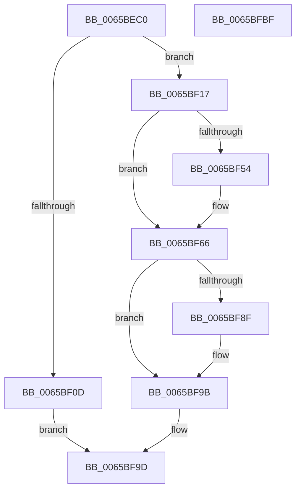

# ExpSvmServicePageFault

- RVA: `0x0065BEC0`–`0x0065BFC0` (길이 `256` bytes)
- VA: `0x000000014065BEC0`
- 실행 섹션: `.text`
- PDB 이름 있음: `예`; PDB Function 태그: `아니요`
- unwind 정보 RVA: `0x000D5634`
- 디코드: `70`개 명령, `256/256` bytes 표시
- 미해석 바이트: `0` (있으면 어셈블리에 `.byte`로 보존)

> 이 문서는 커널 이미지의 기계어와 PDB 기호를 분석해 생성했습니다. 4번과 5번은 함수 원형과 자료형을 바이너리 사용 방식에서 추정한 C 해석이며 원본 소스 복구 결과는 아닙니다.

## 1. Dependencies

- 직접 호출 지점: **6**; 고유 호출 대상: **6**
- 직접 호출자로 확인된 함수: **0**
- RIP 상대 이미지 참조: **2**

### Outgoing calls
- `0x0065BF2C` → [ExpAcquireSvmAgentsLock](ExpAcquireSvmAgentsLock_function_0065AF0C.md) (function, `0x0065AF0C`)
- `0x0065BF47` → [ExpReleaseSvmAgentsLock](ExpReleaseSvmAgentsLock_function_0065B4F0.md) (function, `0x0065B4F0`)
- `0x0065BF5E` → [KiStackAttachProcess](../21/KiStackAttachProcess_function_00216820.md) (function, `0x00216820`)
- `0x0065BF83` → [MmAccessFault](../27/MmAccessFault_function_0027EE80.md) (function, `0x0027EE80`)
- `0x0065BF96` → [KiUnstackDetachProcess](../21/KiUnstackDetachProcess_function_00217D30.md) (function, `0x00217D30`)
- `0x0065BFA5` → [_security_check_cookie](../6A/_security_check_cookie_function_006AC640.md) (function, `0x006AC640`)

### Direct callers
- 이 함수 시작 RVA로 연결되는 직접 call은 확인되지 않았습니다. 간접 호출은 완전히 역산할 수 없습니다.

### Static image references
- `0x0065BED2` → RVA `0x00E0A740` (`.data`; read)
- `0x0065BF31` → RVA `0x00EFA8D0` (`.data`; read)

## 2. Other-region calls and transfers

- 다른 실행 섹션으로 향하는 call: **0**
- 별도 외부 분기/꼬리 이동을 확인하지 못했습니다.

## 3. Assembly (complete function range)

```asm
0065BEC0  48 89 5C 24 08                  mov qword ptr [rsp + 8], rbx
0065BEC5  48 89 6C 24 20                  mov qword ptr [rsp + 0x20], rbp
0065BECA  56                              push rsi
0065BECB  57                              push rdi
0065BECC  41 56                           push r14
0065BECE  48 83 EC 70                     sub rsp, 0x70
0065BED2  48 8B 05 67 E8 7A 00            mov rax, qword ptr [rip + 0x7ae867]
0065BED9  48 33 C4                        xor rax, rsp
0065BEDC  48 89 44 24 68                  mov qword ptr [rsp + 0x68], rax
0065BEE1  0F 57 C0                        xorps xmm0, xmm0
0065BEE4  41 8B F0                        mov esi, r8d
0065BEE7  33 C0                           xor eax, eax
0065BEE9  4C 8B F2                        mov r14, rdx
0065BEEC  48 89 44 24 30                  mov qword ptr [rsp + 0x30], rax
0065BEF1  48 8B F9                        mov rdi, rcx
0065BEF4  0F 11 44 24 38                  movups xmmword ptr [rsp + 0x38], xmm0
0065BEF9  0F 11 44 24 48                  movups xmmword ptr [rsp + 0x48], xmm0
0065BEFE  0F 11 44 24 58                  movups xmmword ptr [rsp + 0x58], xmm0
0065BF03  0F 11 44 24 20                  movups xmmword ptr [rsp + 0x20], xmm0
0065BF08  F6 C1 08                        test cl, 8
0065BF0B  74 0A                           je 0x14065bf17
0065BF0D  B8 05 00 00 C0                  mov eax, 0xc0000005
0065BF12  E9 86 00 00 00                  jmp 0x14065bf9d
0065BF17  65 48 8B 04 25 88 01 00 00      mov rax, qword ptr gs:[0x188]
0065BF20  48 8D 4C 24 20                  lea rcx, [rsp + 0x20]
0065BF25  48 8B 98 B8 00 00 00            mov rbx, qword ptr [rax + 0xb8]
0065BF2C  E8 DB EF FF FF                  call 0x14065af0c
0065BF31  48 8B 0D 98 E9 89 00            mov rcx, qword ptr [rip + 0x89e998]
0065BF38  48 8D 14 76                     lea rdx, [rsi + rsi*2]
0065BF3C  48 8B 34 D1                     mov rsi, qword ptr [rcx + rdx*8]
0065BF40  8A D0                           mov dl, al
0065BF42  48 8D 4C 24 20                  lea rcx, [rsp + 0x20]
0065BF47  E8 A4 F5 FF FF                  call 0x14065b4f0
0065BF4C  40 32 ED                        xor bpl, bpl
0065BF4F  48 3B DE                        cmp rbx, rsi
0065BF52  74 12                           je 0x14065bf66
0065BF54  4C 8D 44 24 38                  lea r8, [rsp + 0x38]
0065BF59  33 D2                           xor edx, edx
0065BF5B  48 8B CE                        mov rcx, rsi
0065BF5E  E8 BD A8 BB FF                  call 0x140216820
0065BF63  40 B5 01                        mov bpl, 1
0065BF66  48 8B C7                        mov rax, rdi
0065BF69  41 B0 01                        mov r8b, 1
0065BF6C  83 E0 02                        and eax, 2
0065BF6F  49 8B D6                        mov rdx, r14
0065BF72  8B C8                           mov ecx, eax
0065BF74  48 83 C9 10                     or rcx, 0x10
0065BF78  40 F6 C7 04                     test dil, 4
0065BF7C  48 0F 44 C8                     cmove rcx, rax
0065BF80  45 33 C9                        xor r9d, r9d
0065BF83  E8 F8 2E C2 FF                  call 0x14027ee80
0065BF88  8B D8                           mov ebx, eax
0065BF8A  40 84 ED                        test bpl, bpl
0065BF8D  74 0C                           je 0x14065bf9b
0065BF8F  33 D2                           xor edx, edx
0065BF91  48 8D 4C 24 38                  lea rcx, [rsp + 0x38]
0065BF96  E8 95 BD BB FF                  call 0x140217d30
0065BF9B  8B C3                           mov eax, ebx
0065BF9D  48 8B 4C 24 68                  mov rcx, qword ptr [rsp + 0x68]
0065BFA2  48 33 CC                        xor rcx, rsp
0065BFA5  E8 96 06 05 00                  call 0x1406ac640
0065BFAA  4C 8D 5C 24 70                  lea r11, [rsp + 0x70]
0065BFAF  49 8B 5B 20                     mov rbx, qword ptr [r11 + 0x20]
0065BFB3  49 8B 6B 38                     mov rbp, qword ptr [r11 + 0x38]
0065BFB7  49 8B E3                        mov rsp, r11
0065BFBA  41 5E                           pop r14
0065BFBC  5F                              pop rdi
0065BFBD  5E                              pop rsi
0065BFBE  C3                              ret
0065BFBF  CC                              int3
```

## 4. C-style interpretation (structured pseudocode)

```c
__int64 __fastcall ExpSvmServicePageFault(__int64 a1, __int64 a2, int a3, int a4)
{
    __int64 result;
    __int64 v_rbp;
    __int64 v_rsp;
    unsigned __int64 v_stack_m18;
    unsigned __int64 v_stack_m20;
    unsigned __int64 v_stack_m30;
    unsigned __int64 v_stack_m40;
    unsigned __int64 v_stack_m50;
    unsigned __int64 v_stack_m58;
    unsigned __int64 v_stack_m68;
    unsigned __int64 v_stack_p20;
    unsigned __int64 v_stack_p8;

    v_stack_p8 = v_rbx;
    v_stack_p20 = v_rbp;
    v_rsp = (v_rsp) - (112);
    result = (*(unsigned __int64 *)(v_rip + 8054887)) ^ (v_rsp);
    v_stack_m20 = result;
    result = 0;
    v_stack_m58 = 0;
    v_stack_m50 = v_xmm0;
    v_stack_m40 = v_xmm0;
    v_stack_m30 = v_xmm0;
    v_stack_m68 = v_xmm0;
    if ((((unsigned __int8)(a1)) & (8)) == 0) goto loc_0065BF17;
    goto loc_0065BF9D;
loc_0065BF17:
    result = ExpAcquireSvmAgentsLock(v_stack_m68, a2, a3, a4);
    result = ExpReleaseSvmAgentsLock(v_stack_m68, (unsigned __int8)(result), a3, a4);
    v_rbp = 0;
    if ((*(unsigned __int64 *)(*(unsigned __int64 *)(gs_base + (0 + 392)) + 184)) != (*(unsigned __int64 *)(*(unsigned __int64 *)(v_rip + 9038232) + (unsigned int)(a3) + (unsigned int)(a3) * 2 * 8))) {
        a3 = v_stack_m50;
        a2 = 0;
        a1 = *(unsigned __int64 *)(*(unsigned __int64 *)(v_rip + 9038232) + (unsigned int)(a3) + (unsigned int)(a3) * 2 * 8);
        result = KiStackAttachProcess(a1, a2, a3, a4);
        v_rbp = 1;
    }
    result = (unsigned int)((a1) & (2));
    a1 = ((unsigned int)((unsigned int)(result))) | (16);
    if ((((unsigned __int8)(a1)) & (4)) == 0) { a1 = result; }
    a4 = 0;
    result = MmAccessFault(a1, 0, 1, a4);
    if ((unsigned __int8)(v_rbp) != 0) {
        a2 = 0;
        a1 = v_stack_m50;
        result = KiUnstackDetachProcess(a1, a2, 1, a4);
    }
loc_0065BF9D:
    a1 = (v_stack_m20) ^ (v_rsp);
    result = _security_check_cookie(a1, a2, 1, a4);
    return result;
}
```

## 5. (Beta) C Style

```c
int64_t ExpSvmServicePageFault(int64_t Arg1, int64_t Arg2, void *Arg3, int32_t Arg4)
{
    uint8_t *arg3 = (uint8_t *)Arg3;

    int64_t result;
    int64_t local_rbp;
    int64_t local_rsp;
    uint64_t v_stack_m18;
    uint64_t v_stack_m20;
    uint64_t v_stack_m30;
    uint64_t v_stack_m40;
    uint64_t v_stack_m50;
    uint64_t v_stack_m58;
    uint64_t v_stack_m68;
    uint64_t v_stack_p20;
    uint64_t v_stack_p8;

    v_stack_p8 = local_rbx;
    v_stack_p20 = local_rbp;
    local_rsp = (local_rsp) - (112);
    result = (*(uint64_t *)(v_rip + 0x7AE867)) ^ (local_rsp);
    v_stack_m20 = result;
    result = 0;
    v_stack_m58 = 0;
    v_stack_m50 = v_xmm0;
    v_stack_m40 = v_xmm0;
    v_stack_m30 = v_xmm0;
    v_stack_m68 = v_xmm0;
    if ((((uint8_t)(Arg1)) & (8)) == 0) goto loc_0065BF17;
    goto loc_0065BF9D;
loc_0065BF17:
    result = ExpAcquireSvmAgentsLock(v_stack_m68, Arg2, Arg3, Arg4);
    result = ExpReleaseSvmAgentsLock(v_stack_m68, (uint8_t)(result), Arg3, Arg4);
    local_rbp = 0;
    if ((*(uint64_t *)(*(uint64_t *)(gs_base + (0 + 0x188)) + 0xB8)) != (*(uint64_t *)(*(uint64_t *)(v_rip + 0x89E998) + (uint32_t)(arg3) + (uint32_t)(arg3) * 2 * 8))) {
        Arg3 = v_stack_m50;
        Arg2 = 0;
        Arg1 = *(uint64_t *)(*(uint64_t *)(v_rip + 0x89E998) + (uint32_t)(arg3) + (uint32_t)(arg3) * 2 * 8);
        result = KiStackAttachProcess(Arg1, Arg2, Arg3, Arg4);
        local_rbp = 1;
    }
    result = (uint32_t)((Arg1) & (2));
    Arg1 = ((uint32_t)((uint32_t)(result))) | (16);
    if ((((uint8_t)(Arg1)) & (4)) == 0) { Arg1 = result; }
    Arg4 = 0;
    result = MmAccessFault(Arg1, 0, 1, Arg4);
    if ((uint8_t)(local_rbp) != 0) {
        Arg2 = 0;
        Arg1 = v_stack_m50;
        result = KiUnstackDetachProcess(Arg1, Arg2, 1, Arg4);
    }
loc_0065BF9D:
    Arg1 = (v_stack_m20) ^ (local_rsp);
    result = _security_check_cookie(Arg1, Arg2, 1, Arg4);
    return result;
}
```

### 관측된 메모리 오프셋

구조체 형식이 확인되지 않은 접근은 인자 기준의 오프셋으로만 기록했습니다.

| 기준 인자 | 오프셋 표현 | 폭 (bit) | 접근 |
|---|---:|---:|---|
| `Arg3` | `+ 0x0 + rsi*2` | `64` | `R` |

## 6. Execution-region graph

[열기: 2D/3D 그래프와 함수 탐색 컨트롤 패널](../../../control-panel.html?section=text&rva=0x0065BEC0&view=graph)

- 2D 그래프는 위에서 아래로 흐르고, 3D 그래프는 빈 공간을 드래그해 회전합니다. Shift+드래그는 이동, 휠은 확대·축소, 함수 노드 선택은 대상 보고서 이동입니다.

### Static fallback


