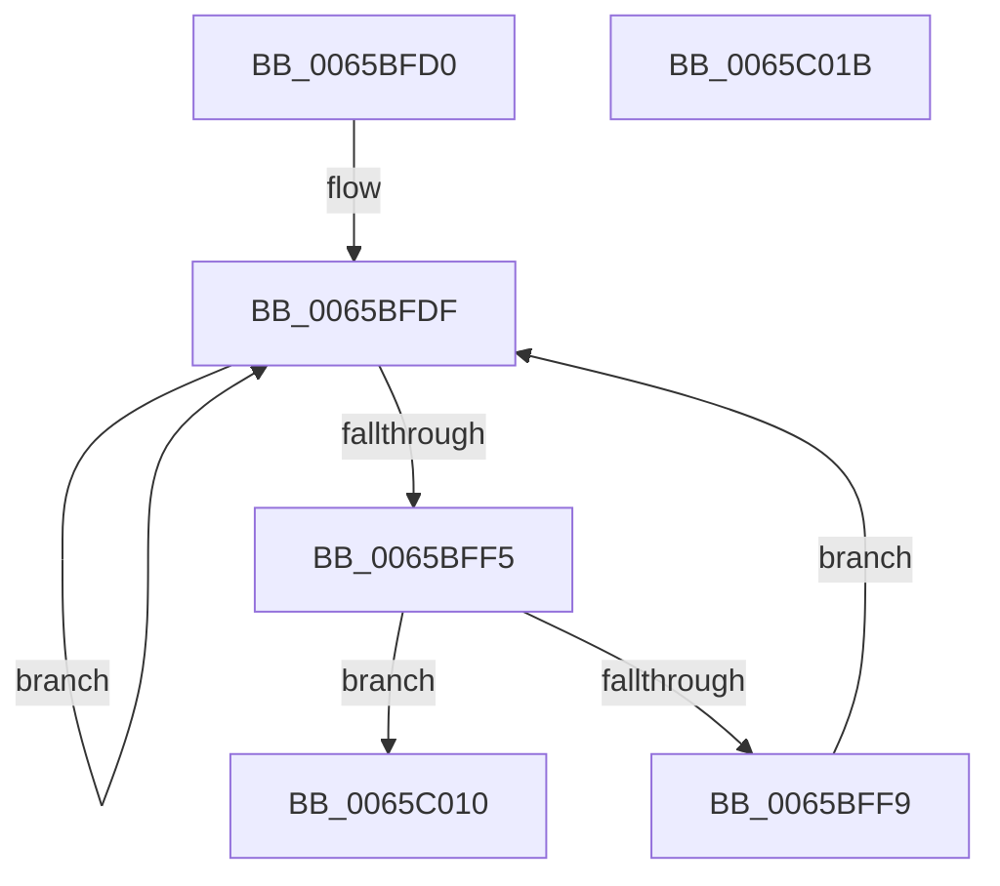

# ExpSvmWorkerThread

- RVA: `0x0065BFD0`–`0x0065C01C` (길이 `76` bytes)
- VA: `0x000000014065BFD0`
- 실행 섹션: `.text`
- PDB 이름 있음: `예`; PDB Function 태그: `아니요`
- unwind 정보 RVA: `0x0005CAAC`
- 디코드: `25`개 명령, `76/76` bytes 표시
- 미해석 바이트: `0` (있으면 어셈블리에 `.byte`로 보존)

> 이 문서는 커널 이미지의 기계어와 PDB 기호를 분석해 생성했습니다. 4번과 5번은 함수 원형과 자료형을 바이너리 사용 방식에서 추정한 C 해석이며 원본 소스 복구 결과는 아닙니다.

## 1. Dependencies

- 직접 호출 지점: **1**; 고유 호출 대상: **1**
- 직접 호출자로 확인된 함수: **0**
- RIP 상대 이미지 참조: **2**

### Outgoing calls
- `0x0065BFEC` → [guard_dispatch_icall](../6B/guard_dispatch_icall_function_006BAAD0.md) (function, `0x006BAAD0`)

### Direct callers
- 이 함수 시작 RVA로 연결되는 직접 call은 확인되지 않았습니다. 간접 호출은 완전히 역산할 수 없습니다.

### Static image references
- `0x0065BFDF` → RVA `0x00E06D28` (`.data`; read)
- `0x0065BFF9` → RVA `0x00EFA838` (`.data`; read)

## 2. Other-region calls and transfers

- 다른 실행 섹션으로 향하는 call: **0**
- 별도 외부 분기/꼬리 이동을 확인하지 못했습니다.

## 3. Assembly (complete function range)

```asm
0065BFD0  48 89 5C 24 08                  mov qword ptr [rsp + 8], rbx
0065BFD5  57                              push rdi
0065BFD6  48 83 EC 20                     sub rsp, 0x20
0065BFDA  48 8B F9                        mov rdi, rcx
0065BFDD  32 DB                           xor bl, bl
0065BFDF  48 8B 05 42 AD 7A 00            mov rax, qword ptr [rip + 0x7aad42]
0065BFE6  8B CF                           mov ecx, edi
0065BFE8  48 8B 40 58                     mov rax, qword ptr [rax + 0x58]
0065BFEC  E8 DF EA 05 00                  call 0x1406baad0
0065BFF1  84 C0                           test al, al
0065BFF3  75 EA                           jne 0x14065bfdf
0065BFF5  84 DB                           test bl, bl
0065BFF7  75 17                           jne 0x14065c010
0065BFF9  48 8B 0D 38 E8 89 00            mov rcx, qword ptr [rip + 0x89e838]
0065C000  B3 01                           mov bl, 1
0065C002  8B C7                           mov eax, edi
0065C004  48 6B D0 68                     imul rdx, rax, 0x68
0065C008  33 C0                           xor eax, eax
0065C00A  87 44 0A 60                     xchg dword ptr [rdx + rcx + 0x60], eax
0065C00E  EB CF                           jmp 0x14065bfdf
0065C010  48 8B 5C 24 30                  mov rbx, qword ptr [rsp + 0x30]
0065C015  48 83 C4 20                     add rsp, 0x20
0065C019  5F                              pop rdi
0065C01A  C3                              ret
0065C01B  CC                              int3
```

## 4. C-style interpretation (structured pseudocode)

```c
__int64 __fastcall ExpSvmWorkerThread(__int64 a1)
{
    __int64 result;
    __int64 v_rbx;
    __int64 v_rsp;
    unsigned __int64 v_stack_p8;

    v_stack_p8 = v_rbx;
    v_rsp = (v_rsp) - (32);
    v_rbx = 0;
loc_0065BFDF:
    result = guard_dispatch_icall((unsigned int)((unsigned int)(a1)), a2, a3, a4);
    if ((unsigned __int8)(result) != 0) goto loc_0065BFDF;
    if (0 != 0) goto loc_0065C010;
    a2 = (a2) * ((unsigned int)((unsigned int)(a1)));
    result = 0;
    goto loc_0065BFDF;
loc_0065C010:
    v_rsp = (v_rsp) + (32);
    return result;
}
```

## 5. (Beta) C Style

```c
int64_t ExpSvmWorkerThread(int64_t Arg1)
{
    int64_t result;
    int64_t local_rbx;
    int64_t local_rsp;
    uint64_t v_stack_p8;

    v_stack_p8 = local_rbx;
    local_rsp = (local_rsp) - (32);
    local_rbx = 0;
loc_0065BFDF:
    result = guard_dispatch_icall((uint32_t)((uint32_t)(Arg1)), a2, a3, a4);
    if ((uint8_t)(result) != 0) goto loc_0065BFDF;
    if (0 != 0) goto loc_0065C010;
    a2 = (a2) * ((uint32_t)((uint32_t)(Arg1)));
    result = 0;
    goto loc_0065BFDF;
loc_0065C010:
    local_rsp = (local_rsp) + (32);
    return result;
}
```

## 6. Execution-region graph

[열기: 2D/3D 그래프와 함수 탐색 컨트롤 패널](../../../control-panel.html?section=text&rva=0x0065BFD0&view=graph)

- 2D 그래프는 위에서 아래로 흐르고, 3D 그래프는 빈 공간을 드래그해 회전합니다. Shift+드래그는 이동, 휠은 확대·축소, 함수 노드 선택은 대상 보고서 이동입니다.

### Static fallback


