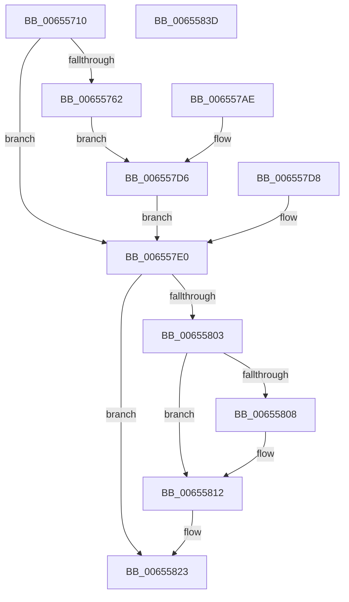

# ExpTimeZoneDpcRoutine

- RVA: `0x00655710`–`0x0065583E` (길이 `302` bytes)
- VA: `0x0000000140655710`
- 실행 섹션: `.text`
- PDB 이름 있음: `예`; PDB Function 태그: `아니요`
- unwind 정보 RVA: `0x000D4920`
- 디코드: `72`개 명령, `302/302` bytes 표시
- 미해석 바이트: `0` (있으면 어셈블리에 `.byte`로 보존)

> 이 문서는 커널 이미지의 기계어와 PDB 기호를 분석해 생성했습니다. 4번과 5번은 함수 원형과 자료형을 바이너리 사용 방식에서 추정한 C 해석이며 원본 소스 복구 결과는 아닙니다.

## 1. Dependencies

- 직접 호출 지점: **5**; 고유 호출 대상: **5**
- 직접 호출자로 확인된 함수: **0**
- RIP 상대 이미지 참조: **0**

### Outgoing calls
- `0x0065574D` → [memset](../6C/memset_function_006C6C40.md) (function, `0x006C6C40`)
- `0x006557A6` → [KiCustomAccessRoutine8](../6B/KiCustomAccessRoutine8_function_006BC400.md) (function, `0x006BC400`)
- `0x006557E3` → [PsGetServerSiloGlobals](../22/PsGetServerSiloGlobals_function_002250A0.md) (function, `0x002250A0`)
- `0x0065580D` → [ObfReferenceObjectWithTag](../21/ObfReferenceObjectWithTag_function_00210710.md) (function, `0x00210710`)
- `0x0065581E` → [ExQueueWorkItem](../2F/ExQueueWorkItem_function_002F9520.md) (function, `0x002F9520`)

### Direct callers
- 이 함수 시작 RVA로 연결되는 직접 call은 확인되지 않았습니다. 간접 호출은 완전히 역산할 수 없습니다.

### Static image references
- 디코드된 RIP-relative 메모리 참조가 없습니다.

## 2. Other-region calls and transfers

- 다른 실행 섹션으로 향하는 call: **0**
- 별도 외부 분기/꼬리 이동을 확인하지 못했습니다.

## 3. Assembly (complete function range)

```asm
00655710  48 8B C4                        mov rax, rsp
00655713  48 89 58 08                     mov qword ptr [rax + 8], rbx
00655717  48 89 70 18                     mov qword ptr [rax + 0x18], rsi
0065571B  48 89 78 20                     mov qword ptr [rax + 0x20], rdi
0065571F  48 89 50 10                     mov qword ptr [rax + 0x10], rdx
00655723  41 56                           push r14
00655725  48 81 EC 60 01 00 00            sub rsp, 0x160
0065572C  48 89 A4 24 50 01 00 00         mov qword ptr [rsp + 0x150], rsp
00655734  4D 8B F1                        mov r14, r9
00655737  49 8B F0                        mov rsi, r8
0065573A  48 8B DA                        mov rbx, rdx
0065573D  48 8B F9                        mov rdi, rcx
00655740  33 D2                           xor edx, edx
00655742  44 8D 42 61                     lea r8d, [rdx + 0x61]
00655746  48 8D 88 28 FF FF FF            lea rcx, [rax - 0xd8]
0065574D  E8 EE 14 07 00                  call 0x1406c6c40
00655752  48 8B C3                        mov rax, rbx
00655755  48 C1 F8 2F                     sar rax, 0x2f
00655759  48 FF C0                        inc rax
0065575C  48 83 F8 01                     cmp rax, 1
00655760  76 7E                           jbe 0x1406557e0
00655762  83 64 24 30 00                  and dword ptr [rsp + 0x30], 0
00655767  C6 07 00                        mov byte ptr [rdi], 0
0065576A  49 8B C6                        mov rax, r14
0065576D  48 C1 E8 08                     shr rax, 8
00655771  48 89 47 20                     mov qword ptr [rdi + 0x20], rax
00655775  48 89 B4 24 E9 00 00 00         mov qword ptr [rsp + 0xe9], rsi
0065577D  8B CE                           mov ecx, esi
0065577F  48 8B C3                        mov rax, rbx
00655782  48 D3 C0                        rol rax, cl
00655785  48 89 84 24 D9 00 00 00         mov qword ptr [rsp + 0xd9], rax
0065578D  48 8B C7                        mov rax, rdi
00655790  48 D3 C8                        ror rax, cl
00655793  48 89 84 24 A1 00 00 00         mov qword ptr [rsp + 0xa1], rax
0065579B  4C 31 77 28                     xor qword ptr [rdi + 0x28], r14
0065579F  48 31 77 30                     xor qword ptr [rdi + 0x30], rsi
006557A3  48 8B CB                        mov rcx, rbx
006557A6  E8 55 6C 06 00                  call 0x1406bc400
006557AB  90                              nop
006557AC  EB 28                           jmp 0x1406557d6
006557AE  48 83 64 24 58 00               and qword ptr [rsp + 0x58], 0
006557B4  48 8B 8C 24 E9 00 00 00         mov rcx, qword ptr [rsp + 0xe9]
006557BC  48 89 4C 24 58                  mov qword ptr [rsp + 0x58], rcx
006557C1  48 8B 84 24 D9 00 00 00         mov rax, qword ptr [rsp + 0xd9]
006557C9  48 D3 C8                        ror rax, cl
006557CC  8B 00                           mov eax, dword ptr [rax]
006557CE  48 8B 9C 24 78 01 00 00         mov rbx, qword ptr [rsp + 0x178]
006557D6  EB 08                           jmp 0x1406557e0
006557D8  48 8B 9C 24 78 01 00 00         mov rbx, qword ptr [rsp + 0x178]
006557E0  48 8B CB                        mov rcx, rbx
006557E3  E8 B8 F8 BC FF                  call 0x1402250a0
006557E8  48 8B B8 C8 04 00 00            mov rdi, qword ptr [rax + 0x4c8]
006557EF  B8 01 00 00 00                  mov eax, 1
006557F4  F0 0F C1 87 A0 03 00 00         lock xadd dword ptr [rdi + 0x3a0], eax
006557FC  FF C0                           inc eax
006557FE  83 F8 01                        cmp eax, 1
00655801  75 20                           jne 0x140655823
00655803  48 85 DB                        test rbx, rbx
00655806  74 0A                           je 0x140655812
00655808  BA 45 78 70 53                  mov edx, 0x53707845
0065580D  E8 FE AE BB FF                  call 0x140210710
00655812  48 8D 8F 40 02 00 00            lea rcx, [rdi + 0x240]
00655819  BA 01 00 00 00                  mov edx, 1
0065581E  E8 FD 3C CA FF                  call 0x1402f9520
00655823  4C 8D 9C 24 60 01 00 00         lea r11, [rsp + 0x160]
0065582B  49 8B 5B 10                     mov rbx, qword ptr [r11 + 0x10]
0065582F  49 8B 73 20                     mov rsi, qword ptr [r11 + 0x20]
00655833  49 8B 7B 28                     mov rdi, qword ptr [r11 + 0x28]
00655837  49 8B E3                        mov rsp, r11
0065583A  41 5E                           pop r14
0065583C  C3                              ret
0065583D  CC                              int3
```

## 4. C-style interpretation (structured pseudocode)

```c
__int64 __fastcall ExpTimeZoneDpcRoutine(__int64 a1, __int64 a2, __int64 a3, __int64 a4)
{
    __int64 result;
    __int64 v_rsp;
    unsigned __int64 v_stack_m110;
    unsigned int v_stack_m138;
    unsigned __int64 v_stack_m18;
    unsigned __int64 v_stack_m7F;
    unsigned __int64 v_stack_m8;
    unsigned __int64 v_stack_m8F;
    unsigned __int64 v_stack_mC7;
    unsigned __int64 v_stack_p10;

    *(unsigned __int64 *)(v_rsp + 8) = v_rbx;
    *(unsigned __int64 *)(v_rsp + 24) = v_rsi;
    *(unsigned __int64 *)(v_rsp + 32) = v_rdi;
    *(unsigned __int64 *)(v_rsp + 16) = a2;
    v_rsp = (v_rsp) - (352);
    v_stack_m18 = v_rsp;
    a2 = 0;
    result = memset(v_rsp - 216, a2, a2 + 97, a4);
    result = (0) >> (47);
    result = (result) + 1;
    if (result <= 1) goto loc_006557E0;
    *(unsigned __int8 *)(a1) = 0;
    result = (a4) >> (8);
    *(unsigned __int64 *)(a1 + 32) = result;
    v_stack_m7F = a3;
    v_stack_m8F = 0;
    v_stack_mC7 = a1;
    result = KiCustomAccessRoutine8(0, a2, a2 + 97, a4);
    goto loc_006557D6;
loc_006557D6:
    goto loc_006557E0;
loc_006557E0:
    result = PsGetServerSiloGlobals(0, a2, a2 + 97, a4);
    result = (unsigned int)((1) + 1);
    if (((unsigned int)(result)) != 1) goto loc_00655823;
    if (0 != 0) {
        a2 = 0x53707845ULL;
        result = ObfReferenceObjectWithTag(0, a2, a2 + 97, a4);
    }
    result = ExQueueWorkItem(*(unsigned __int64 *)(result + 1224) + 576, 1, a2 + 97, a4);
loc_00655823:
    return result;
}
```

## 5. (Beta) C Style

```c
int64_t ExpTimeZoneDpcRoutine(void *Arg1, int64_t Arg2, int64_t Arg3, int64_t Arg4)
{
    uint8_t *arg1 = (uint8_t *)Arg1;

    int64_t result;
    int64_t local_rsp;
    uint64_t v_stack_m110;
    uint32_t v_stack_m138;
    uint64_t v_stack_m18;
    uint64_t v_stack_m7F;
    uint64_t v_stack_m8;
    uint64_t v_stack_m8F;
    uint64_t v_stack_mC7;
    uint64_t v_stack_p10;

    *(uint64_t *)(local_rsp + 0x8) = local_rbx;
    *(uint64_t *)(local_rsp + 0x18) = local_rsi;
    *(uint64_t *)(local_rsp + 0x20) = local_rdi;
    *(uint64_t *)(local_rsp + 0x10) = Arg2;
    local_rsp = (local_rsp) - (352);
    v_stack_m18 = local_rsp;
    Arg2 = 0;
    result = memset(local_rsp - 216, Arg2, Arg2 + 97, Arg4);
    result = (0) >> (47);
    result = (result) + 1;
    if (result <= 1) goto loc_006557E0;
    *(uint8_t *)(arg1) = 0;
    result = (Arg4) >> (8);
    *(uint64_t *)(arg1 + 0x20) = result;
    v_stack_m7F = Arg3;
    v_stack_m8F = 0;
    v_stack_mC7 = Arg1;
    result = KiCustomAccessRoutine8(0, Arg2, Arg2 + 97, Arg4);
    goto loc_006557D6;
loc_006557D6:
    goto loc_006557E0;
loc_006557E0:
    result = PsGetServerSiloGlobals(0, Arg2, Arg2 + 97, Arg4);
    result = (uint32_t)((1) + 1);
    if (((uint32_t)(result)) != 1) goto loc_00655823;
    if (0 != 0) {
        Arg2 = 0x53707845ULL;
        result = ObfReferenceObjectWithTag(0, Arg2, Arg2 + 97, Arg4);
    }
    result = ExQueueWorkItem(*(uint64_t *)(result + 0x4C8) + 576, 1, Arg2 + 97, Arg4);
loc_00655823:
    return result;
}
```

### 관측된 메모리 오프셋

구조체 형식이 확인되지 않은 접근은 인자 기준의 오프셋으로만 기록했습니다.

| 기준 인자 | 오프셋 표현 | 폭 (bit) | 접근 |
|---|---:|---:|---|
| `Arg1` | `+ 0x0` | `8` | `W` |
| `Arg1` | `+ 0x20` | `64` | `W` |
| `Arg1` | `+ 0x28` | `64` | `R/W` |
| `Arg1` | `+ 0x30` | `64` | `R/W` |

## 6. Execution-region graph

[열기: 2D/3D 그래프와 함수 탐색 컨트롤 패널](../../../control-panel.html?section=text&rva=0x00655710&view=graph)

- 2D 그래프는 위에서 아래로 흐르고, 3D 그래프는 빈 공간을 드래그해 회전합니다. Shift+드래그는 이동, 휠은 확대·축소, 함수 노드 선택은 대상 보고서 이동입니다.

### Static fallback


