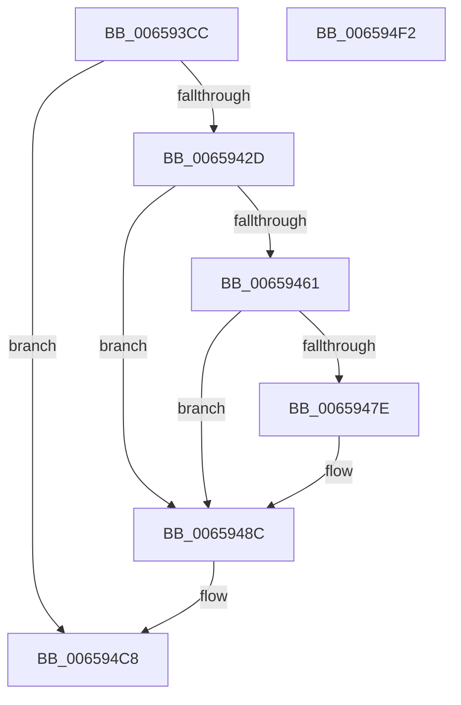

# ExpTimerAdjust

- RVA: `0x006593CC`–`0x006594F3` (길이 `295` bytes)
- VA: `0x00000001406593CC`
- 실행 섹션: `.text`
- PDB 이름 있음: `예`; PDB Function 태그: `아니요`
- unwind 정보 RVA: `0x0007BBB4`
- 디코드: `85`개 명령, `295/295` bytes 표시
- 미해석 바이트: `0` (있으면 어셈블리에 `.byte`로 보존)

> 이 문서는 커널 이미지의 기계어와 PDB 기호를 분석해 생성했습니다. 4번과 5번은 함수 원형과 자료형을 바이너리 사용 방식에서 추정한 C 해석이며 원본 소스 복구 결과는 아닙니다.

## 1. Dependencies

- 직접 호출 지점: **5**; 고유 호출 대상: **5**
- 직접 호출자로 확인된 함수: **1**
- RIP 상대 이미지 참조: **0**

### Outgoing calls
- `0x00659401` → [KeAcquireSpinLockAtDpcLevel](../20/KeAcquireSpinLockAtDpcLevel_function_00208430.md) (function, `0x00208430`)
- `0x0065941D` → [KeCancelTimerInternal](../3D/KeCancelTimerInternal_function_003D39E4.md) (function, `0x003D39E4`)
- `0x00659449` → [ExpCalcAdjustedDueTime](ExpCalcAdjustedDueTime_function_0065937C.md) (function, `0x0065937C`)
- `0x006594C3` → [KeSetCoalescableTimer](../22/KeSetCoalescableTimer_function_0022FFD0.md) (function, `0x0022FFD0`)
- `0x006594CC` → [KxReleaseSpinLock](../20/KxReleaseSpinLock_function_00206670.md) (function, `0x00206670`)

### Direct callers
- [PspSetProcessTimerDelayForKTimers](../5E/PspSetProcessTimerDelayForKTimers_function_005E3C40.md) at `0x005E3D68`

### Static image references
- 디코드된 RIP-relative 메모리 참조가 없습니다.

## 2. Other-region calls and transfers

- 다른 실행 섹션으로 향하는 call: **0**
- 별도 외부 분기/꼬리 이동을 확인하지 못했습니다.

## 3. Assembly (complete function range)

```asm
006593CC  48 8B C4                        mov rax, rsp
006593CF  48 89 58 10                     mov qword ptr [rax + 0x10], rbx
006593D3  48 89 68 18                     mov qword ptr [rax + 0x18], rbp
006593D7  48 89 70 20                     mov qword ptr [rax + 0x20], rsi
006593DB  57                              push rdi
006593DC  41 54                           push r12
006593DE  41 55                           push r13
006593E0  41 56                           push r14
006593E2  41 57                           push r15
006593E4  48 83 EC 40                     sub rsp, 0x40
006593E8  48 8B F9                        mov rdi, rcx
006593EB  33 F6                           xor esi, esi
006593ED  48 83 C1 40                     add rcx, 0x40
006593F1  48 89 70 C8                     mov qword ptr [rax - 0x38], rsi
006593F5  89 70 08                        mov dword ptr [rax + 8], esi
006593F8  49 8B D9                        mov rbx, r9
006593FB  4D 8B E0                        mov r12, r8
006593FE  44 8B EA                        mov r13d, edx
00659401  E8 2A F0 BA FF                  call 0x140208430
00659406  4C 8D BF 40 01 00 00            lea r15, [rdi + 0x140]
0065940D  48 8B CF                        mov rcx, rdi
00659410  4D 8B CF                        mov r9, r15
00659413  4C 8D 44 24 70                  lea r8, [rsp + 0x70]
00659418  48 8D 54 24 30                  lea rdx, [rsp + 0x30]
0065941D  E8 C2 A5 D7 FF                  call 0x1403d39e4
00659422  44 8A F0                        mov r14b, al
00659425  84 C0                           test al, al
00659427  0F 84 9B 00 00 00               je 0x1406594c8
0065942D  48 8B 8C 24 90 00 00 00         mov rcx, qword ptr [rsp + 0x90]
00659435  4C 8B CB                        mov r9, rbx
00659438  8B 54 24 70                     mov edx, dword ptr [rsp + 0x70]
0065943C  4D 8B C4                        mov r8, r12
0065943F  48 89 4C 24 20                  mov qword ptr [rsp + 0x20], rcx
00659444  48 8B 4C 24 30                  mov rcx, qword ptr [rsp + 0x30]
00659449  E8 2E FF FF FF                  call 0x14065937c
0065944E  8B 8F F0 00 00 00               mov ecx, dword ptr [rdi + 0xf0]
00659454  4C 8B D8                        mov r11, rax
00659457  8B 97 F4 00 00 00               mov edx, dword ptr [rdi + 0xf4]
0065945D  85 C9                           test ecx, ecx
0065945F  74 2B                           je 0x14065948c
00659461  8B C1                           mov eax, ecx
00659463  2B C2                           sub eax, edx
00659465  85 D2                           test edx, edx
00659467  0F 44 C1                        cmove eax, ecx
0065946A  8B C8                           mov ecx, eax
0065946C  B8 59 17 B7 D1                  mov eax, 0xd1b71759
00659471  41 F7 E5                        mul r13d
00659474  C1 EA 0D                        shr edx, 0xd
00659477  8D 04 11                        lea eax, [rcx + rdx]
0065947A  3B C1                           cmp eax, ecx
0065947C  72 0E                           jb 0x14065948c
0065947E  8B C8                           mov ecx, eax
00659480  89 87 F0 00 00 00               mov dword ptr [rdi + 0xf0], eax
00659486  89 97 F4 00 00 00               mov dword ptr [rdi + 0xf4], edx
0065948C  8A 9F 30 01 00 00               mov bl, byte ptr [rdi + 0x130]
00659492  48 8D 97 A0 00 00 00            lea rdx, [rdi + 0xa0]
00659499  45 8B 0F                        mov r9d, dword ptr [r15]
0065949C  80 E3 01                        and bl, 1
0065949F  8A C3                           mov al, bl
006594A1  4C 89 9F 38 01 00 00            mov qword ptr [rdi + 0x138], r11
006594A8  F6 D8                           neg al
006594AA  4D 1B D2                        sbb r10, r10
006594AD  4C 23 D2                        and r10, rdx
006594B0  49 8B D3                        mov rdx, r11
006594B3  84 DB                           test bl, bl
006594B5  4C 89 54 24 20                  mov qword ptr [rsp + 0x20], r10
006594BA  0F 44 F1                        cmove esi, ecx
006594BD  48 8B CF                        mov rcx, rdi
006594C0  44 8B C6                        mov r8d, esi
006594C3  E8 08 6B BD FF                  call 0x14022ffd0
006594C8  48 8D 4F 40                     lea rcx, [rdi + 0x40]
006594CC  E8 9F D1 BA FF                  call 0x140206670
006594D1  4C 8D 5C 24 40                  lea r11, [rsp + 0x40]
006594D6  41 8A C6                        mov al, r14b
006594D9  49 8B 5B 38                     mov rbx, qword ptr [r11 + 0x38]
006594DD  49 8B 6B 40                     mov rbp, qword ptr [r11 + 0x40]
006594E1  49 8B 73 48                     mov rsi, qword ptr [r11 + 0x48]
006594E5  49 8B E3                        mov rsp, r11
006594E8  41 5F                           pop r15
006594EA  41 5E                           pop r14
006594EC  41 5D                           pop r13
006594EE  41 5C                           pop r12
006594F0  5F                              pop rdi
006594F1  C3                              ret
006594F2  CC                              int3
```

## 4. C-style interpretation (structured pseudocode)

```c
__int64 __fastcall ExpTimerAdjust(__int64 a1, int a2, __int64 a3, __int64 a4, __int64 a5)
{
    __int64 result;
    __int64 v_r10;
    __int64 v_rbx;
    __int64 v_rsi;
    __int64 v_rsp;
    unsigned __int64 v_stack_m28;
    unsigned __int64 v_stack_m38;
    unsigned __int64 v_stack_m48;
    unsigned __int64 v_stack_p8;

    *(unsigned __int64 *)(v_rsp + 16) = v_rbx;
    *(unsigned __int64 *)(v_rsp + 24) = v_rbp;
    *(unsigned __int64 *)(v_rsp + 32) = v_rsi;
    v_rsp = (v_rsp) - (64);
    v_rsi = 0;
    a1 = (a1) + (64);
    *(unsigned __int64 *)(v_rsp - 56) = 0;
    *(unsigned int *)(v_rsp + 8) = 0;
    result = KeAcquireSpinLockAtDpcLevel(a1, a2, a3, a4);
    result = KeCancelTimerInternal(a1, v_stack_m38, v_stack_p8, a1 + 320);
    if ((unsigned __int8)(result) == 0) goto loc_006594C8;
    v_stack_m48 = a5;
    result = ExpCalcAdjustedDueTime(v_stack_m38, (unsigned int)(v_stack_p8), a3, a4);
    if ((unsigned int)((unsigned int)(*(unsigned int *)(a1 + 240))) == 0) goto loc_0065948C;
    result = (unsigned int)(((unsigned int)((unsigned int)((unsigned int)(*(unsigned int *)(a1 + 240))))) - ((unsigned int)((unsigned int)(*(unsigned int *)(a1 + 244)))));
    if ((unsigned int)((unsigned int)(*(unsigned int *)(a1 + 244))) == 0) { result = (unsigned int)((unsigned int)(*(unsigned int *)(a1 + 240))); }
    a2 = (unsigned int)(((unsigned int)(*(unsigned int *)(a1 + 244))) >> (13));
    if (((unsigned int)((unsigned int)((unsigned int)(result)) + a2 * 1)) >= ((unsigned int)((unsigned int)((unsigned int)(result))))) {
        a1 = (unsigned int)((unsigned int)((unsigned int)(result)) + a2 * 1);
        *(unsigned int *)(a1 + 240) = (unsigned int)((unsigned int)((unsigned int)(result)) + a2 * 1);
        *(unsigned int *)(a1 + 244) = a2;
    }
    v_rbx = (unsigned __int8)((*(unsigned __int8 *)(a1 + 304)) & (1));
    *(unsigned __int64 *)(a1 + 312) = result;
    result = (unsigned __int8)(-((unsigned __int8)(v_rbx)));
    v_r10 = (v_r10) & (a1 + 160);
    v_stack_m48 = v_r10;
    if ((unsigned __int8)(v_rbx) == 0) { v_rsi = (unsigned int)(a1); }
    result = KeSetCoalescableTimer(a1, result, (unsigned int)((unsigned int)(v_rsi)), (unsigned int)(*(unsigned int *)(a1 + 320)));
loc_006594C8:
    result = KxReleaseSpinLock(a1 + 64, result, (unsigned int)((unsigned int)(v_rsi)), (unsigned int)(*(unsigned int *)(a1 + 320)));
    return (unsigned __int8)((unsigned __int8)(result));
}
```

## 5. (Beta) C Style

```c
int64_t ExpTimerAdjust(void *Arg1, int32_t Arg2, int64_t Arg3, int64_t Arg4, int64_t Arg5)
{
    uint8_t *arg1 = (uint8_t *)Arg1;

    int64_t result;
    int64_t local_r10;
    int64_t local_rbx;
    int64_t local_rsi;
    int64_t local_rsp;
    uint64_t v_stack_m28;
    uint64_t v_stack_m38;
    uint64_t v_stack_m48;
    uint64_t v_stack_p8;

    *(uint64_t *)(local_rsp + 0x10) = local_rbx;
    *(uint64_t *)(local_rsp + 0x18) = local_rbp;
    *(uint64_t *)(local_rsp + 0x20) = local_rsi;
    local_rsp = (local_rsp) - (64);
    local_rsi = 0;
    Arg1 = (Arg1) + (64);
    *(uint64_t *)(local_rsp - 0x38) = 0;
    *(uint32_t *)(local_rsp + 0x8) = 0;
    result = KeAcquireSpinLockAtDpcLevel(Arg1, Arg2, Arg3, Arg4);
    result = KeCancelTimerInternal(Arg1, v_stack_m38, v_stack_p8, Arg1 + 320);
    if ((uint8_t)(result) == 0) goto loc_006594C8;
    v_stack_m48 = Arg5;
    result = ExpCalcAdjustedDueTime(v_stack_m38, (uint32_t)(v_stack_p8), Arg3, Arg4);
    if ((uint32_t)((uint32_t)(*(uint32_t *)(arg1 + 0xF0))) == 0) goto loc_0065948C;
    result = (uint32_t)(((uint32_t)((uint32_t)((uint32_t)(*(uint32_t *)(arg1 + 0xF0))))) - ((uint32_t)((uint32_t)(*(uint32_t *)(arg1 + 0xF4)))));
    if ((uint32_t)((uint32_t)(*(uint32_t *)(arg1 + 0xF4))) == 0) { result = (uint32_t)((uint32_t)(*(uint32_t *)(arg1 + 0xF0))); }
    Arg2 = (uint32_t)(((uint32_t)(*(uint32_t *)(arg1 + 0xF4))) >> (13));
    if (((uint32_t)((uint32_t)((uint32_t)(result)) + Arg2 * 1)) >= ((uint32_t)((uint32_t)((uint32_t)(result))))) {
        Arg1 = (uint32_t)((uint32_t)((uint32_t)(result)) + Arg2 * 1);
        *(uint32_t *)(arg1 + 0xF0) = (uint32_t)((uint32_t)((uint32_t)(result)) + Arg2 * 1);
        *(uint32_t *)(arg1 + 0xF4) = Arg2;
    }
    local_rbx = (uint8_t)((*(uint8_t *)(arg1 + 0x130)) & (1));
    *(uint64_t *)(arg1 + 0x138) = result;
    result = (uint8_t)(-((uint8_t)(local_rbx)));
    local_r10 = (local_r10) & (Arg1 + 160);
    v_stack_m48 = local_r10;
    if ((uint8_t)(local_rbx) == 0) { local_rsi = (uint32_t)(Arg1); }
    result = KeSetCoalescableTimer(Arg1, result, (uint32_t)((uint32_t)(local_rsi)), (uint32_t)(*(uint32_t *)(arg1 + 0x140)));
loc_006594C8:
    result = KxReleaseSpinLock(Arg1 + 64, result, (uint32_t)((uint32_t)(local_rsi)), (uint32_t)(*(uint32_t *)(arg1 + 0x140)));
    return (uint8_t)((uint8_t)(result));
}
```

### 관측된 메모리 오프셋

구조체 형식이 확인되지 않은 접근은 인자 기준의 오프셋으로만 기록했습니다.

| 기준 인자 | 오프셋 표현 | 폭 (bit) | 접근 |
|---|---:|---:|---|
| `Arg1` | `+ 0x0` | `32` | `R` |
| `Arg1` | `+ 0x40` | `64` | `R` |
| `Arg1` | `+ 0xA0` | `64` | `R` |
| `Arg1` | `+ 0xF0` | `32` | `R` |
| `Arg1` | `+ 0xF0` | `32` | `W` |
| `Arg1` | `+ 0xF4` | `32` | `R` |
| `Arg1` | `+ 0xF4` | `32` | `W` |
| `Arg1` | `+ 0x130` | `8` | `R` |
| `Arg1` | `+ 0x138` | `64` | `W` |
| `Arg1` | `+ 0x140` | `64` | `R` |

## 6. Execution-region graph

[열기: 2D/3D 그래프와 함수 탐색 컨트롤 패널](../../../control-panel.html?section=text&rva=0x006593CC&view=graph)

- 2D 그래프는 위에서 아래로 흐르고, 3D 그래프는 빈 공간을 드래그해 회전합니다. Shift+드래그는 이동, 휠은 확대·축소, 함수 노드 선택은 대상 보고서 이동입니다.

### Static fallback


