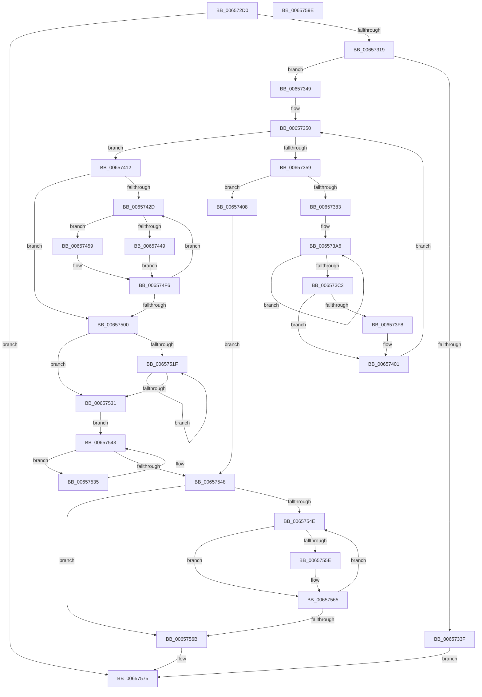

# ExpTrackTableInsertLimit

- RVA: `0x006572D0`–`0x0065759F` (길이 `719` bytes)
- VA: `0x00000001406572D0`
- 실행 섹션: `.text`
- PDB 이름 있음: `예`; PDB Function 태그: `아니요`
- unwind 정보 RVA: `0x000D4CE4`
- 디코드: `196`개 명령, `719/719` bytes 표시
- 미해석 바이트: `0` (있으면 어셈블리에 `.byte`로 보존)

> 이 문서는 커널 이미지의 기계어와 PDB 기호를 분석해 생성했습니다. 4번과 5번은 함수 원형과 자료형을 바이너리 사용 방식에서 추정한 C 해석이며 원본 소스 복구 결과는 아닙니다.

## 1. Dependencies

- 직접 호출 지점: **12**; 고유 호출 대상: **9**
- 직접 호출자로 확인된 함수: **1**
- RIP 상대 이미지 참조: **7**

### Outgoing calls
- `0x0065730A` → [ExpPlGrowTableIfNeeded](ExpPlGrowTableIfNeeded_function_00656F14.md) (function, `0x00656F14`)
- `0x00657332` → [ExAllocatePool2](../../poolcode/B8/ExAllocatePool2_function_00B820F0.md) (function, `0x00B820F0`)
- `0x00657367` → [ExAllocatePool2](../../poolcode/B8/ExAllocatePool2_function_00B820F0.md) (function, `0x00B820F0`)
- `0x006573EF` → [ZwCreateWnfStateName](../6A/ZwCreateWnfStateName_function_006AEB50.md) (function, `0x006AEB50`)
- `0x0065741E` → [KeAcquireInStackQueuedSpinLock](../27/KeAcquireInStackQueuedSpinLock_function_002757A0.md) (function, `0x002757A0`)
- `0x0065743F` → [ExpPlFindLimitEntry](../2E/ExpPlFindLimitEntry_function_002ECBF0.md) (function, `0x002ECBF0`)
- `0x00657505` → [KeReleaseInStackQueuedSpinLock](../34/KeReleaseInStackQueuedSpinLock_function_00342CE0.md) (function, `0x00342CE0`)
- `0x00657514` → [KeGenericCallDpcEx](../2C/KeGenericCallDpcEx_function_002C99F4.md) (function, `0x002C99F4`)
- `0x0065753E` → [ExFreePoolWithTag](../../poolcode/B8/ExFreePoolWithTag_function_00B82870.md) (function, `0x00B82870`)
- `0x00657560` → [ExFreePoolWithTag](../../poolcode/B8/ExFreePoolWithTag_function_00B82870.md) (function, `0x00B82870`)
- `0x00657570` → [ExFreePoolWithTag](../../poolcode/B8/ExFreePoolWithTag_function_00B82870.md) (function, `0x00B82870`)
- `0x0065757F` → [_security_check_cookie](../6A/_security_check_cookie_function_006AC640.md) (function, `0x006AC640`)

### Direct callers
- [ExPoolSetLimit](ExPoolSetLimit_function_00656498.md) at `0x006565F7`

### Static image references
- `0x006572E8` → RVA `0x00E0A740` (`.data`; read)
- `0x006573C7` → RVA `0x00E29090` (`.data`; read)
- `0x00657417` → RVA `0x00EFAD00` (`.data`; read)
- `0x00657459` → RVA `0x00E29084` (`.data`; read)
- `0x006574D9` → RVA `0x00E29088` (`.data`; read)
- `0x006574F0` → RVA `0x00E29080` (`.data`; read/write)
- `0x0065750D` → RVA `0x00656BF0` (`ExpLimitInsertDpc`; read)

## 2. Other-region calls and transfers

- 다른 실행 섹션으로 향하는 call: **5**
  - `0x00657332` → [ExAllocatePool2](../../poolcode/B8/ExAllocatePool2_function_00B820F0.md) (`.text` → `POOLCODE`)
  - `0x00657367` → [ExAllocatePool2](../../poolcode/B8/ExAllocatePool2_function_00B820F0.md) (`.text` → `POOLCODE`)
  - `0x0065753E` → [ExFreePoolWithTag](../../poolcode/B8/ExFreePoolWithTag_function_00B82870.md) (`.text` → `POOLCODE`)
  - `0x00657560` → [ExFreePoolWithTag](../../poolcode/B8/ExFreePoolWithTag_function_00B82870.md) (`.text` → `POOLCODE`)
  - `0x00657570` → [ExFreePoolWithTag](../../poolcode/B8/ExFreePoolWithTag_function_00B82870.md) (`.text` → `POOLCODE`)
- 별도 외부 분기/꼬리 이동을 확인하지 못했습니다.

## 3. Assembly (complete function range)

```asm
006572D0  4C 8B DC                        mov r11, rsp
006572D3  49 89 5B 10                     mov qword ptr [r11 + 0x10], rbx
006572D7  49 89 6B 18                     mov qword ptr [r11 + 0x18], rbp
006572DB  49 89 73 20                     mov qword ptr [r11 + 0x20], rsi
006572DF  57                              push rdi
006572E0  41 56                           push r14
006572E2  41 57                           push r15
006572E4  48 83 EC 70                     sub rsp, 0x70
006572E8  48 8B 05 51 34 7B 00            mov rax, qword ptr [rip + 0x7b3451]
006572EF  48 33 C4                        xor rax, rsp
006572F2  48 89 44 24 60                  mov qword ptr [rsp + 0x60], rax
006572F7  0F 57 C0                        xorps xmm0, xmm0
006572FA  33 C0                           xor eax, eax
006572FC  0F 11 44 24 40                  movups xmmword ptr [rsp + 0x40], xmm0
00657301  49 89 43 C8                     mov qword ptr [r11 - 0x38], rax
00657305  48 8B E9                        mov rbp, rcx
00657308  33 DB                           xor ebx, ebx
0065730A  E8 05 FC FF FF                  call 0x140656f14
0065730F  8B F0                           mov esi, eax
00657311  85 C0                           test eax, eax
00657313  0F 88 5C 02 00 00               js 0x140657575
00657319  8B 45 04                        mov eax, dword ptr [rbp + 4]
0065731C  44 8D 7B 40                     lea r15d, [rbx + 0x40]
00657320  FF C8                           dec eax
00657322  41 B8 50 6F 6F 6C               mov r8d, 0x6c6f6f50
00657328  48 6B D0 38                     imul rdx, rax, 0x38
0065732C  41 8B CF                        mov ecx, r15d
0065732F  49 03 D7                        add rdx, r15
00657332  E8 B9 AD 52 00                  call 0x140b820f0
00657337  48 8B F8                        mov rdi, rax
0065733A  48 85 C0                        test rax, rax
0065733D  75 0A                           jne 0x140657349
0065733F  BE 9A 00 00 C0                  mov esi, 0xc000009a
00657344  E9 2C 02 00 00                  jmp 0x140657575
00657349  8B 45 04                        mov eax, dword ptr [rbp + 4]
0065734C  33 F6                           xor esi, esi
0065734E  89 07                           mov dword ptr [rdi], eax
00657350  3B 75 04                        cmp esi, dword ptr [rbp + 4]
00657353  0F 83 B9 00 00 00               jae 0x140657412
00657359  BA 70 00 00 00                  mov edx, 0x70
0065735E  41 B8 50 6F 6F 6C               mov r8d, 0x6c6f6f50
00657364  49 8B CF                        mov rcx, r15
00657367  E8 84 AD 52 00                  call 0x140b820f0
0065736C  4C 8B F0                        mov r14, rax
0065736F  8B C6                           mov eax, esi
00657371  4C 6B C0 38                     imul r8, rax, 0x38
00657375  4D 89 74 38 08                  mov qword ptr [r8 + rdi + 8], r14
0065737A  4D 85 F6                        test r14, r14
0065737D  0F 84 85 00 00 00               je 0x140657408
00657383  48 8D 14 76                     lea rdx, [rsi + rsi*2]
00657387  48 C1 E2 04                     shl rdx, 4
0065738B  8B 4C 2A 08                     mov ecx, dword ptr [rdx + rbp + 8]
0065738F  49 89 4E 08                     mov qword ptr [r14 + 8], rcx
00657393  48 8D 4F 18                     lea rcx, [rdi + 0x18]
00657397  49 03 C8                        add rcx, r8
0065739A  4C 8D 45 18                     lea r8, [rbp + 0x18]
0065739E  4C 03 C2                        add r8, rdx
006573A1  BA 02 00 00 00                  mov edx, 2
006573A6  49 8B 40 F8                     mov rax, qword ptr [r8 - 8]
006573AA  48 89 41 F8                     mov qword ptr [rcx - 8], rax
006573AE  49 8B 00                        mov rax, qword ptr [r8]
006573B1  4D 8D 40 10                     lea r8, [r8 + 0x10]
006573B5  48 89 01                        mov qword ptr [rcx], rax
006573B8  48 8D 49 18                     lea rcx, [rcx + 0x18]
006573BC  48 83 EA 01                     sub rdx, 1
006573C0  75 E4                           jne 0x1406573a6
006573C2  48 21 5C 24 58                  and qword ptr [rsp + 0x58], rbx
006573C7  48 8D 05 C2 1C 7D 00            lea rax, [rip + 0x7d1cc2]
006573CE  48 89 44 24 30                  mov qword ptr [rsp + 0x30], rax
006573D3  48 8D 4C 24 58                  lea rcx, [rsp + 0x58]
006573D8  45 33 C9                        xor r9d, r9d
006573DB  C7 44 24 28 04 00 00 00         mov dword ptr [rsp + 0x28], 4
006573E3  48 21 5C 24 20                  and qword ptr [rsp + 0x20], rbx
006573E8  45 33 C0                        xor r8d, r8d
006573EB  41 8D 51 03                     lea edx, [r9 + 3]
006573EF  E8 5C 77 05 00                  call 0x1406aeb50
006573F4  85 C0                           test eax, eax
006573F6  78 09                           js 0x140657401
006573F8  48 8B 44 24 58                  mov rax, qword ptr [rsp + 0x58]
006573FD  49 89 46 40                     mov qword ptr [r14 + 0x40], rax
00657401  FF C6                           inc esi
00657403  E9 48 FF FF FF                  jmp 0x140657350
00657408  BE 9A 00 00 C0                  mov esi, 0xc000009a
0065740D  E9 36 01 00 00                  jmp 0x140657548
00657412  48 8D 54 24 40                  lea rdx, [rsp + 0x40]
00657417  48 8D 0D E2 38 8A 00            lea rcx, [rip + 0x8a38e2]
0065741E  E8 7D E3 C1 FF                  call 0x1402757a0
00657423  33 F6                           xor esi, esi
00657425  39 1F                           cmp dword ptr [rdi], ebx
00657427  0F 86 D3 00 00 00               jbe 0x140657500
0065742D  8B C6                           mov eax, esi
0065742F  48 6B E8 38                     imul rbp, rax, 0x38
00657433  4C 8B 7C 2F 08                  mov r15, qword ptr [rdi + rbp + 8]
00657438  4D 8D 77 08                     lea r14, [r15 + 8]
0065743C  41 8B 0E                        mov ecx, dword ptr [r14]
0065743F  E8 AC 57 C9 FF                  call 0x1402ecbf0
00657444  48 85 C0                        test rax, rax
00657447  74 10                           je 0x140657459
00657449  49 89 1E                        mov qword ptr [r14], rbx
0065744C  49 8B DE                        mov rbx, r14
0065744F  48 89 44 2F 08                  mov qword ptr [rdi + rbp + 8], rax
00657454  E9 9D 00 00 00                  jmp 0x1406574f6
00657459  8B 0D 25 1C 7D 00               mov ecx, dword ptr [rip + 0x7d1c25]
0065745F  48 83 C8 FF                     or rax, 0xffffffffffffffff
00657463  44 8B C1                        mov r8d, ecx
00657466  83 E1 1F                        and ecx, 0x1f
00657469  48 D3 E0                        shl rax, cl
0065746C  49 23 06                        and rax, qword ptr [r14]
0065746F  48 89 44 24 58                  mov qword ptr [rsp + 0x58], rax
00657474  0F B6 C0                        movzx eax, al
00657477  48 05 CB 5D B1 00               add rax, 0xb15dcb
0065747D  41 C1 E8 05                     shr r8d, 5
00657481  48 6B C8 25                     imul rcx, rax, 0x25
00657485  0F B6 44 24 59                  movzx eax, byte ptr [rsp + 0x59]
0065748A  48 03 C8                        add rcx, rax
0065748D  0F B6 44 24 5A                  movzx eax, byte ptr [rsp + 0x5a]
00657492  48 6B D1 25                     imul rdx, rcx, 0x25
00657496  48 03 D0                        add rdx, rax
00657499  0F B6 44 24 5B                  movzx eax, byte ptr [rsp + 0x5b]
0065749E  48 6B CA 25                     imul rcx, rdx, 0x25
006574A2  48 03 C8                        add rcx, rax
006574A5  0F B6 44 24 5C                  movzx eax, byte ptr [rsp + 0x5c]
006574AA  48 6B D1 25                     imul rdx, rcx, 0x25
006574AE  48 03 D0                        add rdx, rax
006574B1  0F B6 44 24 5D                  movzx eax, byte ptr [rsp + 0x5d]
006574B6  48 6B CA 25                     imul rcx, rdx, 0x25
006574BA  48 03 C8                        add rcx, rax
006574BD  0F B6 44 24 5E                  movzx eax, byte ptr [rsp + 0x5e]
006574C2  48 6B D1 25                     imul rdx, rcx, 0x25
006574C6  48 03 D0                        add rdx, rax
006574C9  0F B6 44 24 5F                  movzx eax, byte ptr [rsp + 0x5f]
006574CE  48 6B CA 25                     imul rcx, rdx, 0x25
006574D2  41 8D 50 FF                     lea edx, [r8 - 1]
006574D6  48 03 C1                        add rax, rcx
006574D9  48 8B 0D A8 1B 7D 00            mov rcx, qword ptr [rip + 0x7d1ba8]
006574E0  8B C0                           mov eax, eax
006574E2  48 23 D0                        and rdx, rax
006574E5  48 8B 04 D1                     mov rax, qword ptr [rcx + rdx*8]
006574E9  49 89 07                        mov qword ptr [r15], rax
006574EC  4C 89 3C D1                     mov qword ptr [rcx + rdx*8], r15
006574F0  FF 05 8A 1B 7D 00               inc dword ptr [rip + 0x7d1b8a]
006574F6  FF C6                           inc esi
006574F8  3B 37                           cmp esi, dword ptr [rdi]
006574FA  0F 82 2D FF FF FF               jb 0x14065742d
00657500  48 8D 4C 24 40                  lea rcx, [rsp + 0x40]
00657505  E8 D6 B7 CE FF                  call 0x140342ce0
0065750A  48 8B D7                        mov rdx, rdi
0065750D  48 8D 0D DC F6 FF FF            lea rcx, [rip - 0x924]
00657514  E8 DB 24 C7 FF                  call 0x1402c99f4
00657519  33 D2                           xor edx, edx
0065751B  39 17                           cmp dword ptr [rdi], edx
0065751D  76 12                           jbe 0x140657531
0065751F  8B C2                           mov eax, edx
00657521  FF C2                           inc edx
00657523  48 6B C8 38                     imul rcx, rax, 0x38
00657527  48 83 64 39 08 00               and qword ptr [rcx + rdi + 8], 0
0065752D  3B 17                           cmp edx, dword ptr [rdi]
0065752F  72 EE                           jb 0x14065751f
00657531  33 F6                           xor esi, esi
00657533  EB 0E                           jmp 0x140657543
00657535  48 8D 4B F8                     lea rcx, [rbx - 8]
00657539  33 D2                           xor edx, edx
0065753B  48 8B 1B                        mov rbx, qword ptr [rbx]
0065753E  E8 2D B3 52 00                  call 0x140b82870
00657543  48 85 DB                        test rbx, rbx
00657546  75 ED                           jne 0x140657535
00657548  33 DB                           xor ebx, ebx
0065754A  39 1F                           cmp dword ptr [rdi], ebx
0065754C  76 1D                           jbe 0x14065756b
0065754E  8B C3                           mov eax, ebx
00657550  48 6B C8 38                     imul rcx, rax, 0x38
00657554  48 8B 4C 39 08                  mov rcx, qword ptr [rcx + rdi + 8]
00657559  48 85 C9                        test rcx, rcx
0065755C  74 07                           je 0x140657565
0065755E  33 D2                           xor edx, edx
00657560  E8 0B B3 52 00                  call 0x140b82870
00657565  FF C3                           inc ebx
00657567  3B 1F                           cmp ebx, dword ptr [rdi]
00657569  72 E3                           jb 0x14065754e
0065756B  33 D2                           xor edx, edx
0065756D  48 8B CF                        mov rcx, rdi
00657570  E8 FB B2 52 00                  call 0x140b82870
00657575  8B C6                           mov eax, esi
00657577  48 8B 4C 24 60                  mov rcx, qword ptr [rsp + 0x60]
0065757C  48 33 CC                        xor rcx, rsp
0065757F  E8 BC 50 05 00                  call 0x1406ac640
00657584  4C 8D 5C 24 70                  lea r11, [rsp + 0x70]
00657589  49 8B 5B 28                     mov rbx, qword ptr [r11 + 0x28]
0065758D  49 8B 6B 30                     mov rbp, qword ptr [r11 + 0x30]
00657591  49 8B 73 38                     mov rsi, qword ptr [r11 + 0x38]
00657595  49 8B E3                        mov rsp, r11
00657598  41 5F                           pop r15
0065759A  41 5E                           pop r14
0065759C  5F                              pop rdi
0065759D  C3                              ret
0065759E  CC                              int3
```

## 4. C-style interpretation (structured pseudocode)

```c
__int64 __fastcall ExpTrackTableInsertLimit(__int64 a1, __int64 a2, __int64 a3, int a4)
{
    __int64 result;
    __int64 v_rbp;
    __int64 v_rbx;
    __int64 v_rsi;
    __int64 v_rsp;
    unsigned __int64 v_stack_m18;
    unsigned __int64 v_stack_m28;
    unsigned __int8 v_stack_m29;
    unsigned __int8 v_stack_m2A;
    unsigned __int8 v_stack_m2B;
    unsigned __int8 v_stack_m2C;
    unsigned __int8 v_stack_m2D;
    unsigned __int8 v_stack_m2E;
    unsigned __int8 v_stack_m2F;
    unsigned __int64 v_stack_m30;
    unsigned __int64 v_stack_m48;
    unsigned __int64 v_stack_m58;
    unsigned int v_stack_m60;
    unsigned __int64 v_stack_m68;

    *(unsigned __int64 *)(v_rsp + 16) = v_rbx;
    *(unsigned __int64 *)(v_rsp + 24) = v_rbp;
    *(unsigned __int64 *)(v_rsp + 32) = v_rsi;
    v_rsp = (v_rsp) - (112);
    result = (*(unsigned __int64 *)(v_rip + 8074321)) ^ (v_rsp);
    v_stack_m28 = result;
    result = 0;
    v_stack_m48 = v_xmm0;
    *(unsigned __int64 *)(v_rsp - 56) = 0;
    v_rbx = 0;
    result = ExpPlGrowTableIfNeeded(a1, a2, a3, a4);
    if (sign_flag) goto loc_00657575;
    result = (unsigned int)(((unsigned int)(*(unsigned int *)(a1 + 4))) - 1);
    a2 = (a2) * (result);
    a2 = (a2) + (v_rbx + 64);
    result = ExAllocatePool2((unsigned int)((unsigned int)(v_rbx + 64)), a2, (unsigned int)(0x6C6F6F50ULL), a4);
    if (result != 0) goto loc_00657349;
    goto loc_00657575;
loc_00657349:
    v_rsi = 0;
    *(unsigned int *)(result) = (unsigned int)((unsigned int)(*(unsigned int *)(a1 + 4)));
loc_00657350:
    if (0 >= (*(unsigned int *)(a1 + 4))) goto loc_00657412;
    result = ExAllocatePool2(v_rbx + 64, 112, (unsigned int)(0x6C6F6F50ULL), a4);
    a3 = ((unsigned int)(0x6C6F6F50ULL)) * (0);
    *(unsigned __int64 *)(a3 + result * 1 + 8) = result;
    if (result == 0) goto loc_00657408;
    a2 = (v_rsi + v_rsi * 2) << (4);
    *(unsigned __int64 *)(result + 8) = (unsigned int)(*(unsigned int *)(a2 + a1 * 1 + 8));
    a1 = (result + 24) + (a3);
    a3 = (a1 + 24) + (a2);
loc_006573A6:
    *(unsigned __int64 *)(a1 - 8) = *(unsigned __int64 *)(a3 - 8);
    *(unsigned __int64 *)(a1) = *(unsigned __int64 *)(a3);
    a2 = (2) - (1);
    if (condition_is_not_equal) goto loc_006573A6;
    v_stack_m58 = v_rip + 8199362;
    a4 = 0;
    v_stack_m60 = 4;
    a3 = 0;
    result = ZwCreateWnfStateName(v_stack_m30, a4 + 3, a3, a4);
    if (!(sign_flag)) {
        result = v_stack_m30;
        *(unsigned __int64 *)(result + 64) = result;
    }
    v_rsi = (unsigned int)((v_rsi) + 1);
    goto loc_00657350;
loc_00657408:
    goto loc_00657548;
loc_00657412:
    result = KeAcquireInStackQueuedSpinLock(v_rip + 9058530, v_stack_m48, a3, a4);
    v_rsi = 0;
    if ((*(unsigned int *)(result)) <= 0) goto loc_00657500;
loc_0065742D:
    v_rbp = (a1) * (0);
    result = ExpPlFindLimitEntry((unsigned int)(*(unsigned int *)(*(unsigned __int64 *)(result + v_rbp * 1 + 8) + 8)), v_stack_m48, a3, a4);
    if (result == 0) goto loc_00657459;
    *(unsigned __int64 *)(*(unsigned __int64 *)(result + v_rbp * 1 + 8) + 8) = 0;
    *(unsigned __int64 *)(result + v_rbp * 1 + 8) = result;
    goto loc_006574F6;
loc_00657459:
    result = (result) | (-1);
    a1 = (unsigned int)(((unsigned int)(*(unsigned int *)(v_rip + 8199205))) & (31));
    result = (result) << ((unsigned __int8)(a1));
    result = (result) & (*(unsigned __int64 *)(*(unsigned __int64 *)(result + v_rbp * 1 + 8) + 8));
    v_stack_m30 = result;
    result = ((unsigned __int8)(result)) + (0xB15DCBULL);
    a3 = (unsigned int)(((unsigned int)((unsigned int)((unsigned int)(*(unsigned int *)(v_rip + 8199205))))) >> (5));
    a1 = (a1) * (result);
    a1 = (a1) + (v_stack_m2F);
    a2 = (v_stack_m48) * (a1);
    a2 = (a2) + (v_stack_m2E);
    a1 = (a1) * (a2);
    a1 = (a1) + (v_stack_m2D);
    a2 = (a2) * (a1);
    a2 = (a2) + (v_stack_m2C);
    a1 = (a1) * (a2);
    a1 = (a1) + (v_stack_m2B);
    a2 = (a2) * (a1);
    a2 = (a2) + (v_stack_m2A);
    a1 = (a1) * (a2);
    result = (v_stack_m29) + (a1);
    a2 = (a3 - 1) & ((unsigned int)((unsigned int)(result)));
    *(unsigned __int64 *)(*(unsigned __int64 *)(result + v_rbp * 1 + 8)) = *(unsigned __int64 *)(*(unsigned __int64 *)(v_rip + 8199080) + a2 * 8);
    *(unsigned __int64 *)(*(unsigned __int64 *)(v_rip + 8199080) + a2 * 8) = *(unsigned __int64 *)(result + v_rbp * 1 + 8);
loc_006574F6:
    v_rsi = (unsigned int)((v_rsi) + 1);
    if (((unsigned int)(v_rsi)) < (*(unsigned int *)(result))) goto loc_0065742D;
loc_00657500:
    result = KeReleaseInStackQueuedSpinLock(v_stack_m48, a2, a3, a4);
    result = KeGenericCallDpcEx(v_rip - 2340, result, a3, a4);
    a2 = 0;
    if ((*(unsigned int *)(result)) <= 0) goto loc_00657531;
loc_0065751F:
    a2 = (unsigned int)((a2) + 1);
    a1 = (v_rip - 2340) * (0);
    if (((unsigned int)(a2)) < (*(unsigned int *)(result))) goto loc_0065751F;
loc_00657531:
    v_rsi = 0;
    goto loc_00657543;
loc_00657535:
    a2 = 0;
    result = ExFreePoolWithTag(*(unsigned __int64 *)(result + v_rbp * 1 + 8) + 8 - 8, a2, a3, a4);
loc_00657543:
    if (*(unsigned __int64 *)(*(unsigned __int64 *)(result + v_rbp * 1 + 8) + 8) != 0) goto loc_00657535;
loc_00657548:
    v_rbx = 0;
    if ((*(unsigned int *)(result)) <= 0) goto loc_0065756B;
loc_0065754E:
    a1 = (*(unsigned __int64 *)(result + v_rbp * 1 + 8) + 8 - 8) * (0);
    result = 0;
    if (*(unsigned __int64 *)(a1 + result * 1 + 8) != 0) {
        a2 = 0;
        result = ExFreePoolWithTag(*(unsigned __int64 *)(a1 + result * 1 + 8), a2, a3, a4);
    }
    v_rbx = (unsigned int)((v_rbx) + 1);
    if (((unsigned int)(v_rbx)) < (*(unsigned int *)(result))) goto loc_0065754E;
loc_0065756B:
    a2 = 0;
    result = ExFreePoolWithTag(result, a2, a3, a4);
loc_00657575:
    a1 = (v_stack_m28) ^ (v_rsp);
    result = _security_check_cookie(a1, a2, a3, a4);
    return result;
}
```

## 5. (Beta) C Style

```c
int64_t ExpTrackTableInsertLimit(void *Arg1, int64_t Arg2, int64_t Arg3, int32_t Arg4)
{
    uint8_t *arg1 = (uint8_t *)Arg1;

    int64_t result;
    int64_t local_rbp;
    int64_t local_rbx;
    int64_t local_rsi;
    int64_t local_rsp;
    uint64_t v_stack_m18;
    uint64_t v_stack_m28;
    uint8_t v_stack_m29;
    uint8_t v_stack_m2A;
    uint8_t v_stack_m2B;
    uint8_t v_stack_m2C;
    uint8_t v_stack_m2D;
    uint8_t v_stack_m2E;
    uint8_t v_stack_m2F;
    uint64_t v_stack_m30;
    uint64_t v_stack_m48;
    uint64_t v_stack_m58;
    uint32_t v_stack_m60;
    uint64_t v_stack_m68;

    *(uint64_t *)(local_rsp + 0x10) = local_rbx;
    *(uint64_t *)(local_rsp + 0x18) = local_rbp;
    *(uint64_t *)(local_rsp + 0x20) = local_rsi;
    local_rsp = (local_rsp) - (112);
    result = (*(uint64_t *)(v_rip + 0x7B3451)) ^ (local_rsp);
    v_stack_m28 = result;
    result = 0;
    v_stack_m48 = v_xmm0;
    *(uint64_t *)(local_rsp - 0x38) = 0;
    local_rbx = 0;
    result = ExpPlGrowTableIfNeeded(Arg1, Arg2, Arg3, Arg4);
    if (sign_flag) goto loc_00657575;
    result = (uint32_t)(((uint32_t)(*(uint32_t *)(arg1 + 0x4))) - 1);
    Arg2 = (Arg2) * (result);
    Arg2 = (Arg2) + (local_rbx + 64);
    result = ExAllocatePool2((uint32_t)((uint32_t)(local_rbx + 64)), Arg2, (uint32_t)(0x6C6F6F50ULL), Arg4);
    if (result != 0) goto loc_00657349;
    goto loc_00657575;
loc_00657349:
    local_rsi = 0;
    *(uint32_t *)(result) = (uint32_t)((uint32_t)(*(uint32_t *)(arg1 + 0x4)));
loc_00657350:
    if (0 >= (*(uint32_t *)(arg1 + 0x4))) goto loc_00657412;
    result = ExAllocatePool2(local_rbx + 64, 112, (uint32_t)(0x6C6F6F50ULL), Arg4);
    Arg3 = ((uint32_t)(0x6C6F6F50ULL)) * (0);
    *(uint64_t *)(Arg3 + result * 1 + 0x8) = result;
    if (result == 0) goto loc_00657408;
    Arg2 = (local_rsi + local_rsi * 2) << (4);
    *(uint64_t *)(result + 0x8) = (uint32_t)(*(uint32_t *)(Arg2 + arg1 * 1 + 0x8));
    Arg1 = (result + 24) + (Arg3);
    Arg3 = (Arg1 + 24) + (Arg2);
loc_006573A6:
    *(uint64_t *)(arg1 - 0x8) = *(uint64_t *)(Arg3 - 0x8);
    *(uint64_t *)(arg1) = *(uint64_t *)(Arg3);
    Arg2 = (2) - (1);
    if (condition_is_not_equal) goto loc_006573A6;
    v_stack_m58 = v_rip + 8199362;
    Arg4 = 0;
    v_stack_m60 = 4;
    Arg3 = 0;
    result = ZwCreateWnfStateName(v_stack_m30, Arg4 + 3, Arg3, Arg4);
    if (!(sign_flag)) {
        result = v_stack_m30;
        *(uint64_t *)(result + 0x40) = result;
    }
    local_rsi = (uint32_t)((local_rsi) + 1);
    goto loc_00657350;
loc_00657408:
    goto loc_00657548;
loc_00657412:
    result = KeAcquireInStackQueuedSpinLock(v_rip + 9058530, v_stack_m48, Arg3, Arg4);
    local_rsi = 0;
    if ((*(uint32_t *)(result)) <= 0) goto loc_00657500;
loc_0065742D:
    local_rbp = (Arg1) * (0);
    result = ExpPlFindLimitEntry((uint32_t)(*(uint32_t *)(*(uint64_t *)(result + local_rbp * 1 + 0x8) + 0x8)), v_stack_m48, Arg3, Arg4);
    if (result == 0) goto loc_00657459;
    *(uint64_t *)(*(uint64_t *)(result + local_rbp * 1 + 0x8) + 0x8) = 0;
    *(uint64_t *)(result + local_rbp * 1 + 0x8) = result;
    goto loc_006574F6;
loc_00657459:
    result = (result) | (-1);
    Arg1 = (uint32_t)(((uint32_t)(*(uint32_t *)(v_rip + 0x7D1C25))) & (31));
    result = (result) << ((uint8_t)(Arg1));
    result = (result) & (*(uint64_t *)(*(uint64_t *)(result + local_rbp * 1 + 0x8) + 0x8));
    v_stack_m30 = result;
    result = ((uint8_t)(result)) + (0xB15DCBULL);
    Arg3 = (uint32_t)(((uint32_t)((uint32_t)((uint32_t)(*(uint32_t *)(v_rip + 0x7D1C25))))) >> (5));
    Arg1 = (Arg1) * (result);
    Arg1 = (Arg1) + (v_stack_m2F);
    Arg2 = (v_stack_m48) * (Arg1);
    Arg2 = (Arg2) + (v_stack_m2E);
    Arg1 = (Arg1) * (Arg2);
    Arg1 = (Arg1) + (v_stack_m2D);
    Arg2 = (Arg2) * (Arg1);
    Arg2 = (Arg2) + (v_stack_m2C);
    Arg1 = (Arg1) * (Arg2);
    Arg1 = (Arg1) + (v_stack_m2B);
    Arg2 = (Arg2) * (Arg1);
    Arg2 = (Arg2) + (v_stack_m2A);
    Arg1 = (Arg1) * (Arg2);
    result = (v_stack_m29) + (Arg1);
    Arg2 = (Arg3 - 1) & ((uint32_t)((uint32_t)(result)));
    *(uint64_t *)(*(uint64_t *)(result + local_rbp * 1 + 0x8)) = *(uint64_t *)(*(uint64_t *)(v_rip + 0x7D1BA8) + Arg2 * 8);
    *(uint64_t *)(*(uint64_t *)(v_rip + 0x7D1BA8) + Arg2 * 8) = *(uint64_t *)(result + local_rbp * 1 + 0x8);
loc_006574F6:
    local_rsi = (uint32_t)((local_rsi) + 1);
    if (((uint32_t)(local_rsi)) < (*(uint32_t *)(result))) goto loc_0065742D;
loc_00657500:
    result = KeReleaseInStackQueuedSpinLock(v_stack_m48, Arg2, Arg3, Arg4);
    result = KeGenericCallDpcEx(v_rip - 2340, result, Arg3, Arg4);
    Arg2 = 0;
    if ((*(uint32_t *)(result)) <= 0) goto loc_00657531;
loc_0065751F:
    Arg2 = (uint32_t)((Arg2) + 1);
    Arg1 = (v_rip - 2340) * (0);
    if (((uint32_t)(Arg2)) < (*(uint32_t *)(result))) goto loc_0065751F;
loc_00657531:
    local_rsi = 0;
    goto loc_00657543;
loc_00657535:
    Arg2 = 0;
    result = ExFreePoolWithTag(*(uint64_t *)(result + local_rbp * 1 + 0x8) + 8 - 8, Arg2, Arg3, Arg4);
loc_00657543:
    if (*(uint64_t *)(*(uint64_t *)(result + local_rbp * 1 + 0x8) + 0x8) != 0) goto loc_00657535;
loc_00657548:
    local_rbx = 0;
    if ((*(uint32_t *)(result)) <= 0) goto loc_0065756B;
loc_0065754E:
    Arg1 = (*(uint64_t *)(result + local_rbp * 1 + 0x8) + 8 - 8) * (0);
    result = 0;
    if (*(uint64_t *)(arg1 + result * 1 + 0x8) != 0) {
        Arg2 = 0;
        result = ExFreePoolWithTag(*(uint64_t *)(arg1 + result * 1 + 0x8), Arg2, Arg3, Arg4);
    }
    local_rbx = (uint32_t)((local_rbx) + 1);
    if (((uint32_t)(local_rbx)) < (*(uint32_t *)(result))) goto loc_0065754E;
loc_0065756B:
    Arg2 = 0;
    result = ExFreePoolWithTag(result, Arg2, Arg3, Arg4);
loc_00657575:
    Arg1 = (v_stack_m28) ^ (local_rsp);
    result = _security_check_cookie(Arg1, Arg2, Arg3, Arg4);
    return result;
}
```

### 관측된 메모리 오프셋

구조체 형식이 확인되지 않은 접근은 인자 기준의 오프셋으로만 기록했습니다.

| 기준 인자 | 오프셋 표현 | 폭 (bit) | 접근 |
|---|---:|---:|---|
| `Arg1` | `- 0x8` | `64` | `R` |
| `Arg1` | `+ 0x0` | `64` | `R` |
| `Arg1` | `+ 0x4` | `32` | `R` |
| `Arg1` | `+ 0x10` | `64` | `R` |
| `Arg1` | `+ 0x18` | `64` | `R` |

## 6. Execution-region graph

[열기: 2D/3D 그래프와 함수 탐색 컨트롤 패널](../../../control-panel.html?section=text&rva=0x006572D0&view=graph)

- 2D 그래프는 위에서 아래로 흐르고, 3D 그래프는 빈 공간을 드래그해 회전합니다. Shift+드래그는 이동, 휠은 확대·축소, 함수 노드 선택은 대상 보고서 이동입니다.

### Static fallback


