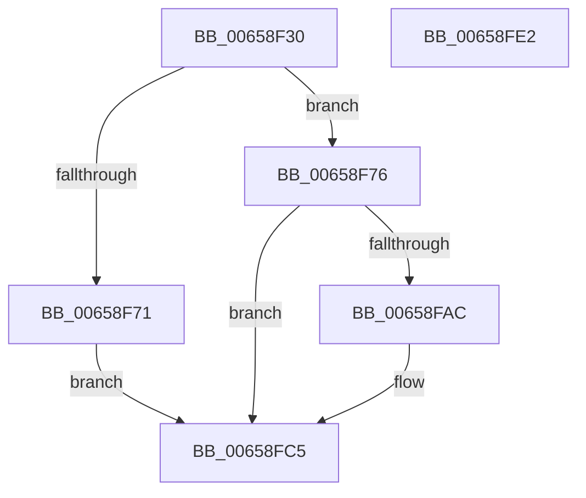

# ExpTryConvertSharedToExclusiveLite

- RVA: `0x00658F30`–`0x00658FE3` (길이 `179` bytes)
- VA: `0x0000000140658F30`
- 실행 섹션: `.text`
- PDB 이름 있음: `예`; PDB Function 태그: `아니요`
- unwind 정보 RVA: `0x0007F83C`
- 디코드: `50`개 명령, `179/179` bytes 표시
- 미해석 바이트: `0` (있으면 어셈블리에 `.byte`로 보존)

> 이 문서는 커널 이미지의 기계어와 PDB 기호를 분석해 생성했습니다. 4번과 5번은 함수 원형과 자료형을 바이너리 사용 방식에서 추정한 C 해석이며 원본 소스 복구 결과는 아닙니다.

## 1. Dependencies

- 직접 호출 지점: **4**; 고유 호출 대상: **4**
- 직접 호출자로 확인된 함수: **1**
- RIP 상대 이미지 참조: **0**

### Outgoing calls
- `0x00658F62` → [KeAcquireInStackQueuedSpinLock](../27/KeAcquireInStackQueuedSpinLock_function_002757A0.md) (function, `0x002757A0`)
- `0x00658F82` → [ExpGetThreadResourceHint](../21/ExpGetThreadResourceHint_function_002134C0.md) (function, `0x002134C0`)
- `0x00658F9E` → [ExpFindCurrentThread](../3D/ExpFindCurrentThread_function_003D46F0.md) (function, `0x003D46F0`)
- `0x00658FCA` → [KeReleaseInStackQueuedSpinLock](../34/KeReleaseInStackQueuedSpinLock_function_00342CE0.md) (function, `0x00342CE0`)

### Direct callers
- [ExTryConvertSharedToExclusiveLite](ExTryConvertSharedToExclusiveLite_function_00658DDC.md) at `0x00658E08`

### Static image references
- 디코드된 RIP-relative 메모리 참조가 없습니다.

## 2. Other-region calls and transfers

- 다른 실행 섹션으로 향하는 call: **0**
- 별도 외부 분기/꼬리 이동을 확인하지 못했습니다.

## 3. Assembly (complete function range)

```asm
00658F30  4C 8B DC                        mov r11, rsp
00658F33  49 89 5B 08                     mov qword ptr [r11 + 8], rbx
00658F37  49 89 73 10                     mov qword ptr [r11 + 0x10], rsi
00658F3B  57                              push rdi
00658F3C  48 83 EC 50                     sub rsp, 0x50
00658F40  0F 57 C0                        xorps xmm0, xmm0
00658F43  49 8D 53 D8                     lea rdx, [r11 - 0x28]
00658F47  0F 11 44 24 30                  movups xmmword ptr [rsp + 0x30], xmm0
00658F4C  33 C0                           xor eax, eax
00658F4E  48 8B D9                        mov rbx, rcx
00658F51  49 89 43 E8                     mov qword ptr [r11 - 0x18], rax
00658F55  48 83 C1 60                     add rcx, 0x60
00658F59  65 48 8B 34 25 88 01 00 00      mov rsi, qword ptr gs:[0x188]
00658F62  E8 39 C8 C1 FF                  call 0x1402757a0
00658F67  BF 01 00 00 00                  mov edi, 1
00658F6C  39 7B 40                        cmp dword ptr [rbx + 0x40], edi
00658F6F  74 05                           je 0x140658f76
00658F71  40 32 FF                        xor dil, dil
00658F74  EB 4F                           jmp 0x140658fc5
00658F76  B8 80 00 00 00                  mov eax, 0x80
00658F7B  48 8B CE                        mov rcx, rsi
00658F7E  66 09 43 1A                     or word ptr [rbx + 0x1a], ax
00658F82  E8 39 A5 BB FF                  call 0x1402134c0
00658F87  89 44 24 28                     mov dword ptr [rsp + 0x28], eax
00658F8B  4C 8D 44 24 30                  lea r8, [rsp + 0x30]
00658F90  83 64 24 20 00                  and dword ptr [rsp + 0x20], 0
00658F95  45 33 C9                        xor r9d, r9d
00658F98  48 8B D6                        mov rdx, rsi
00658F9B  48 8B CB                        mov rcx, rbx
00658F9E  E8 4D B7 D7 FF                  call 0x1403d46f0
00658FA3  48 8D 4B 30                     lea rcx, [rbx + 0x30]
00658FA7  48 3B C1                        cmp rax, rcx
00658FAA  74 19                           je 0x140658fc5
00658FAC  0F 10 00                        movups xmm0, xmmword ptr [rax]
00658FAF  F3 0F 7F 01                     movdqu xmmword ptr [rcx], xmm0
00658FB3  8B 4B 38                        mov ecx, dword ptr [rbx + 0x38]
00658FB6  83 E1 07                        and ecx, 7
00658FB9  0F 57 C0                        xorps xmm0, xmm0
00658FBC  83 C9 08                        or ecx, 8
00658FBF  89 4B 38                        mov dword ptr [rbx + 0x38], ecx
00658FC2  0F 11 00                        movups xmmword ptr [rax], xmm0
00658FC5  48 8D 4C 24 30                  lea rcx, [rsp + 0x30]
00658FCA  E8 11 9D CE FF                  call 0x140342ce0
00658FCF  48 8B 5C 24 60                  mov rbx, qword ptr [rsp + 0x60]
00658FD4  40 8A C7                        mov al, dil
00658FD7  48 8B 74 24 68                  mov rsi, qword ptr [rsp + 0x68]
00658FDC  48 83 C4 50                     add rsp, 0x50
00658FE0  5F                              pop rdi
00658FE1  C3                              ret
00658FE2  CC                              int3
```

## 4. C-style interpretation (structured pseudocode)

```c
__int64 __fastcall ExpTryConvertSharedToExclusiveLite(__int64 a1, __int64 a2, __int64 a3, int a4)
{
    __int64 result;
    __int64 v_rdi;
    __int64 v_rsp;
    unsigned __int64 v_stack_m28;
    unsigned int v_stack_m30;
    unsigned int v_stack_m38;
    unsigned __int64 v_stack_p10;
    unsigned __int64 v_stack_p8;

    *(unsigned __int64 *)(v_rsp + 8) = v_rbx;
    *(unsigned __int64 *)(v_rsp + 16) = v_rsi;
    v_rsp = (v_rsp) - (80);
    v_stack_m28 = v_xmm0;
    result = 0;
    *(unsigned __int64 *)(v_rsp - 24) = 0;
    a1 = (a1) + (96);
    result = KeAcquireInStackQueuedSpinLock(a1, v_rsp - 40, a3, a4);
    if ((*(unsigned int *)(a1 + 64)) == 1) goto loc_00658F76;
    v_rdi = 0;
    goto loc_00658FC5;
loc_00658F76:
    result = ExpGetThreadResourceHint(*(unsigned __int64 *)(gs_base + (0 + 392)), v_rsp - 40, a3, a4);
    v_stack_m30 = (unsigned int)(result);
    a4 = 0;
    result = ExpFindCurrentThread(a1, *(unsigned __int64 *)(gs_base + (0 + 392)), v_stack_m28, a4);
    if (result != (a1 + 48)) {
        *(unsigned __int64 *)(a1 + 48) = v_xmm0;
        a1 = *(unsigned int *)(a1 + 56);
        a1 = (unsigned int)((a1) & (7));
        a1 = (unsigned int)((a1) | (8));
        *(unsigned int *)(a1 + 56) = (unsigned int)(a1);
        *(unsigned __int64 *)(result) = v_xmm0;
    }
    result = KeReleaseInStackQueuedSpinLock(v_stack_m28, *(unsigned __int64 *)(gs_base + (0 + 392)), v_stack_m28, a4);
    v_rsp = (v_rsp) + (80);
    return 0;
}
```

## 5. (Beta) C Style

```c
int64_t ExpTryConvertSharedToExclusiveLite(void *Arg1, int64_t Arg2, int64_t Arg3, int32_t Arg4)
{
    uint8_t *arg1 = (uint8_t *)Arg1;

    int64_t result;
    int64_t local_rdi;
    int64_t local_rsp;
    uint64_t v_stack_m28;
    uint32_t v_stack_m30;
    uint32_t v_stack_m38;
    uint64_t v_stack_p10;
    uint64_t v_stack_p8;

    *(uint64_t *)(local_rsp + 0x8) = local_rbx;
    *(uint64_t *)(local_rsp + 0x10) = local_rsi;
    local_rsp = (local_rsp) - (80);
    v_stack_m28 = v_xmm0;
    result = 0;
    *(uint64_t *)(local_rsp - 0x18) = 0;
    Arg1 = (Arg1) + (96);
    result = KeAcquireInStackQueuedSpinLock(Arg1, local_rsp - 40, Arg3, Arg4);
    if ((*(uint32_t *)(arg1 + 0x40)) == 1) goto loc_00658F76;
    local_rdi = 0;
    goto loc_00658FC5;
loc_00658F76:
    result = ExpGetThreadResourceHint(*(uint64_t *)(gs_base + (0 + 0x188)), local_rsp - 40, Arg3, Arg4);
    v_stack_m30 = (uint32_t)(result);
    Arg4 = 0;
    result = ExpFindCurrentThread(Arg1, *(uint64_t *)(gs_base + (0 + 0x188)), v_stack_m28, Arg4);
    if (result != (Arg1 + 48)) {
        *(uint64_t *)(arg1 + 0x30) = v_xmm0;
        Arg1 = *(uint32_t *)(arg1 + 0x38);
        Arg1 = (uint32_t)((Arg1) & (7));
        Arg1 = (uint32_t)((Arg1) | (8));
        *(uint32_t *)(arg1 + 0x38) = (uint32_t)(Arg1);
        *(uint64_t *)(result) = v_xmm0;
    }
    result = KeReleaseInStackQueuedSpinLock(v_stack_m28, *(uint64_t *)(gs_base + (0 + 0x188)), v_stack_m28, Arg4);
    local_rsp = (local_rsp) + (80);
    return 0;
}
```

### 관측된 메모리 오프셋

구조체 형식이 확인되지 않은 접근은 인자 기준의 오프셋으로만 기록했습니다.

| 기준 인자 | 오프셋 표현 | 폭 (bit) | 접근 |
|---|---:|---:|---|
| `Arg1` | `+ 0x0` | `128` | `W` |
| `Arg1` | `+ 0x1A` | `16` | `R/W` |
| `Arg1` | `+ 0x30` | `64` | `R` |
| `Arg1` | `+ 0x38` | `32` | `R` |
| `Arg1` | `+ 0x38` | `32` | `W` |
| `Arg1` | `+ 0x40` | `32` | `R` |

## 6. Execution-region graph

[열기: 2D/3D 그래프와 함수 탐색 컨트롤 패널](../../../control-panel.html?section=text&rva=0x00658F30&view=graph)

- 2D 그래프는 위에서 아래로 흐르고, 3D 그래프는 빈 공간을 드래그해 회전합니다. Shift+드래그는 이동, 휠은 확대·축소, 함수 노드 선택은 대상 보고서 이동입니다.

### Static fallback


