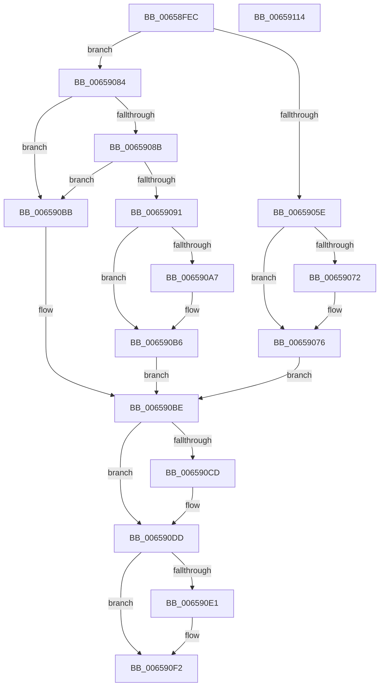

# ExpTryToAcquireResourceExclusiveLite

- RVA: `0x00658FEC`–`0x00659115` (길이 `297` bytes)
- VA: `0x0000000140658FEC`
- 실행 섹션: `.text`
- PDB 이름 있음: `예`; PDB Function 태그: `아니요`
- unwind 정보 RVA: `0x0008A668`
- 디코드: `87`개 명령, `297/297` bytes 표시
- 미해석 바이트: `0` (있으면 어셈블리에 `.byte`로 보존)

> 이 문서는 커널 이미지의 기계어와 PDB 기호를 분석해 생성했습니다. 4번과 5번은 함수 원형과 자료형을 바이너리 사용 방식에서 추정한 C 해석이며 원본 소스 복구 결과는 아닙니다.

## 1. Dependencies

- 직접 호출 지점: **4**; 고유 호출 대상: **4**
- 직접 호출자로 확인된 함수: **1**
- RIP 상대 이미지 참조: **1**

### Outgoing calls
- `0x0065904A` → [KeAcquireInStackQueuedSpinLock](../27/KeAcquireInStackQueuedSpinLock_function_002757A0.md) (function, `0x002757A0`)
- `0x00659052` → [ExpTryAcquireResourceExclusive](../44/ExpTryAcquireResourceExclusive_function_00442DB0.md) (function, `0x00442DB0`)
- `0x006590C3` → [KeReleaseInStackQueuedSpinLock](../34/KeReleaseInStackQueuedSpinLock_function_00342CE0.md) (function, `0x00342CE0`)
- `0x006590ED` → [PerfLogExecutiveResourceAcquire](../47/PerfLogExecutiveResourceAcquire_function_004795E8.md) (function, `0x004795E8`)

### Direct callers
- [ExTryToAcquireResourceExclusiveLite](ExTryToAcquireResourceExclusiveLite_function_00658E20.md) at `0x00658F1E`

### Static image references
- `0x0065902C` → RVA `0x00FC6B04` (`ALMOSTRO`; read)

## 2. Other-region calls and transfers

- 다른 실행 섹션으로 향하는 call: **0**
- 별도 외부 분기/꼬리 이동을 확인하지 못했습니다.

## 3. Assembly (complete function range)

```asm
00658FEC  4C 8B DC                        mov r11, rsp
00658FEF  49 89 5B 08                     mov qword ptr [r11 + 8], rbx
00658FF3  49 89 6B 10                     mov qword ptr [r11 + 0x10], rbp
00658FF7  49 89 73 18                     mov qword ptr [r11 + 0x18], rsi
00658FFB  49 89 7B 20                     mov qword ptr [r11 + 0x20], rdi
00658FFF  41 54                           push r12
00659001  41 56                           push r14
00659003  41 57                           push r15
00659005  48 83 EC 40                     sub rsp, 0x40
00659009  33 C0                           xor eax, eax
0065900B  49 8D 53 C8                     lea rdx, [r11 - 0x38]
0065900F  0F 57 C0                        xorps xmm0, xmm0
00659012  48 8B D9                        mov rbx, rcx
00659015  0F 11 44 24 20                  movups xmmword ptr [rsp + 0x20], xmm0
0065901A  49 89 43 D8                     mov qword ptr [r11 - 0x28], rax
0065901E  33 FF                           xor edi, edi
00659020  65 4C 8B 24 25 88 01 00 00      mov r12, qword ptr gs:[0x188]
00659029  45 33 FF                        xor r15d, r15d
0065902C  8B 2D D2 DA 96 00               mov ebp, dword ptr [rip + 0x96dad2]
00659032  48 83 C1 60                     add rcx, 0x60
00659036  81 E5 00 00 02 00               and ebp, 0x20000
0065903C  41 BE 01 00 01 00               mov r14d, 0x10001
00659042  65 FF 04 25 E0 90 00 00         inc dword ptr gs:[0x90e0]
0065904A  E8 51 C7 C1 FF                  call 0x1402757a0
0065904F  48 8B CB                        mov rcx, rbx
00659052  E8 59 9D DE FF                  call 0x140442db0
00659057  40 8A F0                        mov sil, al
0065905A  84 C0                           test al, al
0065905C  74 26                           je 0x140659084
0065905E  8B 4B 38                        mov ecx, dword ptr [rbx + 0x38]
00659061  83 E1 07                        and ecx, 7
00659064  4C 89 63 30                     mov qword ptr [rbx + 0x30], r12
00659068  83 C9 08                        or ecx, 8
0065906B  89 4B 38                        mov dword ptr [rbx + 0x38], ecx
0065906E  85 ED                           test ebp, ebp
00659070  74 04                           je 0x140659076
00659072  44 8B 7B 44                     mov r15d, dword ptr [rbx + 0x44]
00659076  40 0F 95 C7                     setne dil
0065907A  8B C7                           mov eax, edi
0065907C  C1 E0 05                        shl eax, 5
0065907F  44 03 F0                        add r14d, eax
00659082  EB 3A                           jmp 0x1406590be
00659084  8A 43 1A                        mov al, byte ptr [rbx + 0x1a]
00659087  84 C0                           test al, al
00659089  79 30                           jns 0x1406590bb
0065908B  4C 39 63 30                     cmp qword ptr [rbx + 0x30], r12
0065908F  75 2A                           jne 0x1406590bb
00659091  8B 43 38                        mov eax, dword ptr [rbx + 0x38]
00659094  8D 48 08                        lea ecx, [rax + 8]
00659097  8B D1                           mov edx, ecx
00659099  33 D0                           xor edx, eax
0065909B  83 E2 07                        and edx, 7
0065909E  33 D1                           xor edx, ecx
006590A0  89 53 38                        mov dword ptr [rbx + 0x38], edx
006590A3  85 ED                           test ebp, ebp
006590A5  74 0F                           je 0x1406590b6
006590A7  44 8B 7B 44                     mov r15d, dword ptr [rbx + 0x44]
006590AB  8B FA                           mov edi, edx
006590AD  C1 EF 03                        shr edi, 3
006590B0  41 BE 31 00 01 00               mov r14d, 0x10031
006590B6  40 B6 01                        mov sil, 1
006590B9  EB 03                           jmp 0x1406590be
006590BB  40 32 F6                        xor sil, sil
006590BE  48 8D 4C 24 20                  lea rcx, [rsp + 0x20]
006590C3  E8 18 9C CE FF                  call 0x140342ce0
006590C8  40 84 F6                        test sil, sil
006590CB  74 10                           je 0x1406590dd
006590CD  65 FF 04 25 E4 90 00 00         inc dword ptr gs:[0x90e4]
006590D5  65 FF 04 25 64 90 00 00         inc dword ptr gs:[0x9064]
006590DD  85 ED                           test ebp, ebp
006590DF  74 11                           je 0x1406590f2
006590E1  45 8B CF                        mov r9d, r15d
006590E4  44 8B C7                        mov r8d, edi
006590E7  48 8B D3                        mov rdx, rbx
006590EA  41 8B CE                        mov ecx, r14d
006590ED  E8 F6 04 E2 FF                  call 0x1404795e8
006590F2  48 8B 5C 24 60                  mov rbx, qword ptr [rsp + 0x60]
006590F7  40 8A C6                        mov al, sil
006590FA  48 8B 74 24 70                  mov rsi, qword ptr [rsp + 0x70]
006590FF  48 8B 6C 24 68                  mov rbp, qword ptr [rsp + 0x68]
00659104  48 8B 7C 24 78                  mov rdi, qword ptr [rsp + 0x78]
00659109  48 83 C4 40                     add rsp, 0x40
0065910D  41 5F                           pop r15
0065910F  41 5E                           pop r14
00659111  41 5C                           pop r12
00659113  C3                              ret
00659114  CC                              int3
```

## 4. C-style interpretation (structured pseudocode)

```c
__int64 __fastcall ExpTryToAcquireResourceExclusiveLite(__int64 a1)
{
    __int64 result;
    __int64 v_r14;
    __int64 v_r15;
    __int64 v_rbp;
    __int64 v_rdi;
    __int64 v_rsi;
    __int64 v_rsp;
    unsigned __int64 v_stack_m38;
    unsigned __int64 v_stack_p10;
    unsigned __int64 v_stack_p18;
    unsigned __int64 v_stack_p20;
    unsigned __int64 v_stack_p8;

    *(unsigned __int64 *)(v_rsp + 8) = v_rbx;
    *(unsigned __int64 *)(v_rsp + 16) = v_rbp;
    *(unsigned __int64 *)(v_rsp + 24) = v_rsi;
    *(unsigned __int64 *)(v_rsp + 32) = v_rdi;
    v_rsp = (v_rsp) - (64);
    result = 0;
    v_stack_m38 = v_xmm0;
    *(unsigned __int64 *)(v_rsp - 40) = 0;
    v_rdi = 0;
    v_r15 = 0;
    a1 = (a1) + (96);
    v_rbp = (unsigned int)(((unsigned int)(*(unsigned int *)(v_rip + 9886418))) & (0x20000ULL));
    result = KeAcquireInStackQueuedSpinLock(a1, v_rsp - 56, a3, a4);
    result = ExpTryAcquireResourceExclusive(a1, v_rsp - 56, a3, a4);
    if ((unsigned __int8)(result) == 0) goto loc_00659084;
    a1 = (unsigned int)(((unsigned int)(*(unsigned int *)(a1 + 56))) & (7));
    *(unsigned __int64 *)(a1 + 48) = *(unsigned __int64 *)(gs_base + (0 + 392));
    a1 = (unsigned int)((a1) | (8));
    *(unsigned int *)(a1 + 56) = (unsigned int)(a1);
    if ((unsigned int)(v_rbp) != 0) {
        v_r15 = *(unsigned int *)(a1 + 68);
    }
    v_rdi = ((unsigned int)(v_rbp) != 0) ? 1 : 0;
    result = (unsigned int)(((unsigned int)((unsigned int)(v_rdi))) << (5));
    v_r14 = (unsigned int)(((unsigned int)(0x10001ULL)) + ((unsigned int)(result)));
    goto loc_006590BE;
loc_00659084:
    if (!sign_flag) goto loc_006590BB;
    if ((*(unsigned __int64 *)(a1 + 48)) != (*(unsigned __int64 *)(gs_base + (0 + 392)))) goto loc_006590BB;
    a2 = (unsigned int)(((unsigned int)((unsigned int)((unsigned int)(*(unsigned int *)(a1 + 56)) + 8))) ^ ((unsigned int)((unsigned int)(*(unsigned int *)(a1 + 56)))));
    a2 = (unsigned int)((a2) & (7));
    a2 = (unsigned int)((a2) ^ ((unsigned int)((unsigned int)(*(unsigned int *)(a1 + 56)) + 8)));
    *(unsigned int *)(a1 + 56) = (unsigned int)(a2);
    if ((unsigned int)(v_rbp) != 0) {
        v_r15 = *(unsigned int *)(a1 + 68);
        v_rdi = (unsigned int)(a2);
        v_rdi = (unsigned int)((v_rdi) >> (3));
        v_r14 = 0x10031ULL;
    }
    goto loc_006590BE;
loc_006590BB:
    v_rsi = 0;
loc_006590BE:
    result = KeReleaseInStackQueuedSpinLock(v_stack_m38, a2, a3, a4);
    if (0 != 0) {
    }
    if ((unsigned int)(v_rbp) != 0) {
        a4 = (unsigned int)(v_r15);
        a3 = (unsigned int)(v_rdi);
        a2 = a1;
        a1 = (unsigned int)(v_r14);
        result = PerfLogExecutiveResourceAcquire(a1, a2, a3, a4);
    }
    v_rsp = (v_rsp) + (64);
    return 0;
}
```

## 5. (Beta) C Style

```c
int64_t ExpTryToAcquireResourceExclusiveLite(void *Arg1)
{
    uint8_t *arg1 = (uint8_t *)Arg1;

    int64_t result;
    int64_t local_r14;
    int64_t local_r15;
    int64_t local_rbp;
    int64_t local_rdi;
    int64_t local_rsi;
    int64_t local_rsp;
    uint64_t v_stack_m38;
    uint64_t v_stack_p10;
    uint64_t v_stack_p18;
    uint64_t v_stack_p20;
    uint64_t v_stack_p8;

    *(uint64_t *)(local_rsp + 0x8) = local_rbx;
    *(uint64_t *)(local_rsp + 0x10) = local_rbp;
    *(uint64_t *)(local_rsp + 0x18) = local_rsi;
    *(uint64_t *)(local_rsp + 0x20) = local_rdi;
    local_rsp = (local_rsp) - (64);
    result = 0;
    v_stack_m38 = v_xmm0;
    *(uint64_t *)(local_rsp - 0x28) = 0;
    local_rdi = 0;
    local_r15 = 0;
    Arg1 = (Arg1) + (96);
    local_rbp = (uint32_t)(((uint32_t)(*(uint32_t *)(v_rip + 0x96DAD2))) & (0x20000ULL));
    result = KeAcquireInStackQueuedSpinLock(Arg1, local_rsp - 56, a3, a4);
    result = ExpTryAcquireResourceExclusive(Arg1, local_rsp - 56, a3, a4);
    if ((uint8_t)(result) == 0) goto loc_00659084;
    Arg1 = (uint32_t)(((uint32_t)(*(uint32_t *)(arg1 + 0x38))) & (7));
    *(uint64_t *)(arg1 + 0x30) = *(uint64_t *)(gs_base + (0 + 0x188));
    Arg1 = (uint32_t)((Arg1) | (8));
    *(uint32_t *)(arg1 + 0x38) = (uint32_t)(Arg1);
    if ((uint32_t)(local_rbp) != 0) {
        local_r15 = *(uint32_t *)(arg1 + 0x44);
    }
    local_rdi = ((uint32_t)(local_rbp) != 0) ? 1 : 0;
    result = (uint32_t)(((uint32_t)((uint32_t)(local_rdi))) << (5));
    local_r14 = (uint32_t)(((uint32_t)(0x10001ULL)) + ((uint32_t)(result)));
    goto loc_006590BE;
loc_00659084:
    if (!sign_flag) goto loc_006590BB;
    if ((*(uint64_t *)(arg1 + 0x30)) != (*(uint64_t *)(gs_base + (0 + 0x188)))) goto loc_006590BB;
    a2 = (uint32_t)(((uint32_t)((uint32_t)((uint32_t)(*(uint32_t *)(arg1 + 0x38)) + 8))) ^ ((uint32_t)((uint32_t)(*(uint32_t *)(arg1 + 0x38)))));
    a2 = (uint32_t)((a2) & (7));
    a2 = (uint32_t)((a2) ^ ((uint32_t)((uint32_t)(*(uint32_t *)(arg1 + 0x38)) + 8)));
    *(uint32_t *)(arg1 + 0x38) = (uint32_t)(a2);
    if ((uint32_t)(local_rbp) != 0) {
        local_r15 = *(uint32_t *)(arg1 + 0x44);
        local_rdi = (uint32_t)(a2);
        local_rdi = (uint32_t)((local_rdi) >> (3));
        local_r14 = 0x10031ULL;
    }
    goto loc_006590BE;
loc_006590BB:
    local_rsi = 0;
loc_006590BE:
    result = KeReleaseInStackQueuedSpinLock(v_stack_m38, a2, a3, a4);
    if (0 != 0) {
    }
    if ((uint32_t)(local_rbp) != 0) {
        a4 = (uint32_t)(local_r15);
        a3 = (uint32_t)(local_rdi);
        a2 = Arg1;
        Arg1 = (uint32_t)(local_r14);
        result = PerfLogExecutiveResourceAcquire(Arg1, a2, a3, a4);
    }
    local_rsp = (local_rsp) + (64);
    return 0;
}
```

### 관측된 메모리 오프셋

구조체 형식이 확인되지 않은 접근은 인자 기준의 오프셋으로만 기록했습니다.

| 기준 인자 | 오프셋 표현 | 폭 (bit) | 접근 |
|---|---:|---:|---|
| `Arg1` | `+ 0x1A` | `8` | `R` |
| `Arg1` | `+ 0x30` | `64` | `R` |
| `Arg1` | `+ 0x30` | `64` | `W` |
| `Arg1` | `+ 0x38` | `32` | `R` |
| `Arg1` | `+ 0x38` | `32` | `W` |
| `Arg1` | `+ 0x44` | `32` | `R` |

## 6. Execution-region graph

[열기: 2D/3D 그래프와 함수 탐색 컨트롤 패널](../../../control-panel.html?section=text&rva=0x00658FEC&view=graph)

- 2D 그래프는 위에서 아래로 흐르고, 3D 그래프는 빈 공간을 드래그해 회전합니다. Shift+드래그는 이동, 휠은 확대·축소, 함수 노드 선택은 대상 보고서 이동입니다.

### Static fallback


