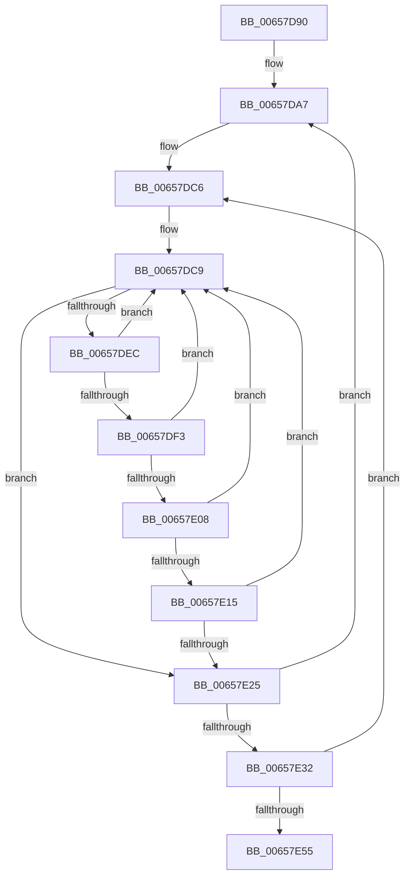

# ExpWaitForBootDevices

- RVA: `0x00657D90`–`0x00657E6D` (길이 `221` bytes)
- VA: `0x0000000140657D90`
- 실행 섹션: `.text`
- PDB 이름 있음: `예`; PDB Function 태그: `아니요`
- unwind 정보 RVA: `0x000D509C`
- 디코드: `56`개 명령, `221/221` bytes 표시
- 미해석 바이트: `0` (있으면 어셈블리에 `.byte`로 보존)

> 이 문서는 커널 이미지의 기계어와 PDB 기호를 분석해 생성했습니다. 4번과 5번은 함수 원형과 자료형을 바이너리 사용 방식에서 추정한 C 해석이며 원본 소스 복구 결과는 아닙니다.

## 1. Dependencies

- 직접 호출 지점: **8**; 고유 호출 대상: **8**
- 직접 호출자로 확인된 함수: **0**
- RIP 상대 이미지 참조: **5**

### Outgoing calls
- `0x00657DBC` → [KeWaitForSingleObject](../20/KeWaitForSingleObject_function_0020E6B0.md) (function, `0x0020E6B0`)
- `0x00657DD0` → [KeAcquireSpinLockRaiseToDpc](../20/KeAcquireSpinLockRaiseToDpc_function_00208470.md) (function, `0x00208470`)
- `0x00657DE2` → [KeReleaseSpinLock](../39/KeReleaseSpinLock_function_00392BA0.md) (function, `0x00392BA0`)
- `0x00657DFF` → [guard_dispatch_icall](../6B/guard_dispatch_icall_function_006BAAD0.md) (function, `0x006BAAD0`)
- `0x00657E36` → [KeFreezeExecution](../4D/KeFreezeExecution_function_004DFA40.md) (function, `0x004DFA40`)
- `0x00657E40` → [KeStallExecutionProcessor](../44/KeStallExecutionProcessor_function_0044F620.md) (function, `0x0044F620`)
- `0x00657E47` → [KeThawExecution](../4F/KeThawExecution_function_004F5240.md) (function, `0x004F5240`)
- `0x00657E67` → [KeBugCheckEx](../4F/KeBugCheckEx_function_004FD660.md) (function, `0x004FD660`)

### Direct callers
- 이 함수 시작 RVA로 연결되는 직접 call은 확인되지 않았습니다. 간접 호출은 완전히 역산할 수 없습니다.

### Static image references
- `0x00657DA0` → RVA `0x00EFAC80` (`.data`; read)
- `0x00657DAD` → RVA `0x00EFAC40` (`.data`; read)
- `0x00657DC9` → RVA `0x00EFAC90` (`.data`; read)
- `0x00657E18` → RVA `0x00EFAC98` (`.data`; read/write)
- `0x00657E25` → RVA `0x00EFAC98` (`.data`; read)

## 2. Other-region calls and transfers

- 다른 실행 섹션으로 향하는 call: **0**
- 별도 외부 분기/꼬리 이동을 확인하지 못했습니다.

## 3. Assembly (complete function range)

```asm
00657D90  48 89 5C 24 08                  mov qword ptr [rsp + 8], rbx
00657D95  48 89 7C 24 10                  mov qword ptr [rsp + 0x10], rdi
00657D9A  41 57                           push r15
00657D9C  48 83 EC 30                     sub rsp, 0x30
00657DA0  4C 8D 3D D9 2E 8A 00            lea r15, [rip + 0x8a2ed9]
00657DA7  48 83 64 24 20 00               and qword ptr [rsp + 0x20], 0
00657DAD  48 8D 0D 8C 2E 8A 00            lea rcx, [rip + 0x8a2e8c]
00657DB4  45 33 C9                        xor r9d, r9d
00657DB7  45 33 C0                        xor r8d, r8d
00657DBA  33 D2                           xor edx, edx
00657DBC  E8 EF 68 BB FF                  call 0x14020e6b0
00657DC1  BF 3C 00 00 00                  mov edi, 0x3c
00657DC6  49 8B DF                        mov rbx, r15
00657DC9  48 8D 0D C0 2E 8A 00            lea rcx, [rip + 0x8a2ec0]
00657DD0  E8 9B 06 BB FF                  call 0x140208470
00657DD5  48 8B 5B 08                     mov rbx, qword ptr [rbx + 8]
00657DD9  48 8D 0D B0 2E 8A 00            lea rcx, [rip + 0x8a2eb0]
00657DE0  8A D0                           mov dl, al
00657DE2  E8 B9 AD D3 FF                  call 0x140392ba0
00657DE7  49 3B DF                        cmp rbx, r15
00657DEA  74 39                           je 0x140657e25
00657DEC  8B 43 FC                        mov eax, dword ptr [rbx - 4]
00657DEF  85 C0                           test eax, eax
00657DF1  74 D6                           je 0x140657dc9
00657DF3  48 8B 43 28                     mov rax, qword ptr [rbx + 0x28]
00657DF7  48 8B 53 30                     mov rdx, qword ptr [rbx + 0x30]
00657DFB  48 8B 4B 20                     mov rcx, qword ptr [rbx + 0x20]
00657DFF  E8 CC 2C 06 00                  call 0x1406baad0
00657E04  84 C0                           test al, al
00657E06  74 C1                           je 0x140657dc9
00657E08  83 C8 FF                        or eax, 0xffffffff
00657E0B  F0 0F C1 43 FC                  lock xadd dword ptr [rbx - 4], eax
00657E10  83 F8 01                        cmp eax, 1
00657E13  75 B4                           jne 0x140657dc9
00657E15  83 C8 FF                        or eax, 0xffffffff
00657E18  F0 0F C1 05 78 2E 8A 00         lock xadd dword ptr [rip + 0x8a2e78], eax
00657E20  83 F8 01                        cmp eax, 1
00657E23  75 A4                           jne 0x140657dc9
00657E25  83 3D 6C 2E 8A 00 00            cmp dword ptr [rip + 0x8a2e6c], 0
00657E2C  0F 84 75 FF FF FF               je 0x140657da7
00657E32  33 D2                           xor edx, edx
00657E34  33 C9                           xor ecx, ecx
00657E36  E8 05 7C E8 FF                  call 0x1404dfa40
00657E3B  B9 40 42 0F 00                  mov ecx, 0xf4240
00657E40  E8 DB 77 DF FF                  call 0x14044f620
00657E45  B1 01                           mov cl, 1
00657E47  E8 F4 D3 E9 FF                  call 0x1404f5240
00657E4C  83 C7 FF                        add edi, -1
00657E4F  0F 85 71 FF FF FF               jne 0x140657dc6
00657E55  48 83 64 24 20 00               and qword ptr [rsp + 0x20], 0
00657E5B  44 8D 4F 03                     lea r9d, [rdi + 3]
00657E5F  45 33 C0                        xor r8d, r8d
00657E62  8D 4F 7B                        lea ecx, [rdi + 0x7b]
00657E65  33 D2                           xor edx, edx
00657E67  E8 F4 57 EA FF                  call 0x1404fd660
00657E6C  CC                              int3
```

## 4. C-style interpretation (structured pseudocode)

```c
__int64 __fastcall ExpWaitForBootDevices(__int64 a1, int a2, int a3, int a4)
{
    __int64 result;
    __int64 v_rdi;
    __int64 v_rsp;
    unsigned __int64 v_stack_m18;
    unsigned __int64 v_stack_p10;
    unsigned __int64 v_stack_p8;

    v_stack_p8 = v_rbx;
    v_stack_p10 = v_rdi;
    v_rsp = (v_rsp) - (48);
loc_00657DA7:
    a4 = 0;
    a3 = 0;
    a2 = 0;
    result = KeWaitForSingleObject(v_rip + 9055884, a2, a3, a4);
loc_00657DC6:
loc_00657DC9:
    result = KeAcquireSpinLockRaiseToDpc(v_rip + 9055936, a2, a3, a4);
    result = KeReleaseSpinLock(v_rip + 9055920, (unsigned __int8)(result), a3, a4);
    if ((*(unsigned __int64 *)(v_rip + 9055961 + 8)) == (v_rip + 9055961)) goto loc_00657E25;
    if ((unsigned int)((unsigned int)(*(unsigned int *)(*(unsigned __int64 *)(v_rip + 9055961 + 8) - 4))) == 0) goto loc_00657DC9;
    result = guard_dispatch_icall(*(unsigned __int64 *)(*(unsigned __int64 *)(v_rip + 9055961 + 8) + 32), *(unsigned __int64 *)(*(unsigned __int64 *)(v_rip + 9055961 + 8) + 48), a3, a4);
    if ((unsigned __int8)(result) == 0) goto loc_00657DC9;
    result = (unsigned int)((result) | (0xFFFFFFFFULL));
    if (((unsigned int)(result)) != 1) goto loc_00657DC9;
    result = (unsigned int)((result) | (0xFFFFFFFFULL));
    if (((unsigned int)(result)) != 1) goto loc_00657DC9;
loc_00657E25:
    if ((*(unsigned int *)(v_rip + 9055852)) == 0) goto loc_00657DA7;
    a2 = 0;
    a1 = 0;
    result = KeFreezeExecution(a1, a2, a3, a4);
    result = KeStallExecutionProcessor((unsigned int)(0xF4240ULL), a2, a3, a4);
    result = KeThawExecution(1, a2, a3, a4);
    v_rdi = (unsigned int)((60) + (-1));
    if (condition_is_not_equal) goto loc_00657DC6;
    a3 = 0;
    a2 = 0;
    result = KeBugCheckEx(v_rdi + 123, a2, a3, v_rdi + 3);
    return result;
}
```

## 5. (Beta) C Style

```c
int64_t ExpWaitForBootDevices(int64_t Arg1, int32_t Arg2, int32_t Arg3, int32_t Arg4)
{
    int64_t result;
    int64_t local_rdi;
    int64_t local_rsp;
    uint64_t v_stack_m18;
    uint64_t v_stack_p10;
    uint64_t v_stack_p8;

    v_stack_p8 = local_rbx;
    v_stack_p10 = local_rdi;
    local_rsp = (local_rsp) - (48);
loc_00657DA7:
    Arg4 = 0;
    Arg3 = 0;
    Arg2 = 0;
    result = KeWaitForSingleObject(v_rip + 9055884, Arg2, Arg3, Arg4);
loc_00657DC6:
loc_00657DC9:
    result = KeAcquireSpinLockRaiseToDpc(v_rip + 9055936, Arg2, Arg3, Arg4);
    result = KeReleaseSpinLock(v_rip + 9055920, (uint8_t)(result), Arg3, Arg4);
    if ((*(uint64_t *)(v_rip + 0x8A2ED9 + 0x8)) == (v_rip + 9055961)) goto loc_00657E25;
    if ((uint32_t)((uint32_t)(*(uint32_t *)(*(uint64_t *)(v_rip + 0x8A2ED9 + 0x8) - 0x4))) == 0) goto loc_00657DC9;
    result = guard_dispatch_icall(*(uint64_t *)(*(uint64_t *)(v_rip + 0x8A2ED9 + 0x8) + 0x20), *(uint64_t *)(*(uint64_t *)(v_rip + 0x8A2ED9 + 0x8) + 0x30), Arg3, Arg4);
    if ((uint8_t)(result) == 0) goto loc_00657DC9;
    result = (uint32_t)((result) | (0xFFFFFFFFULL));
    if (((uint32_t)(result)) != 1) goto loc_00657DC9;
    result = (uint32_t)((result) | (0xFFFFFFFFULL));
    if (((uint32_t)(result)) != 1) goto loc_00657DC9;
loc_00657E25:
    if ((*(uint32_t *)(v_rip + 0x8A2E6C)) == 0) goto loc_00657DA7;
    Arg2 = 0;
    Arg1 = 0;
    result = KeFreezeExecution(Arg1, Arg2, Arg3, Arg4);
    result = KeStallExecutionProcessor((uint32_t)(0xF4240ULL), Arg2, Arg3, Arg4);
    result = KeThawExecution(1, Arg2, Arg3, Arg4);
    local_rdi = (uint32_t)((60) + (-1));
    if (condition_is_not_equal) goto loc_00657DC6;
    Arg3 = 0;
    Arg2 = 0;
    result = KeBugCheckEx(local_rdi + 123, Arg2, Arg3, local_rdi + 3);
    return result;
}
```

## 6. Execution-region graph

[열기: 2D/3D 그래프와 함수 탐색 컨트롤 패널](../../../control-panel.html?section=text&rva=0x00657D90&view=graph)

- 2D 그래프는 위에서 아래로 흐르고, 3D 그래프는 빈 공간을 드래그해 회전합니다. Shift+드래그는 이동, 휠은 확대·축소, 함수 노드 선택은 대상 보고서 이동입니다.

### Static fallback


