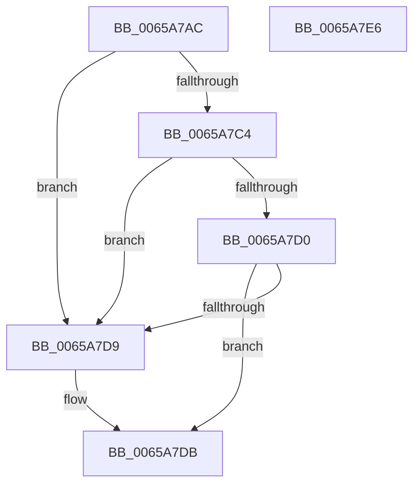

# ExpWorkQueueHealthMetricsEnabled

- RVA: `0x0065A7AC`–`0x0065A7E7` (길이 `59` bytes)
- VA: `0x000000014065A7AC`
- 실행 섹션: `.text`
- PDB 이름 있음: `예`; PDB Function 태그: `아니요`
- unwind 정보 RVA: `0x0005CAAC`
- 디코드: `20`개 명령, `59/59` bytes 표시
- 미해석 바이트: `0` (있으면 어셈블리에 `.byte`로 보존)

> 이 문서는 커널 이미지의 기계어와 PDB 기호를 분석해 생성했습니다. 4번과 5번은 함수 원형과 자료형을 바이너리 사용 방식에서 추정한 C 해석이며 원본 소스 복구 결과는 아닙니다.

## 1. Dependencies

- 직접 호출 지점: **1**; 고유 호출 대상: **1**
- 직접 호출자로 확인된 함수: **2**
- RIP 상대 이미지 참조: **1**

### Outgoing calls
- `0x0065A7BB` → [Feature_WorkQueueShardingWithinNodes__private_IsEnabledNoReportingNoInline](Feature_WorkQueueShardingWithinNodes__private_IsEnabledNoReportingNoInline_function_0065AA88.md) (function, `0x0065AA88`)

### Direct callers
- [ExpTryQueueWorkItem](../39/ExpTryQueueWorkItem_function_0039801C.md) at `0x003980D9`
- [ExpPartitionCreatePoolInternal](../../page/AF/ExpPartitionCreatePoolInternal_function_00AF6C08.md) at `0x00AF6C72`

### Static image references
- `0x0065A7C4` → RVA `0x00FC6EA0` (`ALMOSTRO`; read)

## 2. Other-region calls and transfers

- 다른 실행 섹션으로 향하는 call: **0**
- 별도 외부 분기/꼬리 이동을 확인하지 못했습니다.

## 3. Assembly (complete function range)

```asm
0065A7AC  48 89 5C 24 08                  mov qword ptr [rsp + 8], rbx
0065A7B1  57                              push rdi
0065A7B2  48 83 EC 20                     sub rsp, 0x20
0065A7B6  8B DA                           mov ebx, edx
0065A7B8  48 8B F9                        mov rdi, rcx
0065A7BB  E8 C8 02 00 00                  call 0x14065aa88
0065A7C0  85 C0                           test eax, eax
0065A7C2  74 15                           je 0x14065a7d9
0065A7C4  48 8B 05 D5 C6 96 00            mov rax, qword ptr [rip + 0x96c6d5]
0065A7CB  48 39 07                        cmp qword ptr [rdi], rax
0065A7CE  75 09                           jne 0x14065a7d9
0065A7D0  B8 01 00 00 00                  mov eax, 1
0065A7D5  3B D8                           cmp ebx, eax
0065A7D7  74 02                           je 0x14065a7db
0065A7D9  32 C0                           xor al, al
0065A7DB  48 8B 5C 24 30                  mov rbx, qword ptr [rsp + 0x30]
0065A7E0  48 83 C4 20                     add rsp, 0x20
0065A7E4  5F                              pop rdi
0065A7E5  C3                              ret
0065A7E6  CC                              int3
```

## 4. C-style interpretation (structured pseudocode)

```c
__int64 __fastcall ExpWorkQueueHealthMetricsEnabled(__int64 a1, int a2)
{
    __int64 result;
    __int64 v_rsp;
    unsigned __int64 v_stack_p8;

    v_stack_p8 = v_rbx;
    v_rsp = (v_rsp) - (32);
    result = Feature_WorkQueueShardingWithinNodes__private_IsEnabledNoReportingNoInline(a1, a2, a3, a4);
    if ((unsigned int)(result) == 0) goto loc_0065A7D9;
    if ((*(unsigned __int64 *)(a1)) != (*(unsigned __int64 *)(v_rip + 9881301))) goto loc_0065A7D9;
    result = 1;
    if (((unsigned int)((unsigned int)(a2))) != 1) {
        result = 0;
    }
    v_rsp = (v_rsp) + (32);
    return result;
}
```

## 5. (Beta) C Style

```c
int64_t ExpWorkQueueHealthMetricsEnabled(void *Arg1, int32_t Arg2)
{
    uint8_t *arg1 = (uint8_t *)Arg1;

    int64_t result;
    int64_t local_rsp;
    uint64_t v_stack_p8;

    v_stack_p8 = local_rbx;
    local_rsp = (local_rsp) - (32);
    result = Feature_WorkQueueShardingWithinNodes__private_IsEnabledNoReportingNoInline(Arg1, Arg2, a3, a4);
    if ((uint32_t)(result) == 0) goto loc_0065A7D9;
    if ((*(uint64_t *)(arg1)) != (*(uint64_t *)(v_rip + 0x96C6D5))) goto loc_0065A7D9;
    result = 1;
    if (((uint32_t)((uint32_t)(Arg2))) != 1) {
        result = 0;
    }
    local_rsp = (local_rsp) + (32);
    return result;
}
```

### 관측된 메모리 오프셋

구조체 형식이 확인되지 않은 접근은 인자 기준의 오프셋으로만 기록했습니다.

| 기준 인자 | 오프셋 표현 | 폭 (bit) | 접근 |
|---|---:|---:|---|
| `Arg1` | `+ 0x0` | `64` | `R` |

## 6. Execution-region graph

[열기: 2D/3D 그래프와 함수 탐색 컨트롤 패널](../../../control-panel.html?section=text&rva=0x0065A7AC&view=graph)

- 2D 그래프는 위에서 아래로 흐르고, 3D 그래프는 빈 공간을 드래그해 회전합니다. Shift+드래그는 이동, 휠은 확대·축소, 함수 노드 선택은 대상 보고서 이동입니다.

### Static fallback


