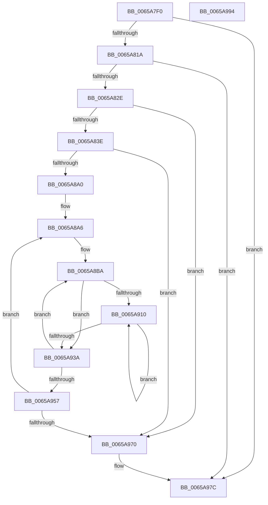

# ExpWorkQueueHealthMetricsMonitorCallback

- RVA: `0x0065A7F0`–`0x0065A995` (길이 `421` bytes)
- VA: `0x000000014065A7F0`
- 실행 섹션: `.text`
- PDB 이름 있음: `예`; PDB Function 태그: `아니요`
- unwind 정보 RVA: `0x000BD508`
- 디코드: `110`개 명령, `421/421` bytes 표시
- 미해석 바이트: `0` (있으면 어셈블리에 `.byte`로 보존)

> 이 문서는 커널 이미지의 기계어와 PDB 기호를 분석해 생성했습니다. 4번과 5번은 함수 원형과 자료형을 바이너리 사용 방식에서 추정한 C 해석이며 원본 소스 복구 결과는 아닙니다.

## 1. Dependencies

- 직접 호출 지점: **7**; 고유 호출 대상: **6**
- 직접 호출자로 확인된 함수: **0**
- RIP 상대 이미지 참조: **6**

### Outgoing calls
- `0x0065A80D` → [Feature_WorkQueueShardingWithinNodes__private_IsEnabledDeviceUsageNoInline](Feature_WorkQueueShardingWithinNodes__private_IsEnabledDeviceUsageNoInline_function_0065AA34.md) (function, `0x0065AA34`)
- `0x0065A821` → [ExAcquireRundownProtection](../21/ExAcquireRundownProtection_function_00216620.md) (function, `0x00216620`)
- `0x0065A893` → [ExpEnumerateNextActiveWorkSubQueue](ExpEnumerateNextActiveWorkSubQueue_function_0065A3B4.md) (function, `0x0065A3B4`)
- `0x0065A8C2` → [memset](../6C/memset_function_006C6C40.md) (function, `0x006C6C40`)
- `0x0065A943` → [EtwTraceWorkQueueHealthMetrics](EtwTraceWorkQueueHealthMetrics_function_006504D8.md) (function, `0x006504D8`)
- `0x0065A95F` → [ExpEnumerateNextActiveWorkSubQueue](ExpEnumerateNextActiveWorkSubQueue_function_0065A3B4.md) (function, `0x0065A3B4`)
- `0x0065A977` → [ExReleaseRundownProtection](../34/ExReleaseRundownProtection_function_00349E80.md) (function, `0x00349E80`)

### Direct callers
- 이 함수 시작 RVA로 연결되는 직접 call은 확인되지 않았습니다. 간접 호출은 완전히 역산할 수 없습니다.

### Static image references
- `0x0065A81A` → RVA `0x00E0EBC0` (`.data`; read)
- `0x0065A82E` → RVA `0x00EFAAA0` (`.data`; read)
- `0x0065A840` → RVA `0x00FDAEC0` (`PAGEDATA`; read)
- `0x0065A855` → RVA `0x00FC6EA0` (`ALMOSTRO`; read)
- `0x0065A85C` → RVA `0x00FCF6C0` (`CACHEALI`; read)
- `0x0065A8FD` → RVA `0x00E0EBDC` (`.data`; read)

## 2. Other-region calls and transfers

- 다른 실행 섹션으로 향하는 call: **0**
- 별도 외부 분기/꼬리 이동을 확인하지 못했습니다.

## 3. Assembly (complete function range)

```asm
0065A7F0  48 89 5C 24 08                  mov qword ptr [rsp + 8], rbx
0065A7F5  55                              push rbp
0065A7F6  56                              push rsi
0065A7F7  57                              push rdi
0065A7F8  41 54                           push r12
0065A7FA  41 55                           push r13
0065A7FC  41 56                           push r14
0065A7FE  41 57                           push r15
0065A800  48 8B EC                        mov rbp, rsp
0065A803  48 83 EC 50                     sub rsp, 0x50
0065A807  33 F6                           xor esi, esi
0065A809  48 89 75 50                     mov qword ptr [rbp + 0x50], rsi
0065A80D  E8 22 02 00 00                  call 0x14065aa34
0065A812  85 C0                           test eax, eax
0065A814  0F 84 62 01 00 00               je 0x14065a97c
0065A81A  48 8D 0D 9F 43 7B 00            lea rcx, [rip + 0x7b439f]
0065A821  E8 FA BD BB FF                  call 0x140216620
0065A826  84 C0                           test al, al
0065A828  0F 84 4E 01 00 00               je 0x14065a97c
0065A82E  48 8B 05 6B 02 8A 00            mov rax, qword ptr [rip + 0x8a026b]
0065A835  48 85 C0                        test rax, rax
0065A838  0F 84 32 01 00 00               je 0x14065a970
0065A83E  8B 18                           mov ebx, dword ptr [rax]
0065A840  4C 8D 05 79 06 98 00            lea r8, [rip + 0x980679]
0065A847  44 8B 78 04                     mov r15d, dword ptr [rax + 4]
0065A84B  8B D6                           mov edx, esi
0065A84D  48 8B 78 08                     mov rdi, qword ptr [rax + 8]
0065A851  4C 8B 60 10                     mov r12, qword ptr [rax + 0x10]
0065A855  48 8B 05 44 C6 96 00            mov rax, qword ptr [rip + 0x96c644]
0065A85C  4C 39 05 5D 4E 97 00            cmp qword ptr [rip + 0x974e5d], r8
0065A863  48 C7 45 D8 01 00 00 00         mov qword ptr [rbp - 0x28], 1
0065A86B  48 0F 45 15 4D 4E 97 00         cmovne rdx, qword ptr [rip + 0x974e4d]
0065A873  48 8B 48 10                     mov rcx, qword ptr [rax + 0x10]
0065A877  48 89 4D D0                     mov qword ptr [rbp - 0x30], rcx
0065A87B  48 8D 4D D0                     lea rcx, [rbp - 0x30]
0065A87F  48 89 55 E0                     mov qword ptr [rbp - 0x20], rdx
0065A883  48 89 55 E8                     mov qword ptr [rbp - 0x18], rdx
0065A887  48 8D 55 50                     lea rdx, [rbp + 0x50]
0065A88B  48 89 75 F8                     mov qword ptr [rbp - 8], rsi
0065A88F  48 89 75 F0                     mov qword ptr [rbp - 0x10], rsi
0065A893  E8 1C FB FF FF                  call 0x14065a3b4
0065A898  85 C0                           test eax, eax
0065A89A  0F 85 D0 00 00 00               jne 0x14065a970
0065A8A0  8B CB                           mov ecx, ebx
0065A8A2  48 89 5D 58                     mov qword ptr [rbp + 0x58], rbx
0065A8A6  48 8B 75 50                     mov rsi, qword ptr [rbp + 0x50]
0065A8AA  33 DB                           xor ebx, ebx
0065A8AC  48 8B 86 E8 02 00 00            mov rax, qword ptr [rsi + 0x2e8]
0065A8B3  4C 8B 28                        mov r13, qword ptr [rax]
0065A8B6  4C 8B 70 08                     mov r14, qword ptr [rax + 8]
0065A8BA  4C 8B C1                        mov r8, rcx
0065A8BD  33 D2                           xor edx, edx
0065A8BF  48 8B CF                        mov rcx, rdi
0065A8C2  E8 79 C3 06 00                  call 0x1406c6c40
0065A8C7  8A 86 D8 02 00 00               mov al, byte ptr [rsi + 0x2d8]
0065A8CD  45 33 C9                        xor r9d, r9d
0065A8D0  88 47 03                        mov byte ptr [rdi + 3], al
0065A8D3  88 5F 02                        mov byte ptr [rdi + 2], bl
0065A8D6  48 8B 86 B8 02 00 00            mov rax, qword ptr [rsi + 0x2b8]
0065A8DD  0F B7 08                        movzx ecx, word ptr [rax]
0065A8E0  66 89 0F                        mov word ptr [rdi], cx
0065A8E3  0F B7 86 DC 02 00 00            movzx eax, word ptr [rsi + 0x2dc]
0065A8EA  66 89 47 04                     mov word ptr [rdi + 4], ax
0065A8EE  48 8B 86 E8 02 00 00            mov rax, qword ptr [rsi + 0x2e8]
0065A8F5  48 8B 44 D8 10                  mov rax, qword ptr [rax + rbx*8 + 0x10]
0065A8FA  89 47 08                        mov dword ptr [rdi + 8], eax
0065A8FD  8B 05 D9 42 7B 00               mov eax, dword ptr [rip + 0x7b42d9]
0065A903  89 47 0C                        mov dword ptr [rdi + 0xc], eax
0065A906  8B 0D D0 42 7B 00               mov ecx, dword ptr [rip + 0x7b42d0]
0065A90C  85 C9                           test ecx, ecx
0065A90E  74 2A                           je 0x14065a93a
0065A910  8B C3                           mov eax, ebx
0065A912  0F AF C1                        imul eax, ecx
0065A915  41 03 C1                        add eax, r9d
0065A918  49 8B 54 C5 00                  mov rdx, qword ptr [r13 + rax*8]
0065A91D  8B CA                           mov ecx, edx
0065A91F  41 2B 0C C6                     sub ecx, dword ptr [r14 + rax*8]
0065A923  42 89 4C 8F 10                  mov dword ptr [rdi + r9*4 + 0x10], ecx
0065A928  41 FF C1                        inc r9d
0065A92B  49 89 14 C6                     mov qword ptr [r14 + rax*8], rdx
0065A92F  8B 0D A7 42 7B 00               mov ecx, dword ptr [rip + 0x7b42a7]
0065A935  44 3B C9                        cmp r9d, ecx
0065A938  72 D6                           jb 0x14065a910
0065A93A  45 8B C7                        mov r8d, r15d
0065A93D  49 8B D4                        mov rdx, r12
0065A940  48 8B CF                        mov rcx, rdi
0065A943  E8 90 5B FF FF                  call 0x1406504d8
0065A948  48 8B 4D 58                     mov rcx, qword ptr [rbp + 0x58]
0065A94C  FF C3                           inc ebx
0065A94E  83 FB 20                        cmp ebx, 0x20
0065A951  0F 8C 63 FF FF FF               jl 0x14065a8ba
0065A957  48 8D 55 50                     lea rdx, [rbp + 0x50]
0065A95B  48 8D 4D D0                     lea rcx, [rbp - 0x30]
0065A95F  E8 50 FA FF FF                  call 0x14065a3b4
0065A964  48 8B 4D 58                     mov rcx, qword ptr [rbp + 0x58]
0065A968  85 C0                           test eax, eax
0065A96A  0F 84 36 FF FF FF               je 0x14065a8a6
0065A970  48 8D 0D 49 42 7B 00            lea rcx, [rip + 0x7b4249]
0065A977  E8 04 F5 CE FF                  call 0x140349e80
0065A97C  48 8B 9C 24 90 00 00 00         mov rbx, qword ptr [rsp + 0x90]
0065A984  48 83 C4 50                     add rsp, 0x50
0065A988  41 5F                           pop r15
0065A98A  41 5E                           pop r14
0065A98C  41 5D                           pop r13
0065A98E  41 5C                           pop r12
0065A990  5F                              pop rdi
0065A991  5E                              pop rsi
0065A992  5D                              pop rbp
0065A993  C3                              ret
0065A994  CC                              int3
```

## 4. C-style interpretation (structured pseudocode)

```c
__int64 __fastcall ExpWorkQueueHealthMetricsMonitorCallback(__int64 a1, __int64 a2, __int64 a3, int a4)
{
    __int64 result;
    __int64 v_rbx;
    __int64 v_rsi;
    __int64 v_rsp;
    unsigned __int64 v_stack_m40;
    unsigned __int64 v_stack_m48;
    unsigned __int64 v_stack_m50;
    unsigned __int64 v_stack_m58;
    unsigned __int64 v_stack_m60;
    unsigned __int64 v_stack_m68;
    unsigned __int64 v_stack_p18;
    unsigned __int64 v_stack_p20;
    unsigned __int64 v_stack_p8;

    v_stack_p8 = v_rbx;
    v_rsp = (v_rsp) - (80);
    v_rsi = 0;
    v_stack_p18 = 0;
    result = Feature_WorkQueueShardingWithinNodes__private_IsEnabledDeviceUsageNoInline(a1, a2, a3, a4);
    if ((unsigned int)(result) == 0) goto loc_0065A97C;
    result = ExAcquireRundownProtection(v_rip + 8078239, a2, a3, a4);
    if ((unsigned __int8)(result) == 0) goto loc_0065A97C;
    if (*(unsigned __int64 *)(v_rip + 9044587) == 0) goto loc_0065A970;
    v_stack_m60 = 1;
    a2 = 0;
    if ((*(unsigned __int64 *)(v_rip + 9915997)) != (v_rip + 9963129)) { a2 = *(unsigned __int64 *)(v_rip + 9915981); }
    v_stack_m68 = *(unsigned __int64 *)(*(unsigned __int64 *)(v_rip + 9881156) + 16);
    v_stack_m58 = a2;
    v_stack_m50 = a2;
    v_stack_m40 = 0;
    v_stack_m48 = 0;
    result = ExpEnumerateNextActiveWorkSubQueue(v_stack_m68, v_stack_p18, v_rip + 9963129, a4);
    if ((unsigned int)(result) != 0) goto loc_0065A970;
    v_stack_p20 = (unsigned int)(*(unsigned int *)(*(unsigned __int64 *)(v_rip + 9044587)));
loc_0065A8A6:
    v_rbx = 0;
loc_0065A8BA:
    a2 = 0;
    result = memset(*(unsigned __int64 *)(*(unsigned __int64 *)(v_rip + 9044587) + 8), a2, (unsigned int)((unsigned int)((unsigned int)(*(unsigned int *)(*(unsigned __int64 *)(v_rip + 9044587))))), a4);
    a4 = 0;
    *(unsigned __int8 *)(*(unsigned __int64 *)(*(unsigned __int64 *)(v_rip + 9044587) + 8) + 3) = (unsigned __int8)(*(unsigned __int8 *)(v_stack_p18 + 728));
    *(unsigned __int8 *)(*(unsigned __int64 *)(*(unsigned __int64 *)(v_rip + 9044587) + 8) + 2) = 0;
    *(unsigned __int16 *)(*(unsigned __int64 *)(*(unsigned __int64 *)(v_rip + 9044587) + 8)) = (unsigned __int16)(*(unsigned __int16 *)(*(unsigned __int64 *)(v_stack_p18 + 696)));
    *(unsigned __int16 *)(*(unsigned __int64 *)(*(unsigned __int64 *)(v_rip + 9044587) + 8) + 4) = (unsigned __int16)(*(unsigned __int16 *)(v_stack_p18 + 732));
    *(unsigned int *)(*(unsigned __int64 *)(*(unsigned __int64 *)(v_rip + 9044587) + 8) + 8) = (unsigned int)(*(unsigned __int64 *)(*(unsigned __int64 *)(v_stack_p18 + 744) + v_rbx * 8 + 16));
    *(unsigned int *)(*(unsigned __int64 *)(*(unsigned __int64 *)(v_rip + 9044587) + 8) + 12) = (unsigned int)((unsigned int)(*(unsigned int *)(v_rip + 8078041)));
    if ((unsigned int)((unsigned int)(*(unsigned int *)(v_rip + 8078032))) == 0) goto loc_0065A93A;
loc_0065A910:
    result = (unsigned int)((0) * ((unsigned int)((unsigned int)(*(unsigned int *)(v_rip + 8078032)))));
    result = (unsigned int)((result) + (0));
    a1 = (unsigned int)(((unsigned int)((unsigned int)(*(unsigned __int64 *)(*(unsigned __int64 *)(*(unsigned __int64 *)(v_stack_p18 + 744)) + result * 8)))) - (*(unsigned int *)(*(unsigned __int64 *)(*(unsigned __int64 *)(v_stack_p18 + 744) + 8) + result * 8)));
    *(unsigned int *)(*(unsigned __int64 *)(*(unsigned __int64 *)(v_rip + 9044587) + 8) + a4 * 4 + 16) = (unsigned int)(a1);
    a4 = (unsigned int)((a4) + 1);
    *(unsigned __int64 *)(*(unsigned __int64 *)(*(unsigned __int64 *)(v_stack_p18 + 744) + 8) + result * 8) = *(unsigned __int64 *)(*(unsigned __int64 *)(*(unsigned __int64 *)(v_stack_p18 + 744)) + result * 8);
    if (a4 < ((unsigned int)((unsigned int)(*(unsigned int *)(v_rip + 8077991))))) goto loc_0065A910;
loc_0065A93A:
    result = EtwTraceWorkQueueHealthMetrics(*(unsigned __int64 *)(*(unsigned __int64 *)(v_rip + 9044587) + 8), *(unsigned __int64 *)(*(unsigned __int64 *)(v_rip + 9044587) + 16), (unsigned int)((unsigned int)((unsigned int)(*(unsigned int *)(*(unsigned __int64 *)(v_rip + 9044587) + 4)))), a4);
    v_rbx = (unsigned int)((v_rbx) + 1);
    if (((unsigned int)(v_rbx)) < 32) goto loc_0065A8BA;
    result = ExpEnumerateNextActiveWorkSubQueue(v_stack_m68, v_stack_p18, (unsigned int)((unsigned int)((unsigned int)(*(unsigned int *)(*(unsigned __int64 *)(v_rip + 9044587) + 4)))), a4);
    if ((unsigned int)(result) == 0) goto loc_0065A8A6;
loc_0065A970:
    result = ExReleaseRundownProtection(v_rip + 8077897, v_stack_p18, (unsigned int)((unsigned int)((unsigned int)(*(unsigned int *)(*(unsigned __int64 *)(v_rip + 9044587) + 4)))), a4);
loc_0065A97C:
    v_rsp = (v_rsp) + (80);
    return result;
}
```

## 5. (Beta) C Style

```c
int64_t ExpWorkQueueHealthMetricsMonitorCallback(int64_t Arg1, int64_t Arg2, int64_t Arg3, int32_t Arg4)
{
    int64_t result;
    int64_t local_rbx;
    int64_t local_rsi;
    int64_t local_rsp;
    uint64_t v_stack_m40;
    uint64_t v_stack_m48;
    uint64_t v_stack_m50;
    uint64_t v_stack_m58;
    uint64_t v_stack_m60;
    uint64_t v_stack_m68;
    uint64_t v_stack_p18;
    uint64_t v_stack_p20;
    uint64_t v_stack_p8;

    v_stack_p8 = local_rbx;
    local_rsp = (local_rsp) - (80);
    local_rsi = 0;
    v_stack_p18 = 0;
    result = Feature_WorkQueueShardingWithinNodes__private_IsEnabledDeviceUsageNoInline(Arg1, Arg2, Arg3, Arg4);
    if ((uint32_t)(result) == 0) goto loc_0065A97C;
    result = ExAcquireRundownProtection(v_rip + 8078239, Arg2, Arg3, Arg4);
    if ((uint8_t)(result) == 0) goto loc_0065A97C;
    if (*(uint64_t *)(v_rip + 0x8A026B) == 0) goto loc_0065A970;
    v_stack_m60 = 1;
    Arg2 = 0;
    if ((*(uint64_t *)(v_rip + 0x974E5D)) != (v_rip + 9963129)) { Arg2 = *(uint64_t *)(v_rip + 0x974E4D); }
    v_stack_m68 = *(uint64_t *)(*(uint64_t *)(v_rip + 0x96C644) + 0x10);
    v_stack_m58 = Arg2;
    v_stack_m50 = Arg2;
    v_stack_m40 = 0;
    v_stack_m48 = 0;
    result = ExpEnumerateNextActiveWorkSubQueue(v_stack_m68, v_stack_p18, v_rip + 9963129, Arg4);
    if ((uint32_t)(result) != 0) goto loc_0065A970;
    v_stack_p20 = (uint32_t)(*(uint32_t *)(*(uint64_t *)(v_rip + 0x8A026B)));
loc_0065A8A6:
    local_rbx = 0;
loc_0065A8BA:
    Arg2 = 0;
    result = memset(*(uint64_t *)(*(uint64_t *)(v_rip + 0x8A026B) + 0x8), Arg2, (uint32_t)((uint32_t)((uint32_t)(*(uint32_t *)(*(uint64_t *)(v_rip + 0x8A026B))))), Arg4);
    Arg4 = 0;
    *(uint8_t *)(*(uint64_t *)(*(uint64_t *)(v_rip + 0x8A026B) + 0x8) + 0x3) = (uint8_t)(*(uint8_t *)(v_stack_p18 + 0x2D8));
    *(uint8_t *)(*(uint64_t *)(*(uint64_t *)(v_rip + 0x8A026B) + 0x8) + 0x2) = 0;
    *(uint16_t *)(*(uint64_t *)(*(uint64_t *)(v_rip + 0x8A026B) + 0x8)) = (uint16_t)(*(uint16_t *)(*(uint64_t *)(v_stack_p18 + 0x2B8)));
    *(uint16_t *)(*(uint64_t *)(*(uint64_t *)(v_rip + 0x8A026B) + 0x8) + 0x4) = (uint16_t)(*(uint16_t *)(v_stack_p18 + 0x2DC));
    *(uint32_t *)(*(uint64_t *)(*(uint64_t *)(v_rip + 0x8A026B) + 0x8) + 0x8) = (uint32_t)(*(uint64_t *)(*(uint64_t *)(v_stack_p18 + 0x2E8) + local_rbx * 8 + 0x10));
    *(uint32_t *)(*(uint64_t *)(*(uint64_t *)(v_rip + 0x8A026B) + 0x8) + 0xC) = (uint32_t)((uint32_t)(*(uint32_t *)(v_rip + 0x7B42D9)));
    if ((uint32_t)((uint32_t)(*(uint32_t *)(v_rip + 0x7B42D0))) == 0) goto loc_0065A93A;
loc_0065A910:
    result = (uint32_t)((0) * ((uint32_t)((uint32_t)(*(uint32_t *)(v_rip + 0x7B42D0)))));
    result = (uint32_t)((result) + (0));
    Arg1 = (uint32_t)(((uint32_t)((uint32_t)(*(uint64_t *)(*(uint64_t *)(*(uint64_t *)(v_stack_p18 + 0x2E8)) + result * 8)))) - (*(uint32_t *)(*(uint64_t *)(*(uint64_t *)(v_stack_p18 + 0x2E8) + 0x8) + result * 8)));
    *(uint32_t *)(*(uint64_t *)(*(uint64_t *)(v_rip + 0x8A026B) + 0x8) + Arg4 * 4 + 0x10) = (uint32_t)(Arg1);
    Arg4 = (uint32_t)((Arg4) + 1);
    *(uint64_t *)(*(uint64_t *)(*(uint64_t *)(v_stack_p18 + 0x2E8) + 0x8) + result * 8) = *(uint64_t *)(*(uint64_t *)(*(uint64_t *)(v_stack_p18 + 0x2E8)) + result * 8);
    if (Arg4 < ((uint32_t)((uint32_t)(*(uint32_t *)(v_rip + 0x7B42A7))))) goto loc_0065A910;
loc_0065A93A:
    result = EtwTraceWorkQueueHealthMetrics(*(uint64_t *)(*(uint64_t *)(v_rip + 0x8A026B) + 0x8), *(uint64_t *)(*(uint64_t *)(v_rip + 0x8A026B) + 0x10), (uint32_t)((uint32_t)((uint32_t)(*(uint32_t *)(*(uint64_t *)(v_rip + 0x8A026B) + 0x4)))), Arg4);
    local_rbx = (uint32_t)((local_rbx) + 1);
    if (((uint32_t)(local_rbx)) < 32) goto loc_0065A8BA;
    result = ExpEnumerateNextActiveWorkSubQueue(v_stack_m68, v_stack_p18, (uint32_t)((uint32_t)((uint32_t)(*(uint32_t *)(*(uint64_t *)(v_rip + 0x8A026B) + 0x4)))), Arg4);
    if ((uint32_t)(result) == 0) goto loc_0065A8A6;
loc_0065A970:
    result = ExReleaseRundownProtection(v_rip + 8077897, v_stack_p18, (uint32_t)((uint32_t)((uint32_t)(*(uint32_t *)(*(uint64_t *)(v_rip + 0x8A026B) + 0x4)))), Arg4);
loc_0065A97C:
    local_rsp = (local_rsp) + (80);
    return result;
}
```

## 6. Execution-region graph

[열기: 2D/3D 그래프와 함수 탐색 컨트롤 패널](../../../control-panel.html?section=text&rva=0x0065A7F0&view=graph)

- 2D 그래프는 위에서 아래로 흐르고, 3D 그래프는 빈 공간을 드래그해 회전합니다. Shift+드래그는 이동, 휠은 확대·축소, 함수 노드 선택은 대상 보고서 이동입니다.

### Static fallback


