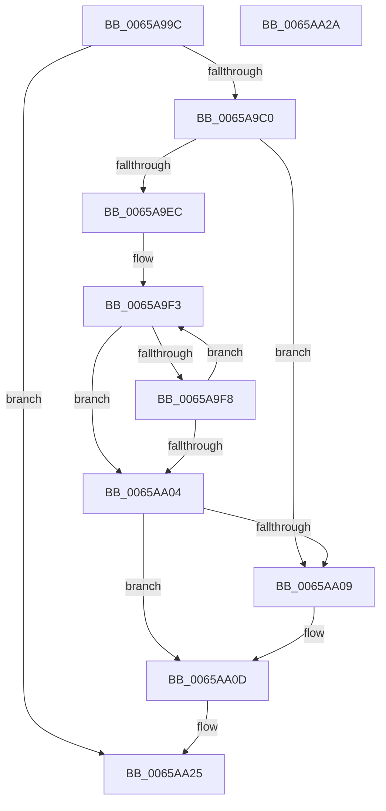

# ExpWorkQueueUpdateHealthMetricsOnRemove

- RVA: `0x0065A99C`–`0x0065AA2B` (길이 `143` bytes)
- VA: `0x000000014065A99C`
- 실행 섹션: `.text`
- PDB 이름 있음: `예`; PDB Function 태그: `아니요`
- unwind 정보 RVA: `0x0005C788`
- 디코드: `38`개 명령, `143/143` bytes 표시
- 미해석 바이트: `0` (있으면 어셈블리에 `.byte`로 보존)

> 이 문서는 커널 이미지의 기계어와 PDB 기호를 분석해 생성했습니다. 4번과 5번은 함수 원형과 자료형을 바이너리 사용 방식에서 추정한 C 해석이며 원본 소스 복구 결과는 아닙니다.

## 1. Dependencies

- 직접 호출 지점: **1**; 고유 호출 대상: **1**
- 직접 호출자로 확인된 함수: **1**
- RIP 상대 이미지 참조: **2**

### Outgoing calls
- `0x0065A9AA` → [ExpTypeToPriority](../35/ExpTypeToPriority_function_00358660.md) (function, `0x00358660`)

### Direct callers
- [ExpTryQueueWorkItem](../39/ExpTryQueueWorkItem_function_0039801C.md) at `0x00398162`

### Static image references
- `0x0065A9DE` → RVA `0x00E0EBDC` (`.data`; read)
- `0x0065A9EC` → RVA `0x00EFA910` (`.data`; read)

## 2. Other-region calls and transfers

- 다른 실행 섹션으로 향하는 call: **0**
- 별도 외부 분기/꼬리 이동을 확인하지 못했습니다.

## 3. Assembly (complete function range)

```asm
0065A99C  48 83 EC 28                     sub rsp, 0x28
0065A9A0  4C 8B 99 E8 02 00 00            mov r11, qword ptr [rcx + 0x2e8]
0065A9A7  8B 4A 54                        mov ecx, dword ptr [rdx + 0x54]
0065A9AA  E8 B1 DC CF FF                  call 0x140358660
0065A9AF  4C 63 D0                        movsxd r10, eax
0065A9B2  45 33 C9                        xor r9d, r9d
0065A9B5  F0 4B FF 4C D3 10               lock dec qword ptr [r11 + r10*8 + 0x10]
0065A9BB  45 84 C0                        test r8b, r8b
0065A9BE  75 65                           jne 0x14065aa25
0065A9C0  48 A1 08 00 00 00 80 F7 FF FF   movabs rax, qword ptr [0xfffff78000000008]
0065A9CA  48 8B C8                        mov rcx, rax
0065A9CD  48 B8 4B 59 86 38 D6 C5 6D 34   movabs rax, 0x346dc5d63886594b
0065A9D7  48 2B 4A 58                     sub rcx, qword ptr [rdx + 0x58]
0065A9DB  48 F7 E1                        mul rcx
0065A9DE  8B 05 F8 41 7B 00               mov eax, dword ptr [rip + 0x7b41f8]
0065A9E4  48 C1 EA 0B                     shr rdx, 0xb
0065A9E8  85 C0                           test eax, eax
0065A9EA  74 1D                           je 0x14065aa09
0065A9EC  48 8B 0D 1D FF 89 00            mov rcx, qword ptr [rip + 0x89ff1d]
0065A9F3  48 3B 11                        cmp rdx, qword ptr [rcx]
0065A9F6  72 0C                           jb 0x14065aa04
0065A9F8  41 FF C1                        inc r9d
0065A9FB  48 83 C1 08                     add rcx, 8
0065A9FF  44 3B C8                        cmp r9d, eax
0065AA02  72 EF                           jb 0x14065a9f3
0065AA04  44 3B C8                        cmp r9d, eax
0065AA07  72 04                           jb 0x14065aa0d
0065AA09  44 8D 48 FF                     lea r9d, [rax - 1]
0065AA0D  44 0F AF D0                     imul r10d, eax
0065AA11  49 8B 03                        mov rax, qword ptr [r11]
0065AA14  45 03 D1                        add r10d, r9d
0065AA17  4A 8B 0C D0                     mov rcx, qword ptr [rax + r10*8]
0065AA1B  49 8B 03                        mov rax, qword ptr [r11]
0065AA1E  48 FF C1                        inc rcx
0065AA21  4A 89 0C D0                     mov qword ptr [rax + r10*8], rcx
0065AA25  48 83 C4 28                     add rsp, 0x28
0065AA29  C3                              ret
0065AA2A  CC                              int3
```

## 4. C-style interpretation (structured pseudocode)

```c
__int64 __fastcall ExpWorkQueueUpdateHealthMetricsOnRemove(__int64 a1, __int64 a2, unsigned __int8 a3, int a4)
{
    __int64 result;
    __int64 v_r10;
    __int64 v_rsp;

    v_rsp = (v_rsp) - (40);
    result = ExpTypeToPriority((unsigned int)(*(unsigned int *)(a2 + 84)), a2, a3, a4);
    a4 = 0;
    if (a3 != 0) goto loc_0065AA25;
    a1 = (result) - (*(unsigned __int64 *)(a2 + 88));
    a2 = (a2) >> (11);
    if ((unsigned int)((unsigned int)(*(unsigned int *)(v_rip + 8077816))) == 0) goto loc_0065AA09;
loc_0065A9F3:
    if (a2 < (*(unsigned __int64 *)(*(unsigned __int64 *)(v_rip + 9043741)))) goto loc_0065AA04;
    a4 = (unsigned int)((a4) + 1);
    a1 = (*(unsigned __int64 *)(v_rip + 9043741)) + (8);
    if (a4 < ((unsigned int)((unsigned int)(*(unsigned int *)(v_rip + 8077816))))) goto loc_0065A9F3;
loc_0065AA04:
    if (a4 >= ((unsigned int)((unsigned int)(*(unsigned int *)(v_rip + 8077816))))) {
        a4 = (unsigned int)(*(unsigned int *)(v_rip + 8077816)) - 1;
    }
    v_r10 = (unsigned int)(((int)((unsigned int)(result))) * ((unsigned int)((unsigned int)(*(unsigned int *)(v_rip + 8077816)))));
    v_r10 = (unsigned int)((v_r10) + (a4));
    a1 = (*(unsigned __int64 *)(*(unsigned __int64 *)(*(unsigned __int64 *)(a1 + 744)) + v_r10 * 8)) + 1;
    *(unsigned __int64 *)(*(unsigned __int64 *)(*(unsigned __int64 *)(a1 + 744)) + v_r10 * 8) = a1;
loc_0065AA25:
    v_rsp = (v_rsp) + (40);
    return *(unsigned __int64 *)(*(unsigned __int64 *)(a1 + 744));
}
```

## 5. (Beta) C Style

```c
int64_t ExpWorkQueueUpdateHealthMetricsOnRemove(void *Arg1, void *Arg2, uint8_t Arg3, int32_t Arg4)
{
    uint8_t *arg1 = (uint8_t *)Arg1;
    uint8_t *arg2 = (uint8_t *)Arg2;

    int64_t result;
    int64_t local_r10;
    int64_t local_rsp;

    local_rsp = (local_rsp) - (40);
    result = ExpTypeToPriority((uint32_t)(*(uint32_t *)(arg2 + 0x54)), Arg2, Arg3, Arg4);
    Arg4 = 0;
    if (Arg3 != 0) goto loc_0065AA25;
    Arg1 = (result) - (*(uint64_t *)(arg2 + 0x58));
    Arg2 = (Arg2) >> (11);
    if ((uint32_t)((uint32_t)(*(uint32_t *)(v_rip + 0x7B41F8))) == 0) goto loc_0065AA09;
loc_0065A9F3:
    if (Arg2 < (*(uint64_t *)(*(uint64_t *)(v_rip + 0x89FF1D)))) goto loc_0065AA04;
    Arg4 = (uint32_t)((Arg4) + 1);
    Arg1 = (*(uint64_t *)(v_rip + 0x89FF1D)) + (8);
    if (Arg4 < ((uint32_t)((uint32_t)(*(uint32_t *)(v_rip + 0x7B41F8))))) goto loc_0065A9F3;
loc_0065AA04:
    if (Arg4 >= ((uint32_t)((uint32_t)(*(uint32_t *)(v_rip + 0x7B41F8))))) {
        Arg4 = (uint32_t)(*(uint32_t *)(v_rip + 0x7B41F8)) - 1;
    }
    local_r10 = (uint32_t)(((int32_t)((uint32_t)(result))) * ((uint32_t)((uint32_t)(*(uint32_t *)(v_rip + 0x7B41F8)))));
    local_r10 = (uint32_t)((local_r10) + (Arg4));
    Arg1 = (*(uint64_t *)(*(uint64_t *)(*(uint64_t *)(arg1 + 0x2E8)) + local_r10 * 8)) + 1;
    *(void **)(*(uint64_t *)(*(uint64_t *)(arg1 + 0x2E8)) + local_r10 * 8) = Arg1;
loc_0065AA25:
    local_rsp = (local_rsp) + (40);
    return *(uint64_t *)(*(uint64_t *)(arg1 + 0x2E8));
}
```

### 관측된 메모리 오프셋

구조체 형식이 확인되지 않은 접근은 인자 기준의 오프셋으로만 기록했습니다.

| 기준 인자 | 오프셋 표현 | 폭 (bit) | 접근 |
|---|---:|---:|---|
| `Arg1` | `+ 0x2E8` | `64` | `R` |
| `Arg2` | `+ 0x54` | `32` | `R` |

## 6. Execution-region graph

[열기: 2D/3D 그래프와 함수 탐색 컨트롤 패널](../../../control-panel.html?section=text&rva=0x0065A99C&view=graph)

- 2D 그래프는 위에서 아래로 흐르고, 3D 그래프는 빈 공간을 드래그해 회전합니다. Shift+드래그는 이동, 휠은 확대·축소, 함수 노드 선택은 대상 보고서 이동입니다.

### Static fallback


