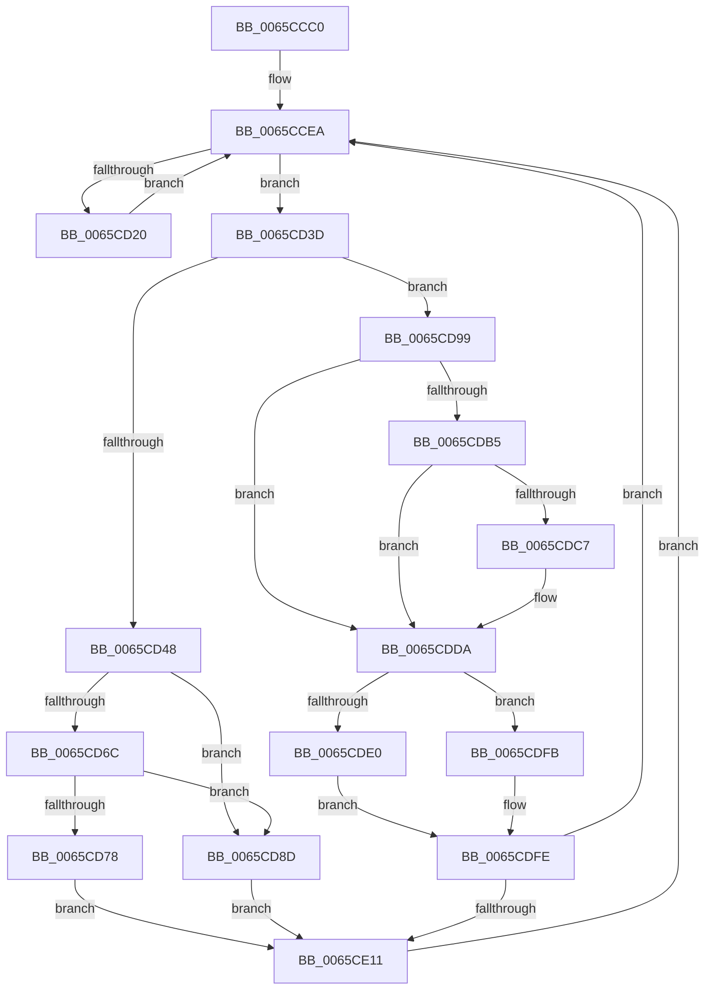

# ExpWorkerFactoryManagerThread

- RVA: `0x0065CCC0`–`0x0065CE23` (길이 `355` bytes)
- VA: `0x000000014065CCC0`
- 실행 섹션: `.text`
- PDB 이름 있음: `예`; PDB Function 태그: `아니요`
- unwind 정보 RVA: `0x000D58FC`
- 디코드: `82`개 명령, `355/355` bytes 표시
- 미해석 바이트: `0` (있으면 어셈블리에 `.byte`로 보존)

> 이 문서는 커널 이미지의 기계어와 PDB 기호를 분석해 생성했습니다. 4번과 5번은 함수 원형과 자료형을 바이너리 사용 방식에서 추정한 C 해석이며 원본 소스 복구 결과는 아닙니다.

## 1. Dependencies

- 직접 호출 지점: **12**; 고유 호출 대상: **9**
- 직접 호출자로 확인된 함수: **0**
- RIP 상대 이미지 참조: **3**

### Outgoing calls
- `0x0065CD11` → [KeRemoveQueueEx](../20/KeRemoveQueueEx_function_0020BD30.md) (function, `0x0020BD30`)
- `0x0065CD20` → [ExpWorkerFactoryDeferredThreadCreation](../49/ExpWorkerFactoryDeferredThreadCreation_function_0049F1A8.md) (function, `0x0049F1A8`)
- `0x0065CD36` → [KeRegisterObjectNotification](../39/KeRegisterObjectNotification_function_00393454.md) (function, `0x00393454`)
- `0x0065CD53` → [KeAcquireInStackQueuedSpinLock](../27/KeAcquireInStackQueuedSpinLock_function_002757A0.md) (function, `0x002757A0`)
- `0x0065CD6F` → [ExpTryEnterWorkerFactoryAwayMode](../39/ExpTryEnterWorkerFactoryAwayMode_function_003930B0.md) (function, `0x003930B0`)
- `0x0065CD83` → [ExpWorkerFactoryCheckCreate](../34/ExpWorkerFactoryCheckCreate_function_00344460.md) (function, `0x00344460`)
- `0x0065CD92` → [KeReleaseInStackQueuedSpinLock](../34/KeReleaseInStackQueuedSpinLock_function_00342CE0.md) (function, `0x00342CE0`)
- `0x0065CDA7` → [KeAcquireInStackQueuedSpinLock](../27/KeAcquireInStackQueuedSpinLock_function_002757A0.md) (function, `0x002757A0`)
- `0x0065CDD5` → [KeTimeOutQueueWaiters](../34/KeTimeOutQueueWaiters_function_0034FB58.md) (function, `0x0034FB58`)
- `0x0065CDF4` → [KeRegisterObjectNotification](../39/KeRegisterObjectNotification_function_00393454.md) (function, `0x00393454`)
- `0x0065CE03` → [KeReleaseInStackQueuedSpinLock](../34/KeReleaseInStackQueuedSpinLock_function_00342CE0.md) (function, `0x00342CE0`)
- `0x0065CE19` → [ObfDereferenceObjectWithTag](../2F/ObfDereferenceObjectWithTag_function_002F78E0.md) (function, `0x002F78E0`)

### Direct callers
- 이 함수 시작 RVA로 연결되는 직접 call은 확인되지 않았습니다. 간접 호출은 완전히 역산할 수 없습니다.

### Static image references
- `0x0065CCD8` → RVA `0x00EFA1E0` (`.data`; read)
- `0x0065CCFD` → RVA `0x00EFA1A0` (`.data`; read)
- `0x0065CD2F` → RVA `0x00EFA220` (`.data`; read)

## 2. Other-region calls and transfers

- 다른 실행 섹션으로 향하는 call: **0**
- 별도 외부 분기/꼬리 이동을 확인하지 못했습니다.

## 3. Assembly (complete function range)

```asm
0065CCC0  4C 8B DC                        mov r11, rsp
0065CCC3  49 89 5B 08                     mov qword ptr [r11 + 8], rbx
0065CCC7  49 89 73 18                     mov qword ptr [r11 + 0x18], rsi
0065CCCB  49 89 7B 20                     mov qword ptr [r11 + 0x20], rdi
0065CCCF  41 54                           push r12
0065CCD1  48 83 EC 50                     sub rsp, 0x50
0065CCD5  0F 57 C0                        xorps xmm0, xmm0
0065CCD8  4C 8D 25 01 D5 89 00            lea r12, [rip + 0x89d501]
0065CCDF  33 C0                           xor eax, eax
0065CCE1  0F 11 44 24 30                  movups xmmword ptr [rsp + 0x30], xmm0
0065CCE6  49 89 43 E8                     mov qword ptr [r11 - 0x18], rax
0065CCEA  48 83 64 24 68 00               and qword ptr [rsp + 0x68], 0
0065CCF0  48 8D 44 24 68                  lea rax, [rsp + 0x68]
0065CCF5  C7 44 24 28 01 00 00 00         mov dword ptr [rsp + 0x28], 1
0065CCFD  48 8D 0D 9C D4 89 00            lea rcx, [rip + 0x89d49c]
0065CD04  45 33 C9                        xor r9d, r9d
0065CD07  48 89 44 24 20                  mov qword ptr [rsp + 0x20], rax
0065CD0C  45 33 C0                        xor r8d, r8d
0065CD0F  33 D2                           xor edx, edx
0065CD11  E8 1A F0 BA FF                  call 0x14020bd30
0065CD16  48 8B 7C 24 68                  mov rdi, qword ptr [rsp + 0x68]
0065CD1B  49 3B FC                        cmp rdi, r12
0065CD1E  75 1D                           jne 0x14065cd3d
0065CD20  E8 83 24 E4 FF                  call 0x14049f1a8
0065CD25  4D 8B C4                        mov r8, r12
0065CD28  48 8D 15 71 D4 89 00            lea rdx, [rip + 0x89d471]
0065CD2F  48 8D 0D EA D4 89 00            lea rcx, [rip + 0x89d4ea]
0065CD36  E8 19 67 D3 FF                  call 0x140393454
0065CD3B  EB AD                           jmp 0x14065ccea
0065CD3D  83 7F 30 00                     cmp dword ptr [rdi + 0x30], 0
0065CD41  48 8D 54 24 30                  lea rdx, [rsp + 0x30]
0065CD46  75 51                           jne 0x14065cd99
0065CD48  48 8D 9F 98 FD FF FF            lea rbx, [rdi - 0x268]
0065CD4F  48 8B 4B 10                     mov rcx, qword ptr [rbx + 0x10]
0065CD53  E8 48 8A C1 FF                  call 0x1402757a0
0065CD58  0F BA B3 98 01 00 00 0A         btr dword ptr [rbx + 0x198], 0xa
0065CD60  F7 83 98 01 00 00 00 02 00 00   test dword ptr [rbx + 0x198], 0x200
0065CD6A  74 21                           je 0x14065cd8d
0065CD6C  48 8B CB                        mov rcx, rbx
0065CD6F  E8 3C 63 D3 FF                  call 0x1403930b0
0065CD74  84 C0                           test al, al
0065CD76  74 15                           je 0x14065cd8d
0065CD78  45 33 C0                        xor r8d, r8d
0065CD7B  48 8D 54 24 30                  lea rdx, [rsp + 0x30]
0065CD80  48 8B CB                        mov rcx, rbx
0065CD83  E8 D8 76 CE FF                  call 0x140344460
0065CD88  E9 84 00 00 00                  jmp 0x14065ce11
0065CD8D  48 8D 4C 24 30                  lea rcx, [rsp + 0x30]
0065CD92  E8 49 5F CE FF                  call 0x140342ce0
0065CD97  EB 78                           jmp 0x14065ce11
0065CD99  48 8D 9F D0 FD FF FF            lea rbx, [rdi - 0x230]
0065CDA0  48 8B 73 10                     mov rsi, qword ptr [rbx + 0x10]
0065CDA4  48 8B CE                        mov rcx, rsi
0065CDA7  E8 F4 89 C1 FF                  call 0x1402757a0
0065CDAC  83 BB 90 01 00 00 00            cmp dword ptr [rbx + 0x190], 0
0065CDB3  75 25                           jne 0x14065cdda
0065CDB5  44 8B 83 80 01 00 00            mov r8d, dword ptr [rbx + 0x180]
0065CDBC  8B 83 78 01 00 00               mov eax, dword ptr [rbx + 0x178]
0065CDC2  44 3B C0                        cmp r8d, eax
0065CDC5  76 13                           jbe 0x14065cdda
0065CDC7  48 8B 53 70                     mov rdx, qword ptr [rbx + 0x70]
0065CDCB  44 2B C0                        sub r8d, eax
0065CDCE  48 8B 4E 08                     mov rcx, qword ptr [rsi + 8]
0065CDD2  48 F7 DA                        neg rdx
0065CDD5  E8 7E 2D CF FF                  call 0x14034fb58
0065CDDA  80 7E 21 00                     cmp byte ptr [rsi + 0x21], 0
0065CDDE  75 1B                           jne 0x14065cdfb
0065CDE0  40 32 F6                        xor sil, sil
0065CDE3  48 8D 8B A8 01 00 00            lea rcx, [rbx + 0x1a8]
0065CDEA  4C 8B C7                        mov r8, rdi
0065CDED  48 8D 15 AC D3 89 00            lea rdx, [rip + 0x89d3ac]
0065CDF4  E8 5B 66 D3 FF                  call 0x140393454
0065CDF9  EB 03                           jmp 0x14065cdfe
0065CDFB  40 B6 01                        mov sil, 1
0065CDFE  48 8D 4C 24 30                  lea rcx, [rsp + 0x30]
0065CE03  E8 D8 5E CE FF                  call 0x140342ce0
0065CE08  40 84 F6                        test sil, sil
0065CE0B  0F 84 D9 FE FF FF               je 0x14065ccea
0065CE11  BA 44 66 6C 74                  mov edx, 0x746c6644
0065CE16  48 8B CB                        mov rcx, rbx
0065CE19  E8 C2 AA C9 FF                  call 0x1402f78e0
0065CE1E  E9 C7 FE FF FF                  jmp 0x14065ccea
```

## 4. C-style interpretation (structured pseudocode)

```c
__int64 __fastcall ExpWorkerFactoryManagerThread(__int64 a1, int a2, int a3, int a4)
{
    __int64 result;
    __int64 v_rsi;
    __int64 v_rsp;
    unsigned __int64 v_stack_m28;
    unsigned int v_stack_m30;
    unsigned __int64 v_stack_m38;
    unsigned __int64 v_stack_p10;

    *(unsigned __int64 *)(v_rsp + 8) = v_rbx;
    *(unsigned __int64 *)(v_rsp + 24) = v_rsi;
    *(unsigned __int64 *)(v_rsp + 32) = v_rdi;
    v_rsp = (v_rsp) - (80);
    result = 0;
    v_stack_m28 = v_xmm0;
    *(unsigned __int64 *)(v_rsp - 24) = 0;
loc_0065CCEA:
    v_stack_m30 = 1;
    a4 = 0;
    v_stack_m38 = v_stack_p10;
    a3 = 0;
    a2 = 0;
    result = KeRemoveQueueEx(v_rip + 9032860, a2, a3, a4);
    if (v_stack_p10 != (v_rip + 9032961)) goto loc_0065CD3D;
    result = ExpWorkerFactoryDeferredThreadCreation(v_rip + 9032860, a2, a3, a4);
    result = KeRegisterObjectNotification(v_rip + 9032938, v_rip + 9032817, v_rip + 9032961, a4);
    goto loc_0065CCEA;
loc_0065CD3D:
    if ((*(unsigned int *)(v_stack_p10 + 48)) != 0) goto loc_0065CD99;
    result = KeAcquireInStackQueuedSpinLock(*(unsigned __int64 *)(v_stack_p10 - 616 + 16), v_stack_m28, v_rip + 9032961, a4);
    if (((*(unsigned int *)(v_stack_p10 - 616 + 408)) & (512)) == 0) goto loc_0065CD8D;
    result = ExpTryEnterWorkerFactoryAwayMode(v_stack_p10 - 616, v_stack_m28, v_rip + 9032961, a4);
    if ((unsigned __int8)(result) == 0) goto loc_0065CD8D;
    a3 = 0;
    result = ExpWorkerFactoryCheckCreate(v_stack_p10 - 616, v_stack_m28, a3, a4);
    goto loc_0065CE11;
loc_0065CD8D:
    result = KeReleaseInStackQueuedSpinLock(v_stack_m28, v_stack_m28, a3, a4);
    goto loc_0065CE11;
loc_0065CD99:
    result = KeAcquireInStackQueuedSpinLock(*(unsigned __int64 *)(v_stack_p10 - 560 + 16), v_stack_m28, a3, a4);
    if ((*(unsigned int *)(v_stack_p10 - 560 + 400)) != 0) goto loc_0065CDDA;
    result = (unsigned int)(*(unsigned int *)(v_stack_p10 - 560 + 376));
    if (((unsigned int)((unsigned int)(*(unsigned int *)(v_stack_p10 - 560 + 384)))) >= = ((unsigned int)((unsigned int)(*(unsigned int *)(v_stack_p10 - 560 + 376))))) {
        a2 = *(unsigned __int64 *)(v_stack_p10 - 560 + 112);
        a3 = (unsigned int)(((unsigned int)(*(unsigned int *)(v_stack_p10 - 560 + 384))) - ((unsigned int)((unsigned int)(*(unsigned int *)(v_stack_p10 - 560 + 376)))));
        a1 = *(unsigned __int64 *)(*(unsigned __int64 *)(v_stack_p10 - 560 + 16) + 8);
        a2 = -(a2);
        result = KeTimeOutQueueWaiters(a1, a2, a3, a4);
    }
    if ((*(unsigned __int8 *)(*(unsigned __int64 *)(v_stack_p10 - 560 + 16) + 33)) != 0) goto loc_0065CDFB;
    v_rsi = 0;
    result = KeRegisterObjectNotification(v_stack_p10 - 560 + 424, v_rip + 9032620, v_stack_p10, a4);
    goto loc_0065CDFE;
loc_0065CDFB:
loc_0065CDFE:
    result = KeReleaseInStackQueuedSpinLock(v_stack_m28, v_rip + 9032620, v_stack_p10, a4);
    if (1 == 0) goto loc_0065CCEA;
loc_0065CE11:
    result = ObfDereferenceObjectWithTag(v_stack_p10 - 560, (unsigned int)(0x746C6644ULL), v_stack_p10, a4);
    goto loc_0065CCEA;
}
```

## 5. (Beta) C Style

```c
int64_t ExpWorkerFactoryManagerThread(int64_t Arg1, int32_t Arg2, int32_t Arg3, int32_t Arg4)
{
    int64_t result;
    int64_t local_rsi;
    int64_t local_rsp;
    uint64_t v_stack_m28;
    uint32_t v_stack_m30;
    uint64_t v_stack_m38;
    uint64_t v_stack_p10;

    *(uint64_t *)(local_rsp + 0x8) = local_rbx;
    *(uint64_t *)(local_rsp + 0x18) = local_rsi;
    *(uint64_t *)(local_rsp + 0x20) = local_rdi;
    local_rsp = (local_rsp) - (80);
    result = 0;
    v_stack_m28 = v_xmm0;
    *(uint64_t *)(local_rsp - 0x18) = 0;
loc_0065CCEA:
    v_stack_m30 = 1;
    Arg4 = 0;
    v_stack_m38 = v_stack_p10;
    Arg3 = 0;
    Arg2 = 0;
    result = KeRemoveQueueEx(v_rip + 9032860, Arg2, Arg3, Arg4);
    if (v_stack_p10 != (v_rip + 9032961)) goto loc_0065CD3D;
    result = ExpWorkerFactoryDeferredThreadCreation(v_rip + 9032860, Arg2, Arg3, Arg4);
    result = KeRegisterObjectNotification(v_rip + 9032938, v_rip + 9032817, v_rip + 9032961, Arg4);
    goto loc_0065CCEA;
loc_0065CD3D:
    if ((*(uint32_t *)(v_stack_p10 + 0x30)) != 0) goto loc_0065CD99;
    result = KeAcquireInStackQueuedSpinLock(*(uint64_t *)(v_stack_p10 - 0x268 + 0x10), v_stack_m28, v_rip + 9032961, Arg4);
    if (((*(uint32_t *)(v_stack_p10 - 0x268 + 0x198)) & (512)) == 0) goto loc_0065CD8D;
    result = ExpTryEnterWorkerFactoryAwayMode(v_stack_p10 - 616, v_stack_m28, v_rip + 9032961, Arg4);
    if ((uint8_t)(result) == 0) goto loc_0065CD8D;
    Arg3 = 0;
    result = ExpWorkerFactoryCheckCreate(v_stack_p10 - 616, v_stack_m28, Arg3, Arg4);
    goto loc_0065CE11;
loc_0065CD8D:
    result = KeReleaseInStackQueuedSpinLock(v_stack_m28, v_stack_m28, Arg3, Arg4);
    goto loc_0065CE11;
loc_0065CD99:
    result = KeAcquireInStackQueuedSpinLock(*(uint64_t *)(v_stack_p10 - 0x230 + 0x10), v_stack_m28, Arg3, Arg4);
    if ((*(uint32_t *)(v_stack_p10 - 0x230 + 0x190)) != 0) goto loc_0065CDDA;
    result = (uint32_t)(*(uint32_t *)(v_stack_p10 - 0x230 + 0x178));
    if (((uint32_t)((uint32_t)(*(uint32_t *)(v_stack_p10 - 0x230 + 0x180)))) >= = ((uint32_t)((uint32_t)(*(uint32_t *)(v_stack_p10 - 0x230 + 0x178))))) {
        Arg2 = *(uint64_t *)(v_stack_p10 - 0x230 + 0x70);
        Arg3 = (uint32_t)(((uint32_t)(*(uint32_t *)(v_stack_p10 - 0x230 + 0x180))) - ((uint32_t)((uint32_t)(*(uint32_t *)(v_stack_p10 - 0x230 + 0x178)))));
        Arg1 = *(uint64_t *)(*(uint64_t *)(v_stack_p10 - 0x230 + 0x10) + 0x8);
        Arg2 = -(Arg2);
        result = KeTimeOutQueueWaiters(Arg1, Arg2, Arg3, Arg4);
    }
    if ((*(uint8_t *)(*(uint64_t *)(v_stack_p10 - 0x230 + 0x10) + 0x21)) != 0) goto loc_0065CDFB;
    local_rsi = 0;
    result = KeRegisterObjectNotification(v_stack_p10 - 560 + 424, v_rip + 9032620, v_stack_p10, Arg4);
    goto loc_0065CDFE;
loc_0065CDFB:
loc_0065CDFE:
    result = KeReleaseInStackQueuedSpinLock(v_stack_m28, v_rip + 9032620, v_stack_p10, Arg4);
    if (1 == 0) goto loc_0065CCEA;
loc_0065CE11:
    result = ObfDereferenceObjectWithTag(v_stack_p10 - 560, (uint32_t)(0x746C6644ULL), v_stack_p10, Arg4);
    goto loc_0065CCEA;
}
```

## 6. Execution-region graph

[열기: 2D/3D 그래프와 함수 탐색 컨트롤 패널](../../../control-panel.html?section=text&rva=0x0065CCC0&view=graph)

- 2D 그래프는 위에서 아래로 흐르고, 3D 그래프는 빈 공간을 드래그해 회전합니다. Shift+드래그는 이동, 휠은 확대·축소, 함수 노드 선택은 대상 보고서 이동입니다.

### Static fallback


