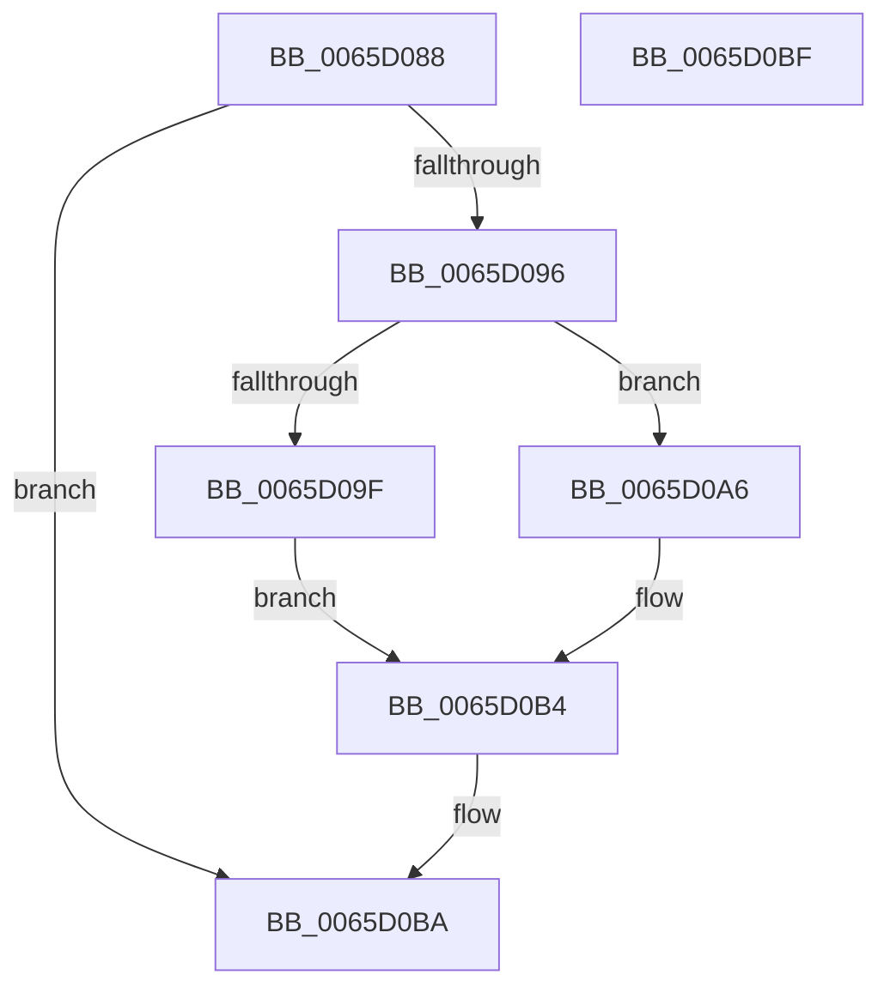

# GetGlobalizationUserModelType

- RVA: `0x0065D088`–`0x0065D0C0` (길이 `56` bytes)
- VA: `0x000000014065D088`
- 실행 섹션: `.text`
- PDB 이름 있음: `예`; PDB Function 태그: `아니요`
- unwind 정보 RVA: `0x0005C788`
- 디코드: `18`개 명령, `56/56` bytes 표시
- 미해석 바이트: `0` (있으면 어셈블리에 `.byte`로 보존)

> 이 문서는 커널 이미지의 기계어와 PDB 기호를 분석해 생성했습니다. 4번과 5번은 함수 원형과 자료형을 바이너리 사용 방식에서 추정한 C 해석이며 원본 소스 복구 결과는 아닙니다.

## 1. Dependencies

- 직접 호출 지점: **2**; 고유 호출 대상: **2**
- 직접 호출자로 확인된 함수: **1**
- RIP 상대 이미지 참조: **2**

### Outgoing calls
- `0x0065D096` → [RtlIsMultiSessionSku](../../page/A2/RtlIsMultiSessionSku_function_00A20730.md) (function, `0x00A20730`)
- `0x0065D0A6` → [RtlIsMultiUsersInSessionSku](../../page/78/RtlIsMultiUsersInSessionSku_function_0078E6C0.md) (function, `0x0078E6C0`)

### Direct callers
- [OpenGlobalizationUserSettingsKey](../4D/OpenGlobalizationUserSettingsKey_function_004D5B3C.md) at `0x004D5B54`

### Static image references
- `0x0065D08C` → RVA `0x00EEEFE4` (`.data`; read)
- `0x0065D0B4` → RVA `0x00EEEFE4` (`.data`; write)

## 2. Other-region calls and transfers

- 다른 실행 섹션으로 향하는 call: **2**
  - `0x0065D096` → [RtlIsMultiSessionSku](../../page/A2/RtlIsMultiSessionSku_function_00A20730.md) (`.text` → `PAGE`)
  - `0x0065D0A6` → [RtlIsMultiUsersInSessionSku](../../page/78/RtlIsMultiUsersInSessionSku_function_0078E6C0.md) (`.text` → `PAGE`)
- 별도 외부 분기/꼬리 이동을 확인하지 못했습니다.

## 3. Assembly (complete function range)

```asm
0065D088  48 83 EC 28                     sub rsp, 0x28
0065D08C  8B 05 52 1F 89 00               mov eax, dword ptr [rip + 0x891f52]
0065D092  85 C0                           test eax, eax
0065D094  75 24                           jne 0x14065d0ba
0065D096  E8 95 36 3C 00                  call 0x140a20730
0065D09B  84 C0                           test al, al
0065D09D  74 07                           je 0x14065d0a6
0065D09F  B8 01 00 00 00                  mov eax, 1
0065D0A4  EB 0E                           jmp 0x14065d0b4
0065D0A6  E8 15 16 13 00                  call 0x14078e6c0
0065D0AB  F6 D8                           neg al
0065D0AD  1B C0                           sbb eax, eax
0065D0AF  F7 D8                           neg eax
0065D0B1  83 C0 02                        add eax, 2
0065D0B4  89 05 2A 1F 89 00               mov dword ptr [rip + 0x891f2a], eax
0065D0BA  48 83 C4 28                     add rsp, 0x28
0065D0BE  C3                              ret
0065D0BF  CC                              int3
```

## 4. C-style interpretation (structured pseudocode)

```c
__int64 __fastcall GetGlobalizationUserModelType(void)
{
    __int64 result;
    __int64 v_rsp;

    v_rsp = (v_rsp) - (40);
    if ((unsigned int)((unsigned int)(*(unsigned int *)(v_rip + 8986450))) != 0) goto loc_0065D0BA;
    result = RtlIsMultiSessionSku(a1, a2, a3, a4);
    if ((unsigned __int8)(result) == 0) goto loc_0065D0A6;
    goto loc_0065D0B4;
loc_0065D0A6:
    result = RtlIsMultiUsersInSessionSku(a1, a2, a3, a4);
    result = (unsigned __int8)(-(result));
    result = (unsigned int)(-(result));
    result = (unsigned int)((result) + (2));
loc_0065D0B4:
    *(unsigned int *)(v_rip + 8986410) = (unsigned int)(result);
loc_0065D0BA:
    v_rsp = (v_rsp) + (40);
    return result;
}
```

## 5. (Beta) C Style

```c
void GetGlobalizationUserModelType(void)
{
    int64_t result;
    int64_t local_rsp;

    local_rsp = (local_rsp) - (40);
    if ((uint32_t)((uint32_t)(*(uint32_t *)(v_rip + 0x891F52))) != 0) goto loc_0065D0BA;
    result = RtlIsMultiSessionSku(a1, a2, a3, a4);
    if ((uint8_t)(result) == 0) goto loc_0065D0A6;
    goto loc_0065D0B4;
loc_0065D0A6:
    result = RtlIsMultiUsersInSessionSku(a1, a2, a3, a4);
    result = (uint8_t)(-(result));
    result = (uint32_t)(-(result));
    result = (uint32_t)((result) + (2));
loc_0065D0B4:
    *(uint32_t *)(v_rip + 0x891F2A) = (uint32_t)(result);
loc_0065D0BA:
    local_rsp = (local_rsp) + (40);
    return result;
}
```

## 6. Execution-region graph

[열기: 2D/3D 그래프와 함수 탐색 컨트롤 패널](../../../control-panel.html?section=text&rva=0x0065D088&view=graph)

- 2D 그래프는 위에서 아래로 흐르고, 3D 그래프는 빈 공간을 드래그해 회전합니다. Shift+드래그는 이동, 휠은 확대·축소, 함수 노드 선택은 대상 보고서 이동입니다.

### Static fallback


