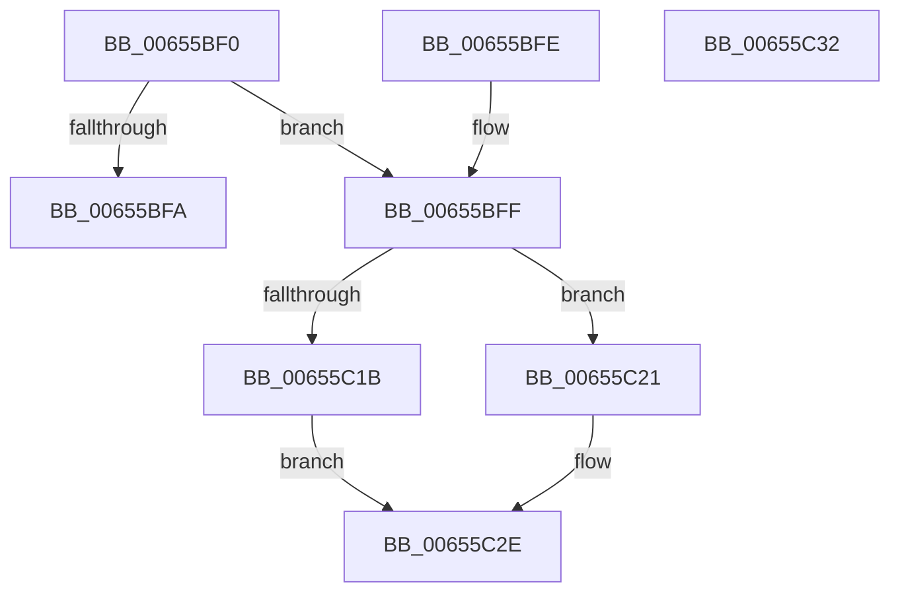

# HdlspUTF8Encode

- RVA: `0x00655BF0`–`0x00655C33` (길이 `67` bytes)
- VA: `0x0000000140655BF0`
- 실행 섹션: `.text`
- PDB 이름 있음: `예`; PDB Function 태그: `아니요`
- unwind 정보 RVA: `0x000DB714`
- 디코드: `26`개 명령, `67/67` bytes 표시
- 미해석 바이트: `0` (있으면 어셈블리에 `.byte`로 보존)

> 이 문서는 커널 이미지의 기계어와 PDB 기호를 분석해 생성했습니다. 4번과 5번은 함수 원형과 자료형을 바이너리 사용 방식에서 추정한 C 해석이며 원본 소스 복구 결과는 아닙니다.

## 1. Dependencies

- 직접 호출 지점: **0**; 고유 호출 대상: **0**
- 직접 호출자로 확인된 함수: **2**
- RIP 상대 이미지 참조: **0**

### Outgoing calls
- 직접 디코드된 call 명령이 없습니다.

### Direct callers
- [HdlspPutString](../../pagehdls/BB/HdlspPutString_function_00BBE2F0.md) at `0x00BBE40D`
- [HdlspPutWideString](../../pagehdls/BB/HdlspPutWideString_function_00BBE468.md) at `0x00BBE4C8`

### Static image references
- 디코드된 RIP-relative 메모리 참조가 없습니다.

## 2. Other-region calls and transfers

- 다른 실행 섹션으로 향하는 call: **0**
- 별도 외부 분기/꼬리 이동을 확인하지 못했습니다.

## 3. Assembly (complete function range)

```asm
00655BF0  B8 80 FF 00 00                  mov eax, 0xff80
00655BF5  66 85 C8                        test ax, cx
00655BF8  75 05                           jne 0x140655bff
00655BFA  88 4A 02                        mov byte ptr [rdx + 2], cl
00655BFD  C3                              ret
00655BFE  CC                              int3
00655BFF  8A C1                           mov al, cl
00655C01  41 B8 00 F8 00 00               mov r8d, 0xf800
00655C07  24 3F                           and al, 0x3f
00655C09  0C 80                           or al, 0x80
00655C0B  88 42 02                        mov byte ptr [rdx + 2], al
00655C0E  0F B7 C1                        movzx eax, cx
00655C11  66 C1 E8 06                     shr ax, 6
00655C15  66 41 85 C8                     test r8w, cx
00655C19  75 06                           jne 0x140655c21
00655C1B  24 1F                           and al, 0x1f
00655C1D  0C C0                           or al, 0xc0
00655C1F  EB 0D                           jmp 0x140655c2e
00655C21  24 3F                           and al, 0x3f
00655C23  66 C1 E9 0C                     shr cx, 0xc
00655C27  0C 80                           or al, 0x80
00655C29  80 C9 E0                        or cl, 0xe0
00655C2C  88 0A                           mov byte ptr [rdx], cl
00655C2E  88 42 01                        mov byte ptr [rdx + 1], al
00655C31  C3                              ret
00655C32  CC                              int3
```

## 4. C-style interpretation (structured pseudocode)

```c
__int64 __fastcall HdlspUTF8Encode(unsigned __int16 a1, __int64 a2)
{
    __int64 result;

    if ((((unsigned __int16)((unsigned int)(0xFF80ULL))) & (a1)) != 0) goto loc_00655BFF;
    *(unsigned __int8 *)(a2 + 2) = (unsigned __int8)(a1);
    return (unsigned int)(0xFF80ULL);
loc_00655BFF:
    result = (unsigned __int8)(((unsigned __int8)(a1)) & (63));
    result = (unsigned __int8)((result) | (128));
    *(unsigned __int8 *)(a2 + 2) = (unsigned __int8)(result);
    result = (unsigned __int16)((a1) >> (6));
    if ((((unsigned __int16)((unsigned int)(0xF800ULL))) & (a1)) != 0) goto loc_00655C21;
    result = (unsigned __int8)((result) & (31));
    result = (unsigned __int8)((result) | (192));
    goto loc_00655C2E;
loc_00655C21:
    result = (unsigned __int8)((result) & (63));
    a1 = (unsigned __int16)((a1) >> (12));
    result = (unsigned __int8)((result) | (128));
    a1 = (unsigned __int8)((a1) | (224));
    *(unsigned __int8 *)(a2) = (unsigned __int8)(a1);
loc_00655C2E:
    *(unsigned __int8 *)(a2 + 1) = (unsigned __int8)(result);
    return result;
}
```

## 5. (Beta) C Style

```c
int64_t HdlspUTF8Encode(uint16_t Arg1, void *Arg2)
{
    uint8_t *arg2 = (uint8_t *)Arg2;

    int64_t result;

    if ((((uint16_t)((uint32_t)(0xFF80ULL))) & (Arg1)) != 0) goto loc_00655BFF;
    *(uint8_t *)(arg2 + 0x2) = (uint8_t)(Arg1);
    return (uint32_t)(0xFF80ULL);
loc_00655BFF:
    result = (uint8_t)(((uint8_t)(Arg1)) & (63));
    result = (uint8_t)((result) | (128));
    *(uint8_t *)(arg2 + 0x2) = (uint8_t)(result);
    result = (uint16_t)((Arg1) >> (6));
    if ((((uint16_t)((uint32_t)(0xF800ULL))) & (Arg1)) != 0) goto loc_00655C21;
    result = (uint8_t)((result) & (31));
    result = (uint8_t)((result) | (192));
    goto loc_00655C2E;
loc_00655C21:
    result = (uint8_t)((result) & (63));
    Arg1 = (uint16_t)((Arg1) >> (12));
    result = (uint8_t)((result) | (128));
    Arg1 = (uint8_t)((Arg1) | (224));
    *(uint8_t *)(arg2) = (uint8_t)(Arg1);
loc_00655C2E:
    *(uint8_t *)(arg2 + 0x1) = (uint8_t)(result);
    return result;
}
```

### 관측된 메모리 오프셋

구조체 형식이 확인되지 않은 접근은 인자 기준의 오프셋으로만 기록했습니다.

| 기준 인자 | 오프셋 표현 | 폭 (bit) | 접근 |
|---|---:|---:|---|
| `Arg2` | `+ 0x0` | `8` | `W` |
| `Arg2` | `+ 0x1` | `8` | `W` |
| `Arg2` | `+ 0x2` | `8` | `W` |

## 6. Execution-region graph

[열기: 2D/3D 그래프와 함수 탐색 컨트롤 패널](../../../control-panel.html?section=text&rva=0x00655BF0&view=graph)

- 2D 그래프는 위에서 아래로 흐르고, 3D 그래프는 빈 공간을 드래그해 회전합니다. Shift+드래그는 이동, 휠은 확대·축소, 함수 노드 선택은 대상 보고서 이동입니다.

### Static fallback


