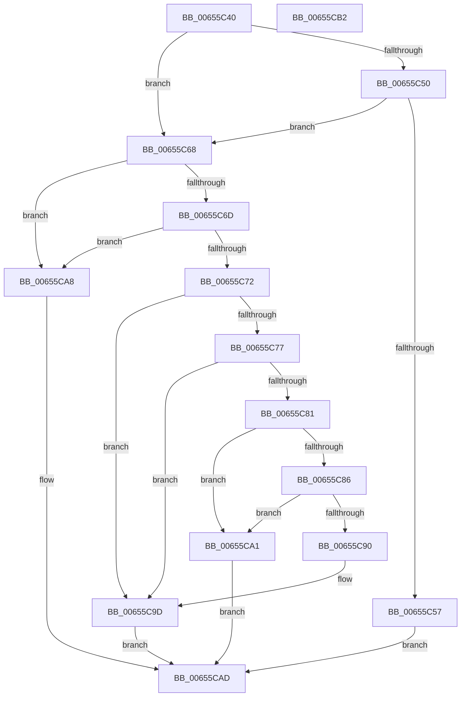

# HeadlessDispatch

- RVA: `0x00655C40`–`0x00655CB3` (길이 `115` bytes)
- VA: `0x0000000140655C40`
- 실행 섹션: `.text`
- PDB 이름 있음: `예`; PDB Function 태그: `아니요`
- unwind 정보 RVA: `0x0005D2F4`
- 디코드: `36`개 명령, `115/115` bytes 표시
- 미해석 바이트: `0` (있으면 어셈블리에 `.byte`로 보존)

> 이 문서는 커널 이미지의 기계어와 PDB 기호를 분석해 생성했습니다. 4번과 5번은 함수 원형과 자료형을 바이너리 사용 방식에서 추정한 C 해석이며 원본 소스 복구 결과는 아닙니다.

## 1. Dependencies

- 직접 호출 지점: **2**; 고유 호출 대상: **2**
- 직접 호출자로 확인된 함수: **8**
- RIP 상대 이미지 참조: **1**

### Outgoing calls
- `0x00655C61` → [HdlspDispatch](../../pagehdls/BB/HdlspDispatch_function_00BBD320.md) (function, `0x00BBD320`)
- `0x00655C98` → [memset](../6C/memset_function_006C6C40.md) (function, `0x006C6C40`)

### Direct callers
- [BgkDisplayStringEx](../59/BgkDisplayStringEx_function_00590C04.md) at `0x00590C56`
- [BvgaDisplayString](../59/BvgaDisplayString_function_00591490.md) at `0x005914E0`
- [BvgaSetTextColor](../59/BvgaSetTextColor_function_00591810.md) at `0x00591844`
- [BvgaSolidColorFill](../59/BvgaSolidColorFill_function_00591870.md) at `0x005918EF`
- [BvgaSolidColorFill](../59/BvgaSolidColorFill_function_00591870.md) at `0x00591905`
- [KiBugCheckDebugBreak](../5B/KiBugCheckDebugBreak_function_005B3DC0.md) at `0x005B3E0A`
- [KiBugCheckDebugBreak](../5B/KiBugCheckDebugBreak_function_005B3DC0.md) at `0x005B3E38`
- [KiBugCheckDebugBreak](../5B/KiBugCheckDebugBreak_function_005B3DC0.md) at `0x005B3E5F`
- [KiDisplayBlueScreen](../5B/KiDisplayBlueScreen_function_005B494C.md) at `0x005B49CA`
- [KiDisplayBlueScreen](../5B/KiDisplayBlueScreen_function_005B494C.md) at `0x005B49E1`
- [KiDisplayBlueScreen](../5B/KiDisplayBlueScreen_function_005B494C.md) at `0x005B49FE`
- [KiHeadlessDisplayString](../5B/KiHeadlessDisplayString_function_005B4F54.md) at `0x005B4F75`
- [EtwpInitializeActivityIdSeed](../../page/7B/EtwpInitializeActivityIdSeed_function_007B69A4.md) at `0x007B69F4`

### Static image references
- `0x00655C44` → RVA `0x00E68578` (`.data`; read)

## 2. Other-region calls and transfers

- 다른 실행 섹션으로 향하는 call: **1**
  - `0x00655C61` → [HdlspDispatch](../../pagehdls/BB/HdlspDispatch_function_00BBD320.md) (`.text` → `PAGEHDLS`)
- 별도 외부 분기/꼬리 이동을 확인하지 못했습니다.

## 3. Assembly (complete function range)

```asm
00655C40  48 83 EC 38                     sub rsp, 0x38
00655C44  48 8B 05 2D 29 81 00            mov rax, qword ptr [rip + 0x81292d]
00655C4B  48 85 C0                        test rax, rax
00655C4E  74 18                           je 0x140655c68
00655C50  48 83 78 08 00                  cmp qword ptr [rax + 8], 0
00655C55  74 11                           je 0x140655c68
00655C57  48 8B 44 24 60                  mov rax, qword ptr [rsp + 0x60]
00655C5C  48 89 44 24 20                  mov qword ptr [rsp + 0x20], rax
00655C61  E8 BA 76 56 00                  call 0x140bbd320
00655C66  EB 45                           jmp 0x140655cad
00655C68  83 F9 01                        cmp ecx, 1
00655C6B  74 3B                           je 0x140655ca8
00655C6D  83 F9 15                        cmp ecx, 0x15
00655C70  74 36                           je 0x140655ca8
00655C72  83 F9 10                        cmp ecx, 0x10
00655C75  77 26                           ja 0x140655c9d
00655C77  B8 04 38 01 00                  mov eax, 0x13804
00655C7C  0F A3 C8                        bt eax, ecx
00655C7F  73 1C                           jae 0x140655c9d
00655C81  4D 85 C9                        test r9, r9
00655C84  74 1B                           je 0x140655ca1
00655C86  4C 8B 44 24 60                  mov r8, qword ptr [rsp + 0x60]
00655C8B  4D 85 C0                        test r8, r8
00655C8E  74 11                           je 0x140655ca1
00655C90  4D 8B 00                        mov r8, qword ptr [r8]
00655C93  33 D2                           xor edx, edx
00655C95  49 8B C9                        mov rcx, r9
00655C98  E8 A3 0F 07 00                  call 0x1406c6c40
00655C9D  33 C0                           xor eax, eax
00655C9F  EB 0C                           jmp 0x140655cad
00655CA1  B8 0D 00 00 C0                  mov eax, 0xc000000d
00655CA6  EB 05                           jmp 0x140655cad
00655CA8  B8 01 00 00 C0                  mov eax, 0xc0000001
00655CAD  48 83 C4 38                     add rsp, 0x38
00655CB1  C3                              ret
00655CB2  CC                              int3
```

## 4. C-style interpretation (structured pseudocode)

```c
__int64 __fastcall HeadlessDispatch(int a1, int a2, __int64 a3, __int64 a4, __int64 a5)
{
    __int64 result;
    __int64 v_rsp;
    unsigned __int64 v_stack_m18;

    v_rsp = (v_rsp) - (56);
    if (*(unsigned __int64 *)(v_rip + 8464685) == 0) goto loc_00655C68;
    if ((*(unsigned __int64 *)(*(unsigned __int64 *)(v_rip + 8464685) + 8)) == 0) goto loc_00655C68;
    v_stack_m18 = a5;
    result = HdlspDispatch(a1, a2, a3, a4);
    goto loc_00655CAD;
loc_00655C68:
    if (a1 == 1) goto loc_00655CA8;
    if (a1 == 21) goto loc_00655CA8;
    if (a1 > 16) goto loc_00655C9D;
    if (a1 >= 16) goto loc_00655C9D;
    if (a4 == 0) goto loc_00655CA1;
    if (a5 == 0) goto loc_00655CA1;
    a2 = 0;
    result = memset(a4, a2, *(unsigned __int64 *)(a5), a4);
loc_00655C9D:
    result = 0;
    goto loc_00655CAD;
loc_00655CA1:
    goto loc_00655CAD;
loc_00655CA8:
loc_00655CAD:
    v_rsp = (v_rsp) + (56);
    return (unsigned int)(0xC0000001ULL);
}
```

## 5. (Beta) C Style

```c
int64_t HeadlessDispatch(int32_t Arg1, int32_t Arg2, int64_t Arg3, int64_t Arg4, int64_t Arg5)
{
    int64_t result;
    int64_t local_rsp;
    uint64_t v_stack_m18;

    local_rsp = (local_rsp) - (56);
    if (*(uint64_t *)(v_rip + 0x81292D) == 0) goto loc_00655C68;
    if ((*(uint64_t *)(*(uint64_t *)(v_rip + 0x81292D) + 0x8)) == 0) goto loc_00655C68;
    v_stack_m18 = Arg5;
    result = HdlspDispatch(Arg1, Arg2, Arg3, Arg4);
    goto loc_00655CAD;
loc_00655C68:
    if (Arg1 == 1) goto loc_00655CA8;
    if (Arg1 == 21) goto loc_00655CA8;
    if (Arg1 > 16) goto loc_00655C9D;
    if (Arg1 >= 16) goto loc_00655C9D;
    if (Arg4 == 0) goto loc_00655CA1;
    if (Arg5 == 0) goto loc_00655CA1;
    Arg2 = 0;
    result = memset(Arg4, Arg2, *(uint64_t *)(Arg5), Arg4);
loc_00655C9D:
    result = 0;
    goto loc_00655CAD;
loc_00655CA1:
    goto loc_00655CAD;
loc_00655CA8:
loc_00655CAD:
    local_rsp = (local_rsp) + (56);
    return (uint32_t)(0xC0000001ULL);
}
```

## 6. Execution-region graph

[열기: 2D/3D 그래프와 함수 탐색 컨트롤 패널](../../../control-panel.html?section=text&rva=0x00655C40&view=graph)

- 2D 그래프는 위에서 아래로 흐르고, 3D 그래프는 빈 공간을 드래그해 회전합니다. Shift+드래그는 이동, 휠은 확대·축소, 함수 노드 선택은 대상 보고서 이동입니다.

### Static fallback


