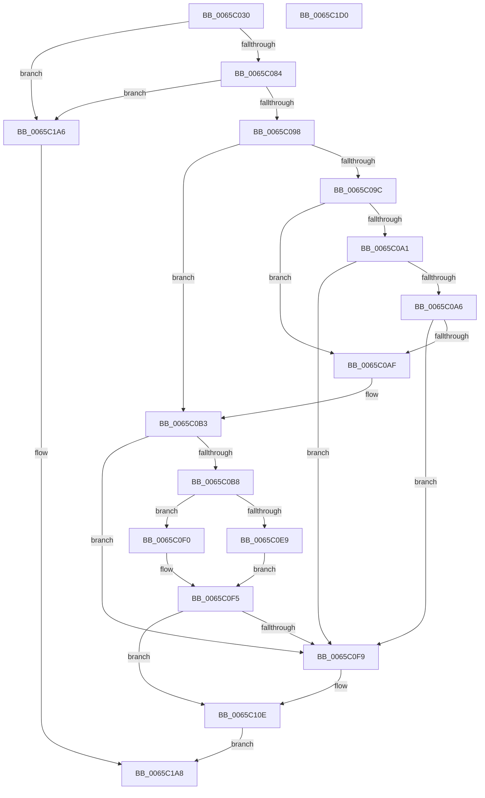

# KitLogFeatureUsage

- RVA: `0x0065C030`–`0x0065C1D1` (길이 `417` bytes)
- VA: `0x000000014065C030`
- 실행 섹션: `.text`
- PDB 이름 있음: `예`; PDB Function 태그: `아니요`
- unwind 정보 RVA: `0x000D56F8`
- 디코드: `99`개 명령, `417/417` bytes 표시
- 미해석 바이트: `0` (있으면 어셈블리에 `.byte`로 보존)

> 이 문서는 커널 이미지의 기계어와 PDB 기호를 분석해 생성했습니다. 4번과 5번은 함수 원형과 자료형을 바이너리 사용 방식에서 추정한 C 해석이며 원본 소스 복구 결과는 아닙니다.

## 1. Dependencies

- 직접 호출 지점: **6**; 고유 호출 대상: **6**
- 직접 호출자로 확인된 함수: **0**
- RIP 상대 이미지 참조: **4**

### Outgoing calls
- `0x0065C08B` → [EtwEventEnabled](../39/EtwEventEnabled_function_00392450.md) (function, `0x00392450`)
- `0x0065C0C6` → [memset](../6C/memset_function_006C6C40.md) (function, `0x006C6C40`)
- `0x0065C0E9` → [RtlPcToFilePath](../../page/A2/RtlPcToFilePath_function_00A2B9A0.md) (function, `0x00A2B9A0`)
- `0x0065C0F0` → [RtlPcToFileName](../3F/RtlPcToFileName_function_003FEBB0.md) (function, `0x003FEBB0`)
- `0x0065C19F` → [EtwWriteEx](../25/EtwWriteEx_function_0025F0D0.md) (function, `0x0025F0D0`)
- `0x0065C1B2` → [_security_check_cookie](../6A/_security_check_cookie_function_006AC640.md) (function, `0x006AC640`)

### Direct callers
- 이 함수 시작 RVA로 연결되는 직접 call은 확인되지 않았습니다. 간접 호출은 완전히 역산할 수 없습니다.

### Static image references
- `0x0065C04E` → RVA `0x00E0A740` (`.data`; read)
- `0x0065C065` → RVA `0x00E685E0` (`.data`; read)
- `0x0065C084` → RVA `0x00022708` (`.rdata`; read)
- `0x0065C0F9` → RVA `0x0000BDC0` (`.rdata`; read)

## 2. Other-region calls and transfers

- 다른 실행 섹션으로 향하는 call: **1**
  - `0x0065C0E9` → [RtlPcToFilePath](../../page/A2/RtlPcToFilePath_function_00A2B9A0.md) (`.text` → `PAGE`)
- 별도 외부 분기/꼬리 이동을 확인하지 못했습니다.

## 3. Assembly (complete function range)

```asm
0065C030  48 8B C4                        mov rax, rsp
0065C033  48 89 58 08                     mov qword ptr [rax + 8], rbx
0065C037  48 89 70 18                     mov qword ptr [rax + 0x18], rsi
0065C03B  48 89 78 20                     mov qword ptr [rax + 0x20], rdi
0065C03F  55                              push rbp
0065C040  48 8D A8 48 FE FF FF            lea rbp, [rax - 0x1b8]
0065C047  48 81 EC B0 02 00 00            sub rsp, 0x2b0
0065C04E  48 8B 05 EB E6 7A 00            mov rax, qword ptr [rip + 0x7ae6eb]
0065C055  48 33 C4                        xor rax, rsp
0065C058  48 89 85 A0 01 00 00            mov qword ptr [rbp + 0x1a0], rax
0065C05F  48 8B F1                        mov rsi, rcx
0065C062  41 8B D8                        mov ebx, r8d
0065C065  48 8B 0D 74 C5 80 00            mov rcx, qword ptr [rip + 0x80c574]
0065C06C  0F 57 C0                        xorps xmm0, xmm0
0065C06F  89 5C 24 44                     mov dword ptr [rsp + 0x44], ebx
0065C073  48 8B FA                        mov rdi, rdx
0065C076  0F 11 44 24 48                  movups xmmword ptr [rsp + 0x48], xmm0
0065C07B  48 85 C9                        test rcx, rcx
0065C07E  0F 84 22 01 00 00               je 0x14065c1a6
0065C084  48 8D 15 7D 66 9C FF            lea rdx, [rip - 0x639983]
0065C08B  E8 C0 63 D3 FF                  call 0x140392450
0065C090  84 C0                           test al, al
0065C092  0F 84 0E 01 00 00               je 0x14065c1a6
0065C098  85 DB                           test ebx, ebx
0065C09A  74 17                           je 0x14065c0b3
0065C09C  83 EB 01                        sub ebx, 1
0065C09F  74 0E                           je 0x14065c0af
0065C0A1  83 FB 01                        cmp ebx, 1
0065C0A4  75 53                           jne 0x14065c0f9
0065C0A6  48 8B 7F 08                     mov rdi, qword ptr [rdi + 8]
0065C0AA  48 85 FF                        test rdi, rdi
0065C0AD  74 4A                           je 0x14065c0f9
0065C0AF  48 8B 7F 18                     mov rdi, qword ptr [rdi + 0x18]
0065C0B3  48 85 FF                        test rdi, rdi
0065C0B6  74 41                           je 0x14065c0f9
0065C0B8  BB FE 01 00 00                  mov ebx, 0x1fe
0065C0BD  48 8D 4D A0                     lea rcx, [rbp - 0x60]
0065C0C1  44 8B C3                        mov r8d, ebx
0065C0C4  33 D2                           xor edx, edx
0065C0C6  E8 75 AB 06 00                  call 0x1406c6c40
0065C0CB  48 8D 45 A0                     lea rax, [rbp - 0x60]
0065C0CF  66 89 5C 24 4A                  mov word ptr [rsp + 0x4a], bx
0065C0D4  48 89 44 24 50                  mov qword ptr [rsp + 0x50], rax
0065C0D9  44 0F 20 C0                     mov rax, cr8
0065C0DD  48 8D 54 24 48                  lea rdx, [rsp + 0x48]
0065C0E2  48 8B CF                        mov rcx, rdi
0065C0E5  3C 01                           cmp al, 1
0065C0E7  77 07                           ja 0x14065c0f0
0065C0E9  E8 B2 F8 3C 00                  call 0x140a2b9a0
0065C0EE  EB 05                           jmp 0x14065c0f5
0065C0F0  E8 BB 2A DA FF                  call 0x1403febb0
0065C0F5  85 C0                           test eax, eax
0065C0F7  79 15                           jns 0x14065c10e
0065C0F9  0F 10 05 C0 FC 9A FF            movups xmm0, xmmword ptr [rip - 0x650340]
0065C100  C7 44 24 44 03 00 00 00         mov dword ptr [rsp + 0x44], 3
0065C108  F3 0F 7F 44 24 48               movdqu xmmword ptr [rsp + 0x48], xmm0
0065C10E  83 64 24 6C 00                  and dword ptr [rsp + 0x6c], 0
0065C113  48 8D 44 24 44                  lea rax, [rsp + 0x44]
0065C118  83 64 24 7C 00                  and dword ptr [rsp + 0x7c], 0
0065C11D  48 8D 15 E4 65 9C FF            lea rdx, [rip - 0x639a1c]
0065C124  83 65 8C 00                     and dword ptr [rbp - 0x74], 0
0065C128  41 B8 04 00 00 00               mov r8d, 4
0065C12E  83 65 9C 00                     and dword ptr [rbp - 0x64], 0
0065C132  45 33 C9                        xor r9d, r9d
0065C135  48 8B 0D A4 C4 80 00            mov rcx, qword ptr [rip + 0x80c4a4]
0065C13C  48 89 44 24 70                  mov qword ptr [rsp + 0x70], rax
0065C141  0F B7 44 24 48                  movzx eax, word ptr [rsp + 0x48]
0065C146  66 D1 E8                        shr ax, 1
0065C149  66 89 44 24 40                  mov word ptr [rsp + 0x40], ax
0065C14E  48 8D 44 24 40                  lea rax, [rsp + 0x40]
0065C153  48 89 45 80                     mov qword ptr [rbp - 0x80], rax
0065C157  48 8B 44 24 50                  mov rax, qword ptr [rsp + 0x50]
0065C15C  48 89 45 90                     mov qword ptr [rbp - 0x70], rax
0065C160  0F B7 44 24 48                  movzx eax, word ptr [rsp + 0x48]
0065C165  89 45 98                        mov dword ptr [rbp - 0x68], eax
0065C168  48 8D 44 24 60                  lea rax, [rsp + 0x60]
0065C16D  48 89 44 24 38                  mov qword ptr [rsp + 0x38], rax
0065C172  44 89 44 24 30                  mov dword ptr [rsp + 0x30], r8d
0065C177  48 83 64 24 28 00               and qword ptr [rsp + 0x28], 0
0065C17D  48 83 64 24 20 00               and qword ptr [rsp + 0x20], 0
0065C183  44 89 44 24 78                  mov dword ptr [rsp + 0x78], r8d
0065C188  45 33 C0                        xor r8d, r8d
0065C18B  48 89 74 24 60                  mov qword ptr [rsp + 0x60], rsi
0065C190  C7 44 24 68 10 00 00 00         mov dword ptr [rsp + 0x68], 0x10
0065C198  C7 45 88 02 00 00 00            mov dword ptr [rbp - 0x78], 2
0065C19F  E8 2C 2F C0 FF                  call 0x14025f0d0
0065C1A4  EB 02                           jmp 0x14065c1a8
0065C1A6  33 C0                           xor eax, eax
0065C1A8  48 8B 8D A0 01 00 00            mov rcx, qword ptr [rbp + 0x1a0]
0065C1AF  48 33 CC                        xor rcx, rsp
0065C1B2  E8 89 04 05 00                  call 0x1406ac640
0065C1B7  4C 8D 9C 24 B0 02 00 00         lea r11, [rsp + 0x2b0]
0065C1BF  49 8B 5B 10                     mov rbx, qword ptr [r11 + 0x10]
0065C1C3  49 8B 73 20                     mov rsi, qword ptr [r11 + 0x20]
0065C1C7  49 8B 7B 28                     mov rdi, qword ptr [r11 + 0x28]
0065C1CB  49 8B E3                        mov rsp, r11
0065C1CE  5D                              pop rbp
0065C1CF  C3                              ret
0065C1D0  CC                              int3
```

## 4. C-style interpretation (structured pseudocode)

```c
__int64 __fastcall KitLogFeatureUsage(__int64 a1, __int64 a2, int a3, int a4)
{
    __int64 result;
    __int64 v_rbx;
    __int64 v_rsp;
    unsigned int v_stack_m23C;
    unsigned int v_stack_m240;
    unsigned __int64 v_stack_m248;
    unsigned int v_stack_m24C;
    unsigned int v_stack_m250;
    unsigned __int64 v_stack_m258;
    unsigned __int64 v_stack_m268;
    unsigned __int16 v_stack_m26E;
    unsigned __int64 v_stack_m270;
    unsigned int v_stack_m274;
    unsigned __int16 v_stack_m278;
    unsigned __int64 v_stack_m280;
    unsigned int v_stack_m288;
    unsigned __int64 v_stack_m290;
    unsigned __int64 v_stack_m298;
    unsigned __int64 v_stack_m8;

    *(unsigned __int64 *)(v_rsp + 8) = v_rbx;
    *(unsigned __int64 *)(v_rsp + 24) = v_rsi;
    *(unsigned __int64 *)(v_rsp + 32) = v_rdi;
    v_rsp = (v_rsp) - (688);
    result = (*(unsigned __int64 *)(v_rip + 8054507)) ^ (v_rsp);
    *(unsigned __int64 *)(v_rsp - 440 + 416) = result;
    v_stack_m274 = (unsigned int)((unsigned int)(a3));
    v_stack_m270 = v_xmm0;
    if (*(unsigned __int64 *)(v_rip + 8439156) == 0) goto loc_0065C1A6;
    result = EtwEventEnabled(*(unsigned __int64 *)(v_rip + 8439156), v_rip - 6527363, a3, a4);
    if ((unsigned __int8)(result) == 0) goto loc_0065C1A6;
    if ((unsigned int)((unsigned int)(a3)) == 0) goto loc_0065C0B3;
    v_rbx = (unsigned int)(((unsigned int)(a3)) - (1));
    if (condition_is_equal) goto loc_0065C0AF;
    if (((unsigned int)(v_rbx)) != 1) goto loc_0065C0F9;
    if (*(unsigned __int64 *)(a2 + 8) == 0) goto loc_0065C0F9;
loc_0065C0AF:
loc_0065C0B3:
    if (*(unsigned __int64 *)(*(unsigned __int64 *)(a2 + 8) + 24) == 0) goto loc_0065C0F9;
    a2 = 0;
    result = memset(v_rsp - 440 - 96, a2, 510, a4);
    v_stack_m26E = 510;
    v_stack_m268 = v_rsp - 440 - 96;
    if (((unsigned __int8)(v_cr8)) > 1) goto loc_0065C0F0;
    result = RtlPcToFilePath(*(unsigned __int64 *)(*(unsigned __int64 *)(a2 + 8) + 24), v_stack_m270, 510, a4);
    goto loc_0065C0F5;
loc_0065C0F0:
    result = RtlPcToFileName(*(unsigned __int64 *)(*(unsigned __int64 *)(a2 + 8) + 24), v_stack_m270, 510, a4);
loc_0065C0F5:
    if (sign_flag) {
        v_stack_m274 = 3;
        v_stack_m270 = v_xmm0;
    }
    a4 = 0;
    v_stack_m248 = v_stack_m274;
    result = (unsigned __int16)((v_stack_m270) >> (1));
    v_stack_m278 = (unsigned __int16)(result);
    *(unsigned __int64 *)(v_rsp - 440 - 128) = v_stack_m278;
    *(unsigned __int64 *)(v_rsp - 440 - 112) = v_stack_m268;
    *(unsigned int *)(v_rsp - 440 - 104) = (unsigned int)(v_stack_m270);
    v_stack_m280 = v_stack_m258;
    v_stack_m288 = 4;
    v_stack_m240 = 4;
    a3 = 0;
    v_stack_m258 = a1;
    v_stack_m250 = 16;
    *(unsigned int *)(v_rsp - 440 - 120) = 2;
    result = EtwWriteEx(*(unsigned __int64 *)(v_rip + 8438948), v_rip - 6527516, a3, a4);
    goto loc_0065C1A8;
loc_0065C1A6:
    result = 0;
loc_0065C1A8:
    a1 = (*(unsigned __int64 *)(v_rsp - 440 + 416)) ^ (v_rsp);
    result = _security_check_cookie(a1, v_rip - 6527516, a3, a4);
    return result;
}
```

## 5. (Beta) C Style

```c
int64_t KitLogFeatureUsage(int64_t Arg1, void *Arg2, int32_t Arg3, int32_t Arg4)
{
    uint8_t *arg2 = (uint8_t *)Arg2;

    int64_t result;
    int64_t local_rbx;
    int64_t local_rsp;
    uint32_t v_stack_m23C;
    uint32_t v_stack_m240;
    uint64_t v_stack_m248;
    uint32_t v_stack_m24C;
    uint32_t v_stack_m250;
    uint64_t v_stack_m258;
    uint64_t v_stack_m268;
    uint16_t v_stack_m26E;
    uint64_t v_stack_m270;
    uint32_t v_stack_m274;
    uint16_t v_stack_m278;
    uint64_t v_stack_m280;
    uint32_t v_stack_m288;
    uint64_t v_stack_m290;
    uint64_t v_stack_m298;
    uint64_t v_stack_m8;

    *(uint64_t *)(local_rsp + 0x8) = local_rbx;
    *(uint64_t *)(local_rsp + 0x18) = local_rsi;
    *(uint64_t *)(local_rsp + 0x20) = local_rdi;
    local_rsp = (local_rsp) - (688);
    result = (*(uint64_t *)(v_rip + 0x7AE6EB)) ^ (local_rsp);
    *(uint64_t *)(local_rsp - 0x1B8 + 0x1A0) = result;
    v_stack_m274 = (uint32_t)((uint32_t)(Arg3));
    v_stack_m270 = v_xmm0;
    if (*(uint64_t *)(v_rip + 0x80C574) == 0) goto loc_0065C1A6;
    result = EtwEventEnabled(*(uint64_t *)(v_rip + 0x80C574), v_rip - 6527363, Arg3, Arg4);
    if ((uint8_t)(result) == 0) goto loc_0065C1A6;
    if ((uint32_t)((uint32_t)(Arg3)) == 0) goto loc_0065C0B3;
    local_rbx = (uint32_t)(((uint32_t)(Arg3)) - (1));
    if (condition_is_equal) goto loc_0065C0AF;
    if (((uint32_t)(local_rbx)) != 1) goto loc_0065C0F9;
    if (*(uint64_t *)(arg2 + 0x8) == 0) goto loc_0065C0F9;
loc_0065C0AF:
loc_0065C0B3:
    if (*(uint64_t *)(*(uint64_t *)(arg2 + 0x8) + 0x18) == 0) goto loc_0065C0F9;
    Arg2 = 0;
    result = memset(local_rsp - 440 - 96, Arg2, 510, Arg4);
    v_stack_m26E = 510;
    v_stack_m268 = local_rsp - 440 - 96;
    if (((uint8_t)(v_cr8)) > 1) goto loc_0065C0F0;
    result = RtlPcToFilePath(*(uint64_t *)(*(uint64_t *)(arg2 + 0x8) + 0x18), v_stack_m270, 510, Arg4);
    goto loc_0065C0F5;
loc_0065C0F0:
    result = RtlPcToFileName(*(uint64_t *)(*(uint64_t *)(arg2 + 0x8) + 0x18), v_stack_m270, 510, Arg4);
loc_0065C0F5:
    if (sign_flag) {
        v_stack_m274 = 3;
        v_stack_m270 = v_xmm0;
    }
    Arg4 = 0;
    v_stack_m248 = v_stack_m274;
    result = (uint16_t)((v_stack_m270) >> (1));
    v_stack_m278 = (uint16_t)(result);
    *(uint64_t *)(local_rsp - 0x1B8 - 0x80) = v_stack_m278;
    *(uint64_t *)(local_rsp - 0x1B8 - 0x70) = v_stack_m268;
    *(uint32_t *)(local_rsp - 0x1B8 - 0x68) = (uint32_t)(v_stack_m270);
    v_stack_m280 = v_stack_m258;
    v_stack_m288 = 4;
    v_stack_m240 = 4;
    Arg3 = 0;
    v_stack_m258 = Arg1;
    v_stack_m250 = 16;
    *(uint32_t *)(local_rsp - 0x1B8 - 0x78) = 2;
    result = EtwWriteEx(*(uint64_t *)(v_rip + 0x80C4A4), v_rip - 6527516, Arg3, Arg4);
    goto loc_0065C1A8;
loc_0065C1A6:
    result = 0;
loc_0065C1A8:
    Arg1 = (*(uint64_t *)(local_rsp - 0x1B8 + 0x1A0)) ^ (local_rsp);
    result = _security_check_cookie(Arg1, v_rip - 6527516, Arg3, Arg4);
    return result;
}
```

### 관측된 메모리 오프셋

구조체 형식이 확인되지 않은 접근은 인자 기준의 오프셋으로만 기록했습니다.

| 기준 인자 | 오프셋 표현 | 폭 (bit) | 접근 |
|---|---:|---:|---|
| `Arg2` | `+ 0x8` | `64` | `R` |

## 6. Execution-region graph

[열기: 2D/3D 그래프와 함수 탐색 컨트롤 패널](../../../control-panel.html?section=text&rva=0x0065C030&view=graph)

- 2D 그래프는 위에서 아래로 흐르고, 3D 그래프는 빈 공간을 드래그해 회전합니다. Shift+드래그는 이동, 휠은 확대·축소, 함수 노드 선택은 대상 보고서 이동입니다.

### Static fallback


