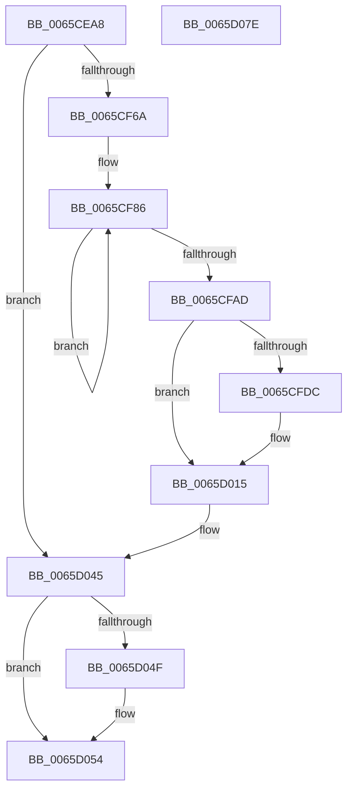

# MigrateOOBELanguageToInstallationLanguage

- RVA: `0x0065CEA8`–`0x0065D07F` (길이 `471` bytes)
- VA: `0x000000014065CEA8`
- 실행 섹션: `.text`
- PDB 이름 있음: `예`; PDB Function 태그: `아니요`
- unwind 정보 RVA: `0x000CD09C`
- 디코드: `108`개 명령, `471/471` bytes 표시
- 미해석 바이트: `0` (있으면 어셈블리에 `.byte`로 보존)

> 이 문서는 커널 이미지의 기계어와 PDB 기호를 분석해 생성했습니다. 4번과 5번은 함수 원형과 자료형을 바이너리 사용 방식에서 추정한 C 해석이며 원본 소스 복구 결과는 아닙니다.

## 1. Dependencies

- 직접 호출 지점: **10**; 고유 호출 대상: **7**
- 직접 호출자로 확인된 함수: **2**
- RIP 상대 이미지 참조: **5**

### Outgoing calls
- `0x0065CF04` → [memset](../6C/memset_function_006C6C40.md) (function, `0x006C6C40`)
- `0x0065CF21` → [RtlInitUnicodeString](../42/RtlInitUnicodeString_function_0042A780.md) (function, `0x0042A780`)
- `0x0065CF5B` → [ZwOpenKey](../6A/ZwOpenKey_function_006AD310.md) (function, `0x006AD310`)
- `0x0065CF76` → [RtlInitUnicodeString](../42/RtlInitUnicodeString_function_0042A780.md) (function, `0x0042A780`)
- `0x0065CFD3` → [ZwQueryValueKey](../6A/ZwQueryValueKey_function_006AD3B0.md) (function, `0x006AD3B0`)
- `0x0065CFE8` → [RtlInitUnicodeString](../42/RtlInitUnicodeString_function_0042A780.md) (function, `0x0042A780`)
- `0x0065D010` → [ZwSetValueKey](../6A/ZwSetValueKey_function_006ADCD0.md) (function, `0x006ADCD0`)
- `0x0065D039` → [ZwSetValueKey](../6A/ZwSetValueKey_function_006ADCD0.md) (function, `0x006ADCD0`)
- `0x0065D04F` → [ZwClose](../6A/ZwClose_function_006AD2B0.md) (function, `0x006AD2B0`)
- `0x0065D060` → [_security_check_cookie](../6A/_security_check_cookie_function_006AC640.md) (function, `0x006AC640`)

### Direct callers
- [NtFlushInstallUILanguage](../../page/7D/NtFlushInstallUILanguage_function_007D4200.md) at `0x007D42CB`
- [sub_00B30AB8](../../page/B3/Unknown_function_00B30AB8.md) at `0x00B30B38`

### Static image references
- `0x0065CEC6` → RVA `0x00E0A740` (`.data`; read)
- `0x0065CF10` → RVA `0x006D0420` (` ?? ::FNODOBFM::`string'`; read)
- `0x0065CF6A` → RVA `0x006D0400` (` ?? ::FNODOBFM::`string'`; read)
- `0x0065CF7B` → RVA `0x00FD9A60` (`PAGEDATA`; read)
- `0x0065CFDC` → RVA `0x006D04A0` (` ?? ::FNODOBFM::`string'`; read)

## 2. Other-region calls and transfers

- 다른 실행 섹션으로 향하는 call: **0**
- 별도 외부 분기/꼬리 이동을 확인하지 못했습니다.

## 3. Assembly (complete function range)

```asm
0065CEA8  48 8B C4                        mov rax, rsp
0065CEAB  48 89 58 08                     mov qword ptr [rax + 8], rbx
0065CEAF  48 89 70 10                     mov qword ptr [rax + 0x10], rsi
0065CEB3  48 89 78 18                     mov qword ptr [rax + 0x18], rdi
0065CEB7  55                              push rbp
0065CEB8  48 8D A8 38 FE FF FF            lea rbp, [rax - 0x1c8]
0065CEBF  48 81 EC C0 02 00 00            sub rsp, 0x2c0
0065CEC6  48 8B 05 73 D8 7A 00            mov rax, qword ptr [rip + 0x7ad873]
0065CECD  48 33 C4                        xor rax, rsp
0065CED0  48 89 85 B0 01 00 00            mov qword ptr [rbp + 0x1b0], rax
0065CED7  33 C0                           xor eax, eax
0065CED9  48 8D 4D A0                     lea rcx, [rbp - 0x60]
0065CEDD  33 FF                           xor edi, edi
0065CEDF  48 89 45 90                     mov qword ptr [rbp - 0x70], rax
0065CEE3  0F 57 C0                        xorps xmm0, xmm0
0065CEE6  89 7C 24 64                     mov dword ptr [rsp + 0x64], edi
0065CEEA  33 D2                           xor edx, edx
0065CEEC  89 7C 24 7C                     mov dword ptr [rsp + 0x7c], edi
0065CEF0  41 B8 10 02 00 00               mov r8d, 0x210
0065CEF6  48 89 7C 24 30                  mov qword ptr [rsp + 0x30], rdi
0065CEFB  0F 11 44 24 40                  movups xmmword ptr [rsp + 0x40], xmm0
0065CF00  66 89 45 98                     mov word ptr [rbp - 0x68], ax
0065CF04  E8 37 9D 06 00                  call 0x1406c6c40
0065CF09  0F 57 C0                        xorps xmm0, xmm0
0065CF0C  89 7C 24 38                     mov dword ptr [rsp + 0x38], edi
0065CF10  48 8D 15 09 35 07 00            lea rdx, [rip + 0x73509]
0065CF17  48 8D 4C 24 40                  lea rcx, [rsp + 0x40]
0065CF1C  0F 11 44 24 50                  movups xmmword ptr [rsp + 0x50], xmm0
0065CF21  E8 5A D8 DC FF                  call 0x14042a780
0065CF26  48 8D 44 24 40                  lea rax, [rsp + 0x40]
0065CF2B  48 89 7C 24 68                  mov qword ptr [rsp + 0x68], rdi
0065CF30  0F 57 C0                        xorps xmm0, xmm0
0065CF33  48 89 44 24 70                  mov qword ptr [rsp + 0x70], rax
0065CF38  8D 77 30                        lea esi, [rdi + 0x30]
0065CF3B  C7 44 24 78 40 02 00 00         mov dword ptr [rsp + 0x78], 0x240
0065CF43  4C 8D 44 24 60                  lea r8, [rsp + 0x60]
0065CF48  89 74 24 60                     mov dword ptr [rsp + 0x60], esi
0065CF4C  BA 1F 00 02 00                  mov edx, 0x2001f
0065CF51  48 8D 4C 24 30                  lea rcx, [rsp + 0x30]
0065CF56  F3 0F 7F 45 80                  movdqu xmmword ptr [rbp - 0x80], xmm0
0065CF5B  E8 B0 03 05 00                  call 0x1406ad310
0065CF60  8B D8                           mov ebx, eax
0065CF62  85 C0                           test eax, eax
0065CF64  0F 88 DB 00 00 00               js 0x14065d045
0065CF6A  48 8D 15 8F 34 07 00            lea rdx, [rip + 0x7348f]
0065CF71  48 8D 4C 24 40                  lea rcx, [rsp + 0x40]
0065CF76  E8 05 D8 DC FF                  call 0x14042a780
0065CF7B  0F B7 15 DE CA 97 00            movzx edx, word ptr [rip + 0x97cade]
0065CF82  44 8D 47 03                     lea r8d, [rdi + 3]
0065CF86  0F B7 CA                        movzx ecx, dx
0065CF89  B8 37 00 00 00                  mov eax, 0x37
0065CF8E  66 83 E1 0F                     and cx, 0xf
0065CF92  66 83 F9 09                     cmp cx, 9
0065CF96  66 0F 46 C6                     cmovbe ax, si
0065CF9A  66 C1 EA 04                     shr dx, 4
0065CF9E  66 03 C1                        add ax, cx
0065CFA1  66 42 89 44 45 90               mov word ptr [rbp + r8*2 - 0x70], ax
0065CFA7  49 83 E8 01                     sub r8, 1
0065CFAB  79 D9                           jns 0x14065cf86
0065CFAD  48 8B 4C 24 30                  mov rcx, qword ptr [rsp + 0x30]
0065CFB2  48 8D 44 24 38                  lea rax, [rsp + 0x38]
0065CFB7  48 89 44 24 28                  mov qword ptr [rsp + 0x28], rax
0065CFBC  4C 8D 4D A0                     lea r9, [rbp - 0x60]
0065CFC0  41 B8 02 00 00 00               mov r8d, 2
0065CFC6  C7 44 24 20 10 02 00 00         mov dword ptr [rsp + 0x20], 0x210
0065CFCE  48 8D 54 24 40                  lea rdx, [rsp + 0x40]
0065CFD3  E8 D8 03 05 00                  call 0x1406ad3b0
0065CFD8  85 C0                           test eax, eax
0065CFDA  78 39                           js 0x14065d015
0065CFDC  48 8D 15 BD 34 07 00            lea rdx, [rip + 0x734bd]
0065CFE3  48 8D 4C 24 50                  lea rcx, [rsp + 0x50]
0065CFE8  E8 93 D7 DC FF                  call 0x14042a780
0065CFED  8B 45 A8                        mov eax, dword ptr [rbp - 0x58]
0065CFF0  48 8D 54 24 50                  lea rdx, [rsp + 0x50]
0065CFF5  48 8B 4C 24 30                  mov rcx, qword ptr [rsp + 0x30]
0065CFFA  41 B9 01 00 00 00               mov r9d, 1
0065D000  89 44 24 28                     mov dword ptr [rsp + 0x28], eax
0065D004  45 33 C0                        xor r8d, r8d
0065D007  48 8D 45 AC                     lea rax, [rbp - 0x54]
0065D00B  48 89 44 24 20                  mov qword ptr [rsp + 0x20], rax
0065D010  E8 BB 0C 05 00                  call 0x1406adcd0
0065D015  48 8B 4C 24 30                  mov rcx, qword ptr [rsp + 0x30]
0065D01A  48 8D 45 90                     lea rax, [rbp - 0x70]
0065D01E  C7 44 24 28 0A 00 00 00         mov dword ptr [rsp + 0x28], 0xa
0065D026  48 8D 54 24 40                  lea rdx, [rsp + 0x40]
0065D02B  41 B9 01 00 00 00               mov r9d, 1
0065D031  48 89 44 24 20                  mov qword ptr [rsp + 0x20], rax
0065D036  45 33 C0                        xor r8d, r8d
0065D039  E8 92 0C 05 00                  call 0x1406adcd0
0065D03E  85 C0                           test eax, eax
0065D040  8B D8                           mov ebx, eax
0065D042  0F 49 DF                        cmovns ebx, edi
0065D045  48 8B 4C 24 30                  mov rcx, qword ptr [rsp + 0x30]
0065D04A  48 85 C9                        test rcx, rcx
0065D04D  74 05                           je 0x14065d054
0065D04F  E8 5C 02 05 00                  call 0x1406ad2b0
0065D054  8B C3                           mov eax, ebx
0065D056  48 8B 8D B0 01 00 00            mov rcx, qword ptr [rbp + 0x1b0]
0065D05D  48 33 CC                        xor rcx, rsp
0065D060  E8 DB F5 04 00                  call 0x1406ac640
0065D065  4C 8D 9C 24 C0 02 00 00         lea r11, [rsp + 0x2c0]
0065D06D  49 8B 5B 10                     mov rbx, qword ptr [r11 + 0x10]
0065D071  49 8B 73 18                     mov rsi, qword ptr [r11 + 0x18]
0065D075  49 8B 7B 20                     mov rdi, qword ptr [r11 + 0x20]
0065D079  49 8B E3                        mov rsp, r11
0065D07C  5D                              pop rbp
0065D07D  C3                              ret
0065D07E  CC                              int3
```

## 4. C-style interpretation (structured pseudocode)

```c
__int64 __fastcall MigrateOOBELanguageToInstallationLanguage(__int64 a1, int a2)
{
    __int64 result;
    __int64 v_rbx;
    __int64 v_rdi;
    __int64 v_rsp;
    unsigned int v_stack_m24C;
    unsigned int v_stack_m250;
    unsigned __int64 v_stack_m258;
    unsigned __int64 v_stack_m260;
    unsigned int v_stack_m264;
    unsigned __int64 v_stack_m268;
    unsigned __int64 v_stack_m278;
    unsigned __int64 v_stack_m288;
    unsigned int v_stack_m290;
    unsigned __int64 v_stack_m298;
    unsigned __int64 v_stack_m2A0;
    unsigned int v_stack_m2A8;
    unsigned __int64 v_stack_m8;

    *(unsigned __int64 *)(v_rsp + 8) = v_rbx;
    *(unsigned __int64 *)(v_rsp + 16) = v_rsi;
    *(unsigned __int64 *)(v_rsp + 24) = v_rdi;
    v_rsp = (v_rsp) - (704);
    result = (*(unsigned __int64 *)(v_rip + 8050803)) ^ (v_rsp);
    *(unsigned __int64 *)(v_rsp - 456 + 432) = result;
    result = 0;
    v_rdi = 0;
    *(unsigned __int64 *)(v_rsp - 456 - 112) = 0;
    v_stack_m264 = 0;
    a2 = 0;
    v_stack_m24C = 0;
    v_stack_m298 = 0;
    v_stack_m288 = v_xmm0;
    *(unsigned __int16 *)(v_rsp - 456 - 104) = 0;
    result = memset(v_rsp - 456 - 96, a2, 528, a4);
    v_stack_m290 = 0;
    v_stack_m278 = v_xmm0;
    result = RtlInitUnicodeString(v_stack_m288, v_rip + 472329, 528, a4);
    v_stack_m260 = 0;
    v_stack_m258 = v_stack_m288;
    v_stack_m250 = 576;
    v_stack_m268 = (unsigned int)(v_rdi + 48);
    *(unsigned __int64 *)(v_rsp - 456 - 128) = v_xmm0;
    result = ZwOpenKey(v_stack_m298, (unsigned int)(0x2001FULL), v_stack_m268, a4);
    if (sign_flag) goto loc_0065D045;
    result = RtlInitUnicodeString(v_stack_m288, v_rip + 472207, v_stack_m268, a4);
loc_0065CF86:
    a1 = (unsigned __int16)(((unsigned __int16)(*(unsigned __int16 *)(v_rip + 9947870))) & (15));
    result = 55;
    if (((unsigned __int16)(a1)) <= 9) { result = (unsigned __int16)(v_rdi + 48); }
    a2 = (unsigned __int16)((*(unsigned __int16 *)(v_rip + 9947870)) >> (4));
    result = (unsigned __int16)((result) + ((unsigned __int16)(a1)));
    *(unsigned __int16 *)(v_rsp - 456 + v_rdi + 3 * 2 - 112) = (unsigned __int16)(result);
    a3 = (v_rdi + 3) - (1);
    if (!sign_flag) goto loc_0065CF86;
    v_stack_m2A0 = v_stack_m290;
    v_stack_m2A8 = 528;
    result = ZwQueryValueKey(v_stack_m298, v_stack_m288, 2, v_rsp - 456 - 96);
    if (!(sign_flag)) {
        a2 = v_rip + 472253;
        a1 = v_stack_m278;
        result = RtlInitUnicodeString(a1, a2, 2, v_rsp - 456 - 96);
        result = *(unsigned int *)(v_rsp - 456 - 88);
        a2 = v_stack_m278;
        a1 = v_stack_m298;
        a4 = 1;
        v_stack_m2A0 = (unsigned int)(result);
        a3 = 0;
        result = v_rsp - 456 - 84;
        v_stack_m2A8 = result;
        result = ZwSetValueKey(a1, a2, a3, a4);
    }
    v_stack_m2A0 = 10;
    v_stack_m2A8 = v_rsp - 456 - 112;
    a3 = 0;
    result = ZwSetValueKey(v_stack_m298, v_stack_m288, a3, 1);
    v_rbx = (unsigned int)((unsigned int)(result));
    if (!sign_flag) { v_rbx = 0; }
loc_0065D045:
    if (v_stack_m298 != 0) {
        result = ZwClose(v_stack_m298, v_stack_m288, a3, 1);
    }
    a1 = (*(unsigned __int64 *)(v_rsp - 456 + 432)) ^ (v_rsp);
    result = _security_check_cookie(a1, v_stack_m288, a3, 1);
    return result;
}
```

## 5. (Beta) C Style

```c
int64_t MigrateOOBELanguageToInstallationLanguage(int64_t Arg1, int32_t Arg2)
{
    int64_t result;
    int64_t local_rbx;
    int64_t local_rdi;
    int64_t local_rsp;
    uint32_t v_stack_m24C;
    uint32_t v_stack_m250;
    uint64_t v_stack_m258;
    uint64_t v_stack_m260;
    uint32_t v_stack_m264;
    uint64_t v_stack_m268;
    uint64_t v_stack_m278;
    uint64_t v_stack_m288;
    uint32_t v_stack_m290;
    uint64_t v_stack_m298;
    uint64_t v_stack_m2A0;
    uint32_t v_stack_m2A8;
    uint64_t v_stack_m8;

    *(uint64_t *)(local_rsp + 0x8) = local_rbx;
    *(uint64_t *)(local_rsp + 0x10) = local_rsi;
    *(uint64_t *)(local_rsp + 0x18) = local_rdi;
    local_rsp = (local_rsp) - (704);
    result = (*(uint64_t *)(v_rip + 0x7AD873)) ^ (local_rsp);
    *(uint64_t *)(local_rsp - 0x1C8 + 0x1B0) = result;
    result = 0;
    local_rdi = 0;
    *(uint64_t *)(local_rsp - 0x1C8 - 0x70) = 0;
    v_stack_m264 = 0;
    Arg2 = 0;
    v_stack_m24C = 0;
    v_stack_m298 = 0;
    v_stack_m288 = v_xmm0;
    *(uint16_t *)(local_rsp - 0x1C8 - 0x68) = 0;
    result = memset(local_rsp - 456 - 96, Arg2, 528, a4);
    v_stack_m290 = 0;
    v_stack_m278 = v_xmm0;
    result = RtlInitUnicodeString(v_stack_m288, v_rip + 472329, 528, a4);
    v_stack_m260 = 0;
    v_stack_m258 = v_stack_m288;
    v_stack_m250 = 576;
    v_stack_m268 = (uint32_t)(local_rdi + 48);
    *(uint64_t *)(local_rsp - 0x1C8 - 0x80) = v_xmm0;
    result = ZwOpenKey(v_stack_m298, (uint32_t)(0x2001FULL), v_stack_m268, a4);
    if (sign_flag) goto loc_0065D045;
    result = RtlInitUnicodeString(v_stack_m288, v_rip + 472207, v_stack_m268, a4);
loc_0065CF86:
    Arg1 = (uint16_t)(((uint16_t)(*(uint16_t *)(v_rip + 0x97CADE))) & (15));
    result = 55;
    if (((uint16_t)(Arg1)) <= 9) { result = (uint16_t)(local_rdi + 48); }
    Arg2 = (uint16_t)((*(uint16_t *)(v_rip + 0x97CADE)) >> (4));
    result = (uint16_t)((result) + ((uint16_t)(Arg1)));
    *(uint16_t *)(local_rsp - 0x1C8 + local_rdi + 0x3 * 2 - 0x70) = (uint16_t)(result);
    a3 = (local_rdi + 3) - (1);
    if (!sign_flag) goto loc_0065CF86;
    v_stack_m2A0 = v_stack_m290;
    v_stack_m2A8 = 528;
    result = ZwQueryValueKey(v_stack_m298, v_stack_m288, 2, local_rsp - 456 - 96);
    if (!(sign_flag)) {
        Arg2 = v_rip + 472253;
        Arg1 = v_stack_m278;
        result = RtlInitUnicodeString(Arg1, Arg2, 2, local_rsp - 456 - 96);
        result = *(uint32_t *)(local_rsp - 0x1C8 - 0x58);
        Arg2 = v_stack_m278;
        Arg1 = v_stack_m298;
        a4 = 1;
        v_stack_m2A0 = (uint32_t)(result);
        a3 = 0;
        result = local_rsp - 456 - 84;
        v_stack_m2A8 = result;
        result = ZwSetValueKey(Arg1, Arg2, a3, a4);
    }
    v_stack_m2A0 = 10;
    v_stack_m2A8 = local_rsp - 456 - 112;
    a3 = 0;
    result = ZwSetValueKey(v_stack_m298, v_stack_m288, a3, 1);
    local_rbx = (uint32_t)((uint32_t)(result));
    if (!sign_flag) { local_rbx = 0; }
loc_0065D045:
    if (v_stack_m298 != 0) {
        result = ZwClose(v_stack_m298, v_stack_m288, a3, 1);
    }
    Arg1 = (*(uint64_t *)(local_rsp - 0x1C8 + 0x1B0)) ^ (local_rsp);
    result = _security_check_cookie(Arg1, v_stack_m288, a3, 1);
    return result;
}
```

## 6. Execution-region graph

[열기: 2D/3D 그래프와 함수 탐색 컨트롤 패널](../../../control-panel.html?section=text&rva=0x0065CEA8&view=graph)

- 2D 그래프는 위에서 아래로 흐르고, 3D 그래프는 빈 공간을 드래그해 회전합니다. Shift+드래그는 이동, 휠은 확대·축소, 함수 노드 선택은 대상 보고서 이동입니다.

### Static fallback


