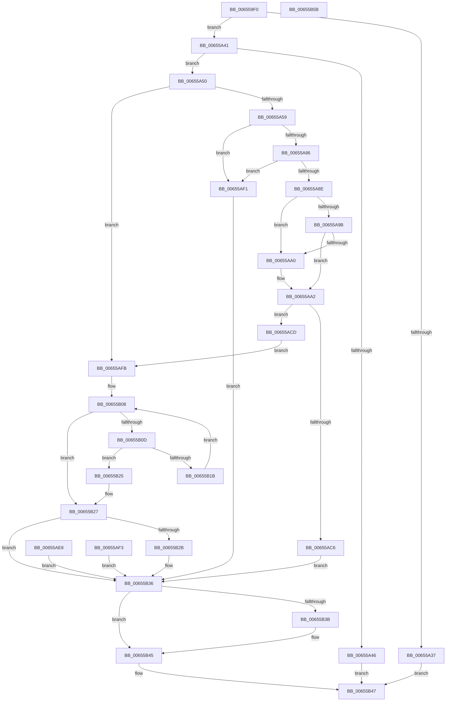

# NtDrawText

- RVA: `0x006559F0`–`0x00655B5C` (길이 `364` bytes)
- VA: `0x00000001406559F0`
- 실행 섹션: `.text`
- PDB 이름 있음: `예`; PDB Function 태그: `아니요`
- unwind 정보 RVA: `0x000D4B38`
- 디코드: `108`개 명령, `364/364` bytes 표시
- 미해석 바이트: `0` (있으면 어셈블리에 `.byte`로 보존)

> 이 문서는 커널 이미지의 기계어와 PDB 기호를 분석해 생성했습니다. 4번과 5번은 함수 원형과 자료형을 바이너리 사용 방식에서 추정한 C 해석이며 원본 소스 복구 결과는 아닙니다.

## 1. Dependencies

- 직접 호출 지점: **5**; 고유 호출 대상: **5**
- 직접 호출자로 확인된 함수: **0**
- RIP 상대 이미지 참조: **1**

### Outgoing calls
- `0x00655A2E` → [SeSinglePrivilegeCheck](../../page/87/SeSinglePrivilegeCheck_function_00871E20.md) (function, `0x00871E20`)
- `0x00655AB4` → [ExAllocatePool2](../../poolcode/B8/ExAllocatePool2_function_00B820F0.md) (function, `0x00B820F0`)
- `0x00655AD6` → [memcpy](../6C/memcpy_function_006C6840.md) (function, `0x006C6840`)
- `0x00655B2F` → [BgkDrawText](../../pagebgfx/BC/BgkDrawText_function_00BC02DC.md) (function, `0x00BC02DC`)
- `0x00655B40` → [ExFreePoolWithTag](../../poolcode/B8/ExFreePoolWithTag_function_00B82870.md) (function, `0x00B82870`)

### Direct callers
- 이 함수 시작 RVA로 연결되는 직접 call은 확인되지 않았습니다. 간접 호출은 완전히 역산할 수 없습니다.

### Static image references
- `0x00655A27` → RVA `0x00FD9A78` (`PAGEDATA`; read)

## 2. Other-region calls and transfers

- 다른 실행 섹션으로 향하는 call: **4**
  - `0x00655A2E` → [SeSinglePrivilegeCheck](../../page/87/SeSinglePrivilegeCheck_function_00871E20.md) (`.text` → `PAGE`)
  - `0x00655AB4` → [ExAllocatePool2](../../poolcode/B8/ExAllocatePool2_function_00B820F0.md) (`.text` → `POOLCODE`)
  - `0x00655B2F` → [BgkDrawText](../../pagebgfx/BC/BgkDrawText_function_00BC02DC.md) (`.text` → `PAGEBGFX`)
  - `0x00655B40` → [ExFreePoolWithTag](../../poolcode/B8/ExFreePoolWithTag_function_00B82870.md) (`.text` → `POOLCODE`)
- 별도 외부 분기/꼬리 이동을 확인하지 못했습니다.

## 3. Assembly (complete function range)

```asm
006559F0  48 89 5C 24 08                  mov qword ptr [rsp + 8], rbx
006559F5  48 89 74 24 20                  mov qword ptr [rsp + 0x20], rsi
006559FA  57                              push rdi
006559FB  41 56                           push r14
006559FD  41 57                           push r15
006559FF  48 83 EC 30                     sub rsp, 0x30
00655A03  4C 8B F1                        mov r14, rcx
00655A06  0F 57 C0                        xorps xmm0, xmm0
00655A09  0F 11 44 24 20                  movups xmmword ptr [rsp + 0x20], xmm0
00655A0E  33 DB                           xor ebx, ebx
00655A10  8B FB                           mov edi, ebx
00655A12  8B F3                           mov esi, ebx
00655A14  65 48 8B 04 25 88 01 00 00      mov rax, qword ptr gs:[0x188]
00655A1D  44 8A B8 32 02 00 00            mov r15b, byte ptr [rax + 0x232]
00655A24  41 8A D7                        mov dl, r15b
00655A27  48 8B 0D 4A 40 98 00            mov rcx, qword ptr [rip + 0x98404a]
00655A2E  E8 ED C3 21 00                  call 0x140871e20
00655A33  84 C0                           test al, al
00655A35  75 0A                           jne 0x140655a41
00655A37  B8 61 00 00 C0                  mov eax, 0xc0000061
00655A3C  E9 06 01 00 00                  jmp 0x140655b47
00655A41  4D 85 F6                        test r14, r14
00655A44  75 0A                           jne 0x140655a50
00655A46  B8 0D 00 00 C0                  mov eax, 0xc000000d
00655A4B  E9 F7 00 00 00                  jmp 0x140655b47
00655A50  45 84 FF                        test r15b, r15b
00655A53  0F 84 A2 00 00 00               je 0x140655afb
00655A59  48 BA 00 00 FF FF FF 7F 00 00   movabs rdx, 0x7fffffff0000
00655A63  48 8B C2                        mov rax, rdx
00655A66  4C 3B F2                        cmp r14, rdx
00655A69  49 0F 42 C6                     cmovb rax, r14
00655A6D  90                              nop
00655A6E  8B 08                           mov ecx, dword ptr [rax]
00655A70  89 4C 24 58                     mov dword ptr [rsp + 0x58], ecx
00655A74  89 4C 24 20                     mov dword ptr [rsp + 0x20], ecx
00655A78  4C 8B 70 08                     mov r14, qword ptr [rax + 8]
00655A7C  4C 89 74 24 28                  mov qword ptr [rsp + 0x28], r14
00655A81  4D 85 F6                        test r14, r14
00655A84  74 6B                           je 0x140655af1
00655A86  C1 F9 10                        sar ecx, 0x10
00655A89  66 85 C9                        test cx, cx
00655A8C  74 63                           je 0x140655af1
00655A8E  0F B7 4C 24 5A                  movzx ecx, word ptr [rsp + 0x5a]
00655A93  49 03 CE                        add rcx, r14
00655A96  48 3B CA                        cmp rcx, rdx
00655A99  77 05                           ja 0x140655aa0
00655A9B  49 3B CE                        cmp rcx, r14
00655A9E  73 02                           jae 0x140655aa2
00655AA0  8A 02                           mov al, byte ptr [rdx]
00655AA2  0F B7 7C 24 5A                  movzx edi, word ptr [rsp + 0x5a]
00655AA7  41 B8 53 74 72 67               mov r8d, 0x67727453
00655AAD  8B D7                           mov edx, edi
00655AAF  B9 40 00 00 00                  mov ecx, 0x40
00655AB4  E8 37 C6 52 00                  call 0x140b820f0
00655AB9  48 8B F0                        mov rsi, rax
00655ABC  48 89 44 24 60                  mov qword ptr [rsp + 0x60], rax
00655AC1  48 85 C0                        test rax, rax
00655AC4  75 07                           jne 0x140655acd
00655AC6  BF 17 00 00 C0                  mov edi, 0xc0000017
00655ACB  EB 69                           jmp 0x140655b36
00655ACD  4C 8B C7                        mov r8, rdi
00655AD0  49 8B D6                        mov rdx, r14
00655AD3  48 8B CE                        mov rcx, rsi
00655AD6  E8 65 0D 07 00                  call 0x1406c6840
00655ADB  90                              nop
00655ADC  48 89 74 24 28                  mov qword ptr [rsp + 0x28], rsi
00655AE1  4C 8D 74 24 20                  lea r14, [rsp + 0x20]
00655AE6  EB 13                           jmp 0x140655afb
00655AE8  8B F8                           mov edi, eax
00655AEA  48 8B 74 24 60                  mov rsi, qword ptr [rsp + 0x60]
00655AEF  EB 45                           jmp 0x140655b36
00655AF1  EB 43                           jmp 0x140655b36
00655AF3  8B F8                           mov edi, eax
00655AF5  33 DB                           xor ebx, ebx
00655AF7  8B F3                           mov esi, ebx
00655AF9  EB 3B                           jmp 0x140655b36
00655AFB  BF 0D 00 00 C0                  mov edi, 0xc000000d
00655B00  41 0F B7 56 02                  movzx edx, word ptr [r14 + 2]
00655B05  66 D1 EA                        shr dx, 1
00655B08  66 85 D2                        test dx, dx
00655B0B  74 1A                           je 0x140655b27
00655B0D  0F B7 CA                        movzx ecx, dx
00655B10  49 8B 46 08                     mov rax, qword ptr [r14 + 8]
00655B14  66 39 5C 48 FE                  cmp word ptr [rax + rcx*2 - 2], bx
00655B19  74 0A                           je 0x140655b25
00655B1B  B8 FF FF 00 00                  mov eax, 0xffff
00655B20  66 03 D0                        add dx, ax
00655B23  EB E3                           jmp 0x140655b08
00655B25  8B FB                           mov edi, ebx
00655B27  85 FF                           test edi, edi
00655B29  78 0B                           js 0x140655b36
00655B2B  49 8B 4E 08                     mov rcx, qword ptr [r14 + 8]
00655B2F  E8 A8 A7 56 00                  call 0x140bc02dc
00655B34  8B F8                           mov edi, eax
00655B36  48 85 F6                        test rsi, rsi
00655B39  74 0A                           je 0x140655b45
00655B3B  33 D2                           xor edx, edx
00655B3D  48 8B CE                        mov rcx, rsi
00655B40  E8 2B CD 52 00                  call 0x140b82870
00655B45  8B C7                           mov eax, edi
00655B47  48 8B 5C 24 50                  mov rbx, qword ptr [rsp + 0x50]
00655B4C  48 8B 74 24 68                  mov rsi, qword ptr [rsp + 0x68]
00655B51  48 83 C4 30                     add rsp, 0x30
00655B55  41 5F                           pop r15
00655B57  41 5E                           pop r14
00655B59  5F                              pop rdi
00655B5A  C3                              ret
00655B5B  CC                              int3
```

## 4. C-style interpretation (structured pseudocode)

```c
__int64 __fastcall NtDrawText(__int64 a1)
{
    __int64 result;
    __int64 v_rbx;
    __int64 v_rdi;
    __int64 v_rsp;
    unsigned __int64 v_stack_m20;
    unsigned __int64 v_stack_m28;
    unsigned int v_stack_p10;
    unsigned __int16 v_stack_p12;
    unsigned __int64 v_stack_p18;
    unsigned __int64 v_stack_p20;
    unsigned __int64 v_stack_p8;

    v_stack_p8 = v_rbx;
    v_stack_p20 = v_rsi;
    v_rsp = (v_rsp) - (48);
    v_stack_m28 = v_xmm0;
    v_rbx = 0;
    result = SeSinglePrivilegeCheck(*(unsigned __int64 *)(v_rip + 9977930), (unsigned __int8)(*(unsigned __int8 *)(*(unsigned __int64 *)(gs_base + (0 + 392)) + 562)), a3, a4);
    if ((unsigned __int8)(result) != 0) goto loc_00655A41;
    goto loc_00655B47;
loc_00655A41:
    if (a1 != 0) goto loc_00655A50;
    goto loc_00655B47;
loc_00655A50:
    if ((unsigned __int8)(*(unsigned __int8 *)(*(unsigned __int64 *)(gs_base + (0 + 392)) + 562)) == 0) goto loc_00655AFB;
    result = (unsigned __int8)(*(unsigned __int8 *)(*(unsigned __int64 *)(gs_base + (0 + 392)) + 562));
    if (a1 < ((unsigned __int8)(*(unsigned __int8 *)(*(unsigned __int64 *)(gs_base + (0 + 392)) + 562)))) { result = a1; }
    v_stack_p10 = (unsigned int)((unsigned int)(*(unsigned int *)(result)));
    v_stack_m28 = (unsigned int)((unsigned int)(*(unsigned int *)(result)));
    v_stack_m20 = *(unsigned __int64 *)(result + 8);
    if (*(unsigned __int64 *)(result + 8) == 0) goto loc_00655AF1;
    a1 = (unsigned int)(((unsigned int)(*(unsigned int *)(result))) >> (16));
    if ((unsigned __int16)(a1) == 0) goto loc_00655AF1;
    a1 = (v_stack_p12) + (*(unsigned __int64 *)(result + 8));
    if (a1 > ((unsigned __int8)(*(unsigned __int8 *)(*(unsigned __int64 *)(gs_base + (0 + 392)) + 562)))) goto loc_00655AA0;
    if (a1 < (*(unsigned __int64 *)(result + 8))) {
        result = *(unsigned __int8 *)((unsigned __int8)(*(unsigned __int8 *)(*(unsigned __int64 *)(gs_base + (0 + 392)) + 562)));
    }
    result = ExAllocatePool2(64, (unsigned int)((unsigned int)(v_stack_p12)), (unsigned int)(0x67727453ULL), a4);
    v_stack_p18 = result;
    if (result != 0) goto loc_00655ACD;
    goto loc_00655B36;
loc_00655ACD:
    result = memcpy(result, *(unsigned __int64 *)(result + 8), (unsigned int)(0xC0000017ULL), a4);
    v_stack_m20 = result;
    goto loc_00655AFB;
loc_00655AF1:
    goto loc_00655B36;
loc_00655AFB:
    a2 = (unsigned __int16)((*(unsigned __int16 *)(v_stack_m28 + 2)) >> (1));
loc_00655B08:
    if ((unsigned __int16)(a2) == 0) goto loc_00655B27;
    if ((*(unsigned __int16 *)(*(unsigned __int64 *)(v_stack_m28 + 8) + (unsigned __int16)(a2) * 2 - 2)) == 0) goto loc_00655B25;
    a2 = (unsigned __int16)((a2) + ((unsigned __int16)((unsigned int)(0xFFFFULL))));
    goto loc_00655B08;
loc_00655B25:
loc_00655B27:
    result = (unsigned int)(0xFFFFULL);
    v_rdi = 0;
    if (!(sign_flag)) {
        a1 = *(unsigned __int64 *)(v_stack_m28 + 8);
        result = BgkDrawText(a1, a2, (unsigned int)(0xC0000017ULL), a4);
        v_rdi = (unsigned int)(result);
    }
    if (result != 0) {
        a2 = 0;
        a1 = result;
        result = ExFreePoolWithTag(a1, a2, (unsigned int)(0xC0000017ULL), a4);
    }
loc_00655B47:
    v_rsp = (v_rsp) + (48);
    return (unsigned int)((unsigned int)(v_rdi));
}
```

## 5. (Beta) C Style

```c
int64_t NtDrawText(int64_t Arg1)
{
    int64_t result;
    int64_t local_rbx;
    int64_t local_rdi;
    int64_t local_rsp;
    uint64_t v_stack_m20;
    uint64_t v_stack_m28;
    uint32_t v_stack_p10;
    uint16_t v_stack_p12;
    uint64_t v_stack_p18;
    uint64_t v_stack_p20;
    uint64_t v_stack_p8;

    v_stack_p8 = local_rbx;
    v_stack_p20 = local_rsi;
    local_rsp = (local_rsp) - (48);
    v_stack_m28 = v_xmm0;
    local_rbx = 0;
    result = SeSinglePrivilegeCheck(*(uint64_t *)(v_rip + 0x98404A), (uint8_t)(*(uint8_t *)(*(uint64_t *)(gs_base + (0 + 0x188)) + 0x232)), a3, a4);
    if ((uint8_t)(result) != 0) goto loc_00655A41;
    goto loc_00655B47;
loc_00655A41:
    if (Arg1 != 0) goto loc_00655A50;
    goto loc_00655B47;
loc_00655A50:
    if ((uint8_t)(*(uint8_t *)(*(uint64_t *)(gs_base + (0 + 0x188)) + 0x232)) == 0) goto loc_00655AFB;
    result = (uint8_t)(*(uint8_t *)(*(uint64_t *)(gs_base + (0 + 0x188)) + 0x232));
    if (Arg1 < ((uint8_t)(*(uint8_t *)(*(uint64_t *)(gs_base + (0 + 0x188)) + 0x232)))) { result = Arg1; }
    v_stack_p10 = (uint32_t)((uint32_t)(*(uint32_t *)(result)));
    v_stack_m28 = (uint32_t)((uint32_t)(*(uint32_t *)(result)));
    v_stack_m20 = *(uint64_t *)(result + 0x8);
    if (*(uint64_t *)(result + 0x8) == 0) goto loc_00655AF1;
    Arg1 = (uint32_t)(((uint32_t)(*(uint32_t *)(result))) >> (16));
    if ((uint16_t)(Arg1) == 0) goto loc_00655AF1;
    Arg1 = (v_stack_p12) + (*(uint64_t *)(result + 0x8));
    if (Arg1 > ((uint8_t)(*(uint8_t *)(*(uint64_t *)(gs_base + (0 + 0x188)) + 0x232)))) goto loc_00655AA0;
    if (Arg1 < (*(uint64_t *)(result + 0x8))) {
        result = *(uint8_t *)((uint8_t)(*(uint8_t *)(*(uint64_t *)(gs_base + (0 + 0x188)) + 0x232)));
    }
    result = ExAllocatePool2(64, (uint32_t)((uint32_t)(v_stack_p12)), (uint32_t)(0x67727453ULL), a4);
    v_stack_p18 = result;
    if (result != 0) goto loc_00655ACD;
    goto loc_00655B36;
loc_00655ACD:
    result = memcpy(result, *(uint64_t *)(result + 0x8), (uint32_t)(0xC0000017ULL), a4);
    v_stack_m20 = result;
    goto loc_00655AFB;
loc_00655AF1:
    goto loc_00655B36;
loc_00655AFB:
    a2 = (uint16_t)((*(uint16_t *)(v_stack_m28 + 0x2)) >> (1));
loc_00655B08:
    if ((uint16_t)(a2) == 0) goto loc_00655B27;
    if ((*(uint16_t *)(*(uint64_t *)(v_stack_m28 + 0x8) + (uint16_t)(a2) * 2 - 0x2)) == 0) goto loc_00655B25;
    a2 = (uint16_t)((a2) + ((uint16_t)((uint32_t)(0xFFFFULL))));
    goto loc_00655B08;
loc_00655B25:
loc_00655B27:
    result = (uint32_t)(0xFFFFULL);
    local_rdi = 0;
    if (!(sign_flag)) {
        Arg1 = *(uint64_t *)(v_stack_m28 + 0x8);
        result = BgkDrawText(Arg1, a2, (uint32_t)(0xC0000017ULL), a4);
        local_rdi = (uint32_t)(result);
    }
    if (result != 0) {
        a2 = 0;
        Arg1 = result;
        result = ExFreePoolWithTag(Arg1, a2, (uint32_t)(0xC0000017ULL), a4);
    }
loc_00655B47:
    local_rsp = (local_rsp) + (48);
    return (uint32_t)((uint32_t)(local_rdi));
}
```

## 6. Execution-region graph

[열기: 2D/3D 그래프와 함수 탐색 컨트롤 패널](../../../control-panel.html?section=text&rva=0x006559F0&view=graph)

- 2D 그래프는 위에서 아래로 흐르고, 3D 그래프는 빈 공간을 드래그해 회전합니다. Shift+드래그는 이동, 휠은 확대·축소, 함수 노드 선택은 대상 보고서 이동입니다.

### Static fallback


