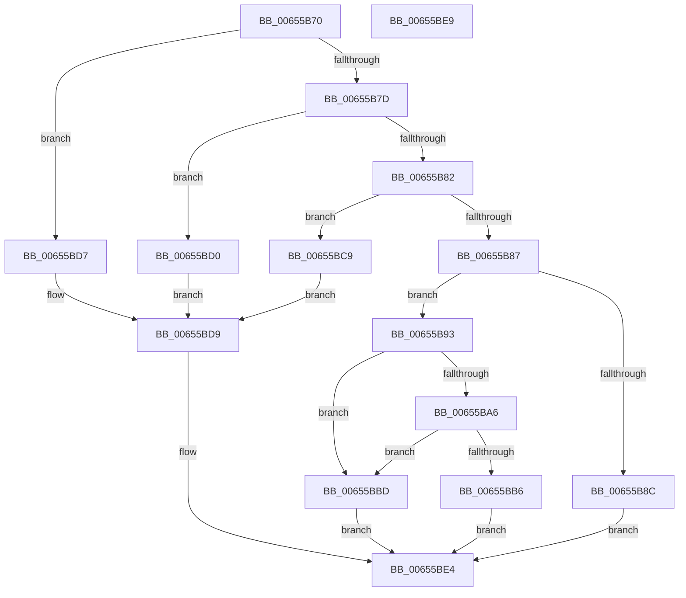

# NtShutdownSystem

- RVA: `0x00655B70`–`0x00655BEA` (길이 `122` bytes)
- VA: `0x0000000140655B70`
- 실행 섹션: `.text`
- PDB 이름 있음: `예`; PDB Function 태그: `아니요`
- unwind 정보 RVA: `0x0005C788`
- 디코드: `35`개 명령, `122/122` bytes 표시
- 미해석 바이트: `0` (있으면 어셈블리에 `.byte`로 보존)

> 이 문서는 커널 이미지의 기계어와 PDB 기호를 분석해 생성했습니다. 4번과 5번은 함수 원형과 자료형을 바이너리 사용 방식에서 추정한 C 해석이며 원본 소스 복구 결과는 아닙니다.

## 1. Dependencies

- 직접 호출 지점: **3**; 고유 호출 대상: **3**
- 직접 호출자로 확인된 함수: **0**
- RIP 상대 이미지 참조: **1**

### Outgoing calls
- `0x00655BAD` → [SeSinglePrivilegeCheck](../../page/87/SeSinglePrivilegeCheck_function_00871E20.md) (function, `0x00871E20`)
- `0x00655BBD` → [ExRebootSystemForRecovery](ExRebootSystemForRecovery_function_00655924.md) (function, `0x00655924`)
- `0x00655BDF` → [NtSetSystemPowerState](../../pagelk/B7/NtSetSystemPowerState_function_00B70890.md) (function, `0x00B70890`)

### Direct callers
- 이 함수 시작 RVA로 연결되는 직접 call은 확인되지 않았습니다. 간접 호출은 완전히 역산할 수 없습니다.

### Static image references
- `0x00655BA6` → RVA `0x00FD9B30` (`PAGEDATA`; read)

## 2. Other-region calls and transfers

- 다른 실행 섹션으로 향하는 call: **2**
  - `0x00655BAD` → [SeSinglePrivilegeCheck](../../page/87/SeSinglePrivilegeCheck_function_00871E20.md) (`.text` → `PAGE`)
  - `0x00655BDF` → [NtSetSystemPowerState](../../pagelk/B7/NtSetSystemPowerState_function_00B70890.md) (`.text` → `PAGELK`)
- 별도 외부 분기/꼬리 이동을 확인하지 못했습니다.

## 3. Assembly (complete function range)

```asm
00655B70  48 83 EC 28                     sub rsp, 0x28
00655B74  BA 04 00 00 00                  mov edx, 4
00655B79  85 C9                           test ecx, ecx
00655B7B  74 5A                           je 0x140655bd7
00655B7D  83 E9 01                        sub ecx, 1
00655B80  74 4E                           je 0x140655bd0
00655B82  83 E9 01                        sub ecx, 1
00655B85  74 42                           je 0x140655bc9
00655B87  83 F9 01                        cmp ecx, 1
00655B8A  74 07                           je 0x140655b93
00655B8C  B8 0D 00 00 C0                  mov eax, 0xc000000d
00655B91  EB 51                           jmp 0x140655be4
00655B93  65 48 8B 04 25 88 01 00 00      mov rax, qword ptr gs:[0x188]
00655B9C  8A 90 32 02 00 00               mov dl, byte ptr [rax + 0x232]
00655BA2  84 D2                           test dl, dl
00655BA4  74 17                           je 0x140655bbd
00655BA6  48 8B 0D 83 3F 98 00            mov rcx, qword ptr [rip + 0x983f83]
00655BAD  E8 6E C2 21 00                  call 0x140871e20
00655BB2  84 C0                           test al, al
00655BB4  75 07                           jne 0x140655bbd
00655BB6  B8 61 00 00 C0                  mov eax, 0xc0000061
00655BBB  EB 27                           jmp 0x140655be4
00655BBD  E8 62 FD FF FF                  call 0x140655924
00655BC2  B8 01 00 00 C0                  mov eax, 0xc0000001
00655BC7  EB 1B                           jmp 0x140655be4
00655BC9  B9 06 00 00 00                  mov ecx, 6
00655BCE  EB 09                           jmp 0x140655bd9
00655BD0  B9 05 00 00 00                  mov ecx, 5
00655BD5  EB 02                           jmp 0x140655bd9
00655BD7  8B CA                           mov ecx, edx
00655BD9  41 B8 04 00 00 C0               mov r8d, 0xc0000004
00655BDF  E8 AC AC 51 00                  call 0x140b70890
00655BE4  48 83 C4 28                     add rsp, 0x28
00655BE8  C3                              ret
00655BE9  CC                              int3
```

## 4. C-style interpretation (structured pseudocode)

```c
__int64 __fastcall NtShutdownSystem(int a1)
{
    __int64 result;
    __int64 v_rsp;

    v_rsp = (v_rsp) - (40);
    if (a1 == 0) goto loc_00655BD7;
    a1 = (unsigned int)((a1) - (1));
    if (condition_is_equal) goto loc_00655BD0;
    a1 = (unsigned int)((a1) - (1));
    if (condition_is_equal) goto loc_00655BC9;
    if (a1 == 1) goto loc_00655B93;
    goto loc_00655BE4;
loc_00655B93:
    if ((unsigned __int8)(*(unsigned __int8 *)(*(unsigned __int64 *)(gs_base + (0 + 392)) + 562)) == 0) goto loc_00655BBD;
    result = SeSinglePrivilegeCheck(*(unsigned __int64 *)(v_rip + 9977731), *(unsigned __int8 *)(*(unsigned __int64 *)(gs_base + (0 + 392)) + 562), a3, a4);
    if ((unsigned __int8)(result) != 0) goto loc_00655BBD;
    goto loc_00655BE4;
loc_00655BBD:
    result = ExRebootSystemForRecovery(*(unsigned __int64 *)(v_rip + 9977731), *(unsigned __int8 *)(*(unsigned __int64 *)(gs_base + (0 + 392)) + 562), a3, a4);
    goto loc_00655BE4;
loc_00655BC9:
    goto loc_00655BD9;
loc_00655BD0:
    goto loc_00655BD9;
loc_00655BD7:
loc_00655BD9:
    result = NtSetSystemPowerState((unsigned int)((unsigned int)(*(unsigned __int8 *)(*(unsigned __int64 *)(gs_base + (0 + 392)) + 562))), *(unsigned __int8 *)(*(unsigned __int64 *)(gs_base + (0 + 392)) + 562), (unsigned int)(0xC0000004ULL), a4);
loc_00655BE4:
    v_rsp = (v_rsp) + (40);
    return result;
}
```

## 5. (Beta) C Style

```c
int64_t NtShutdownSystem(int32_t Arg1)
{
    int64_t result;
    int64_t local_rsp;

    local_rsp = (local_rsp) - (40);
    if (Arg1 == 0) goto loc_00655BD7;
    Arg1 = (uint32_t)((Arg1) - (1));
    if (condition_is_equal) goto loc_00655BD0;
    Arg1 = (uint32_t)((Arg1) - (1));
    if (condition_is_equal) goto loc_00655BC9;
    if (Arg1 == 1) goto loc_00655B93;
    goto loc_00655BE4;
loc_00655B93:
    if ((uint8_t)(*(uint8_t *)(*(uint64_t *)(gs_base + (0 + 0x188)) + 0x232)) == 0) goto loc_00655BBD;
    result = SeSinglePrivilegeCheck(*(uint64_t *)(v_rip + 0x983F83), *(uint8_t *)(*(uint64_t *)(gs_base + (0 + 0x188)) + 0x232), a3, a4);
    if ((uint8_t)(result) != 0) goto loc_00655BBD;
    goto loc_00655BE4;
loc_00655BBD:
    result = ExRebootSystemForRecovery(*(uint64_t *)(v_rip + 0x983F83), *(uint8_t *)(*(uint64_t *)(gs_base + (0 + 0x188)) + 0x232), a3, a4);
    goto loc_00655BE4;
loc_00655BC9:
    goto loc_00655BD9;
loc_00655BD0:
    goto loc_00655BD9;
loc_00655BD7:
loc_00655BD9:
    result = NtSetSystemPowerState((uint32_t)((uint32_t)(*(uint8_t *)(*(uint64_t *)(gs_base + (0 + 0x188)) + 0x232))), *(uint8_t *)(*(uint64_t *)(gs_base + (0 + 0x188)) + 0x232), (uint32_t)(0xC0000004ULL), a4);
loc_00655BE4:
    local_rsp = (local_rsp) + (40);
    return result;
}
```

## 6. Execution-region graph

[열기: 2D/3D 그래프와 함수 탐색 컨트롤 패널](../../../control-panel.html?section=text&rva=0x00655B70&view=graph)

- 2D 그래프는 위에서 아래로 흐르고, 3D 그래프는 빈 공간을 드래그해 회전합니다. Shift+드래그는 이동, 휠은 확대·축소, 함수 노드 선택은 대상 보고서 이동입니다.

### Static fallback


