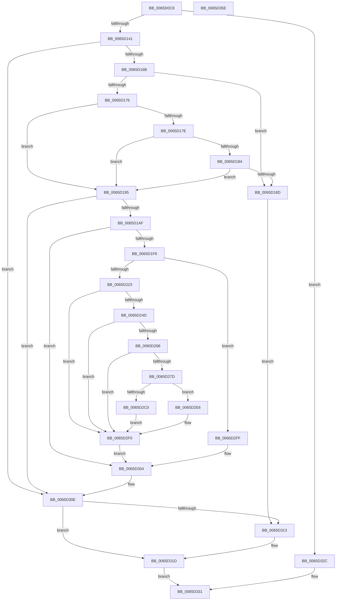

# OpenGlobalizationUserSettingsKey_ForMua

- RVA: `0x0065D0C8`–`0x0065D35F` (길이 `663` bytes)
- VA: `0x000000014065D0C8`
- 실행 섹션: `.text`
- PDB 이름 있음: `예`; PDB Function 태그: `예`
- unwind 정보 RVA: `0x000D5C58`
- 디코드: `166`개 명령, `663/663` bytes 표시
- 미해석 바이트: `0` (있으면 어셈블리에 `.byte`로 보존)

> 이 문서는 커널 이미지의 기계어와 PDB 기호를 분석해 생성했습니다. 4번과 5번은 함수 원형과 자료형을 바이너리 사용 방식에서 추정한 C 해석이며 원본 소스 복구 결과는 아닙니다.

## 1. Dependencies

- 직접 호출 지점: **16**; 고유 호출 대상: **12**
- 직접 호출자로 확인된 함수: **1**
- RIP 상대 이미지 참조: **5**

### Outgoing calls
- `0x0065D130` → [ExAllocatePool2](../../poolcode/B8/ExAllocatePool2_function_00B820F0.md) (function, `0x00B820F0`)
- `0x0065D15C` → [ZwQueryInformationToken](../6A/ZwQueryInformationToken_function_006AD4F0.md) (function, `0x006AD4F0`)
- `0x0065D1A0` → [RtlConvertSidToUnicodeString](../../page/92/RtlConvertSidToUnicodeString_function_00927B30.md) (function, `0x00927B30`)
- `0x0065D1E7` → [RtlGetPersistedStateLocation](../../page/8C/RtlGetPersistedStateLocation_function_008C8DE0.md) (function, `0x008C8DE0`)
- `0x0065D212` → [ExAllocatePool2](../../poolcode/B8/ExAllocatePool2_function_00B820F0.md) (function, `0x00B820F0`)
- `0x0065D23E` → [RtlAppendUnicodeToString](../40/RtlAppendUnicodeToString_function_0040F990.md) (function, `0x0040F990`)
- `0x0065D259` → [RtlAppendUnicodeToString](../40/RtlAppendUnicodeToString_function_0040F990.md) (function, `0x0040F990`)
- `0x0065D272` → [RtlAppendUnicodeStringToString](../40/RtlAppendUnicodeStringToString_function_0040FA50.md) (function, `0x0040FA50`)
- `0x0065D2B7` → [ZwOpenKey](../6A/ZwOpenKey_function_006AD310.md) (function, `0x006AD310`)
- `0x0065D2C5` → [ZwClose](../6A/ZwClose_function_006AD2B0.md) (function, `0x006AD2B0`)
- `0x0065D2DD` → [ZwOpenKey](../6A/ZwOpenKey_function_006AD310.md) (function, `0x006AD310`)
- `0x0065D2F8` → [ExFreePoolWithTag](../../poolcode/B8/ExFreePoolWithTag_function_00B82870.md) (function, `0x00B82870`)
- `0x0065D309` → [RtlFreeAnsiString](../../page/9C/RtlFreeAnsiString_function_009C0800.md) (function, `0x009C0800`)
- `0x0065D316` → [OpenGlobalizationUserSettingsKey_ForSingleUserModel](OpenGlobalizationUserSettingsKey_ForSingleUserModel_function_0065D368.md) (function, `0x0065D368`)
- `0x0065D325` → [ExFreePoolWithTag](../../poolcode/B8/ExFreePoolWithTag_function_00B82870.md) (function, `0x00B82870`)
- `0x0065D33D` → [_security_check_cookie](../6A/_security_check_cookie_function_006AC640.md) (function, `0x006AC640`)

### Direct callers
- [OpenGlobalizationUserSettingsKey](../4D/OpenGlobalizationUserSettingsKey_function_004D5B3C.md) at `0x004D5B7E`

### Static image references
- `0x0065D0E9` → RVA `0x00E0A740` (`.data`; read)
- `0x0065D1BE` → RVA `0x006D05B0` (` ?? ::FNODOBFM::`string'`; read)
- `0x0065D1D9` → RVA `0x006CCF40` (` ?? ::FNODOBFM::`string'`; read)
- `0x0065D1E0` → RVA `0x006D04D0` (` ?? ::FNODOBFM::`string'`; read)
- `0x0065D24D` → RVA `0x006CC5D0` (` ?? ::FNODOBFM::`string'`; read)

## 2. Other-region calls and transfers

- 다른 실행 섹션으로 향하는 call: **7**
  - `0x0065D130` → [ExAllocatePool2](../../poolcode/B8/ExAllocatePool2_function_00B820F0.md) (`.text` → `POOLCODE`)
  - `0x0065D1A0` → [RtlConvertSidToUnicodeString](../../page/92/RtlConvertSidToUnicodeString_function_00927B30.md) (`.text` → `PAGE`)
  - `0x0065D1E7` → [RtlGetPersistedStateLocation](../../page/8C/RtlGetPersistedStateLocation_function_008C8DE0.md) (`.text` → `PAGE`)
  - `0x0065D212` → [ExAllocatePool2](../../poolcode/B8/ExAllocatePool2_function_00B820F0.md) (`.text` → `POOLCODE`)
  - `0x0065D2F8` → [ExFreePoolWithTag](../../poolcode/B8/ExFreePoolWithTag_function_00B82870.md) (`.text` → `POOLCODE`)
  - `0x0065D309` → [RtlFreeAnsiString](../../page/9C/RtlFreeAnsiString_function_009C0800.md) (`.text` → `PAGE`)
  - `0x0065D325` → [ExFreePoolWithTag](../../poolcode/B8/ExFreePoolWithTag_function_00B82870.md) (`.text` → `POOLCODE`)
- 별도 외부 분기/꼬리 이동을 확인하지 못했습니다.

## 3. Assembly (complete function range)

```asm
0065D0C8  48 89 5C 24 08                  mov qword ptr [rsp + 8], rbx
0065D0CD  48 89 74 24 10                  mov qword ptr [rsp + 0x10], rsi
0065D0D2  55                              push rbp
0065D0D3  57                              push rdi
0065D0D4  41 54                           push r12
0065D0D6  41 56                           push r14
0065D0D8  41 57                           push r15
0065D0DA  48 8D AC 24 40 FE FF FF         lea rbp, [rsp - 0x1c0]
0065D0E2  48 81 EC C0 02 00 00            sub rsp, 0x2c0
0065D0E9  48 8B 05 50 D6 7A 00            mov rax, qword ptr [rip + 0x7ad650]
0065D0F0  48 33 C4                        xor rax, rsp
0065D0F3  48 89 85 B0 01 00 00            mov qword ptr [rbp + 0x1b0], rax
0065D0FA  0F 57 C0                        xorps xmm0, xmm0
0065D0FD  33 C0                           xor eax, eax
0065D0FF  4D 8B E0                        mov r12, r8
0065D102  48 89 45 88                     mov qword ptr [rbp - 0x78], rax
0065D106  33 FF                           xor edi, edi
0065D108  89 45 90                        mov dword ptr [rbp - 0x70], eax
0065D10B  41 B8 53 4C 4E 00               mov r8d, 0x4e4c53
0065D111  B9 00 01 00 00                  mov ecx, 0x100
0065D116  49 8B F1                        mov rsi, r9
0065D119  45 33 FF                        xor r15d, r15d
0065D11C  0F 11 44 24 58                  movups xmmword ptr [rsp + 0x58], xmm0
0065D121  8D 5F 54                        lea ebx, [rdi + 0x54]
0065D124  8B D3                           mov edx, ebx
0065D126  0F 11 44 24 68                  movups xmmword ptr [rsp + 0x68], xmm0
0065D12B  0F 11 44 24 78                  movups xmmword ptr [rsp + 0x78], xmm0
0065D130  E8 BB 4F 52 00                  call 0x140b820f0
0065D135  4C 8B F0                        mov r14, rax
0065D138  48 85 C0                        test rax, rax
0065D13B  0F 84 EB 01 00 00               je 0x14065d32c
0065D141  21 7C 24 40                     and dword ptr [rsp + 0x40], edi
0065D145  48 8D 44 24 40                  lea rax, [rsp + 0x40]
0065D14A  44 8B CB                        mov r9d, ebx
0065D14D  48 89 44 24 20                  mov qword ptr [rsp + 0x20], rax
0065D152  4D 8B C6                        mov r8, r14
0065D155  8D 57 01                        lea edx, [rdi + 1]
0065D158  48 8D 4F FA                     lea rcx, [rdi - 6]
0065D15C  E8 8F 03 05 00                  call 0x1406ad4f0
0065D161  8B D8                           mov ebx, eax
0065D163  85 C0                           test eax, eax
0065D165  0F 88 A3 01 00 00               js 0x14065d30e
0065D16B  49 8B 06                        mov rax, qword ptr [r14]
0065D16E  8A 48 01                        mov cl, byte ptr [rax + 1]
0065D171  80 F9 02                        cmp cl, 2
0065D174  72 17                           jb 0x14065d18d
0065D176  48 8B F8                        mov rdi, rax
0065D179  80 F9 05                        cmp cl, 5
0065D17C  75 17                           jne 0x14065d195
0065D17E  83 78 08 15                     cmp dword ptr [rax + 8], 0x15
0065D182  75 11                           jne 0x14065d195
0065D184  81 78 18 F7 01 00 00            cmp dword ptr [rax + 0x18], 0x1f7
0065D18B  75 08                           jne 0x14065d195
0065D18D  44 21 3E                        and dword ptr [rsi], r15d
0065D190  E9 7E 01 00 00                  jmp 0x14065d313
0065D195  41 B0 01                        mov r8b, 1
0065D198  48 8D 4C 24 58                  lea rcx, [rsp + 0x58]
0065D19D  48 8B D7                        mov rdx, rdi
0065D1A0  E8 8B A9 2C 00                  call 0x140927b30
0065D1A5  8B D8                           mov ebx, eax
0065D1A7  85 C0                           test eax, eax
0065D1A9  0F 88 5F 01 00 00               js 0x14065d30e
0065D1AF  44 21 7C 24 40                  and dword ptr [rsp + 0x40], r15d
0065D1B4  48 8D 44 24 40                  lea rax, [rsp + 0x40]
0065D1B9  48 89 44 24 30                  mov qword ptr [rsp + 0x30], rax
0065D1BE  4C 8D 05 EB 33 07 00            lea r8, [rip + 0x733eb]
0065D1C5  48 8D 45 A0                     lea rax, [rbp - 0x60]
0065D1C9  C7 44 24 28 08 02 00 00         mov dword ptr [rsp + 0x28], 0x208
0065D1D1  45 33 C9                        xor r9d, r9d
0065D1D4  48 89 44 24 20                  mov qword ptr [rsp + 0x20], rax
0065D1D9  48 8D 15 60 FD 06 00            lea rdx, [rip + 0x6fd60]
0065D1E0  48 8D 0D E9 32 07 00            lea rcx, [rip + 0x732e9]
0065D1E7  E8 F4 BB 26 00                  call 0x1408c8de0
0065D1EC  8B D8                           mov ebx, eax
0065D1EE  85 C0                           test eax, eax
0065D1F0  0F 88 0E 01 00 00               js 0x14065d304
0065D1F6  0F B7 5C 24 58                  movzx ebx, word ptr [rsp + 0x58]
0065D1FB  B9 00 01 00 00                  mov ecx, 0x100
0065D200  66 83 C3 04                     add bx, 4
0065D204  41 B8 53 4C 4E 00               mov r8d, 0x4e4c53
0065D20A  66 03 5C 24 40                  add bx, word ptr [rsp + 0x40]
0065D20F  0F B7 D3                        movzx edx, bx
0065D212  E8 D9 4E 52 00                  call 0x140b820f0
0065D217  48 8B F8                        mov rdi, rax
0065D21A  48 85 C0                        test rax, rax
0065D21D  0F 84 DC 00 00 00               je 0x14065d2ff
0065D223  0F 57 C0                        xorps xmm0, xmm0
0065D226  48 8D 55 A0                     lea rdx, [rbp - 0x60]
0065D22A  0F 11 44 24 48                  movups xmmword ptr [rsp + 0x48], xmm0
0065D22F  48 8D 4C 24 48                  lea rcx, [rsp + 0x48]
0065D234  66 89 5C 24 4A                  mov word ptr [rsp + 0x4a], bx
0065D239  48 89 44 24 50                  mov qword ptr [rsp + 0x50], rax
0065D23E  E8 4D 27 DB FF                  call 0x14040f990
0065D243  8B D8                           mov ebx, eax
0065D245  85 C0                           test eax, eax
0065D247  0F 88 A3 00 00 00               js 0x14065d2f0
0065D24D  48 8D 15 7C F3 06 00            lea rdx, [rip + 0x6f37c]
0065D254  48 8D 4C 24 48                  lea rcx, [rsp + 0x48]
0065D259  E8 32 27 DB FF                  call 0x14040f990
0065D25E  8B D8                           mov ebx, eax
0065D260  85 C0                           test eax, eax
0065D262  0F 88 88 00 00 00               js 0x14065d2f0
0065D268  48 8D 54 24 58                  lea rdx, [rsp + 0x58]
0065D26D  48 8D 4C 24 48                  lea rcx, [rsp + 0x48]
0065D272  E8 D9 27 DB FF                  call 0x14040fa50
0065D277  8B D8                           mov ebx, eax
0065D279  85 C0                           test eax, eax
0065D27B  78 73                           js 0x14065d2f0
0065D27D  4C 21 7C 24 70                  and qword ptr [rsp + 0x70], r15
0065D282  48 8D 44 24 48                  lea rax, [rsp + 0x48]
0065D287  4C 21 7C 24 40                  and qword ptr [rsp + 0x40], r15
0065D28C  4C 8D 44 24 68                  lea r8, [rsp + 0x68]
0065D291  0F 57 C0                        xorps xmm0, xmm0
0065D294  48 89 44 24 78                  mov qword ptr [rsp + 0x78], rax
0065D299  BA 19 00 02 00                  mov edx, 0x20019
0065D29E  C7 44 24 68 30 00 00 00         mov dword ptr [rsp + 0x68], 0x30
0065D2A6  48 8D 4C 24 40                  lea rcx, [rsp + 0x40]
0065D2AB  C7 45 80 40 02 00 00            mov dword ptr [rbp - 0x80], 0x240
0065D2B2  F3 0F 7F 45 88                  movdqu xmmword ptr [rbp - 0x78], xmm0
0065D2B7  E8 54 00 05 00                  call 0x1406ad310
0065D2BC  85 C0                           test eax, eax
0065D2BE  78 26                           js 0x14065d2e6
0065D2C0  48 8B 4C 24 40                  mov rcx, qword ptr [rsp + 0x40]
0065D2C5  E8 E6 FF 04 00                  call 0x1406ad2b0
0065D2CA  4C 8D 44 24 68                  lea r8, [rsp + 0x68]
0065D2CF  C7 06 02 00 00 00               mov dword ptr [rsi], 2
0065D2D5  BA 08 00 00 00                  mov edx, 8
0065D2DA  49 8B CC                        mov rcx, r12
0065D2DD  E8 2E 00 05 00                  call 0x1406ad310
0065D2E2  8B D8                           mov ebx, eax
0065D2E4  EB 0A                           jmp 0x14065d2f0
0065D2E6  B8 01 00 00 00                  mov eax, 1
0065D2EB  89 06                           mov dword ptr [rsi], eax
0065D2ED  44 8B F8                        mov r15d, eax
0065D2F0  BA 53 4C 4E 00                  mov edx, 0x4e4c53
0065D2F5  48 8B CF                        mov rcx, rdi
0065D2F8  E8 73 55 52 00                  call 0x140b82870
0065D2FD  EB 05                           jmp 0x14065d304
0065D2FF  BB 17 00 00 C0                  mov ebx, 0xc0000017
0065D304  48 8D 4C 24 58                  lea rcx, [rsp + 0x58]
0065D309  E8 F2 34 36 00                  call 0x1409c0800
0065D30E  45 85 FF                        test r15d, r15d
0065D311  74 0A                           je 0x14065d31d
0065D313  49 8B D4                        mov rdx, r12
0065D316  E8 4D 00 00 00                  call 0x14065d368
0065D31B  8B D8                           mov ebx, eax
0065D31D  BA 53 4C 4E 00                  mov edx, 0x4e4c53
0065D322  49 8B CE                        mov rcx, r14
0065D325  E8 46 55 52 00                  call 0x140b82870
0065D32A  EB 05                           jmp 0x14065d331
0065D32C  BB 17 00 00 C0                  mov ebx, 0xc0000017
0065D331  8B C3                           mov eax, ebx
0065D333  48 8B 8D B0 01 00 00            mov rcx, qword ptr [rbp + 0x1b0]
0065D33A  48 33 CC                        xor rcx, rsp
0065D33D  E8 FE F2 04 00                  call 0x1406ac640
0065D342  4C 8D 9C 24 C0 02 00 00         lea r11, [rsp + 0x2c0]
0065D34A  49 8B 5B 30                     mov rbx, qword ptr [r11 + 0x30]
0065D34E  49 8B 73 38                     mov rsi, qword ptr [r11 + 0x38]
0065D352  49 8B E3                        mov rsp, r11
0065D355  41 5F                           pop r15
0065D357  41 5E                           pop r14
0065D359  41 5C                           pop r12
0065D35B  5F                              pop rdi
0065D35C  5D                              pop rbp
0065D35D  C3                              ret
0065D35E  CC                              int3
```

## 4. C-style interpretation (structured pseudocode)

```c
__int64 __fastcall OpenGlobalizationUserSettingsKey_ForMua(__int64 a1, __int64 a2, __int64 a3, __int64 a4)
{
    __int64 result;
    __int64 v_r15;
    __int64 v_rbx;
    __int64 v_rdi;
    __int64 v_rsp;
    unsigned __int64 v_stack_m1E8;
    unsigned __int64 v_stack_m248;
    unsigned int v_stack_m258;
    unsigned __int64 v_stack_m260;
    unsigned int v_stack_m268;
    unsigned __int64 v_stack_m270;
    unsigned __int64 v_stack_m278;
    unsigned __int64 v_stack_m28;
    unsigned __int64 v_stack_m280;
    unsigned __int64 v_stack_m290;
    unsigned __int64 v_stack_m298;
    unsigned __int16 v_stack_m29E;
    unsigned __int64 v_stack_m2A0;
    unsigned int v_stack_m2A8;
    unsigned __int64 v_stack_m2B8;
    unsigned int v_stack_m2C0;
    unsigned __int64 v_stack_m2C8;
    unsigned __int64 v_stack_m38;
    unsigned __int64 v_stack_p10;
    unsigned __int64 v_stack_p8;

    v_stack_p8 = v_rbx;
    v_stack_p10 = v_rsi;
    v_rsp = (v_rsp) - (704);
    result = (*(unsigned __int64 *)(v_rip + 8050256)) ^ (v_rsp);
    v_stack_m38 = result;
    result = 0;
    v_stack_m260 = 0;
    v_rdi = 0;
    v_stack_m258 = 0;
    v_r15 = 0;
    v_stack_m290 = v_xmm0;
    v_stack_m280 = v_xmm0;
    v_stack_m270 = v_xmm0;
    result = ExAllocatePool2(256, (unsigned int)((unsigned int)(v_rdi + 84)), (unsigned int)(0x4E4C53ULL), a4);
    if (result == 0) goto loc_0065D32C;
    v_stack_m2C8 = v_stack_m2A8;
    result = ZwQueryInformationToken(v_rdi - 6, v_rdi + 1, result, (unsigned int)((unsigned int)(v_rdi + 84)));
    if (sign_flag) goto loc_0065D30E;
    if (((unsigned __int8)(*(unsigned __int8 *)(*(unsigned __int64 *)(result) + 1))) < 2) goto loc_0065D18D;
    if (((unsigned __int8)(*(unsigned __int8 *)(*(unsigned __int64 *)(result) + 1))) != 5) goto loc_0065D195;
    if ((*(unsigned int *)(*(unsigned __int64 *)(result) + 8)) != 21) goto loc_0065D195;
    if ((*(unsigned int *)(*(unsigned __int64 *)(result) + 24)) != 503) goto loc_0065D195;
loc_0065D18D:
    goto loc_0065D313;
loc_0065D195:
    result = RtlConvertSidToUnicodeString(v_stack_m290, *(unsigned __int64 *)(result), 1, (unsigned int)((unsigned int)(v_rdi + 84)));
    if (sign_flag) goto loc_0065D30E;
    v_stack_m2B8 = v_stack_m2A8;
    v_stack_m2C0 = 520;
    a4 = 0;
    v_stack_m2C8 = v_stack_m248;
    result = RtlGetPersistedStateLocation(v_rip + 471785, v_rip + 458080, v_rip + 472043, a4);
    if (sign_flag) goto loc_0065D304;
    v_rbx = (unsigned __int16)((v_stack_m290) + (4));
    v_rbx = (unsigned __int16)((v_rbx) + (v_stack_m2A8));
    result = ExAllocatePool2(256, (unsigned __int16)(v_rbx), (unsigned int)(0x4E4C53ULL), a4);
    if (result == 0) goto loc_0065D2FF;
    v_stack_m2A0 = v_xmm0;
    v_stack_m29E = (unsigned __int16)(v_rbx);
    v_stack_m298 = result;
    result = RtlAppendUnicodeToString(v_stack_m2A0, v_stack_m248, (unsigned int)(0x4E4C53ULL), a4);
    if (sign_flag) goto loc_0065D2F0;
    result = RtlAppendUnicodeToString(v_stack_m2A0, v_rip + 455548, (unsigned int)(0x4E4C53ULL), a4);
    if (sign_flag) goto loc_0065D2F0;
    result = RtlAppendUnicodeStringToString(v_stack_m2A0, v_stack_m290, (unsigned int)(0x4E4C53ULL), a4);
    if (sign_flag) goto loc_0065D2F0;
    v_stack_m270 = v_stack_m2A0;
    v_stack_m280 = 48;
    v_stack_m268 = 576;
    v_stack_m260 = v_xmm0;
    result = ZwOpenKey(v_stack_m2A8, (unsigned int)(0x20019ULL), v_stack_m280, a4);
    if (sign_flag) goto loc_0065D2E6;
    result = ZwClose(v_stack_m2A8, (unsigned int)(0x20019ULL), v_stack_m280, a4);
    *(unsigned int *)(a4) = 2;
    result = ZwOpenKey(a3, 8, v_stack_m280, a4);
    goto loc_0065D2F0;
loc_0065D2E6:
    *(unsigned int *)(a4) = 1;
loc_0065D2F0:
    result = ExFreePoolWithTag(result, (unsigned int)(0x4E4C53ULL), v_stack_m280, a4);
    goto loc_0065D304;
loc_0065D2FF:
loc_0065D304:
    result = RtlFreeAnsiString(v_stack_m290, (unsigned int)(0x4E4C53ULL), v_stack_m280, a4);
loc_0065D30E:
    v_rbx = (unsigned int)(0xC0000017ULL);
    if (1 != 0) {
        a2 = a3;
        result = OpenGlobalizationUserSettingsKey_ForSingleUserModel(v_stack_m290, a2, v_stack_m280, a4);
        v_rbx = (unsigned int)(result);
    }
    result = ExFreePoolWithTag(result, (unsigned int)(0x4E4C53ULL), v_stack_m280, a4);
    goto loc_0065D331;
loc_0065D32C:
loc_0065D331:
    a1 = (v_stack_m38) ^ (v_rsp);
    result = _security_check_cookie(a1, (unsigned int)(0x4E4C53ULL), v_stack_m280, a4);
    return result;
}
```

## 5. (Beta) C Style

```c
int64_t OpenGlobalizationUserSettingsKey_ForMua(int64_t Arg1, int64_t Arg2, int64_t Arg3, void *Arg4)
{
    uint8_t *arg4 = (uint8_t *)Arg4;

    int64_t result;
    int64_t local_r15;
    int64_t local_rbx;
    int64_t local_rdi;
    int64_t local_rsp;
    uint64_t v_stack_m1E8;
    uint64_t v_stack_m248;
    uint32_t v_stack_m258;
    uint64_t v_stack_m260;
    uint32_t v_stack_m268;
    uint64_t v_stack_m270;
    uint64_t v_stack_m278;
    uint64_t v_stack_m28;
    uint64_t v_stack_m280;
    uint64_t v_stack_m290;
    uint64_t v_stack_m298;
    uint16_t v_stack_m29E;
    uint64_t v_stack_m2A0;
    uint32_t v_stack_m2A8;
    uint64_t v_stack_m2B8;
    uint32_t v_stack_m2C0;
    uint64_t v_stack_m2C8;
    uint64_t v_stack_m38;
    uint64_t v_stack_p10;
    uint64_t v_stack_p8;

    v_stack_p8 = local_rbx;
    v_stack_p10 = local_rsi;
    local_rsp = (local_rsp) - (704);
    result = (*(uint64_t *)(v_rip + 0x7AD650)) ^ (local_rsp);
    v_stack_m38 = result;
    result = 0;
    v_stack_m260 = 0;
    local_rdi = 0;
    v_stack_m258 = 0;
    local_r15 = 0;
    v_stack_m290 = v_xmm0;
    v_stack_m280 = v_xmm0;
    v_stack_m270 = v_xmm0;
    result = ExAllocatePool2(256, (uint32_t)((uint32_t)(local_rdi + 84)), (uint32_t)(0x4E4C53ULL), Arg4);
    if (result == 0) goto loc_0065D32C;
    v_stack_m2C8 = v_stack_m2A8;
    result = ZwQueryInformationToken(local_rdi - 6, local_rdi + 1, result, (uint32_t)((uint32_t)(local_rdi + 84)));
    if (sign_flag) goto loc_0065D30E;
    if (((uint8_t)(*(uint8_t *)(*(uint64_t *)(result) + 0x1))) < 2) goto loc_0065D18D;
    if (((uint8_t)(*(uint8_t *)(*(uint64_t *)(result) + 0x1))) != 5) goto loc_0065D195;
    if ((*(uint32_t *)(*(uint64_t *)(result) + 0x8)) != 21) goto loc_0065D195;
    if ((*(uint32_t *)(*(uint64_t *)(result) + 0x18)) != 503) goto loc_0065D195;
loc_0065D18D:
    goto loc_0065D313;
loc_0065D195:
    result = RtlConvertSidToUnicodeString(v_stack_m290, *(uint64_t *)(result), 1, (uint32_t)((uint32_t)(local_rdi + 84)));
    if (sign_flag) goto loc_0065D30E;
    v_stack_m2B8 = v_stack_m2A8;
    v_stack_m2C0 = 520;
    Arg4 = 0;
    v_stack_m2C8 = v_stack_m248;
    result = RtlGetPersistedStateLocation(v_rip + 471785, v_rip + 458080, v_rip + 472043, Arg4);
    if (sign_flag) goto loc_0065D304;
    local_rbx = (uint16_t)((v_stack_m290) + (4));
    local_rbx = (uint16_t)((local_rbx) + (v_stack_m2A8));
    result = ExAllocatePool2(256, (uint16_t)(local_rbx), (uint32_t)(0x4E4C53ULL), Arg4);
    if (result == 0) goto loc_0065D2FF;
    v_stack_m2A0 = v_xmm0;
    v_stack_m29E = (uint16_t)(local_rbx);
    v_stack_m298 = result;
    result = RtlAppendUnicodeToString(v_stack_m2A0, v_stack_m248, (uint32_t)(0x4E4C53ULL), Arg4);
    if (sign_flag) goto loc_0065D2F0;
    result = RtlAppendUnicodeToString(v_stack_m2A0, v_rip + 455548, (uint32_t)(0x4E4C53ULL), Arg4);
    if (sign_flag) goto loc_0065D2F0;
    result = RtlAppendUnicodeStringToString(v_stack_m2A0, v_stack_m290, (uint32_t)(0x4E4C53ULL), Arg4);
    if (sign_flag) goto loc_0065D2F0;
    v_stack_m270 = v_stack_m2A0;
    v_stack_m280 = 48;
    v_stack_m268 = 576;
    v_stack_m260 = v_xmm0;
    result = ZwOpenKey(v_stack_m2A8, (uint32_t)(0x20019ULL), v_stack_m280, Arg4);
    if (sign_flag) goto loc_0065D2E6;
    result = ZwClose(v_stack_m2A8, (uint32_t)(0x20019ULL), v_stack_m280, Arg4);
    *(uint32_t *)(arg4) = 2;
    result = ZwOpenKey(Arg3, 8, v_stack_m280, Arg4);
    goto loc_0065D2F0;
loc_0065D2E6:
    *(uint32_t *)(arg4) = 1;
loc_0065D2F0:
    result = ExFreePoolWithTag(result, (uint32_t)(0x4E4C53ULL), v_stack_m280, Arg4);
    goto loc_0065D304;
loc_0065D2FF:
loc_0065D304:
    result = RtlFreeAnsiString(v_stack_m290, (uint32_t)(0x4E4C53ULL), v_stack_m280, Arg4);
loc_0065D30E:
    local_rbx = (uint32_t)(0xC0000017ULL);
    if (1 != 0) {
        Arg2 = Arg3;
        result = OpenGlobalizationUserSettingsKey_ForSingleUserModel(v_stack_m290, Arg2, v_stack_m280, Arg4);
        local_rbx = (uint32_t)(result);
    }
    result = ExFreePoolWithTag(result, (uint32_t)(0x4E4C53ULL), v_stack_m280, Arg4);
    goto loc_0065D331;
loc_0065D32C:
loc_0065D331:
    Arg1 = (v_stack_m38) ^ (local_rsp);
    result = _security_check_cookie(Arg1, (uint32_t)(0x4E4C53ULL), v_stack_m280, Arg4);
    return result;
}
```

### 관측된 메모리 오프셋

구조체 형식이 확인되지 않은 접근은 인자 기준의 오프셋으로만 기록했습니다.

| 기준 인자 | 오프셋 표현 | 폭 (bit) | 접근 |
|---|---:|---:|---|
| `Arg4` | `+ 0x0` | `32` | `R/W` |
| `Arg4` | `+ 0x0` | `32` | `W` |

## 6. Execution-region graph

[열기: 2D/3D 그래프와 함수 탐색 컨트롤 패널](../../../control-panel.html?section=text&rva=0x0065D0C8&view=graph)

- 2D 그래프는 위에서 아래로 흐르고, 3D 그래프는 빈 공간을 드래그해 회전합니다. Shift+드래그는 이동, 휠은 확대·축소, 함수 노드 선택은 대상 보고서 이동입니다.

### Static fallback


