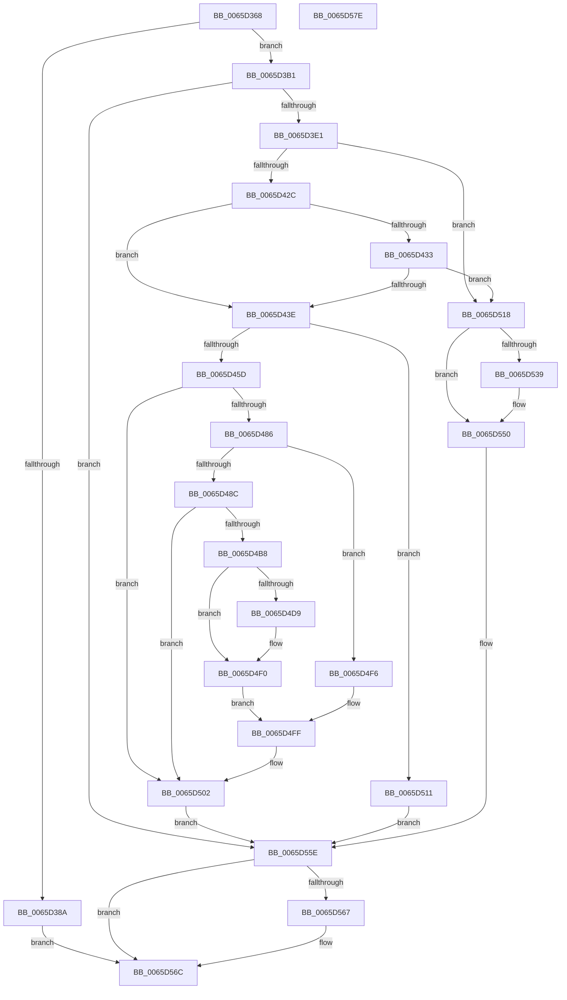

# OpenGlobalizationUserSettingsKey_ForSingleUserModel

- RVA: `0x0065D368`–`0x0065D57F` (길이 `535` bytes)
- VA: `0x000000014065D368`
- 실행 섹션: `.text`
- PDB 이름 있음: `예`; PDB Function 태그: `예`
- unwind 정보 RVA: `0x000D5C80`
- 디코드: `137`개 명령, `535/535` bytes 표시
- 미해석 바이트: `0` (있으면 어셈블리에 `.byte`로 보존)

> 이 문서는 커널 이미지의 기계어와 PDB 기호를 분석해 생성했습니다. 4번과 5번은 함수 원형과 자료형을 바이너리 사용 방식에서 추정한 C 해석이며 원본 소스 복구 결과는 아닙니다.

## 1. Dependencies

- 직접 호출 지점: **14**; 고유 호출 대상: **7**
- 직접 호출자로 확인된 함수: **2**
- RIP 상대 이미지 참조: **5**

### Outgoing calls
- `0x0065D399` → [RtlInitUnicodeString](../42/RtlInitUnicodeString_function_0042A780.md) (function, `0x0042A780`)
- `0x0065D3A5` → [OpenRegistryKey](OpenRegistryKey_function_0065D588.md) (function, `0x0065D588`)
- `0x0065D3C5` → [RtlInitUnicodeString](../42/RtlInitUnicodeString_function_0042A780.md) (function, `0x0042A780`)
- `0x0065D3D2` → [OpenRegistryKey](OpenRegistryKey_function_0065D588.md) (function, `0x0065D588`)
- `0x0065D3F7` → [RtlInitUnicodeString](../42/RtlInitUnicodeString_function_0042A780.md) (function, `0x0042A780`)
- `0x0065D41C` → [ZwQueryValueKey](../6A/ZwQueryValueKey_function_006AD3B0.md) (function, `0x006AD3B0`)
- `0x0065D44C` → [ExAllocatePool2](../../poolcode/B8/ExAllocatePool2_function_00B820F0.md) (function, `0x00B820F0`)
- `0x0065D47B` → [ZwQueryValueKey](../6A/ZwQueryValueKey_function_006AD3B0.md) (function, `0x006AD3B0`)
- `0x0065D4A0` → [RtlInitUnicodeString](../42/RtlInitUnicodeString_function_0042A780.md) (function, `0x0042A780`)
- `0x0065D4AD` → [OpenRegistryKey](OpenRegistryKey_function_0065D588.md) (function, `0x0065D588`)
- `0x0065D4E1` → [RtlCopyUnicodeString](../3F/RtlCopyUnicodeString_function_003FEF30.md) (function, `0x003FEF30`)
- `0x0065D50A` → [ExFreePoolWithTag](../../poolcode/B8/ExFreePoolWithTag_function_00B82870.md) (function, `0x00B82870`)
- `0x0065D541` → [RtlCopyUnicodeString](../3F/RtlCopyUnicodeString_function_003FEF30.md) (function, `0x003FEF30`)
- `0x0065D567` → [ZwClose](../6A/ZwClose_function_006AD2B0.md) (function, `0x006AD2B0`)

### Direct callers
- [OpenGlobalizationUserSettingsKey](../4D/OpenGlobalizationUserSettingsKey_function_004D5B3C.md) at `0x004D5B88`
- [OpenGlobalizationUserSettingsKey_ForMua](OpenGlobalizationUserSettingsKey_ForMua_function_0065D0C8.md) at `0x0065D316`

### Static image references
- `0x0065D37B` → RVA `0x00EEEFE8` (`.data`; read)
- `0x0065D38A` → RVA `0x00E62420` (`.data`; read)
- `0x0065D3B6` → RVA `0x006D0510` (` ?? ::FNODOBFM::`string'`; read)
- `0x0065D3E5` → RVA `0x006D0640` (` ?? ::FNODOBFM::`string'`; read)
- `0x0065D4E6` → RVA `0x00EEEFE8` (`.data`; write)

## 2. Other-region calls and transfers

- 다른 실행 섹션으로 향하는 call: **2**
  - `0x0065D44C` → [ExAllocatePool2](../../poolcode/B8/ExAllocatePool2_function_00B820F0.md) (`.text` → `POOLCODE`)
  - `0x0065D50A` → [ExFreePoolWithTag](../../poolcode/B8/ExFreePoolWithTag_function_00B82870.md) (`.text` → `POOLCODE`)
- 별도 외부 분기/꼬리 이동을 확인하지 못했습니다.

## 3. Assembly (complete function range)

```asm
0065D368  48 89 5C 24 10                  mov qword ptr [rsp + 0x10], rbx
0065D36D  89 4C 24 08                     mov dword ptr [rsp + 8], ecx
0065D371  55                              push rbp
0065D372  56                              push rsi
0065D373  57                              push rdi
0065D374  48 8B EC                        mov rbp, rsp
0065D377  48 83 EC 70                     sub rsp, 0x70
0065D37B  83 3D 66 1C 89 00 00            cmp dword ptr [rip + 0x891c66], 0
0065D382  48 8B FA                        mov rdi, rdx
0065D385  0F 57 C0                        xorps xmm0, xmm0
0065D388  74 27                           je 0x14065d3b1
0065D38A  48 8D 15 8F 50 80 00            lea rdx, [rip + 0x80508f]
0065D391  48 8D 4D F0                     lea rcx, [rbp - 0x10]
0065D395  0F 11 45 F0                     movups xmmword ptr [rbp - 0x10], xmm0
0065D399  E8 E2 D3 DC FF                  call 0x14042a780
0065D39E  4C 8B C7                        mov r8, rdi
0065D3A1  48 8D 55 F0                     lea rdx, [rbp - 0x10]
0065D3A5  E8 DE 01 00 00                  call 0x14065d588
0065D3AA  8B D8                           mov ebx, eax
0065D3AC  E9 BB 01 00 00                  jmp 0x14065d56c
0065D3B1  48 83 65 30 00                  and qword ptr [rbp + 0x30], 0
0065D3B6  48 8D 15 53 31 07 00            lea rdx, [rip + 0x73153]
0065D3BD  48 8D 4D D0                     lea rcx, [rbp - 0x30]
0065D3C1  0F 11 45 D0                     movups xmmword ptr [rbp - 0x30], xmm0
0065D3C5  E8 B6 D3 DC FF                  call 0x14042a780
0065D3CA  4C 8D 45 30                     lea r8, [rbp + 0x30]
0065D3CE  48 8D 55 D0                     lea rdx, [rbp - 0x30]
0065D3D2  E8 B1 01 00 00                  call 0x14065d588
0065D3D7  8B D8                           mov ebx, eax
0065D3D9  85 C0                           test eax, eax
0065D3DB  0F 88 7D 01 00 00               js 0x14065d55e
0065D3E1  83 65 20 00                     and dword ptr [rbp + 0x20], 0
0065D3E5  48 8D 15 54 32 07 00            lea rdx, [rip + 0x73254]
0065D3EC  0F 57 C0                        xorps xmm0, xmm0
0065D3EF  48 8D 4D E0                     lea rcx, [rbp - 0x20]
0065D3F3  0F 11 45 E0                     movups xmmword ptr [rbp - 0x20], xmm0
0065D3F7  E8 84 D3 DC FF                  call 0x14042a780
0065D3FC  48 8B 4D 30                     mov rcx, qword ptr [rbp + 0x30]
0065D400  48 8D 45 20                     lea rax, [rbp + 0x20]
0065D404  45 33 C9                        xor r9d, r9d
0065D407  48 89 44 24 28                  mov qword ptr [rsp + 0x28], rax
0065D40C  83 64 24 20 00                  and dword ptr [rsp + 0x20], 0
0065D411  48 8D 55 E0                     lea rdx, [rbp - 0x20]
0065D415  41 8D 59 02                     lea ebx, [r9 + 2]
0065D419  44 8B C3                        mov r8d, ebx
0065D41C  E8 8F FF 04 00                  call 0x1406ad3b0
0065D421  8B 4D 20                        mov ecx, dword ptr [rbp + 0x20]
0065D424  85 C9                           test ecx, ecx
0065D426  0F 84 EC 00 00 00               je 0x14065d518
0065D42C  3D 23 00 00 C0                  cmp eax, 0xc0000023
0065D431  74 0B                           je 0x14065d43e
0065D433  3D 05 00 00 80                  cmp eax, 0x80000005
0065D438  0F 85 DA 00 00 00               jne 0x14065d518
0065D43E  48 8B D1                        mov rdx, rcx
0065D441  41 B8 53 4C 4E 00               mov r8d, 0x4e4c53
0065D447  B9 00 01 00 00                  mov ecx, 0x100
0065D44C  E8 9F 4C 52 00                  call 0x140b820f0
0065D451  48 8B F0                        mov rsi, rax
0065D454  48 85 C0                        test rax, rax
0065D457  0F 84 B4 00 00 00               je 0x14065d511
0065D45D  8B 4D 20                        mov ecx, dword ptr [rbp + 0x20]
0065D460  48 8D 45 20                     lea rax, [rbp + 0x20]
0065D464  48 89 44 24 28                  mov qword ptr [rsp + 0x28], rax
0065D469  48 8D 55 E0                     lea rdx, [rbp - 0x20]
0065D46D  89 4C 24 20                     mov dword ptr [rsp + 0x20], ecx
0065D471  4C 8B CE                        mov r9, rsi
0065D474  48 8B 4D 30                     mov rcx, qword ptr [rbp + 0x30]
0065D478  44 8B C3                        mov r8d, ebx
0065D47B  E8 30 FF 04 00                  call 0x1406ad3b0
0065D480  8B D8                           mov ebx, eax
0065D482  85 C0                           test eax, eax
0065D484  78 7C                           js 0x14065d502
0065D486  83 7E 04 01                     cmp dword ptr [rsi + 4], 1
0065D48A  75 6A                           jne 0x14065d4f6
0065D48C  48 83 65 38 00                  and qword ptr [rbp + 0x38], 0
0065D491  48 8D 56 0C                     lea rdx, [rsi + 0xc]
0065D495  0F 57 C0                        xorps xmm0, xmm0
0065D498  48 8D 4D C0                     lea rcx, [rbp - 0x40]
0065D49C  0F 11 45 C0                     movups xmmword ptr [rbp - 0x40], xmm0
0065D4A0  E8 DB D2 DC FF                  call 0x14042a780
0065D4A5  4C 8D 45 38                     lea r8, [rbp + 0x38]
0065D4A9  48 8D 55 C0                     lea rdx, [rbp - 0x40]
0065D4AD  E8 D6 00 00 00                  call 0x14065d588
0065D4B2  8B D8                           mov ebx, eax
0065D4B4  85 C0                           test eax, eax
0065D4B6  78 4A                           js 0x14065d502
0065D4B8  B9 AA 00 00 00                  mov ecx, 0xaa
0065D4BD  48 8D 05 5C 4F 80 00            lea rax, [rip + 0x804f5c]
0065D4C4  0F 57 C0                        xorps xmm0, xmm0
0065D4C7  0F 11 45 F0                     movups xmmword ptr [rbp - 0x10], xmm0
0065D4CB  66 89 4D F2                     mov word ptr [rbp - 0xe], cx
0065D4CF  48 89 45 F8                     mov qword ptr [rbp - 8], rax
0065D4D3  66 3B 4D C0                     cmp cx, word ptr [rbp - 0x40]
0065D4D7  72 17                           jb 0x14065d4f0
0065D4D9  48 8D 55 C0                     lea rdx, [rbp - 0x40]
0065D4DD  48 8D 4D F0                     lea rcx, [rbp - 0x10]
0065D4E1  E8 4A 1A DA FF                  call 0x1403fef30
0065D4E6  C7 05 F8 1A 89 00 01 00 00 00   mov dword ptr [rip + 0x891af8], 1
0065D4F0  48 8B 45 38                     mov rax, qword ptr [rbp + 0x38]
0065D4F4  EB 09                           jmp 0x14065d4ff
0065D4F6  48 8B 45 30                     mov rax, qword ptr [rbp + 0x30]
0065D4FA  48 83 65 30 00                  and qword ptr [rbp + 0x30], 0
0065D4FF  48 89 07                        mov qword ptr [rdi], rax
0065D502  BA 53 4C 4E 00                  mov edx, 0x4e4c53
0065D507  48 8B CE                        mov rcx, rsi
0065D50A  E8 61 53 52 00                  call 0x140b82870
0065D50F  EB 4D                           jmp 0x14065d55e
0065D511  BB 17 00 00 C0                  mov ebx, 0xc0000017
0065D516  EB 46                           jmp 0x14065d55e
0065D518  B9 AA 00 00 00                  mov ecx, 0xaa
0065D51D  48 8D 05 FC 4E 80 00            lea rax, [rip + 0x804efc]
0065D524  0F 57 C0                        xorps xmm0, xmm0
0065D527  0F 11 45 F0                     movups xmmword ptr [rbp - 0x10], xmm0
0065D52B  66 89 4D F2                     mov word ptr [rbp - 0xe], cx
0065D52F  48 89 45 F8                     mov qword ptr [rbp - 8], rax
0065D533  66 3B 4D D0                     cmp cx, word ptr [rbp - 0x30]
0065D537  72 17                           jb 0x14065d550
0065D539  48 8D 55 D0                     lea rdx, [rbp - 0x30]
0065D53D  48 8D 4D F0                     lea rcx, [rbp - 0x10]
0065D541  E8 EA 19 DA FF                  call 0x1403fef30
0065D546  C7 05 98 1A 89 00 01 00 00 00   mov dword ptr [rip + 0x891a98], 1
0065D550  48 8B 45 30                     mov rax, qword ptr [rbp + 0x30]
0065D554  48 83 65 30 00                  and qword ptr [rbp + 0x30], 0
0065D559  33 DB                           xor ebx, ebx
0065D55B  48 89 07                        mov qword ptr [rdi], rax
0065D55E  48 8B 4D 30                     mov rcx, qword ptr [rbp + 0x30]
0065D562  48 85 C9                        test rcx, rcx
0065D565  74 05                           je 0x14065d56c
0065D567  E8 44 FD 04 00                  call 0x1406ad2b0
0065D56C  8B C3                           mov eax, ebx
0065D56E  48 8B 9C 24 98 00 00 00         mov rbx, qword ptr [rsp + 0x98]
0065D576  48 83 C4 70                     add rsp, 0x70
0065D57A  5F                              pop rdi
0065D57B  5E                              pop rsi
0065D57C  5D                              pop rbp
0065D57D  C3                              ret
0065D57E  CC                              int3
```

## 4. C-style interpretation (structured pseudocode)

```c
__int64 __fastcall OpenGlobalizationUserSettingsKey_ForSingleUserModel(int a1, __int64 a2, __int64 a3, int a4)
{
    __int64 result;
    __int64 v_rbx;
    __int64 v_rsp;
    unsigned __int64 v_stack_m20;
    unsigned __int16 v_stack_m26;
    unsigned __int64 v_stack_m28;
    unsigned __int64 v_stack_m38;
    unsigned __int64 v_stack_m48;
    unsigned __int64 v_stack_m58;
    unsigned __int64 v_stack_m60;
    unsigned int v_stack_m68;
    unsigned __int64 v_stack_p10;
    unsigned __int64 v_stack_p18;
    unsigned __int64 v_stack_p20;
    unsigned int v_stack_p8;

    v_stack_p10 = v_rbx;
    v_stack_p8 = a1;
    v_rsp = (v_rsp) - (112);
    if ((*(unsigned int *)(v_rip + 8985702)) == 0) goto loc_0065D3B1;
    v_stack_m28 = v_xmm0;
    result = RtlInitUnicodeString(v_stack_m28, v_rip + 8409231, a3, a4);
    result = OpenRegistryKey(v_stack_m28, v_stack_m28, a2, a4);
    goto loc_0065D56C;
loc_0065D3B1:
    v_stack_m48 = v_xmm0;
    result = RtlInitUnicodeString(v_stack_m48, v_rip + 471379, a2, a4);
    result = OpenRegistryKey(v_stack_m48, v_stack_m48, v_stack_p18, a4);
    if (sign_flag) goto loc_0065D55E;
    v_stack_m38 = v_xmm0;
    result = RtlInitUnicodeString(v_stack_m38, v_rip + 471636, v_stack_p18, a4);
    a4 = 0;
    v_stack_m60 = v_stack_p8;
    result = ZwQueryValueKey(v_stack_p18, v_stack_m38, (unsigned int)((unsigned int)(a4 + 2)), a4);
    if ((unsigned int)((unsigned int)(v_stack_p8)) == 0) goto loc_0065D518;
    if (((unsigned int)(result)) == 0xC0000023ULL) goto loc_0065D43E;
    if (((unsigned int)(result)) != 0x80000005ULL) goto loc_0065D518;
loc_0065D43E:
    result = ExAllocatePool2(256, (unsigned int)(v_stack_p8), (unsigned int)(0x4E4C53ULL), a4);
    if (result == 0) goto loc_0065D511;
    v_stack_m60 = v_stack_p8;
    v_stack_m68 = (unsigned int)((unsigned int)(v_stack_p8));
    result = ZwQueryValueKey(v_stack_p18, v_stack_m38, (unsigned int)((unsigned int)(a4 + 2)), result);
    if (sign_flag) goto loc_0065D502;
    if ((*(unsigned int *)(result + 4)) != 1) goto loc_0065D4F6;
    v_stack_m58 = v_xmm0;
    result = RtlInitUnicodeString(v_stack_m58, result + 12, (unsigned int)((unsigned int)(a4 + 2)), result);
    result = OpenRegistryKey(v_stack_m58, v_stack_m58, v_stack_p20, result);
    if (sign_flag) goto loc_0065D502;
    v_stack_m28 = v_xmm0;
    v_stack_m26 = 170;
    v_stack_m20 = v_rip + 8408924;
    result = v_rip + 8408924;
    if (170 >= v_stack_m58) {
        a2 = v_stack_m58;
        a1 = v_stack_m28;
        result = RtlCopyUnicodeString(a1, a2, v_stack_p20, result);
        *(unsigned int *)(v_rip + 8985336) = 1;
    }
    goto loc_0065D4FF;
loc_0065D4F6:
loc_0065D4FF:
    *(unsigned __int64 *)(a2) = v_stack_p18;
loc_0065D502:
    result = ExFreePoolWithTag(result, (unsigned int)(0x4E4C53ULL), v_stack_p20, result);
    goto loc_0065D55E;
loc_0065D511:
    goto loc_0065D55E;
loc_0065D518:
    v_stack_m28 = v_xmm0;
    v_stack_m26 = 170;
    v_stack_m20 = v_rip + 8408828;
    result = v_rip + 8408828;
    if (170 >= v_stack_m48) {
        a2 = v_stack_m48;
        a1 = v_stack_m28;
        result = RtlCopyUnicodeString(a1, a2, v_stack_p20, result);
        *(unsigned int *)(v_rip + 8985240) = 1;
    }
    v_rbx = 0;
    *(unsigned __int64 *)(a2) = v_stack_p18;
loc_0065D55E:
    result = v_stack_p18;
    if (v_stack_p18 != 0) {
        result = ZwClose(v_stack_p18, a2, v_stack_p20, result);
    }
    v_rsp = (v_rsp) + (112);
    return 0;
}
```

## 5. (Beta) C Style

```c
int64_t OpenGlobalizationUserSettingsKey_ForSingleUserModel(int32_t Arg1, void *Arg2, int64_t Arg3, int32_t Arg4)
{
    uint8_t *arg2 = (uint8_t *)Arg2;

    int64_t result;
    int64_t local_rbx;
    int64_t local_rsp;
    uint64_t v_stack_m20;
    uint16_t v_stack_m26;
    uint64_t v_stack_m28;
    uint64_t v_stack_m38;
    uint64_t v_stack_m48;
    uint64_t v_stack_m58;
    uint64_t v_stack_m60;
    uint32_t v_stack_m68;
    uint64_t v_stack_p10;
    uint64_t v_stack_p18;
    uint64_t v_stack_p20;
    uint32_t v_stack_p8;

    v_stack_p10 = local_rbx;
    v_stack_p8 = Arg1;
    local_rsp = (local_rsp) - (112);
    if ((*(uint32_t *)(v_rip + 0x891C66)) == 0) goto loc_0065D3B1;
    v_stack_m28 = v_xmm0;
    result = RtlInitUnicodeString(v_stack_m28, v_rip + 8409231, Arg3, Arg4);
    result = OpenRegistryKey(v_stack_m28, v_stack_m28, Arg2, Arg4);
    goto loc_0065D56C;
loc_0065D3B1:
    v_stack_m48 = v_xmm0;
    result = RtlInitUnicodeString(v_stack_m48, v_rip + 471379, Arg2, Arg4);
    result = OpenRegistryKey(v_stack_m48, v_stack_m48, v_stack_p18, Arg4);
    if (sign_flag) goto loc_0065D55E;
    v_stack_m38 = v_xmm0;
    result = RtlInitUnicodeString(v_stack_m38, v_rip + 471636, v_stack_p18, Arg4);
    Arg4 = 0;
    v_stack_m60 = v_stack_p8;
    result = ZwQueryValueKey(v_stack_p18, v_stack_m38, (uint32_t)((uint32_t)(Arg4 + 2)), Arg4);
    if ((uint32_t)((uint32_t)(v_stack_p8)) == 0) goto loc_0065D518;
    if (((uint32_t)(result)) == 0xC0000023ULL) goto loc_0065D43E;
    if (((uint32_t)(result)) != 0x80000005ULL) goto loc_0065D518;
loc_0065D43E:
    result = ExAllocatePool2(256, (uint32_t)(v_stack_p8), (uint32_t)(0x4E4C53ULL), Arg4);
    if (result == 0) goto loc_0065D511;
    v_stack_m60 = v_stack_p8;
    v_stack_m68 = (uint32_t)((uint32_t)(v_stack_p8));
    result = ZwQueryValueKey(v_stack_p18, v_stack_m38, (uint32_t)((uint32_t)(Arg4 + 2)), result);
    if (sign_flag) goto loc_0065D502;
    if ((*(uint32_t *)(result + 0x4)) != 1) goto loc_0065D4F6;
    v_stack_m58 = v_xmm0;
    result = RtlInitUnicodeString(v_stack_m58, result + 12, (uint32_t)((uint32_t)(Arg4 + 2)), result);
    result = OpenRegistryKey(v_stack_m58, v_stack_m58, v_stack_p20, result);
    if (sign_flag) goto loc_0065D502;
    v_stack_m28 = v_xmm0;
    v_stack_m26 = 170;
    v_stack_m20 = v_rip + 8408924;
    result = v_rip + 8408924;
    if (170 >= v_stack_m58) {
        Arg2 = v_stack_m58;
        Arg1 = v_stack_m28;
        result = RtlCopyUnicodeString(Arg1, Arg2, v_stack_p20, result);
        *(uint32_t *)(v_rip + 0x891AF8) = 1;
    }
    goto loc_0065D4FF;
loc_0065D4F6:
loc_0065D4FF:
    *(uint64_t *)(arg2) = v_stack_p18;
loc_0065D502:
    result = ExFreePoolWithTag(result, (uint32_t)(0x4E4C53ULL), v_stack_p20, result);
    goto loc_0065D55E;
loc_0065D511:
    goto loc_0065D55E;
loc_0065D518:
    v_stack_m28 = v_xmm0;
    v_stack_m26 = 170;
    v_stack_m20 = v_rip + 8408828;
    result = v_rip + 8408828;
    if (170 >= v_stack_m48) {
        Arg2 = v_stack_m48;
        Arg1 = v_stack_m28;
        result = RtlCopyUnicodeString(Arg1, Arg2, v_stack_p20, result);
        *(uint32_t *)(v_rip + 0x891A98) = 1;
    }
    local_rbx = 0;
    *(uint64_t *)(arg2) = v_stack_p18;
loc_0065D55E:
    result = v_stack_p18;
    if (v_stack_p18 != 0) {
        result = ZwClose(v_stack_p18, Arg2, v_stack_p20, result);
    }
    local_rsp = (local_rsp) + (112);
    return 0;
}
```

### 관측된 메모리 오프셋

구조체 형식이 확인되지 않은 접근은 인자 기준의 오프셋으로만 기록했습니다.

| 기준 인자 | 오프셋 표현 | 폭 (bit) | 접근 |
|---|---:|---:|---|
| `Arg2` | `+ 0x0` | `64` | `W` |

## 6. Execution-region graph

[열기: 2D/3D 그래프와 함수 탐색 컨트롤 패널](../../../control-panel.html?section=text&rva=0x0065D368&view=graph)

- 2D 그래프는 위에서 아래로 흐르고, 3D 그래프는 빈 공간을 드래그해 회전합니다. Shift+드래그는 이동, 휠은 확대·축소, 함수 노드 선택은 대상 보고서 이동입니다.

### Static fallback


