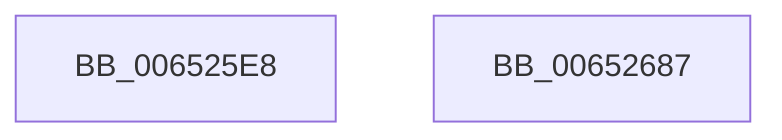

# PerfLogExecutiveResourceInitialize

- RVA: `0x006525E8`–`0x00652688` (길이 `160` bytes)
- VA: `0x00000001406525E8`
- 실행 섹션: `.text`
- PDB 이름 있음: `예`; PDB Function 태그: `아니요`
- unwind 정보 RVA: `0x000886E8`
- 디코드: `35`개 명령, `160/160` bytes 표시
- 미해석 바이트: `0` (있으면 어셈블리에 `.byte`로 보존)

> 이 문서는 커널 이미지의 기계어와 PDB 기호를 분석해 생성했습니다. 4번과 5번은 함수 원형과 자료형을 바이너리 사용 방식에서 추정한 C 해석이며 원본 소스 복구 결과는 아닙니다.

## 1. Dependencies

- 직접 호출 지점: **2**; 고유 호출 대상: **2**
- 직접 호출자로 확인된 함수: **3**
- RIP 상대 이미지 참조: **1**

### Outgoing calls
- `0x0065266D` → [EtwTraceKernelEvent](../23/EtwTraceKernelEvent_function_00235350.md) (function, `0x00235350`)
- `0x00652679` → [_security_check_cookie](../6A/_security_check_cookie_function_006AC640.md) (function, `0x006AC640`)

### Direct callers
- [sub_0038BEEF](../38/Unknown_function_0038BEEF.md) at `0x0038C01F`
- [ExInitializeResourceLite2](../41/ExInitializeResourceLite2_function_0041F710.md) at `0x0041F827`
- [sub_0041FA0C](../41/Unknown_function_0041FA0C.md) at `0x0041FA23`

### Static image references
- `0x006525F4` → RVA `0x00E0A740` (`.data`; read)

## 2. Other-region calls and transfers

- 다른 실행 섹션으로 향하는 call: **0**
- 별도 외부 분기/꼬리 이동을 확인하지 못했습니다.

## 3. Assembly (complete function range)

```asm
006525E8  40 55                           push rbp
006525EA  48 8B EC                        mov rbp, rsp
006525ED  48 81 EC 80 00 00 00            sub rsp, 0x80
006525F4  48 8B 05 45 81 7B 00            mov rax, qword ptr [rip + 0x7b8145]
006525FB  48 33 C4                        xor rax, rsp
006525FE  48 89 45 F0                     mov qword ptr [rbp - 0x10], rax
00652602  65 48 8B 04 25 20 00 00 00      mov rax, qword ptr gs:[0x20]
0065260B  45 33 D2                        xor r10d, r10d
0065260E  C7 44 24 20 02 18 60 01         mov dword ptr [rsp + 0x20], 0x1601802
00652616  FF 80 70 8F 00 00               inc dword ptr [rax + 0x8f70]
0065261C  89 4D D8                        mov dword ptr [rbp - 0x28], ecx
0065261F  48 89 55 D0                     mov qword ptr [rbp - 0x30], rdx
00652623  41 8D 52 01                     lea edx, [r10 + 1]
00652627  44 89 45 C8                     mov dword ptr [rbp - 0x38], r8d
0065262B  41 B8 00 00 02 20               mov r8d, 0x20020000
00652631  44 89 4D DC                     mov dword ptr [rbp - 0x24], r9d
00652635  41 B9 2B 05 00 00               mov r9d, 0x52b
0065263B  4C 89 55 B0                     mov qword ptr [rbp - 0x50], r10
0065263F  4C 89 55 B8                     mov qword ptr [rbp - 0x48], r10
00652643  4C 89 55 C0                     mov qword ptr [rbp - 0x40], r10
00652647  65 48 8B 04 25 88 01 00 00      mov rax, qword ptr gs:[0x188]
00652650  48 C7 45 E8 30 00 00 00         mov qword ptr [rbp - 0x18], 0x30
00652658  8B 88 10 05 00 00               mov ecx, dword ptr [rax + 0x510]
0065265E  48 8D 45 B0                     lea rax, [rbp - 0x50]
00652662  89 4D CC                        mov dword ptr [rbp - 0x34], ecx
00652665  48 8D 4D E0                     lea rcx, [rbp - 0x20]
00652669  48 89 45 E0                     mov qword ptr [rbp - 0x20], rax
0065266D  E8 DE 2C BE FF                  call 0x140235350
00652672  48 8B 4D F0                     mov rcx, qword ptr [rbp - 0x10]
00652676  48 33 CC                        xor rcx, rsp
00652679  E8 C2 9F 05 00                  call 0x1406ac640
0065267E  48 81 C4 80 00 00 00            add rsp, 0x80
00652685  5D                              pop rbp
00652686  C3                              ret
00652687  CC                              int3
```

## 4. C-style interpretation (structured pseudocode)

```c
__int64 __fastcall PerfLogExecutiveResourceInitialize(int a1, __int64 a2, int a3, int a4)
{
    __int64 result;
    __int64 v_r10;
    __int64 v_rsp;
    unsigned __int64 v_stack_m18;
    unsigned __int64 v_stack_m20;
    unsigned __int64 v_stack_m28;
    unsigned int v_stack_m2C;
    unsigned int v_stack_m30;
    unsigned __int64 v_stack_m38;
    unsigned int v_stack_m3C;
    unsigned int v_stack_m40;
    unsigned __int64 v_stack_m48;
    unsigned __int64 v_stack_m50;
    unsigned __int64 v_stack_m58;
    unsigned int v_stack_m68;

    v_rsp = (v_rsp) - (128);
    result = (*(unsigned __int64 *)(v_rip + 8094021)) ^ (v_rsp);
    v_stack_m18 = result;
    v_r10 = 0;
    v_stack_m68 = 0x1601802ULL;
    v_stack_m30 = a1;
    v_stack_m38 = a2;
    v_stack_m40 = a3;
    v_stack_m2C = a4;
    v_stack_m58 = 0;
    v_stack_m50 = 0;
    v_stack_m48 = 0;
    v_stack_m20 = 48;
    v_stack_m3C = (unsigned int)((unsigned int)(*(unsigned int *)(*(unsigned __int64 *)(gs_base + (0 + 392)) + 1296)));
    v_stack_m28 = v_stack_m58;
    result = EtwTraceKernelEvent(v_stack_m28, v_r10 + 1, (unsigned int)(0x20020000ULL), (unsigned int)(0x52BULL));
    a1 = (v_stack_m18) ^ (v_rsp);
    result = _security_check_cookie(a1, v_r10 + 1, (unsigned int)(0x20020000ULL), (unsigned int)(0x52BULL));
    v_rsp = (v_rsp) + (128);
    return result;
}
```

## 5. (Beta) C Style

```c
int64_t PerfLogExecutiveResourceInitialize(int32_t Arg1, int64_t Arg2, int32_t Arg3, int32_t Arg4)
{
    int64_t result;
    int64_t local_r10;
    int64_t local_rsp;
    uint64_t v_stack_m18;
    uint64_t v_stack_m20;
    uint64_t v_stack_m28;
    uint32_t v_stack_m2C;
    uint32_t v_stack_m30;
    uint64_t v_stack_m38;
    uint32_t v_stack_m3C;
    uint32_t v_stack_m40;
    uint64_t v_stack_m48;
    uint64_t v_stack_m50;
    uint64_t v_stack_m58;
    uint32_t v_stack_m68;

    local_rsp = (local_rsp) - (128);
    result = (*(uint64_t *)(v_rip + 0x7B8145)) ^ (local_rsp);
    v_stack_m18 = result;
    local_r10 = 0;
    v_stack_m68 = 0x1601802ULL;
    v_stack_m30 = Arg1;
    v_stack_m38 = Arg2;
    v_stack_m40 = Arg3;
    v_stack_m2C = Arg4;
    v_stack_m58 = 0;
    v_stack_m50 = 0;
    v_stack_m48 = 0;
    v_stack_m20 = 48;
    v_stack_m3C = (uint32_t)((uint32_t)(*(uint32_t *)(*(uint64_t *)(gs_base + (0 + 0x188)) + 0x510)));
    v_stack_m28 = v_stack_m58;
    result = EtwTraceKernelEvent(v_stack_m28, local_r10 + 1, (uint32_t)(0x20020000ULL), (uint32_t)(0x52BULL));
    Arg1 = (v_stack_m18) ^ (local_rsp);
    result = _security_check_cookie(Arg1, local_r10 + 1, (uint32_t)(0x20020000ULL), (uint32_t)(0x52BULL));
    local_rsp = (local_rsp) + (128);
    return result;
}
```

## 6. Execution-region graph

[열기: 2D/3D 그래프와 함수 탐색 컨트롤 패널](../../../control-panel.html?section=text&rva=0x006525E8&view=graph)

- 2D 그래프는 위에서 아래로 흐르고, 3D 그래프는 빈 공간을 드래그해 회전합니다. Shift+드래그는 이동, 휠은 확대·축소, 함수 노드 선택은 대상 보고서 이동입니다.

### Static fallback


