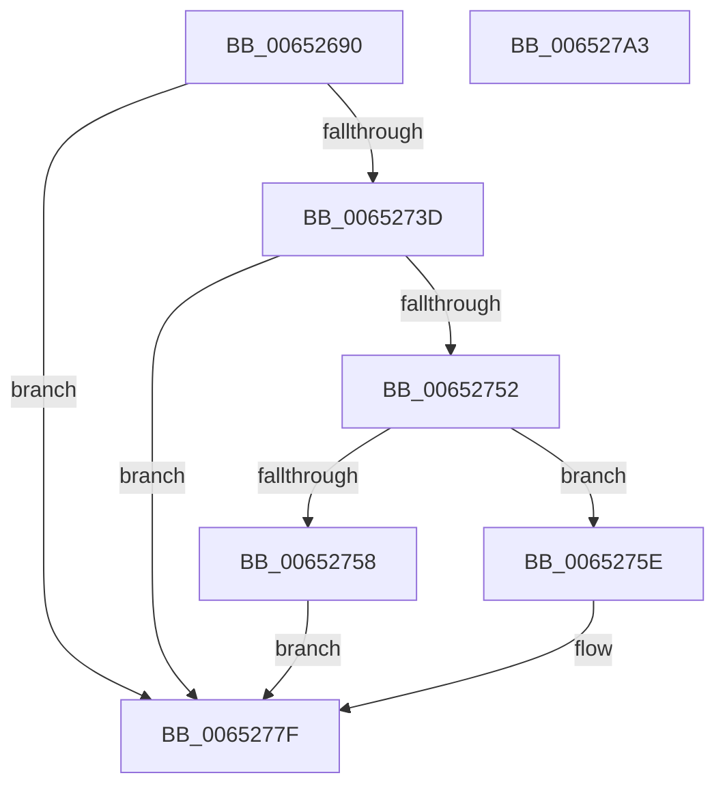

# PerfLogExecutiveResourceSetOwnerPointer

- RVA: `0x00652690`–`0x006527A4` (길이 `276` bytes)
- VA: `0x0000000140652690`
- 실행 섹션: `.text`
- PDB 이름 있음: `예`; PDB Function 태그: `아니요`
- unwind 정보 RVA: `0x000D3BEC`
- 디코드: `67`개 명령, `276/276` bytes 표시
- 미해석 바이트: `0` (있으면 어셈블리에 `.byte`로 보존)

> 이 문서는 커널 이미지의 기계어와 PDB 기호를 분석해 생성했습니다. 4번과 5번은 함수 원형과 자료형을 바이너리 사용 방식에서 추정한 C 해석이며 원본 소스 복구 결과는 아닙니다.

## 1. Dependencies

- 직접 호출 지점: **3**; 고유 호출 대상: **3**
- 직접 호출자로 확인된 함수: **1**
- RIP 상대 이미지 참조: **1**

### Outgoing calls
- `0x00652726` → [EtwTraceKernelEvent](../23/EtwTraceKernelEvent_function_00235350.md) (function, `0x00235350`)
- `0x00652748` → [EtwpGetTrackingLockSlotForThread](../21/EtwpGetTrackingLockSlotForThread_function_00215B34.md) (function, `0x00215B34`)
- `0x00652786` → [_security_check_cookie](../6A/_security_check_cookie_function_006AC640.md) (function, `0x006AC640`)

### Direct callers
- [ExpSetResourceOwnerPointerEx](../34/ExpSetResourceOwnerPointerEx_function_00343E20.md) at `0x0034433F`

### Static image references
- `0x006526A8` → RVA `0x00E0A740` (`.data`; read)

## 2. Other-region calls and transfers

- 다른 실행 섹션으로 향하는 call: **0**
- 별도 외부 분기/꼬리 이동을 확인하지 못했습니다.

## 3. Assembly (complete function range)

```asm
00652690  48 89 5C 24 18                  mov qword ptr [rsp + 0x18], rbx
00652695  48 89 74 24 20                  mov qword ptr [rsp + 0x20], rsi
0065269A  55                              push rbp
0065269B  57                              push rdi
0065269C  41 56                           push r14
0065269E  48 8B EC                        mov rbp, rsp
006526A1  48 81 EC 80 00 00 00            sub rsp, 0x80
006526A8  48 8B 05 91 80 7B 00            mov rax, qword ptr [rip + 0x7b8091]
006526AF  48 33 C4                        xor rax, rsp
006526B2  48 89 45 F0                     mov qword ptr [rbp - 0x10], rax
006526B6  65 48 8B 3C 25 20 00 00 00      mov rdi, qword ptr gs:[0x20]
006526BF  45 33 F6                        xor r14d, r14d
006526C2  8B D9                           mov ebx, ecx
006526C4  C7 44 24 20 02 18 60 01         mov dword ptr [rsp + 0x20], 0x1601802
006526CC  48 8B F2                        mov rsi, rdx
006526CF  41 B9 2B 05 00 00               mov r9d, 0x52b
006526D5  41 B8 00 00 02 20               mov r8d, 0x20020000
006526DB  FF 87 70 8F 00 00               inc dword ptr [rdi + 0x8f70]
006526E1  89 4D D8                        mov dword ptr [rbp - 0x28], ecx
006526E4  48 89 55 D0                     mov qword ptr [rbp - 0x30], rdx
006526E8  41 8D 56 01                     lea edx, [r14 + 1]
006526EC  4C 89 75 B0                     mov qword ptr [rbp - 0x50], r14
006526F0  44 89 75 C8                     mov dword ptr [rbp - 0x38], r14d
006526F4  4C 89 75 B8                     mov qword ptr [rbp - 0x48], r14
006526F8  4C 89 75 C0                     mov qword ptr [rbp - 0x40], r14
006526FC  44 89 75 DC                     mov dword ptr [rbp - 0x24], r14d
00652700  65 48 8B 04 25 88 01 00 00      mov rax, qword ptr gs:[0x188]
00652709  48 C7 45 E8 30 00 00 00         mov qword ptr [rbp - 0x18], 0x30
00652711  8B 88 10 05 00 00               mov ecx, dword ptr [rax + 0x510]
00652717  48 8D 45 B0                     lea rax, [rbp - 0x50]
0065271B  89 4D CC                        mov dword ptr [rbp - 0x34], ecx
0065271E  48 8D 4D E0                     lea rcx, [rbp - 0x20]
00652722  48 89 45 E0                     mov qword ptr [rbp - 0x20], rax
00652726  E8 25 2C BE FF                  call 0x140235350
0065272B  65 48 8B 04 25 88 01 00 00      mov rax, qword ptr gs:[0x188]
00652734  4C 39 B0 20 06 00 00            cmp qword ptr [rax + 0x620], r14
0065273B  74 42                           je 0x14065277f
0065273D  81 E3 00 00 FF FF               and ebx, 0xffff0000
00652743  48 8B CE                        mov rcx, rsi
00652746  8B D3                           mov edx, ebx
00652748  E8 E7 33 BC FF                  call 0x140215b34
0065274D  48 85 C0                        test rax, rax
00652750  74 2D                           je 0x14065277f
00652752  44 39 70 20                     cmp dword ptr [rax + 0x20], r14d
00652756  75 06                           jne 0x14065275e
00652758  44 89 70 1C                     mov dword ptr [rax + 0x1c], r14d
0065275C  EB 21                           jmp 0x14065277f
0065275E  FF 87 74 8F 00 00               inc dword ptr [rdi + 0x8f74]
00652764  4C 89 70 10                     mov qword ptr [rax + 0x10], r14
00652768  4C 89 70 1C                     mov qword ptr [rax + 0x1c], r14
0065276C  44 89 70 24                     mov dword ptr [rax + 0x24], r14d
00652770  4C 89 30                        mov qword ptr [rax], r14
00652773  4C 89 70 08                     mov qword ptr [rax + 8], r14
00652777  44 89 70 18                     mov dword ptr [rax + 0x18], r14d
0065277B  44 89 70 2C                     mov dword ptr [rax + 0x2c], r14d
0065277F  48 8B 4D F0                     mov rcx, qword ptr [rbp - 0x10]
00652783  48 33 CC                        xor rcx, rsp
00652786  E8 B5 9E 05 00                  call 0x1406ac640
0065278B  4C 8D 9C 24 80 00 00 00         lea r11, [rsp + 0x80]
00652793  49 8B 5B 30                     mov rbx, qword ptr [r11 + 0x30]
00652797  49 8B 73 38                     mov rsi, qword ptr [r11 + 0x38]
0065279B  49 8B E3                        mov rsp, r11
0065279E  41 5E                           pop r14
006527A0  5F                              pop rdi
006527A1  5D                              pop rbp
006527A2  C3                              ret
006527A3  CC                              int3
```

## 4. C-style interpretation (structured pseudocode)

```c
__int64 __fastcall PerfLogExecutiveResourceSetOwnerPointer(int a1, __int64 a2)
{
    __int64 result;
    __int64 v_r14;
    __int64 v_rbx;
    __int64 v_rsp;
    unsigned __int64 v_stack_m18;
    unsigned __int64 v_stack_m28;
    unsigned __int64 v_stack_m30;
    unsigned __int64 v_stack_m38;
    unsigned int v_stack_m3C;
    unsigned int v_stack_m40;
    unsigned __int64 v_stack_m48;
    unsigned int v_stack_m4C;
    unsigned int v_stack_m50;
    unsigned __int64 v_stack_m58;
    unsigned __int64 v_stack_m60;
    unsigned __int64 v_stack_m68;
    unsigned int v_stack_m78;
    unsigned __int64 v_stack_p18;
    unsigned __int64 v_stack_p20;

    v_stack_p18 = v_rbx;
    v_stack_p20 = v_rsi;
    v_rsp = (v_rsp) - (128);
    result = (*(unsigned __int64 *)(v_rip + 8093841)) ^ (v_rsp);
    v_stack_m28 = result;
    v_r14 = 0;
    v_stack_m78 = 0x1601802ULL;
    v_stack_m40 = a1;
    v_stack_m48 = a2;
    v_stack_m68 = 0;
    v_stack_m50 = 0;
    v_stack_m60 = 0;
    v_stack_m58 = 0;
    v_stack_m3C = 0;
    v_stack_m30 = 48;
    v_stack_m4C = (unsigned int)((unsigned int)(*(unsigned int *)(*(unsigned __int64 *)(gs_base + (0 + 392)) + 1296)));
    v_stack_m38 = v_stack_m68;
    result = EtwTraceKernelEvent(v_stack_m38, v_r14 + 1, (unsigned int)(0x20020000ULL), (unsigned int)(0x52BULL));
    if ((*(unsigned __int64 *)(*(unsigned __int64 *)(gs_base + (0 + 392)) + 1568)) == 0) goto loc_0065277F;
    v_rbx = (unsigned int)(((unsigned int)(a1)) & (0xFFFF0000ULL));
    result = EtwpGetTrackingLockSlotForThread(a2, (unsigned int)((unsigned int)(v_rbx)), (unsigned int)(0x20020000ULL), (unsigned int)(0x52BULL));
    if (result == 0) goto loc_0065277F;
    if ((*(unsigned int *)(result + 32)) != 0) goto loc_0065275E;
    *(unsigned int *)(result + 28) = 0;
    goto loc_0065277F;
loc_0065275E:
    *(unsigned __int64 *)(result + 16) = 0;
    *(unsigned __int64 *)(result + 28) = 0;
    *(unsigned int *)(result + 36) = 0;
    *(unsigned __int64 *)(result) = 0;
    *(unsigned __int64 *)(result + 8) = 0;
    *(unsigned int *)(result + 24) = 0;
    *(unsigned int *)(result + 44) = 0;
loc_0065277F:
    a1 = (v_stack_m28) ^ (v_rsp);
    result = _security_check_cookie(a1, (unsigned int)((unsigned int)(v_rbx)), (unsigned int)(0x20020000ULL), (unsigned int)(0x52BULL));
    return result;
}
```

## 5. (Beta) C Style

```c
int64_t PerfLogExecutiveResourceSetOwnerPointer(int32_t Arg1, int64_t Arg2)
{
    int64_t result;
    int64_t local_r14;
    int64_t local_rbx;
    int64_t local_rsp;
    uint64_t v_stack_m18;
    uint64_t v_stack_m28;
    uint64_t v_stack_m30;
    uint64_t v_stack_m38;
    uint32_t v_stack_m3C;
    uint32_t v_stack_m40;
    uint64_t v_stack_m48;
    uint32_t v_stack_m4C;
    uint32_t v_stack_m50;
    uint64_t v_stack_m58;
    uint64_t v_stack_m60;
    uint64_t v_stack_m68;
    uint32_t v_stack_m78;
    uint64_t v_stack_p18;
    uint64_t v_stack_p20;

    v_stack_p18 = local_rbx;
    v_stack_p20 = local_rsi;
    local_rsp = (local_rsp) - (128);
    result = (*(uint64_t *)(v_rip + 0x7B8091)) ^ (local_rsp);
    v_stack_m28 = result;
    local_r14 = 0;
    v_stack_m78 = 0x1601802ULL;
    v_stack_m40 = Arg1;
    v_stack_m48 = Arg2;
    v_stack_m68 = 0;
    v_stack_m50 = 0;
    v_stack_m60 = 0;
    v_stack_m58 = 0;
    v_stack_m3C = 0;
    v_stack_m30 = 48;
    v_stack_m4C = (uint32_t)((uint32_t)(*(uint32_t *)(*(uint64_t *)(gs_base + (0 + 0x188)) + 0x510)));
    v_stack_m38 = v_stack_m68;
    result = EtwTraceKernelEvent(v_stack_m38, local_r14 + 1, (uint32_t)(0x20020000ULL), (uint32_t)(0x52BULL));
    if ((*(uint64_t *)(*(uint64_t *)(gs_base + (0 + 0x188)) + 0x620)) == 0) goto loc_0065277F;
    local_rbx = (uint32_t)(((uint32_t)(Arg1)) & (0xFFFF0000ULL));
    result = EtwpGetTrackingLockSlotForThread(Arg2, (uint32_t)((uint32_t)(local_rbx)), (uint32_t)(0x20020000ULL), (uint32_t)(0x52BULL));
    if (result == 0) goto loc_0065277F;
    if ((*(uint32_t *)(result + 0x20)) != 0) goto loc_0065275E;
    *(uint32_t *)(result + 0x1C) = 0;
    goto loc_0065277F;
loc_0065275E:
    *(uint64_t *)(result + 0x10) = 0;
    *(uint64_t *)(result + 0x1C) = 0;
    *(uint32_t *)(result + 0x24) = 0;
    *(uint64_t *)(result) = 0;
    *(uint64_t *)(result + 0x8) = 0;
    *(uint32_t *)(result + 0x18) = 0;
    *(uint32_t *)(result + 0x2C) = 0;
loc_0065277F:
    Arg1 = (v_stack_m28) ^ (local_rsp);
    result = _security_check_cookie(Arg1, (uint32_t)((uint32_t)(local_rbx)), (uint32_t)(0x20020000ULL), (uint32_t)(0x52BULL));
    return result;
}
```

## 6. Execution-region graph

[열기: 2D/3D 그래프와 함수 탐색 컨트롤 패널](../../../control-panel.html?section=text&rva=0x00652690&view=graph)

- 2D 그래프는 위에서 아래로 흐르고, 3D 그래프는 빈 공간을 드래그해 회전합니다. Shift+드래그는 이동, 휠은 확대·축소, 함수 노드 선택은 대상 보고서 이동입니다.

### Static fallback


