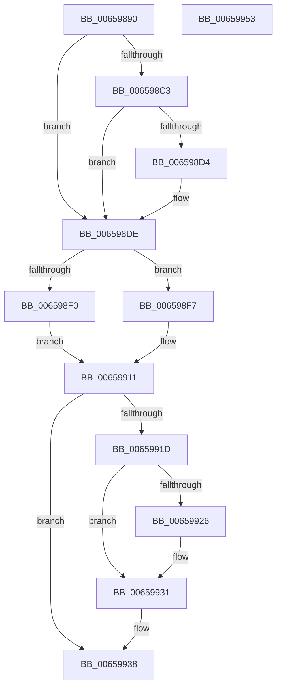

# PrmInvokeHandler

- RVA: `0x00659890`–`0x00659954` (길이 `196` bytes)
- VA: `0x0000000140659890`
- 실행 섹션: `.text`
- PDB 이름 있음: `예`; PDB Function 태그: `아니요`
- unwind 정보 RVA: `0x00084C9C`
- 디코드: `55`개 명령, `196/196` bytes 표시
- 미해석 바이트: `0` (있으면 어셈블리에 `.byte`로 보존)

> 이 문서는 커널 이미지의 기계어와 PDB 기호를 분석해 생성했습니다. 4번과 5번은 함수 원형과 자료형을 바이너리 사용 방식에서 추정한 C 해석이며 원본 소스 복구 결과는 아닙니다.

## 1. Dependencies

- 직접 호출 지점: **3**; 고유 호출 대상: **3**
- 직접 호출자로 확인된 함수: **0**
- RIP 상대 이미지 참조: **4**

### Outgoing calls
- `0x006598D9` → [KiRaiseIrqlProcessIrqlFlags](../4F/KiRaiseIrqlProcessIrqlFlags_function_004F56FC.md) (function, `0x004F56FC`)
- `0x0065990A` → [guard_dispatch_icall](../6B/guard_dispatch_icall_function_006BAAD0.md) (function, `0x006BAAD0`)
- `0x0065992C` → [KiLowerIrqlProcessIrqlFlags](../4F/KiLowerIrqlProcessIrqlFlags_function_004F5698.md) (function, `0x004F5698`)

### Direct callers
- 이 함수 시작 RVA로 연결되는 직접 call은 확인되지 않았습니다. 간접 호출은 완전히 역산할 수 없습니다.

### Static image references
- `0x006598CB` → RVA `0x00FC6D20` (`ALMOSTRO`; read)
- `0x006598DE` → RVA `0x00EFAAC4` (`.data`; read/write)
- `0x006598E5` → RVA `0x00EFAAC0` (`.data`; read)
- `0x006598F7` → RVA `0x00EFAAF8` (`.data`; read)

## 2. Other-region calls and transfers

- 다른 실행 섹션으로 향하는 call: **0**
- 별도 외부 분기/꼬리 이동을 확인하지 못했습니다.

## 3. Assembly (complete function range)

```asm
00659890  48 89 5C 24 08                  mov qword ptr [rsp + 8], rbx
00659895  48 89 6C 24 10                  mov qword ptr [rsp + 0x10], rbp
0065989A  48 89 74 24 18                  mov qword ptr [rsp + 0x18], rsi
0065989F  57                              push rdi
006598A0  41 56                           push r14
006598A2  41 57                           push r15
006598A4  48 83 EC 30                     sub rsp, 0x30
006598A8  49 8B F9                        mov rdi, r9
006598AB  41 8B F0                        mov esi, r8d
006598AE  48 8B EA                        mov rbp, rdx
006598B1  4C 8B F1                        mov r14, rcx
006598B4  44 0F 20 C3                     mov rbx, cr8
006598B8  41 BF 02 00 00 00               mov r15d, 2
006598BE  41 3A DF                        cmp bl, r15b
006598C1  73 1B                           jae 0x1406598de
006598C3  44 0F 20 C3                     mov rbx, cr8
006598C7  45 0F 22 C7                     mov cr8, r15
006598CB  83 3D 4E D4 96 00 00            cmp dword ptr [rip + 0x96d44e], 0
006598D2  74 0A                           je 0x1406598de
006598D4  41 8A D7                        mov dl, r15b
006598D7  8A CB                           mov cl, bl
006598D9  E8 1E BE E9 FF                  call 0x1404f56fc
006598DE  F0 FF 05 DF 11 8A 00            lock inc dword ptr [rip + 0x8a11df]
006598E5  8B 05 D5 11 8A 00               mov eax, dword ptr [rip + 0x8a11d5]
006598EB  41 3B C7                        cmp eax, r15d
006598EE  74 07                           je 0x1406598f7
006598F0  BF 0D 02 EE C0                  mov edi, 0xc0ee020d
006598F5  EB 1A                           jmp 0x140659911
006598F7  48 8B 05 FA 11 8A 00            mov rax, qword ptr [rip + 0x8a11fa]
006598FE  4C 8B CF                        mov r9, rdi
00659901  44 8B C6                        mov r8d, esi
00659904  48 8B D5                        mov rdx, rbp
00659907  49 8B CE                        mov rcx, r14
0065990A  E8 C1 11 06 00                  call 0x1406baad0
0065990F  8B F8                           mov edi, eax
00659911  F0 FF 0D AC 11 8A 00            lock dec dword ptr [rip + 0x8a11ac]
00659918  41 3A DF                        cmp bl, r15b
0065991B  73 1B                           jae 0x140659938
0065991D  83 3D FC D3 96 00 00            cmp dword ptr [rip + 0x96d3fc], 0
00659924  74 0B                           je 0x140659931
00659926  44 0F 20 C1                     mov rcx, cr8
0065992A  8A D3                           mov dl, bl
0065992C  E8 67 BD E9 FF                  call 0x1404f5698
00659931  0F B6 C3                        movzx eax, bl
00659934  44 0F 22 C0                     mov cr8, rax
00659938  48 8B 5C 24 50                  mov rbx, qword ptr [rsp + 0x50]
0065993D  8B C7                           mov eax, edi
0065993F  48 8B 6C 24 58                  mov rbp, qword ptr [rsp + 0x58]
00659944  48 8B 74 24 60                  mov rsi, qword ptr [rsp + 0x60]
00659949  48 83 C4 30                     add rsp, 0x30
0065994D  41 5F                           pop r15
0065994F  41 5E                           pop r14
00659951  5F                              pop rdi
00659952  C3                              ret
00659953  CC                              int3
```

## 4. C-style interpretation (structured pseudocode)

```c
__int64 __fastcall PrmInvokeHandler(__int64 a1, __int64 a2, int a3, __int64 a4)
{
    __int64 result;
    __int64 v_rsp;
    unsigned __int64 v_stack_p10;
    unsigned __int64 v_stack_p18;
    unsigned __int64 v_stack_p8;

    v_stack_p8 = v_rbx;
    v_stack_p10 = v_rbp;
    v_stack_p18 = v_rsi;
    v_rsp = (v_rsp) - (48);
    if (((unsigned __int8)(v_cr8)) >= 2) goto loc_006598DE;
    if ((*(unsigned int *)(v_rip + 9884750)) != 0) {
        a2 = 2;
        a1 = (unsigned __int8)(v_cr8);
        result = KiRaiseIrqlProcessIrqlFlags(a1, a2, a3, a4);
    }
    if (((unsigned int)((unsigned int)(*(unsigned int *)(v_rip + 9048533)))) == 2) goto loc_006598F7;
    goto loc_00659911;
loc_006598F7:
    result = guard_dispatch_icall(a1, a2, (unsigned int)((unsigned int)((unsigned int)(a3))), (unsigned int)(0xC0EE020DULL));
loc_00659911:
    if (((unsigned __int8)(v_cr8)) >= 2) goto loc_00659938;
    if ((*(unsigned int *)(v_rip + 9884668)) != 0) {
        a1 = 2;
        a2 = (unsigned __int8)(v_cr8);
        result = KiLowerIrqlProcessIrqlFlags(a1, a2, (unsigned int)((unsigned int)((unsigned int)(a3))), (unsigned int)(0xC0EE020DULL));
    }
loc_00659938:
    v_rsp = (v_rsp) + (48);
    return (unsigned int)((unsigned int)((unsigned int)((unsigned int)(result))));
}
```

## 5. (Beta) C Style

```c
int64_t PrmInvokeHandler(int64_t Arg1, int64_t Arg2, int32_t Arg3, int64_t Arg4)
{
    int64_t result;
    int64_t local_rsp;
    uint64_t v_stack_p10;
    uint64_t v_stack_p18;
    uint64_t v_stack_p8;

    v_stack_p8 = local_rbx;
    v_stack_p10 = local_rbp;
    v_stack_p18 = local_rsi;
    local_rsp = (local_rsp) - (48);
    if (((uint8_t)(v_cr8)) >= 2) goto loc_006598DE;
    if ((*(uint32_t *)(v_rip + 0x96D44E)) != 0) {
        Arg2 = 2;
        Arg1 = (uint8_t)(v_cr8);
        result = KiRaiseIrqlProcessIrqlFlags(Arg1, Arg2, Arg3, Arg4);
    }
    if (((uint32_t)((uint32_t)(*(uint32_t *)(v_rip + 0x8A11D5)))) == 2) goto loc_006598F7;
    goto loc_00659911;
loc_006598F7:
    result = guard_dispatch_icall(Arg1, Arg2, (uint32_t)((uint32_t)((uint32_t)(Arg3))), (uint32_t)(0xC0EE020DULL));
loc_00659911:
    if (((uint8_t)(v_cr8)) >= 2) goto loc_00659938;
    if ((*(uint32_t *)(v_rip + 0x96D3FC)) != 0) {
        Arg1 = 2;
        Arg2 = (uint8_t)(v_cr8);
        result = KiLowerIrqlProcessIrqlFlags(Arg1, Arg2, (uint32_t)((uint32_t)((uint32_t)(Arg3))), (uint32_t)(0xC0EE020DULL));
    }
loc_00659938:
    local_rsp = (local_rsp) + (48);
    return (uint32_t)((uint32_t)((uint32_t)((uint32_t)(result))));
}
```

## 6. Execution-region graph

[열기: 2D/3D 그래프와 함수 탐색 컨트롤 패널](../../../control-panel.html?section=text&rva=0x00659890&view=graph)

- 2D 그래프는 위에서 아래로 흐르고, 3D 그래프는 빈 공간을 드래그해 회전합니다. Shift+드래그는 이동, 휠은 확대·축소, 함수 노드 선택은 대상 보고서 이동입니다.

### Static fallback


