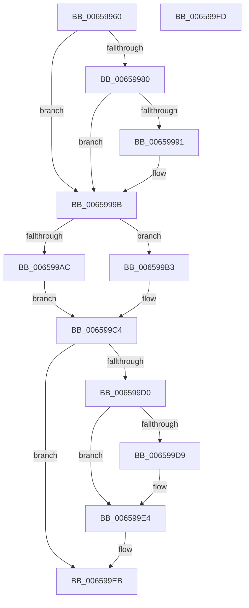

# PrmLockModule

- RVA: `0x00659960`–`0x006599FE` (길이 `158` bytes)
- VA: `0x0000000140659960`
- 실행 섹션: `.text`
- PDB 이름 있음: `예`; PDB Function 태그: `아니요`
- unwind 정보 RVA: `0x00060BC4`
- 디코드: `43`개 명령, `158/158` bytes 표시
- 미해석 바이트: `0` (있으면 어셈블리에 `.byte`로 보존)

> 이 문서는 커널 이미지의 기계어와 PDB 기호를 분석해 생성했습니다. 4번과 5번은 함수 원형과 자료형을 바이너리 사용 방식에서 추정한 C 해석이며 원본 소스 복구 결과는 아닙니다.

## 1. Dependencies

- 직접 호출 지점: **3**; 고유 호출 대상: **3**
- 직접 호출자로 확인된 함수: **0**
- RIP 상대 이미지 참조: **4**

### Outgoing calls
- `0x00659996` → [KiRaiseIrqlProcessIrqlFlags](../4F/KiRaiseIrqlProcessIrqlFlags_function_004F56FC.md) (function, `0x004F56FC`)
- `0x006599BD` → [guard_dispatch_icall](../6B/guard_dispatch_icall_function_006BAAD0.md) (function, `0x006BAAD0`)
- `0x006599DF` → [KiLowerIrqlProcessIrqlFlags](../4F/KiLowerIrqlProcessIrqlFlags_function_004F5698.md) (function, `0x004F5698`)

### Direct callers
- 이 함수 시작 RVA로 연결되는 직접 call은 확인되지 않았습니다. 간접 호출은 완전히 역산할 수 없습니다.

### Static image references
- `0x00659988` → RVA `0x00FC6D20` (`ALMOSTRO`; read)
- `0x0065999B` → RVA `0x00EFAAC4` (`.data`; read/write)
- `0x006599A2` → RVA `0x00EFAAC0` (`.data`; read)
- `0x006599B3` → RVA `0x00EFAB08` (`.data`; read)

## 2. Other-region calls and transfers

- 다른 실행 섹션으로 향하는 call: **0**
- 별도 외부 분기/꼬리 이동을 확인하지 못했습니다.

## 3. Assembly (complete function range)

```asm
00659960  48 89 5C 24 08                  mov qword ptr [rsp + 8], rbx
00659965  48 89 74 24 10                  mov qword ptr [rsp + 0x10], rsi
0065996A  57                              push rdi
0065996B  48 83 EC 20                     sub rsp, 0x20
0065996F  48 8B F9                        mov rdi, rcx
00659972  44 0F 20 C3                     mov rbx, cr8
00659976  BE 02 00 00 00                  mov esi, 2
0065997B  40 3A DE                        cmp bl, sil
0065997E  73 1B                           jae 0x14065999b
00659980  44 0F 20 C3                     mov rbx, cr8
00659984  44 0F 22 C6                     mov cr8, rsi
00659988  83 3D 91 D3 96 00 00            cmp dword ptr [rip + 0x96d391], 0
0065998F  74 0A                           je 0x14065999b
00659991  40 8A D6                        mov dl, sil
00659994  8A CB                           mov cl, bl
00659996  E8 61 BD E9 FF                  call 0x1404f56fc
0065999B  F0 FF 05 22 11 8A 00            lock inc dword ptr [rip + 0x8a1122]
006599A2  8B 05 18 11 8A 00               mov eax, dword ptr [rip + 0x8a1118]
006599A8  3B C6                           cmp eax, esi
006599AA  74 07                           je 0x1406599b3
006599AC  BF 0D 02 EE C0                  mov edi, 0xc0ee020d
006599B1  EB 11                           jmp 0x1406599c4
006599B3  48 8B 05 4E 11 8A 00            mov rax, qword ptr [rip + 0x8a114e]
006599BA  48 8B CF                        mov rcx, rdi
006599BD  E8 0E 11 06 00                  call 0x1406baad0
006599C2  8B F8                           mov edi, eax
006599C4  F0 FF 0D F9 10 8A 00            lock dec dword ptr [rip + 0x8a10f9]
006599CB  40 3A DE                        cmp bl, sil
006599CE  73 1B                           jae 0x1406599eb
006599D0  83 3D 49 D3 96 00 00            cmp dword ptr [rip + 0x96d349], 0
006599D7  74 0B                           je 0x1406599e4
006599D9  44 0F 20 C1                     mov rcx, cr8
006599DD  8A D3                           mov dl, bl
006599DF  E8 B4 BC E9 FF                  call 0x1404f5698
006599E4  0F B6 C3                        movzx eax, bl
006599E7  44 0F 22 C0                     mov cr8, rax
006599EB  48 8B 5C 24 30                  mov rbx, qword ptr [rsp + 0x30]
006599F0  8B C7                           mov eax, edi
006599F2  48 8B 74 24 38                  mov rsi, qword ptr [rsp + 0x38]
006599F7  48 83 C4 20                     add rsp, 0x20
006599FB  5F                              pop rdi
006599FC  C3                              ret
006599FD  CC                              int3
```

## 4. C-style interpretation (structured pseudocode)

```c
__int64 __fastcall PrmLockModule(__int64 a1)
{
    __int64 result;
    __int64 v_rsp;
    unsigned __int64 v_stack_p10;
    unsigned __int64 v_stack_p8;

    v_stack_p8 = v_rbx;
    v_stack_p10 = v_rsi;
    v_rsp = (v_rsp) - (32);
    if (((unsigned __int8)(v_cr8)) >= 2) goto loc_0065999B;
    if ((*(unsigned int *)(v_rip + 9884561)) != 0) {
        a2 = 2;
        a1 = (unsigned __int8)(v_cr8);
        result = KiRaiseIrqlProcessIrqlFlags(a1, a2, a3, a4);
    }
    if (((unsigned int)((unsigned int)(*(unsigned int *)(v_rip + 9048344)))) == 2) goto loc_006599B3;
    goto loc_006599C4;
loc_006599B3:
    result = guard_dispatch_icall((unsigned int)(0xC0EE020DULL), a2, a3, a4);
loc_006599C4:
    if (((unsigned __int8)(v_cr8)) >= 2) goto loc_006599EB;
    if ((*(unsigned int *)(v_rip + 9884489)) != 0) {
        a1 = 2;
        a2 = (unsigned __int8)(v_cr8);
        result = KiLowerIrqlProcessIrqlFlags(a1, a2, a3, a4);
    }
loc_006599EB:
    v_rsp = (v_rsp) + (32);
    return (unsigned int)((unsigned int)((unsigned int)((unsigned int)(result))));
}
```

## 5. (Beta) C Style

```c
int64_t PrmLockModule(int64_t Arg1)
{
    int64_t result;
    int64_t local_rsp;
    uint64_t v_stack_p10;
    uint64_t v_stack_p8;

    v_stack_p8 = local_rbx;
    v_stack_p10 = local_rsi;
    local_rsp = (local_rsp) - (32);
    if (((uint8_t)(v_cr8)) >= 2) goto loc_0065999B;
    if ((*(uint32_t *)(v_rip + 0x96D391)) != 0) {
        a2 = 2;
        Arg1 = (uint8_t)(v_cr8);
        result = KiRaiseIrqlProcessIrqlFlags(Arg1, a2, a3, a4);
    }
    if (((uint32_t)((uint32_t)(*(uint32_t *)(v_rip + 0x8A1118)))) == 2) goto loc_006599B3;
    goto loc_006599C4;
loc_006599B3:
    result = guard_dispatch_icall((uint32_t)(0xC0EE020DULL), a2, a3, a4);
loc_006599C4:
    if (((uint8_t)(v_cr8)) >= 2) goto loc_006599EB;
    if ((*(uint32_t *)(v_rip + 0x96D349)) != 0) {
        Arg1 = 2;
        a2 = (uint8_t)(v_cr8);
        result = KiLowerIrqlProcessIrqlFlags(Arg1, a2, a3, a4);
    }
loc_006599EB:
    local_rsp = (local_rsp) + (32);
    return (uint32_t)((uint32_t)((uint32_t)((uint32_t)(result))));
}
```

## 6. Execution-region graph

[열기: 2D/3D 그래프와 함수 탐색 컨트롤 패널](../../../control-panel.html?section=text&rva=0x00659960&view=graph)

- 2D 그래프는 위에서 아래로 흐르고, 3D 그래프는 빈 공간을 드래그해 회전합니다. Shift+드래그는 이동, 휠은 확대·축소, 함수 노드 선택은 대상 보고서 이동입니다.

### Static fallback


