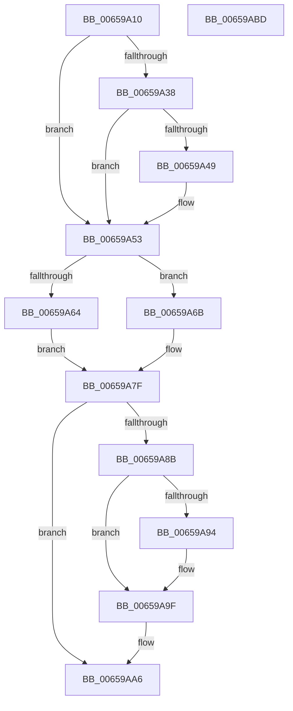

# PrmQueryHandler

- RVA: `0x00659A10`–`0x00659ABE` (길이 `174` bytes)
- VA: `0x0000000140659A10`
- 실행 섹션: `.text`
- PDB 이름 있음: `예`; PDB Function 태그: `아니요`
- unwind 정보 RVA: `0x0005C954`
- 디코드: `47`개 명령, `174/174` bytes 표시
- 미해석 바이트: `0` (있으면 어셈블리에 `.byte`로 보존)

> 이 문서는 커널 이미지의 기계어와 PDB 기호를 분석해 생성했습니다. 4번과 5번은 함수 원형과 자료형을 바이너리 사용 방식에서 추정한 C 해석이며 원본 소스 복구 결과는 아닙니다.

## 1. Dependencies

- 직접 호출 지점: **3**; 고유 호출 대상: **3**
- 직접 호출자로 확인된 함수: **0**
- RIP 상대 이미지 참조: **4**

### Outgoing calls
- `0x00659A4E` → [KiRaiseIrqlProcessIrqlFlags](../4F/KiRaiseIrqlProcessIrqlFlags_function_004F56FC.md) (function, `0x004F56FC`)
- `0x00659A78` → [guard_dispatch_icall](../6B/guard_dispatch_icall_function_006BAAD0.md) (function, `0x006BAAD0`)
- `0x00659A9A` → [KiLowerIrqlProcessIrqlFlags](../4F/KiLowerIrqlProcessIrqlFlags_function_004F5698.md) (function, `0x004F5698`)

### Direct callers
- 이 함수 시작 RVA로 연결되는 직접 call은 확인되지 않았습니다. 간접 호출은 완전히 역산할 수 없습니다.

### Static image references
- `0x00659A40` → RVA `0x00FC6D20` (`ALMOSTRO`; read)
- `0x00659A53` → RVA `0x00EFAAC4` (`.data`; read/write)
- `0x00659A5A` → RVA `0x00EFAAC0` (`.data`; read)
- `0x00659A6B` → RVA `0x00EFAB00` (`.data`; read)

## 2. Other-region calls and transfers

- 다른 실행 섹션으로 향하는 call: **0**
- 별도 외부 분기/꼬리 이동을 확인하지 못했습니다.

## 3. Assembly (complete function range)

```asm
00659A10  48 89 5C 24 08                  mov qword ptr [rsp + 8], rbx
00659A15  48 89 6C 24 10                  mov qword ptr [rsp + 0x10], rbp
00659A1A  48 89 74 24 18                  mov qword ptr [rsp + 0x18], rsi
00659A1F  57                              push rdi
00659A20  48 83 EC 20                     sub rsp, 0x20
00659A24  48 8B FA                        mov rdi, rdx
00659A27  48 8B F1                        mov rsi, rcx
00659A2A  44 0F 20 C3                     mov rbx, cr8
00659A2E  BD 02 00 00 00                  mov ebp, 2
00659A33  40 3A DD                        cmp bl, bpl
00659A36  73 1B                           jae 0x140659a53
00659A38  44 0F 20 C3                     mov rbx, cr8
00659A3C  44 0F 22 C5                     mov cr8, rbp
00659A40  83 3D D9 D2 96 00 00            cmp dword ptr [rip + 0x96d2d9], 0
00659A47  74 0A                           je 0x140659a53
00659A49  40 8A D5                        mov dl, bpl
00659A4C  8A CB                           mov cl, bl
00659A4E  E8 A9 BC E9 FF                  call 0x1404f56fc
00659A53  F0 FF 05 6A 10 8A 00            lock inc dword ptr [rip + 0x8a106a]
00659A5A  8B 05 60 10 8A 00               mov eax, dword ptr [rip + 0x8a1060]
00659A60  3B C5                           cmp eax, ebp
00659A62  74 07                           je 0x140659a6b
00659A64  BF 0D 02 EE C0                  mov edi, 0xc0ee020d
00659A69  EB 14                           jmp 0x140659a7f
00659A6B  48 8B 05 8E 10 8A 00            mov rax, qword ptr [rip + 0x8a108e]
00659A72  48 8B D7                        mov rdx, rdi
00659A75  48 8B CE                        mov rcx, rsi
00659A78  E8 53 10 06 00                  call 0x1406baad0
00659A7D  8B F8                           mov edi, eax
00659A7F  F0 FF 0D 3E 10 8A 00            lock dec dword ptr [rip + 0x8a103e]
00659A86  40 3A DD                        cmp bl, bpl
00659A89  73 1B                           jae 0x140659aa6
00659A8B  83 3D 8E D2 96 00 00            cmp dword ptr [rip + 0x96d28e], 0
00659A92  74 0B                           je 0x140659a9f
00659A94  44 0F 20 C1                     mov rcx, cr8
00659A98  8A D3                           mov dl, bl
00659A9A  E8 F9 BB E9 FF                  call 0x1404f5698
00659A9F  0F B6 C3                        movzx eax, bl
00659AA2  44 0F 22 C0                     mov cr8, rax
00659AA6  48 8B 5C 24 30                  mov rbx, qword ptr [rsp + 0x30]
00659AAB  8B C7                           mov eax, edi
00659AAD  48 8B 6C 24 38                  mov rbp, qword ptr [rsp + 0x38]
00659AB2  48 8B 74 24 40                  mov rsi, qword ptr [rsp + 0x40]
00659AB7  48 83 C4 20                     add rsp, 0x20
00659ABB  5F                              pop rdi
00659ABC  C3                              ret
00659ABD  CC                              int3
```

## 4. C-style interpretation (structured pseudocode)

```c
__int64 __fastcall PrmQueryHandler(__int64 a1, __int64 a2)
{
    __int64 result;
    __int64 v_rsp;
    unsigned __int64 v_stack_p10;
    unsigned __int64 v_stack_p18;
    unsigned __int64 v_stack_p8;

    v_stack_p8 = v_rbx;
    v_stack_p10 = v_rbp;
    v_stack_p18 = v_rsi;
    v_rsp = (v_rsp) - (32);
    if (((unsigned __int8)(v_cr8)) >= 2) goto loc_00659A53;
    if ((*(unsigned int *)(v_rip + 9884377)) != 0) {
        a2 = 2;
        a1 = (unsigned __int8)(v_cr8);
        result = KiRaiseIrqlProcessIrqlFlags(a1, a2, a3, a4);
    }
    if (((unsigned int)((unsigned int)(*(unsigned int *)(v_rip + 9048160)))) == 2) goto loc_00659A6B;
    goto loc_00659A7F;
loc_00659A6B:
    result = guard_dispatch_icall(a1, (unsigned int)(0xC0EE020DULL), a3, a4);
loc_00659A7F:
    if (((unsigned __int8)(v_cr8)) >= 2) goto loc_00659AA6;
    if ((*(unsigned int *)(v_rip + 9884302)) != 0) {
        a1 = 2;
        a2 = (unsigned __int8)(v_cr8);
        result = KiLowerIrqlProcessIrqlFlags(a1, a2, a3, a4);
    }
loc_00659AA6:
    v_rsp = (v_rsp) + (32);
    return (unsigned int)((unsigned int)((unsigned int)((unsigned int)(result))));
}
```

## 5. (Beta) C Style

```c
int64_t PrmQueryHandler(int64_t Arg1, int64_t Arg2)
{
    int64_t result;
    int64_t local_rsp;
    uint64_t v_stack_p10;
    uint64_t v_stack_p18;
    uint64_t v_stack_p8;

    v_stack_p8 = local_rbx;
    v_stack_p10 = local_rbp;
    v_stack_p18 = local_rsi;
    local_rsp = (local_rsp) - (32);
    if (((uint8_t)(v_cr8)) >= 2) goto loc_00659A53;
    if ((*(uint32_t *)(v_rip + 0x96D2D9)) != 0) {
        Arg2 = 2;
        Arg1 = (uint8_t)(v_cr8);
        result = KiRaiseIrqlProcessIrqlFlags(Arg1, Arg2, a3, a4);
    }
    if (((uint32_t)((uint32_t)(*(uint32_t *)(v_rip + 0x8A1060)))) == 2) goto loc_00659A6B;
    goto loc_00659A7F;
loc_00659A6B:
    result = guard_dispatch_icall(Arg1, (uint32_t)(0xC0EE020DULL), a3, a4);
loc_00659A7F:
    if (((uint8_t)(v_cr8)) >= 2) goto loc_00659AA6;
    if ((*(uint32_t *)(v_rip + 0x96D28E)) != 0) {
        Arg1 = 2;
        Arg2 = (uint8_t)(v_cr8);
        result = KiLowerIrqlProcessIrqlFlags(Arg1, Arg2, a3, a4);
    }
loc_00659AA6:
    local_rsp = (local_rsp) + (32);
    return (uint32_t)((uint32_t)((uint32_t)((uint32_t)(result))));
}
```

## 6. Execution-region graph

[열기: 2D/3D 그래프와 함수 탐색 컨트롤 패널](../../../control-panel.html?section=text&rva=0x00659A10&view=graph)

- 2D 그래프는 위에서 아래로 흐르고, 3D 그래프는 빈 공간을 드래그해 회전합니다. Shift+드래그는 이동, 휠은 확대·축소, 함수 노드 선택은 대상 보고서 이동입니다.

### Static fallback


