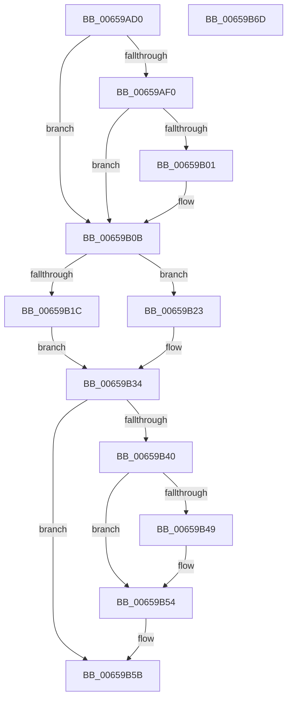

# PrmUnlockModule

- RVA: `0x00659AD0`–`0x00659B6E` (길이 `158` bytes)
- VA: `0x0000000140659AD0`
- 실행 섹션: `.text`
- PDB 이름 있음: `예`; PDB Function 태그: `아니요`
- unwind 정보 RVA: `0x00060BC4`
- 디코드: `43`개 명령, `158/158` bytes 표시
- 미해석 바이트: `0` (있으면 어셈블리에 `.byte`로 보존)

> 이 문서는 커널 이미지의 기계어와 PDB 기호를 분석해 생성했습니다. 4번과 5번은 함수 원형과 자료형을 바이너리 사용 방식에서 추정한 C 해석이며 원본 소스 복구 결과는 아닙니다.

## 1. Dependencies

- 직접 호출 지점: **3**; 고유 호출 대상: **3**
- 직접 호출자로 확인된 함수: **0**
- RIP 상대 이미지 참조: **4**

### Outgoing calls
- `0x00659B06` → [KiRaiseIrqlProcessIrqlFlags](../4F/KiRaiseIrqlProcessIrqlFlags_function_004F56FC.md) (function, `0x004F56FC`)
- `0x00659B2D` → [guard_dispatch_icall](../6B/guard_dispatch_icall_function_006BAAD0.md) (function, `0x006BAAD0`)
- `0x00659B4F` → [KiLowerIrqlProcessIrqlFlags](../4F/KiLowerIrqlProcessIrqlFlags_function_004F5698.md) (function, `0x004F5698`)

### Direct callers
- 이 함수 시작 RVA로 연결되는 직접 call은 확인되지 않았습니다. 간접 호출은 완전히 역산할 수 없습니다.

### Static image references
- `0x00659AF8` → RVA `0x00FC6D20` (`ALMOSTRO`; read)
- `0x00659B0B` → RVA `0x00EFAAC4` (`.data`; read/write)
- `0x00659B12` → RVA `0x00EFAAC0` (`.data`; read)
- `0x00659B23` → RVA `0x00EFAB10` (`.data`; read)

## 2. Other-region calls and transfers

- 다른 실행 섹션으로 향하는 call: **0**
- 별도 외부 분기/꼬리 이동을 확인하지 못했습니다.

## 3. Assembly (complete function range)

```asm
00659AD0  48 89 5C 24 08                  mov qword ptr [rsp + 8], rbx
00659AD5  48 89 74 24 10                  mov qword ptr [rsp + 0x10], rsi
00659ADA  57                              push rdi
00659ADB  48 83 EC 20                     sub rsp, 0x20
00659ADF  48 8B F9                        mov rdi, rcx
00659AE2  44 0F 20 C3                     mov rbx, cr8
00659AE6  BE 02 00 00 00                  mov esi, 2
00659AEB  40 3A DE                        cmp bl, sil
00659AEE  73 1B                           jae 0x140659b0b
00659AF0  44 0F 20 C3                     mov rbx, cr8
00659AF4  44 0F 22 C6                     mov cr8, rsi
00659AF8  83 3D 21 D2 96 00 00            cmp dword ptr [rip + 0x96d221], 0
00659AFF  74 0A                           je 0x140659b0b
00659B01  40 8A D6                        mov dl, sil
00659B04  8A CB                           mov cl, bl
00659B06  E8 F1 BB E9 FF                  call 0x1404f56fc
00659B0B  F0 FF 05 B2 0F 8A 00            lock inc dword ptr [rip + 0x8a0fb2]
00659B12  8B 05 A8 0F 8A 00               mov eax, dword ptr [rip + 0x8a0fa8]
00659B18  3B C6                           cmp eax, esi
00659B1A  74 07                           je 0x140659b23
00659B1C  BF 0D 02 EE C0                  mov edi, 0xc0ee020d
00659B21  EB 11                           jmp 0x140659b34
00659B23  48 8B 05 E6 0F 8A 00            mov rax, qword ptr [rip + 0x8a0fe6]
00659B2A  48 8B CF                        mov rcx, rdi
00659B2D  E8 9E 0F 06 00                  call 0x1406baad0
00659B32  8B F8                           mov edi, eax
00659B34  F0 FF 0D 89 0F 8A 00            lock dec dword ptr [rip + 0x8a0f89]
00659B3B  40 3A DE                        cmp bl, sil
00659B3E  73 1B                           jae 0x140659b5b
00659B40  83 3D D9 D1 96 00 00            cmp dword ptr [rip + 0x96d1d9], 0
00659B47  74 0B                           je 0x140659b54
00659B49  44 0F 20 C1                     mov rcx, cr8
00659B4D  8A D3                           mov dl, bl
00659B4F  E8 44 BB E9 FF                  call 0x1404f5698
00659B54  0F B6 C3                        movzx eax, bl
00659B57  44 0F 22 C0                     mov cr8, rax
00659B5B  48 8B 5C 24 30                  mov rbx, qword ptr [rsp + 0x30]
00659B60  8B C7                           mov eax, edi
00659B62  48 8B 74 24 38                  mov rsi, qword ptr [rsp + 0x38]
00659B67  48 83 C4 20                     add rsp, 0x20
00659B6B  5F                              pop rdi
00659B6C  C3                              ret
00659B6D  CC                              int3
```

## 4. C-style interpretation (structured pseudocode)

```c
__int64 __fastcall PrmUnlockModule(__int64 a1)
{
    __int64 result;
    __int64 v_rsp;
    unsigned __int64 v_stack_p10;
    unsigned __int64 v_stack_p8;

    v_stack_p8 = v_rbx;
    v_stack_p10 = v_rsi;
    v_rsp = (v_rsp) - (32);
    if (((unsigned __int8)(v_cr8)) >= 2) goto loc_00659B0B;
    if ((*(unsigned int *)(v_rip + 9884193)) != 0) {
        a2 = 2;
        a1 = (unsigned __int8)(v_cr8);
        result = KiRaiseIrqlProcessIrqlFlags(a1, a2, a3, a4);
    }
    if (((unsigned int)((unsigned int)(*(unsigned int *)(v_rip + 9047976)))) == 2) goto loc_00659B23;
    goto loc_00659B34;
loc_00659B23:
    result = guard_dispatch_icall((unsigned int)(0xC0EE020DULL), a2, a3, a4);
loc_00659B34:
    if (((unsigned __int8)(v_cr8)) >= 2) goto loc_00659B5B;
    if ((*(unsigned int *)(v_rip + 9884121)) != 0) {
        a1 = 2;
        a2 = (unsigned __int8)(v_cr8);
        result = KiLowerIrqlProcessIrqlFlags(a1, a2, a3, a4);
    }
loc_00659B5B:
    v_rsp = (v_rsp) + (32);
    return (unsigned int)((unsigned int)((unsigned int)((unsigned int)(result))));
}
```

## 5. (Beta) C Style

```c
int64_t PrmUnlockModule(int64_t Arg1)
{
    int64_t result;
    int64_t local_rsp;
    uint64_t v_stack_p10;
    uint64_t v_stack_p8;

    v_stack_p8 = local_rbx;
    v_stack_p10 = local_rsi;
    local_rsp = (local_rsp) - (32);
    if (((uint8_t)(v_cr8)) >= 2) goto loc_00659B0B;
    if ((*(uint32_t *)(v_rip + 0x96D221)) != 0) {
        a2 = 2;
        Arg1 = (uint8_t)(v_cr8);
        result = KiRaiseIrqlProcessIrqlFlags(Arg1, a2, a3, a4);
    }
    if (((uint32_t)((uint32_t)(*(uint32_t *)(v_rip + 0x8A0FA8)))) == 2) goto loc_00659B23;
    goto loc_00659B34;
loc_00659B23:
    result = guard_dispatch_icall((uint32_t)(0xC0EE020DULL), a2, a3, a4);
loc_00659B34:
    if (((uint8_t)(v_cr8)) >= 2) goto loc_00659B5B;
    if ((*(uint32_t *)(v_rip + 0x96D1D9)) != 0) {
        Arg1 = 2;
        a2 = (uint8_t)(v_cr8);
        result = KiLowerIrqlProcessIrqlFlags(Arg1, a2, a3, a4);
    }
loc_00659B5B:
    local_rsp = (local_rsp) + (32);
    return (uint32_t)((uint32_t)((uint32_t)((uint32_t)(result))));
}
```

## 6. Execution-region graph

[열기: 2D/3D 그래프와 함수 탐색 컨트롤 패널](../../../control-panel.html?section=text&rva=0x00659AD0&view=graph)

- 2D 그래프는 위에서 아래로 흐르고, 3D 그래프는 빈 공간을 드래그해 회전합니다. Shift+드래그는 이동, 휠은 확대·축소, 함수 노드 선택은 대상 보고서 이동입니다.

### Static fallback


