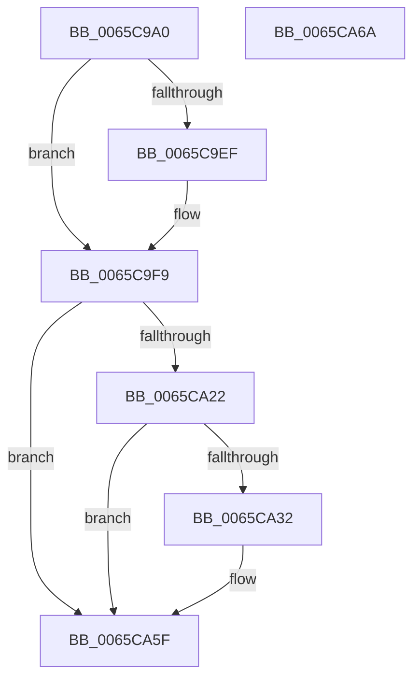

# RtlHpKInitializeHeapManager

- RVA: `0x0065C9A0`–`0x0065CA6B` (길이 `203` bytes)
- VA: `0x000000014065C9A0`
- 실행 섹션: `.text`
- PDB 이름 있음: `예`; PDB Function 태그: `아니요`
- unwind 정보 RVA: `0x000D5858`
- 디코드: `47`개 명령, `203/203` bytes 표시
- 미해석 바이트: `0` (있으면 어셈블리에 `.byte`로 보존)

> 이 문서는 커널 이미지의 기계어와 PDB 기호를 분석해 생성했습니다. 4번과 5번은 함수 원형과 자료형을 바이너리 사용 방식에서 추정한 C 해석이며 원본 소스 복구 결과는 아닙니다.

## 1. Dependencies

- 직접 호출 지점: **5**; 고유 호출 대상: **5**
- 직접 호출자로 확인된 함수: **1**
- RIP 상대 이미지 참조: **7**

### Outgoing calls
- `0x0065C9AD` → [RtlHpGlobalsInitialize](../5F/RtlHpGlobalsInitialize_function_005F09DC.md) (function, `0x005F09DC`)
- `0x0065C9D8` → [RtlHpHeapManagerInitialize](../5F/RtlHpHeapManagerInitialize_function_005F0B20.md) (function, `0x005F0B20`)
- `0x0065CA19` → [RtlCSparseBitmapStart](../60/RtlCSparseBitmapStart_function_00605338.md) (function, `0x00605338`)
- `0x0065CA29` → [RtlpHpVaMgrCtxStart](../60/RtlpHpVaMgrCtxStart_function_00603E2C.md) (function, `0x00603E2C`)
- `0x0065CA58` → [RtlpHpMetadataHeapCreate](../60/RtlpHpMetadataHeapCreate_function_00603680.md) (function, `0x00603680`)

### Direct callers
- [ExInitializePoolHeapManagement](ExInitializePoolHeapManagement_function_0065C3D0.md) at `0x0065C40C`

### Static image references
- `0x0065C9BF` → RVA `0x00E68600` (`.data`; read)
- `0x0065C9DD` → RVA `0x00FC5000` (`ALMOSTRO`; read)
- `0x0065C9E4` → RVA `0x00E6BF10` (`.data`; write)
- `0x0065CA03` → RVA `0x00E68610` (`.data`; read)
- `0x0065CA0D` → RVA `0x00E68608` (`.data`; write)
- `0x0065CA22` → RVA `0x00E68658` (`.data`; read)
- `0x0065CA41` → RVA `0x00E6BEB0` (`.data`; read)

## 2. Other-region calls and transfers

- 다른 실행 섹션으로 향하는 call: **0**
- 별도 외부 분기/꼬리 이동을 확인하지 못했습니다.

## 3. Assembly (complete function range)

```asm
0065C9A0  48 89 5C 24 10                  mov qword ptr [rsp + 0x10], rbx
0065C9A5  55                              push rbp
0065C9A6  48 8B EC                        mov rbp, rsp
0065C9A9  48 83 EC 40                     sub rsp, 0x40
0065C9AD  E8 2A 40 F9 FF                  call 0x1405f09dc
0065C9B2  48 83 65 10 00                  and qword ptr [rbp + 0x10], 0
0065C9B7  48 8D 55 10                     lea rdx, [rbp + 0x10]
0065C9BB  80 4D 14 03                     or byte ptr [rbp + 0x14], 3
0065C9BF  48 8D 0D 3A BC 80 00            lea rcx, [rip + 0x80bc3a]
0065C9C6  B8 00 02 00 00                  mov eax, 0x200
0065C9CB  BB 01 00 00 00                  mov ebx, 1
0065C9D0  66 09 5D 12                     or word ptr [rbp + 0x12], bx
0065C9D4  66 89 45 10                     mov word ptr [rbp + 0x10], ax
0065C9D8  E8 43 41 F9 FF                  call 0x1405f0b20
0065C9DD  0F B7 05 1C 86 96 00            movzx eax, word ptr [rip + 0x96861c]
0065C9E4  89 05 26 F5 80 00               mov dword ptr [rip + 0x80f526], eax
0065C9EA  83 F8 40                        cmp eax, 0x40
0065C9ED  76 0A                           jbe 0x14065c9f9
0065C9EF  C7 05 17 F5 80 00 40 00 00 00   mov dword ptr [rip + 0x80f517], 0x40
0065C9F9  48 B8 00 00 00 00 00 80 FF FF   movabs rax, 0xffff800000000000
0065CA03  48 8D 0D 06 BC 80 00            lea rcx, [rip + 0x80bc06]
0065CA0A  44 8B CB                        mov r9d, ebx
0065CA0D  48 89 05 F4 BB 80 00            mov qword ptr [rip + 0x80bbf4], rax
0065CA14  BA 00 00 00 10                  mov edx, 0x10000000
0065CA19  E8 1A 89 FA FF                  call 0x140605338
0065CA1E  85 C0                           test eax, eax
0065CA20  78 3D                           js 0x14065ca5f
0065CA22  48 8D 0D 2F BC 80 00            lea rcx, [rip + 0x80bc2f]
0065CA29  E8 FE 73 FA FF                  call 0x140603e2c
0065CA2E  85 C0                           test eax, eax
0065CA30  78 2D                           js 0x14065ca5f
0065CA32  0F 57 C0                        xorps xmm0, xmm0
0065CA35  48 8D 55 F0                     lea rdx, [rbp - 0x10]
0065CA39  0F 11 45 F0                     movups xmmword ptr [rbp - 0x10], xmm0
0065CA3D  66 89 5D F1                     mov word ptr [rbp - 0xf], bx
0065CA41  48 8D 0D 68 F4 80 00            lea rcx, [rip + 0x80f468]
0065CA48  C6 45 F0 03                     mov byte ptr [rbp - 0x10], 3
0065CA4C  45 33 C0                        xor r8d, r8d
0065CA4F  0F 28 45 F0                     movaps xmm0, xmmword ptr [rbp - 0x10]
0065CA53  66 0F 7F 45 F0                  movdqa xmmword ptr [rbp - 0x10], xmm0
0065CA58  E8 23 6C FA FF                  call 0x140603680
0065CA5D  33 C0                           xor eax, eax
0065CA5F  48 8B 5C 24 58                  mov rbx, qword ptr [rsp + 0x58]
0065CA64  48 83 C4 40                     add rsp, 0x40
0065CA68  5D                              pop rbp
0065CA69  C3                              ret
0065CA6A  CC                              int3
```

## 4. C-style interpretation (structured pseudocode)

```c
__int64 __fastcall RtlHpKInitializeHeapManager(__int64 a1, __int64 a2, int a3)
{
    __int64 result;
    __int64 v_rsp;
    unsigned __int16 v_stack_m17;
    unsigned __int64 v_stack_m18;
    unsigned __int64 v_stack_p10;
    unsigned __int64 v_stack_p8;
    unsigned __int16 v_stack_pA;
    unsigned __int8 v_stack_pC;

    v_stack_p10 = v_rbx;
    v_rsp = (v_rsp) - (64);
    result = RtlHpGlobalsInitialize(a1, a2, a3, a4);
    v_stack_p8 = 512;
    result = RtlHpHeapManagerInitialize(v_rip + 8436794, v_stack_p8, a3, a4);
    *(unsigned int *)(v_rip + 8451366) = (unsigned int)(*(unsigned __int16 *)(v_rip + 9864732));
    if (((unsigned int)(*(unsigned __int16 *)(v_rip + 9864732))) >= = 64) {
        *(unsigned int *)(v_rip + 8451351) = 64;
    }
    *(unsigned __int64 *)(v_rip + 8436724) = *(unsigned __int16 *)(v_rip + 9864732);
    result = RtlCSparseBitmapStart(v_rip + 8436742, (unsigned int)(0x10000000ULL), a3, 1);
    if (sign_flag) goto loc_0065CA5F;
    result = RtlpHpVaMgrCtxStart(v_rip + 8436783, (unsigned int)(0x10000000ULL), a3, 1);
    if (!(sign_flag)) {
        a2 = v_stack_m18;
        v_stack_m18 = v_xmm0;
        v_stack_m17 = 1;
        a1 = v_rip + 8451176;
        v_stack_m18 = 3;
        a3 = 0;
        v_stack_m18 = v_xmm0;
        result = RtlpHpMetadataHeapCreate(a1, a2, a3, 1);
        result = 0;
    }
    v_rsp = (v_rsp) + (64);
    return result;
}
```

## 5. (Beta) C Style

```c
int64_t RtlHpKInitializeHeapManager(int64_t Arg1, int64_t Arg2, int32_t Arg3)
{
    int64_t result;
    int64_t local_rsp;
    uint16_t v_stack_m17;
    uint64_t v_stack_m18;
    uint64_t v_stack_p10;
    uint64_t v_stack_p8;
    uint16_t v_stack_pA;
    uint8_t v_stack_pC;

    v_stack_p10 = local_rbx;
    local_rsp = (local_rsp) - (64);
    result = RtlHpGlobalsInitialize(Arg1, Arg2, Arg3, a4);
    v_stack_p8 = 512;
    result = RtlHpHeapManagerInitialize(v_rip + 8436794, v_stack_p8, Arg3, a4);
    *(uint32_t *)(v_rip + 0x80F526) = (uint32_t)(*(uint16_t *)(v_rip + 0x96861C));
    if (((uint32_t)(*(uint16_t *)(v_rip + 0x96861C))) >= = 64) {
        *(uint32_t *)(v_rip + 0x80F517) = 64;
    }
    *(uint64_t *)(v_rip + 0x80BBF4) = *(uint16_t *)(v_rip + 0x96861C);
    result = RtlCSparseBitmapStart(v_rip + 8436742, (uint32_t)(0x10000000ULL), Arg3, 1);
    if (sign_flag) goto loc_0065CA5F;
    result = RtlpHpVaMgrCtxStart(v_rip + 8436783, (uint32_t)(0x10000000ULL), Arg3, 1);
    if (!(sign_flag)) {
        Arg2 = v_stack_m18;
        v_stack_m18 = v_xmm0;
        v_stack_m17 = 1;
        Arg1 = v_rip + 8451176;
        v_stack_m18 = 3;
        Arg3 = 0;
        v_stack_m18 = v_xmm0;
        result = RtlpHpMetadataHeapCreate(Arg1, Arg2, Arg3, 1);
        result = 0;
    }
    local_rsp = (local_rsp) + (64);
    return result;
}
```

## 6. Execution-region graph

[열기: 2D/3D 그래프와 함수 탐색 컨트롤 패널](../../../control-panel.html?section=text&rva=0x0065C9A0&view=graph)

- 2D 그래프는 위에서 아래로 흐르고, 3D 그래프는 빈 공간을 드래그해 회전합니다. Shift+드래그는 이동, 휠은 확대·축소, 함수 노드 선택은 대상 보고서 이동입니다.

### Static fallback


