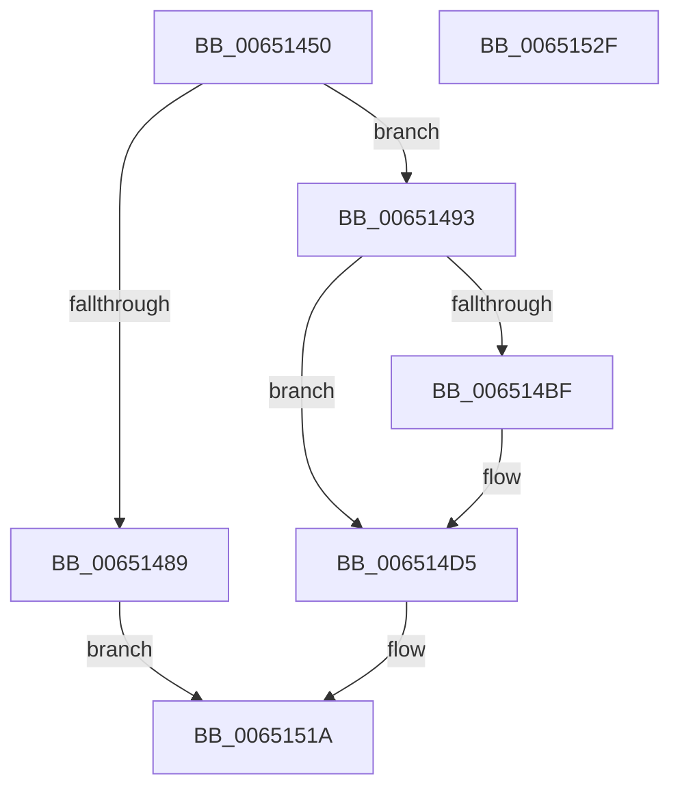

# SeEtwWriteKMCveEvent

- RVA: `0x00651450`–`0x00651530` (길이 `224` bytes)
- VA: `0x0000000140651450`
- 실행 섹션: `.text`
- PDB 이름 있음: `예`; PDB Function 태그: `아니요`
- unwind 정보 RVA: `0x0009EA9C`
- 디코드: `56`개 명령, `224/224` bytes 표시
- 미해석 바이트: `0` (있으면 어셈블리에 `.byte`로 보존)

> 이 문서는 커널 이미지의 기계어와 PDB 기호를 분석해 생성했습니다. 4번과 5번은 함수 원형과 자료형을 바이너리 사용 방식에서 추정한 C 해석이며 원본 소스 복구 결과는 아닙니다.

## 1. Dependencies

- 직접 호출 지점: **2**; 고유 호출 대상: **2**
- 직접 호출자로 확인된 함수: **0**
- RIP 상대 이미지 참조: **3**

### Outgoing calls
- `0x00651515` → [EtwWriteEx](../25/EtwWriteEx_function_0025F0D0.md) (function, `0x0025F0D0`)
- `0x00651521` → [_security_check_cookie](../6A/_security_check_cookie_function_006AC640.md) (function, `0x006AC640`)

### Direct callers
- 이 함수 시작 RVA로 연결되는 직접 call은 확인되지 않았습니다. 간접 호출은 완전히 역산할 수 없습니다.

### Static image references
- `0x0065145E` → RVA `0x00E0A740` (`.data`; read)
- `0x006514E8` → RVA `0x00023558` (`.rdata`; read)
- `0x006514F4` → RVA `0x00EFF818` (`.data`; read)

## 2. Other-region calls and transfers

- 다른 실행 섹션으로 향하는 call: **0**
- 별도 외부 분기/꼬리 이동을 확인하지 못했습니다.

## 3. Assembly (complete function range)

```asm
00651450  40 55                           push rbp
00651452  48 8D 6C 24 A9                  lea rbp, [rsp - 0x57]
00651457  48 81 EC A0 00 00 00            sub rsp, 0xa0
0065145E  48 8B 05 DB 92 7B 00            mov rax, qword ptr [rip + 0x7b92db]
00651465  48 33 C4                        xor rax, rsp
00651468  48 89 45 47                     mov qword ptr [rbp + 0x47], rax
0065146C  45 33 C9                        xor r9d, r9d
0065146F  0F 57 C0                        xorps xmm0, xmm0
00651472  66 0F 7F 45 27                  movdqa xmmword ptr [rbp + 0x27], xmm0
00651477  0F 57 C9                        xorps xmm1, xmm1
0065147A  66 0F 7F 4D 37                  movdqa xmmword ptr [rbp + 0x37], xmm1
0065147F  66 44 89 4D F7                  mov word ptr [rbp - 9], r9w
00651484  48 85 C9                        test rcx, rcx
00651487  75 0A                           jne 0x140651493
00651489  B8 0D 00 00 C0                  mov eax, 0xc000000d
0065148E  E9 87 00 00 00                  jmp 0x14065151a
00651493  48 8B 41 08                     mov rax, qword ptr [rcx + 8]
00651497  41 BA 02 00 00 00               mov r10d, 2
0065149D  48 89 45 07                     mov qword ptr [rbp + 7], rax
006514A1  45 8B C2                        mov r8d, r10d
006514A4  0F B7 01                        movzx eax, word ptr [rcx]
006514A7  89 45 0F                        mov dword ptr [rbp + 0xf], eax
006514AA  48 8D 45 F7                     lea rax, [rbp - 9]
006514AE  48 89 45 17                     mov qword ptr [rbp + 0x17], rax
006514B2  44 89 4D 13                     mov dword ptr [rbp + 0x13], r9d
006514B6  4C 89 55 1F                     mov qword ptr [rbp + 0x1f], r10
006514BA  48 85 D2                        test rdx, rdx
006514BD  74 16                           je 0x1406514d5
006514BF  48 8B 42 08                     mov rax, qword ptr [rdx + 8]
006514C3  45 8D 42 01                     lea r8d, [r10 + 1]
006514C7  48 89 45 27                     mov qword ptr [rbp + 0x27], rax
006514CB  0F B7 02                        movzx eax, word ptr [rdx]
006514CE  89 45 2F                        mov dword ptr [rbp + 0x2f], eax
006514D1  44 89 4D 33                     mov dword ptr [rbp + 0x33], r9d
006514D5  41 8B C0                        mov eax, r8d
006514D8  48 8D 4D F7                     lea rcx, [rbp - 9]
006514DC  48 03 C0                        add rax, rax
006514DF  48 8D 55 07                     lea rdx, [rbp + 7]
006514E3  48 89 54 24 38                  mov qword ptr [rsp + 0x38], rdx
006514E8  48 8D 15 69 20 9D FF            lea rdx, [rip - 0x62df97]
006514EF  48 89 4C C5 07                  mov qword ptr [rbp + rax*8 + 7], rcx
006514F4  48 8B 0D 1D E3 8A 00            mov rcx, qword ptr [rip + 0x8ae31d]
006514FB  4C 89 54 C5 0F                  mov qword ptr [rbp + rax*8 + 0xf], r10
00651500  41 8D 40 01                     lea eax, [r8 + 1]
00651504  89 44 24 30                     mov dword ptr [rsp + 0x30], eax
00651508  45 33 C0                        xor r8d, r8d
0065150B  4C 89 4C 24 28                  mov qword ptr [rsp + 0x28], r9
00651510  4C 89 4C 24 20                  mov qword ptr [rsp + 0x20], r9
00651515  E8 B6 DB C0 FF                  call 0x14025f0d0
0065151A  48 8B 4D 47                     mov rcx, qword ptr [rbp + 0x47]
0065151E  48 33 CC                        xor rcx, rsp
00651521  E8 1A B1 05 00                  call 0x1406ac640
00651526  48 81 C4 A0 00 00 00            add rsp, 0xa0
0065152D  5D                              pop rbp
0065152E  C3                              ret
0065152F  CC                              int3
```

## 4. C-style interpretation (structured pseudocode)

```c
__int64 __fastcall SeEtwWriteKMCveEvent(__int64 a1, __int64 a2, __int64 a3, int a4)
{
    __int64 result;
    __int64 v_rsp;
    unsigned __int64 v_stack_m18;
    unsigned __int64 v_stack_m28;
    unsigned int v_stack_m2C;
    unsigned int v_stack_m30;
    unsigned __int64 v_stack_m38;
    unsigned __int64 v_stack_m40;
    unsigned __int64 v_stack_m48;
    unsigned int v_stack_m4C;
    unsigned int v_stack_m50;
    unsigned __int64 v_stack_m58;
    unsigned __int64 v_stack_m5F;
    unsigned __int16 v_stack_m68;
    unsigned __int64 v_stack_m70;
    unsigned int v_stack_m78;
    unsigned __int64 v_stack_m80;
    unsigned __int64 v_stack_m88;

    v_rsp = (v_rsp) - (160);
    result = (*(unsigned __int64 *)(v_rip + 8098523)) ^ (v_rsp);
    v_stack_m18 = result;
    a4 = 0;
    v_stack_m38 = v_xmm0;
    v_stack_m28 = v_xmm1;
    v_stack_m68 = 0;
    if (a1 != 0) goto loc_00651493;
    goto loc_0065151A;
loc_00651493:
    v_stack_m58 = *(unsigned __int64 *)(a1 + 8);
    v_stack_m50 = (unsigned int)(*(unsigned __int16 *)(a1));
    v_stack_m48 = v_stack_m68;
    v_stack_m4C = 0;
    v_stack_m40 = 2;
    result = v_stack_m68;
    if (a2 != 0) {
        result = *(unsigned __int64 *)(a2 + 8);
        a3 = 2 + 1;
        v_stack_m38 = result;
        result = *(unsigned __int16 *)(a2);
        v_stack_m30 = (unsigned int)(result);
        v_stack_m2C = 0;
    }
    result = ((unsigned int)((unsigned int)(a3))) + ((unsigned int)((unsigned int)(a3)));
    v_stack_m70 = v_stack_m58;
    *(unsigned __int64 *)(v_stack_m5F + result * 8 + 7) = v_stack_m68;
    *(unsigned __int64 *)(v_stack_m5F + result * 8 + 15) = 2;
    v_stack_m78 = (unsigned int)(a3 + 1);
    a3 = 0;
    v_stack_m80 = 0;
    v_stack_m88 = 0;
    result = EtwWriteEx(*(unsigned __int64 *)(v_rip + 9102109), v_rip - 6479767, a3, a4);
loc_0065151A:
    a1 = (v_stack_m18) ^ (v_rsp);
    result = _security_check_cookie(a1, v_rip - 6479767, a3, a4);
    v_rsp = (v_rsp) + (160);
    return result;
}
```

## 5. (Beta) C Style

```c
int64_t SeEtwWriteKMCveEvent(int64_t Arg1, int64_t Arg2, int64_t Arg3, int32_t Arg4)
{
    int64_t result;
    int64_t local_rsp;
    uint64_t v_stack_m18;
    uint64_t v_stack_m28;
    uint32_t v_stack_m2C;
    uint32_t v_stack_m30;
    uint64_t v_stack_m38;
    uint64_t v_stack_m40;
    uint64_t v_stack_m48;
    uint32_t v_stack_m4C;
    uint32_t v_stack_m50;
    uint64_t v_stack_m58;
    uint64_t v_stack_m5F;
    uint16_t v_stack_m68;
    uint64_t v_stack_m70;
    uint32_t v_stack_m78;
    uint64_t v_stack_m80;
    uint64_t v_stack_m88;

    local_rsp = (local_rsp) - (160);
    result = (*(uint64_t *)(v_rip + 0x7B92DB)) ^ (local_rsp);
    v_stack_m18 = result;
    Arg4 = 0;
    v_stack_m38 = v_xmm0;
    v_stack_m28 = v_xmm1;
    v_stack_m68 = 0;
    if (Arg1 != 0) goto loc_00651493;
    goto loc_0065151A;
loc_00651493:
    v_stack_m58 = *(uint64_t *)(Arg1 + 0x8);
    v_stack_m50 = (uint32_t)(*(uint16_t *)(Arg1));
    v_stack_m48 = v_stack_m68;
    v_stack_m4C = 0;
    v_stack_m40 = 2;
    result = v_stack_m68;
    if (Arg2 != 0) {
        result = *(uint64_t *)(Arg2 + 0x8);
        Arg3 = 2 + 1;
        v_stack_m38 = result;
        result = *(uint16_t *)(Arg2);
        v_stack_m30 = (uint32_t)(result);
        v_stack_m2C = 0;
    }
    result = ((uint32_t)((uint32_t)(Arg3))) + ((uint32_t)((uint32_t)(Arg3)));
    v_stack_m70 = v_stack_m58;
    *(uint64_t *)(v_stack_m5F + result * 8 + 0x7) = v_stack_m68;
    *(uint64_t *)(v_stack_m5F + result * 8 + 0xF) = 2;
    v_stack_m78 = (uint32_t)(Arg3 + 1);
    Arg3 = 0;
    v_stack_m80 = 0;
    v_stack_m88 = 0;
    result = EtwWriteEx(*(uint64_t *)(v_rip + 0x8AE31D), v_rip - 6479767, Arg3, Arg4);
loc_0065151A:
    Arg1 = (v_stack_m18) ^ (local_rsp);
    result = _security_check_cookie(Arg1, v_rip - 6479767, Arg3, Arg4);
    local_rsp = (local_rsp) + (160);
    return result;
}
```

## 6. Execution-region graph

[열기: 2D/3D 그래프와 함수 탐색 컨트롤 패널](../../../control-panel.html?section=text&rva=0x00651450&view=graph)

- 2D 그래프는 위에서 아래로 흐르고, 3D 그래프는 빈 공간을 드래그해 회전합니다. Shift+드래그는 이동, 휠은 확대·축소, 함수 노드 선택은 대상 보고서 이동입니다.

### Static fallback


