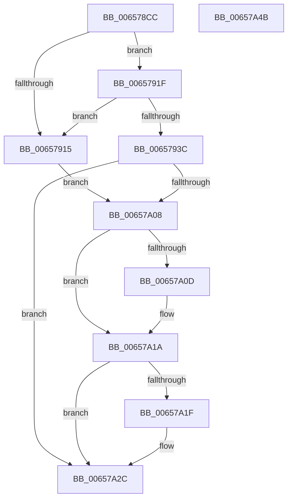

# sub_006578CC

- RVA: `0x006578CC`–`0x00657A4C` (길이 `384` bytes)
- VA: `0x00000001406578CC`
- 실행 섹션: `.text`
- PDB 이름 있음: `아니요`; PDB Function 태그: `아니요`
- unwind 정보 RVA: `0x000D5058`
- 디코드: `87`개 명령, `384/384` bytes 표시
- 미해석 바이트: `0` (있으면 어셈블리에 `.byte`로 보존)

> 이 문서는 커널 이미지의 기계어와 PDB 기호를 분석해 생성했습니다. 4번과 5번은 함수 원형과 자료형을 바이너리 사용 방식에서 추정한 C 해석이며 원본 소스 복구 결과는 아닙니다.

## 1. Dependencies

- 직접 호출 지점: **8**; 고유 호출 대상: **6**
- 직접 호출자로 확인된 함수: **1**
- RIP 상대 이미지 참조: **3**

### Outgoing calls
- `0x006578EE` → [PsGetServerSiloGlobals](../22/PsGetServerSiloGlobals_function_002250A0.md) (function, `0x002250A0`)
- `0x00657908` → [ExAllocatePool2](../../poolcode/B8/ExAllocatePool2_function_00B820F0.md) (function, `0x00B820F0`)
- `0x0065792F` → [ExAllocatePool2](../../poolcode/B8/ExAllocatePool2_function_00B820F0.md) (function, `0x00B820F0`)
- `0x006579B4` → [ExpInitLicensing](../../page/7C/ExpInitLicensing_function_007C85C8.md) (function, `0x007C85C8`)
- `0x006579E8` → [RtlQueryRegistryValuesEx](../../page/8C/RtlQueryRegistryValuesEx_function_008C8FF0.md) (function, `0x008C8FF0`)
- `0x006579EF` → [sub_009669C4](../../page/96/Unknown_function_009669C4.md) (function, `0x009669C4`)
- `0x00657A15` → [ExFreePoolWithTag](../../poolcode/B8/ExFreePoolWithTag_function_00B82870.md) (function, `0x00B82870`)
- `0x00657A27` → [ExFreePoolWithTag](../../poolcode/B8/ExFreePoolWithTag_function_00B82870.md) (function, `0x00B82870`)

### Direct callers
- [PspInitializeServerSiloDeferred](../../page/77/PspInitializeServerSiloDeferred_function_0077FEE0.md) at `0x0077FF08`

### Static image references
- `0x00657986` → RVA `0x00657A60` (`ExpQueryRegistryRoutine`; read)
- `0x00657991` → RVA `0x006D0270` (` ?? ::FNODOBFM::`string'`; read)
- `0x006579CC` → RVA `0x006D02D0` (` ?? ::FNODOBFM::`string'`; read)

## 2. Other-region calls and transfers

- 다른 실행 섹션으로 향하는 call: **7**
  - `0x00657908` → [ExAllocatePool2](../../poolcode/B8/ExAllocatePool2_function_00B820F0.md) (`.text` → `POOLCODE`)
  - `0x0065792F` → [ExAllocatePool2](../../poolcode/B8/ExAllocatePool2_function_00B820F0.md) (`.text` → `POOLCODE`)
  - `0x006579B4` → [ExpInitLicensing](../../page/7C/ExpInitLicensing_function_007C85C8.md) (`.text` → `PAGE`)
  - `0x006579E8` → [RtlQueryRegistryValuesEx](../../page/8C/RtlQueryRegistryValuesEx_function_008C8FF0.md) (`.text` → `PAGE`)
  - `0x006579EF` → [sub_009669C4](../../page/96/Unknown_function_009669C4.md) (`.text` → `PAGE`)
  - `0x00657A15` → [ExFreePoolWithTag](../../poolcode/B8/ExFreePoolWithTag_function_00B82870.md) (`.text` → `POOLCODE`)
  - `0x00657A27` → [ExFreePoolWithTag](../../poolcode/B8/ExFreePoolWithTag_function_00B82870.md) (`.text` → `POOLCODE`)
- 별도 외부 분기/꼬리 이동을 확인하지 못했습니다.

## 3. Assembly (complete function range)

```asm
006578CC  48 8B C4                        mov rax, rsp
006578CF  48 89 58 08                     mov qword ptr [rax + 8], rbx
006578D3  48 89 70 10                     mov qword ptr [rax + 0x10], rsi
006578D7  48 89 78 18                     mov qword ptr [rax + 0x18], rdi
006578DB  4C 89 70 20                     mov qword ptr [rax + 0x20], r14
006578DF  55                              push rbp
006578E0  48 8D 68 A1                     lea rbp, [rax - 0x5f]
006578E4  48 81 EC A0 00 00 00            sub rsp, 0xa0
006578EB  48 8B F9                        mov rdi, rcx
006578EE  E8 AD D7 BC FF                  call 0x1402250a0
006578F3  BA 08 40 01 00                  mov edx, 0x14008
006578F8  B9 00 01 00 00                  mov ecx, 0x100
006578FD  41 B8 53 4C 53 69               mov r8d, 0x69534c53
00657903  48 8B D8                        mov rbx, rax
00657906  33 F6                           xor esi, esi
00657908  E8 E3 A7 52 00                  call 0x140b820f0
0065790D  4C 8B F0                        mov r14, rax
00657910  48 85 C0                        test rax, rax
00657913  75 0A                           jne 0x14065791f
00657915  BF 17 00 00 C0                  mov edi, 0xc0000017
0065791A  E9 E9 00 00 00                  jmp 0x140657a08
0065791F  BA C0 B7 00 00                  mov edx, 0xb7c0
00657924  B9 00 01 00 00                  mov ecx, 0x100
00657929  41 B8 53 4C 53 69               mov r8d, 0x69534c53
0065792F  E8 BC A7 52 00                  call 0x140b820f0
00657934  48 8B F0                        mov rsi, rax
00657937  48 85 C0                        test rax, rax
0065793A  74 D9                           je 0x140657915
0065793C  41 83 A6 04 40 01 00 00         and dword ptr [r14 + 0x14004], 0
00657944  B9 00 40 01 00                  mov ecx, 0x14000
00657949  48 83 65 0F 00                  and qword ptr [rbp + 0xf], 0
0065794E  48 83 65 1F 00                  and qword ptr [rbp + 0x1f], 0
00657953  83 65 27 00                     and dword ptr [rbp + 0x27], 0
00657957  48 83 65 2F 00                  and qword ptr [rbp + 0x2f], 0
0065795C  48 83 65 37 00                  and qword ptr [rbp + 0x37], 0
00657961  83 65 3F 00                     and dword ptr [rbp + 0x3f], 0
00657965  48 83 65 47 00                  and qword ptr [rbp + 0x47], 0
0065796A  83 65 4F 00                     and dword ptr [rbp + 0x4f], 0
0065796E  41 89 8E 00 40 01 00            mov dword ptr [r14 + 0x14000], ecx
00657975  83 88 BC B7 00 00 FF            or dword ptr [rax + 0xb7bc], 0xffffffff
0065797C  4C 89 30                        mov qword ptr [rax], r14
0065797F  48 89 83 68 03 00 00            mov qword ptr [rbx + 0x368], rax
00657986  48 8D 05 D3 00 00 00            lea rax, [rip + 0xd3]
0065798D  48 89 45 E7                     mov qword ptr [rbp - 0x19], rax
00657991  48 8D 05 D8 88 07 00            lea rax, [rip + 0x788d8]
00657998  89 4D 17                        mov dword ptr [rbp + 0x17], ecx
0065799B  48 8B CB                        mov rcx, rbx
0065799E  48 89 45 F7                     mov qword ptr [rbp - 9], rax
006579A2  C7 45 EF 00 01 00 00            mov dword ptr [rbp - 0x11], 0x100
006579A9  C7 45 07 03 00 00 03            mov dword ptr [rbp + 7], 0x3000003
006579B0  48 89 75 FF                     mov qword ptr [rbp - 1], rsi
006579B4  E8 0F 0C 17 00                  call 0x1407c85c8
006579B9  65 4C 8B 0C 25 88 01 00 00      mov r9, qword ptr gs:[0x188]
006579C2  4C 8D 45 E7                     lea r8, [rbp - 0x19]
006579C6  48 83 64 24 20 00               and qword ptr [rsp + 0x20], 0
006579CC  48 8D 15 FD 88 07 00            lea rdx, [rip + 0x788fd]
006579D3  49 8B 99 98 06 00 00            mov rbx, qword ptr [r9 + 0x698]
006579DA  49 89 B9 98 06 00 00            mov qword ptr [r9 + 0x698], rdi
006579E1  45 33 C9                        xor r9d, r9d
006579E4  41 8D 49 02                     lea ecx, [r9 + 2]
006579E8  E8 03 16 27 00                  call 0x1408c8ff0
006579ED  8B F8                           mov edi, eax
006579EF  E8 D0 EF 30 00                  call 0x1409669c4
006579F4  65 48 8B 0C 25 88 01 00 00      mov rcx, qword ptr gs:[0x188]
006579FD  48 89 99 98 06 00 00            mov qword ptr [rcx + 0x698], rbx
00657A04  85 FF                           test edi, edi
00657A06  79 24                           jns 0x140657a2c
00657A08  4D 85 F6                        test r14, r14
00657A0B  74 0D                           je 0x140657a1a
00657A0D  BA 53 4C 53 69                  mov edx, 0x69534c53
00657A12  49 8B CE                        mov rcx, r14
00657A15  E8 56 AE 52 00                  call 0x140b82870
00657A1A  48 85 F6                        test rsi, rsi
00657A1D  74 0D                           je 0x140657a2c
00657A1F  BA 53 4C 53 69                  mov edx, 0x69534c53
00657A24  48 8B CE                        mov rcx, rsi
00657A27  E8 44 AE 52 00                  call 0x140b82870
00657A2C  4C 8D 9C 24 A0 00 00 00         lea r11, [rsp + 0xa0]
00657A34  8B C7                           mov eax, edi
00657A36  49 8B 5B 10                     mov rbx, qword ptr [r11 + 0x10]
00657A3A  49 8B 73 18                     mov rsi, qword ptr [r11 + 0x18]
00657A3E  49 8B 7B 20                     mov rdi, qword ptr [r11 + 0x20]
00657A42  4D 8B 73 28                     mov r14, qword ptr [r11 + 0x28]
00657A46  49 8B E3                        mov rsp, r11
00657A49  5D                              pop rbp
00657A4A  C3                              ret
00657A4B  CC                              int3
```

## 4. C-style interpretation (structured pseudocode)

```c
__int64 __fastcall sub_006578CC(__int64 a1)
{
    __int64 result;
    __int64 v_rsi;
    __int64 v_rsp;
    unsigned __int64 v_stack_m8;
    unsigned __int64 v_stack_m88;

    *(unsigned __int64 *)(v_rsp + 8) = v_rbx;
    *(unsigned __int64 *)(v_rsp + 16) = v_rsi;
    *(unsigned __int64 *)(v_rsp + 24) = v_rdi;
    *(unsigned __int64 *)(v_rsp + 32) = v_r14;
    v_rsp = (v_rsp) - (160);
    result = PsGetServerSiloGlobals(a1, a2, a3, a4);
    v_rsi = 0;
    result = ExAllocatePool2(256, (unsigned int)(0x14008ULL), (unsigned int)(0x69534C53ULL), a4);
    if (result != 0) goto loc_0065791F;
loc_00657915:
    goto loc_00657A08;
loc_0065791F:
    result = ExAllocatePool2(256, (unsigned int)(0xB7C0ULL), (unsigned int)(0x69534C53ULL), a4);
    if (result == 0) goto loc_00657915;
    *(unsigned int *)(result + 81920) = (unsigned int)((unsigned int)(0x14000ULL));
    *(unsigned __int64 *)(result) = result;
    *(unsigned __int64 *)(result + 872) = result;
    *(unsigned __int64 *)(v_rsp - 95 - 25) = v_rip + 211;
    *(unsigned int *)(v_rsp - 95 + 23) = (unsigned int)((unsigned int)(0x14000ULL));
    *(unsigned __int64 *)(v_rsp - 95 - 9) = v_rip + 493784;
    *(unsigned int *)(v_rsp - 95 - 17) = 256;
    *(unsigned int *)(v_rsp - 95 + 7) = 0x3000003ULL;
    *(unsigned __int64 *)(v_rsp - 95 - 1) = result;
    result = ExpInitLicensing(result, (unsigned int)(0xB7C0ULL), (unsigned int)(0x69534C53ULL), a4);
    *(unsigned __int64 *)(*(unsigned __int64 *)(gs_base + (0 + 392)) + 1688) = (unsigned int)(0xC0000017ULL);
    a4 = 0;
    result = RtlQueryRegistryValuesEx(a4 + 2, v_rip + 493821, v_rsp - 95 - 25, a4);
    result = sub_009669C4(a4 + 2, v_rip + 493821, v_rsp - 95 - 25, a4);
    *(unsigned __int64 *)(*(unsigned __int64 *)(gs_base + (0 + 392)) + 1688) = *(unsigned __int64 *)(*(unsigned __int64 *)(gs_base + (0 + 392)) + 1688);
    if (!sign_flag) goto loc_00657A2C;
loc_00657A08:
    if (result != 0) {
        a2 = 0x69534C53ULL;
        a1 = result;
        result = ExFreePoolWithTag(a1, a2, v_rsp - 95 - 25, a4);
    }
    if (result != 0) {
        a2 = 0x69534C53ULL;
        a1 = result;
        result = ExFreePoolWithTag(a1, a2, v_rsp - 95 - 25, a4);
    }
    return (unsigned int)((unsigned int)((unsigned int)((unsigned int)(result))));
}
```

## 5. (Beta) C Style

```c
int64_t sub_006578CC(int64_t Arg1)
{
    int64_t result;
    int64_t local_rsi;
    int64_t local_rsp;
    uint64_t v_stack_m8;
    uint64_t v_stack_m88;

    *(uint64_t *)(local_rsp + 0x8) = local_rbx;
    *(uint64_t *)(local_rsp + 0x10) = local_rsi;
    *(uint64_t *)(local_rsp + 0x18) = local_rdi;
    *(uint64_t *)(local_rsp + 0x20) = local_r14;
    local_rsp = (local_rsp) - (160);
    result = PsGetServerSiloGlobals(Arg1, a2, a3, a4);
    local_rsi = 0;
    result = ExAllocatePool2(256, (uint32_t)(0x14008ULL), (uint32_t)(0x69534C53ULL), a4);
    if (result != 0) goto loc_0065791F;
loc_00657915:
    goto loc_00657A08;
loc_0065791F:
    result = ExAllocatePool2(256, (uint32_t)(0xB7C0ULL), (uint32_t)(0x69534C53ULL), a4);
    if (result == 0) goto loc_00657915;
    *(uint32_t *)(result + 0x14000) = (uint32_t)((uint32_t)(0x14000ULL));
    *(uint64_t *)(result) = result;
    *(uint64_t *)(result + 0x368) = result;
    *(uint64_t *)(local_rsp - 0x5F - 0x19) = v_rip + 211;
    *(uint32_t *)(local_rsp - 0x5F + 0x17) = (uint32_t)((uint32_t)(0x14000ULL));
    *(uint64_t *)(local_rsp - 0x5F - 0x9) = v_rip + 493784;
    *(uint32_t *)(local_rsp - 0x5F - 0x11) = 256;
    *(uint32_t *)(local_rsp - 0x5F + 0x7) = 0x3000003ULL;
    *(uint64_t *)(local_rsp - 0x5F - 0x1) = result;
    result = ExpInitLicensing(result, (uint32_t)(0xB7C0ULL), (uint32_t)(0x69534C53ULL), a4);
    *(uint64_t *)(*(uint64_t *)(gs_base + (0 + 0x188)) + 0x698) = (uint32_t)(0xC0000017ULL);
    a4 = 0;
    result = RtlQueryRegistryValuesEx(a4 + 2, v_rip + 493821, local_rsp - 95 - 25, a4);
    result = sub_009669C4(a4 + 2, v_rip + 493821, local_rsp - 95 - 25, a4);
    *(uint64_t *)(*(uint64_t *)(gs_base + (0 + 0x188)) + 0x698) = *(uint64_t *)(*(uint64_t *)(gs_base + (0 + 0x188)) + 0x698);
    if (!sign_flag) goto loc_00657A2C;
loc_00657A08:
    if (result != 0) {
        a2 = 0x69534C53ULL;
        Arg1 = result;
        result = ExFreePoolWithTag(Arg1, a2, local_rsp - 95 - 25, a4);
    }
    if (result != 0) {
        a2 = 0x69534C53ULL;
        Arg1 = result;
        result = ExFreePoolWithTag(Arg1, a2, local_rsp - 95 - 25, a4);
    }
    return (uint32_t)((uint32_t)((uint32_t)((uint32_t)(result))));
}
```

## 6. Execution-region graph

[열기: 2D/3D 그래프와 함수 탐색 컨트롤 패널](../../../control-panel.html?section=text&rva=0x006578CC&view=graph)

- 2D 그래프는 위에서 아래로 흐르고, 3D 그래프는 빈 공간을 드래그해 회전합니다. Shift+드래그는 이동, 휠은 확대·축소, 함수 노드 선택은 대상 보고서 이동입니다.

### Static fallback


