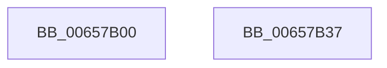

# sub_00657B00

- RVA: `0x00657B00`–`0x00657B38` (길이 `56` bytes)
- VA: `0x0000000140657B00`
- 실행 섹션: `.text`
- PDB 이름 있음: `아니요`; PDB Function 태그: `아니요`
- unwind 정보 RVA: `0x00064C80`
- 디코드: `18`개 명령, `56/56` bytes 표시
- 미해석 바이트: `0` (있으면 어셈블리에 `.byte`로 보존)

> 이 문서는 커널 이미지의 기계어와 PDB 기호를 분석해 생성했습니다. 4번과 5번은 함수 원형과 자료형을 바이너리 사용 방식에서 추정한 C 해석이며 원본 소스 복구 결과는 아닙니다.

## 1. Dependencies

- 직접 호출 지점: **1**; 고유 호출 대상: **1**
- 직접 호출자로 확인된 함수: **0**
- RIP 상대 이미지 참조: **0**

### Outgoing calls
- `0x00657B2C` → [sub_007C7CEC](../../page/7C/Unknown_function_007C7CEC.md) (function, `0x007C7CEC`)

### Direct callers
- 이 함수 시작 RVA로 연결되는 직접 call은 확인되지 않았습니다. 간접 호출은 완전히 역산할 수 없습니다.

### Static image references
- 디코드된 RIP-relative 메모리 참조가 없습니다.

## 2. Other-region calls and transfers

- 다른 실행 섹션으로 향하는 call: **1**
  - `0x00657B2C` → [sub_007C7CEC](../../page/7C/Unknown_function_007C7CEC.md) (`.text` → `PAGE`)
- 별도 외부 분기/꼬리 이동을 확인하지 못했습니다.

## 3. Assembly (complete function range)

```asm
00657B00  40 53                           push rbx
00657B02  48 83 EC 30                     sub rsp, 0x30
00657B06  48 8B 44 24 68                  mov rax, qword ptr [rsp + 0x68]
00657B0B  45 8B D1                        mov r10d, r9d
00657B0E  4C 8B 4C 24 60                  mov r9, qword ptr [rsp + 0x60]
00657B13  4D 8B D8                        mov r11, r8
00657B16  48 8B DA                        mov rbx, rdx
00657B19  45 8B C2                        mov r8d, r10d
00657B1C  49 8B D3                        mov rdx, r11
00657B1F  C6 00 01                        mov byte ptr [rax], 1
00657B22  8B 41 08                        mov eax, dword ptr [rcx + 8]
00657B25  48 8B CB                        mov rcx, rbx
00657B28  89 44 24 20                     mov dword ptr [rsp + 0x20], eax
00657B2C  E8 BB 01 17 00                  call 0x1407c7cec
00657B31  48 83 C4 30                     add rsp, 0x30
00657B35  5B                              pop rbx
00657B36  C3                              ret
00657B37  CC                              int3
```

## 4. C-style interpretation (structured pseudocode)

```c
__int64 __fastcall sub_00657B00(__int64 a1, __int64 a2, __int64 a3, int a4, __int64 a5, __int64 a6)
{
    __int64 result;
    __int64 v_rsp;
    unsigned int v_stack_m18;

    v_rsp = (v_rsp) - (48);
    *(unsigned __int8 *)(a6) = 1;
    v_stack_m18 = (unsigned int)((unsigned int)(*(unsigned int *)(a1 + 8)));
    result = sub_007C7CEC(a2, a3, (unsigned int)((unsigned int)((unsigned int)(a4))), a5);
    v_rsp = (v_rsp) + (48);
    return result;
}
```

## 5. (Beta) C Style

```c
int64_t sub_00657B00(void *Arg1, int64_t Arg2, int64_t Arg3, int32_t Arg4, int64_t Arg5, void *Arg6)
{
    uint8_t *arg1 = (uint8_t *)Arg1;
    uint8_t *arg6 = (uint8_t *)Arg6;

    int64_t result;
    int64_t local_rsp;
    uint32_t v_stack_m18;

    local_rsp = (local_rsp) - (48);
    *(uint8_t *)(arg6) = 1;
    v_stack_m18 = (uint32_t)((uint32_t)(*(uint32_t *)(arg1 + 0x8)));
    result = sub_007C7CEC(Arg2, Arg3, (uint32_t)((uint32_t)((uint32_t)(Arg4))), Arg5);
    local_rsp = (local_rsp) + (48);
    return result;
}
```

### 관측된 메모리 오프셋

구조체 형식이 확인되지 않은 접근은 인자 기준의 오프셋으로만 기록했습니다.

| 기준 인자 | 오프셋 표현 | 폭 (bit) | 접근 |
|---|---:|---:|---|
| `Arg1` | `+ 0x8` | `32` | `R` |
| `Arg6` | `+ 0x0` | `8` | `W` |

## 6. Execution-region graph

[열기: 2D/3D 그래프와 함수 탐색 컨트롤 패널](../../../control-panel.html?section=text&rva=0x00657B00&view=graph)

- 2D 그래프는 위에서 아래로 흐르고, 3D 그래프는 빈 공간을 드래그해 회전합니다. Shift+드래그는 이동, 휠은 확대·축소, 함수 노드 선택은 대상 보고서 이동입니다.

### Static fallback


