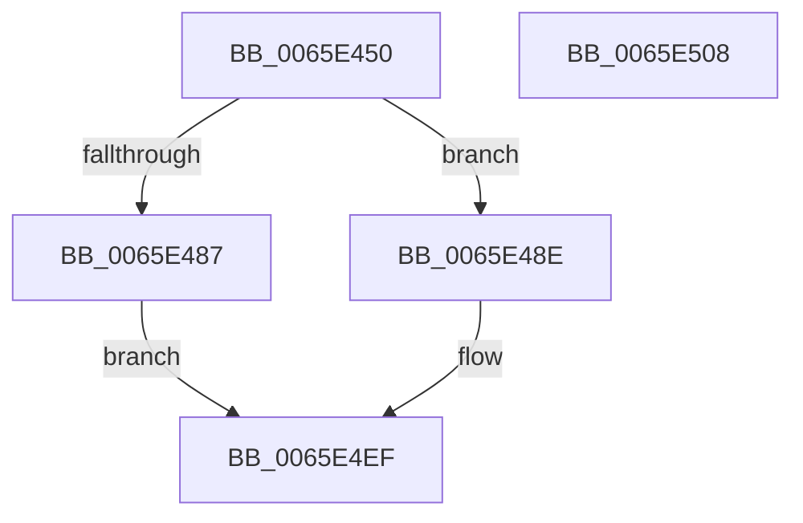

# WheaAddErrorSourceDeviceDriverV1

- RVA: `0x0065E450`–`0x0065E509` (길이 `185` bytes)
- VA: `0x000000014065E450`
- 실행 섹션: `.text`
- PDB 이름 있음: `예`; PDB Function 태그: `아니요`
- unwind 정보 RVA: `0x0007FA5C`
- 디코드: `45`개 명령, `185/185` bytes 표시
- 미해석 바이트: `0` (있으면 어셈블리에 `.byte`로 보존)

> 이 문서는 커널 이미지의 기계어와 PDB 기호를 분석해 생성했습니다. 4번과 5번은 함수 원형과 자료형을 바이너리 사용 방식에서 추정한 C 해석이며 원본 소스 복구 결과는 아닙니다.

## 1. Dependencies

- 직접 호출 지점: **2**; 고유 호출 대상: **2**
- 직접 호출자로 확인된 함수: **0**
- RIP 상대 이미지 참조: **2**

### Outgoing calls
- `0x0065E47D` → [memset](../6C/memset_function_006C6C40.md) (function, `0x006C6C40`)
- `0x0065E4EA` → [WheaAddErrorSourceDeviceDriver](../../page/7D/WheaAddErrorSourceDeviceDriver_function_007D6E70.md) (function, `0x007D6E70`)

### Direct callers
- 이 함수 시작 RVA로 연결되는 직접 call은 확인되지 않았습니다. 간접 호출은 완전히 역산할 수 없습니다.

### Static image references
- `0x0065E4B3` → RVA `0x000248C8` (`.rdata`; read)
- `0x0065E4C3` → RVA `0x000112D0` (`.rdata`; read)

## 2. Other-region calls and transfers

- 다른 실행 섹션으로 향하는 call: **1**
  - `0x0065E4EA` → [WheaAddErrorSourceDeviceDriver](../../page/7D/WheaAddErrorSourceDeviceDriver_function_007D6E70.md) (`.text` → `PAGE`)
- 별도 외부 분기/꼬리 이동을 확인하지 못했습니다.

## 3. Assembly (complete function range)

```asm
0065E450  48 8B C4                        mov rax, rsp
0065E453  48 89 58 08                     mov qword ptr [rax + 8], rbx
0065E457  48 89 68 10                     mov qword ptr [rax + 0x10], rbp
0065E45B  48 89 70 18                     mov qword ptr [rax + 0x18], rsi
0065E45F  57                              push rdi
0065E460  48 81 EC 80 00 00 00            sub rsp, 0x80
0065E467  48 8B DA                        mov rbx, rdx
0065E46A  41 8B F0                        mov esi, r8d
0065E46D  33 D2                           xor edx, edx
0065E46F  48 8B E9                        mov rbp, rcx
0065E472  48 8D 48 98                     lea rcx, [rax - 0x68]
0065E476  41 8B F9                        mov edi, r9d
0065E479  44 8D 42 54                     lea r8d, [rdx + 0x54]
0065E47D  E8 BE 87 06 00                  call 0x1406c6c40
0065E482  83 3B 01                        cmp dword ptr [rbx], 1
0065E485  74 07                           je 0x14065e48e
0065E487  B8 F0 00 00 C0                  mov eax, 0xc00000f0
0065E48C  EB 61                           jmp 0x14065e4ef
0065E48E  0F 10 03                        movups xmm0, xmmword ptr [rbx]
0065E491  8B 43 28                        mov eax, dword ptr [rbx + 0x28]
0065E494  44 8B C6                        mov r8d, esi
0065E497  0F 10 4B 10                     movups xmm1, xmmword ptr [rbx + 0x10]
0065E49B  48 8D 54 24 20                  lea rdx, [rsp + 0x20]
0065E4A0  48 8B CD                        mov rcx, rbp
0065E4A3  0F 29 44 24 20                  movaps xmmword ptr [rsp + 0x20], xmm0
0065E4A8  F2 0F 10 43 20                  movsd xmm0, qword ptr [rbx + 0x20]
0065E4AD  F2 0F 11 44 24 40               movsd qword ptr [rsp + 0x40], xmm0
0065E4B3  0F 10 05 0E 64 9C FF            movups xmm0, xmmword ptr [rip - 0x639bf2]
0065E4BA  89 44 24 48                     mov dword ptr [rsp + 0x48], eax
0065E4BE  0F 29 4C 24 30                  movaps xmmword ptr [rsp + 0x30], xmm1
0065E4C3  0F 10 0D 06 2E 9B FF            movups xmm1, xmmword ptr [rip - 0x64d1fa]
0065E4CA  89 7C 24 4C                     mov dword ptr [rsp + 0x4c], edi
0065E4CE  F3 0F 7F 44 24 54               movdqu xmmword ptr [rsp + 0x54], xmm0
0065E4D4  C7 44 24 50 01 00 00 00         mov dword ptr [rsp + 0x50], 1
0065E4DC  F3 0F 7F 4C 24 64               movdqu xmmword ptr [rsp + 0x64], xmm1
0065E4E2  C7 44 24 20 02 00 00 00         mov dword ptr [rsp + 0x20], 2
0065E4EA  E8 81 89 17 00                  call 0x1407d6e70
0065E4EF  4C 8D 9C 24 80 00 00 00         lea r11, [rsp + 0x80]
0065E4F7  49 8B 5B 10                     mov rbx, qword ptr [r11 + 0x10]
0065E4FB  49 8B 6B 18                     mov rbp, qword ptr [r11 + 0x18]
0065E4FF  49 8B 73 20                     mov rsi, qword ptr [r11 + 0x20]
0065E503  49 8B E3                        mov rsp, r11
0065E506  5F                              pop rdi
0065E507  C3                              ret
0065E508  CC                              int3
```

## 4. C-style interpretation (structured pseudocode)

```c
__int64 __fastcall WheaAddErrorSourceDeviceDriverV1(__int64 a1, __int64 a2, int a3, int a4)
{
    __int64 result;
    __int64 v_rsp;
    unsigned __int64 v_stack_m24;
    unsigned __int64 v_stack_m34;
    unsigned int v_stack_m38;
    unsigned int v_stack_m3C;
    unsigned int v_stack_m40;
    unsigned __int64 v_stack_m48;
    unsigned __int64 v_stack_m58;
    unsigned __int64 v_stack_m68;
    unsigned __int64 v_stack_m8;

    *(unsigned __int64 *)(v_rsp + 8) = v_rbx;
    *(unsigned __int64 *)(v_rsp + 16) = v_rbp;
    *(unsigned __int64 *)(v_rsp + 24) = v_rsi;
    v_rsp = (v_rsp) - (128);
    a2 = 0;
    result = memset(v_rsp - 104, a2, a2 + 84, a4);
    if ((*(unsigned int *)(a2)) == 1) goto loc_0065E48E;
    goto loc_0065E4EF;
loc_0065E48E:
    v_stack_m68 = v_xmm0;
    v_stack_m48 = v_xmm0;
    v_stack_m40 = (unsigned int)((unsigned int)(*(unsigned int *)(a2 + 40)));
    v_stack_m58 = v_xmm1;
    v_stack_m3C = (unsigned int)((unsigned int)(a4));
    v_stack_m34 = v_xmm0;
    v_stack_m38 = 1;
    v_stack_m24 = v_xmm1;
    v_stack_m68 = 2;
    result = WheaAddErrorSourceDeviceDriver(a1, v_stack_m68, (unsigned int)((unsigned int)((unsigned int)(a3))), a4);
loc_0065E4EF:
    return result;
}
```

## 5. (Beta) C Style

```c
int64_t WheaAddErrorSourceDeviceDriverV1(int64_t Arg1, void *Arg2, int32_t Arg3, int32_t Arg4)
{
    uint8_t *arg2 = (uint8_t *)Arg2;

    int64_t result;
    int64_t local_rsp;
    uint64_t v_stack_m24;
    uint64_t v_stack_m34;
    uint32_t v_stack_m38;
    uint32_t v_stack_m3C;
    uint32_t v_stack_m40;
    uint64_t v_stack_m48;
    uint64_t v_stack_m58;
    uint64_t v_stack_m68;
    uint64_t v_stack_m8;

    *(uint64_t *)(local_rsp + 0x8) = local_rbx;
    *(uint64_t *)(local_rsp + 0x10) = local_rbp;
    *(uint64_t *)(local_rsp + 0x18) = local_rsi;
    local_rsp = (local_rsp) - (128);
    Arg2 = 0;
    result = memset(local_rsp - 104, Arg2, Arg2 + 84, Arg4);
    if ((*(uint32_t *)(arg2)) == 1) goto loc_0065E48E;
    goto loc_0065E4EF;
loc_0065E48E:
    v_stack_m68 = v_xmm0;
    v_stack_m48 = v_xmm0;
    v_stack_m40 = (uint32_t)((uint32_t)(*(uint32_t *)(arg2 + 0x28)));
    v_stack_m58 = v_xmm1;
    v_stack_m3C = (uint32_t)((uint32_t)(Arg4));
    v_stack_m34 = v_xmm0;
    v_stack_m38 = 1;
    v_stack_m24 = v_xmm1;
    v_stack_m68 = 2;
    result = WheaAddErrorSourceDeviceDriver(Arg1, v_stack_m68, (uint32_t)((uint32_t)((uint32_t)(Arg3))), Arg4);
loc_0065E4EF:
    return result;
}
```

### 관측된 메모리 오프셋

구조체 형식이 확인되지 않은 접근은 인자 기준의 오프셋으로만 기록했습니다.

| 기준 인자 | 오프셋 표현 | 폭 (bit) | 접근 |
|---|---:|---:|---|
| `Arg2` | `+ 0x0` | `32` | `R` |
| `Arg2` | `+ 0x0` | `128` | `R` |
| `Arg2` | `+ 0x10` | `128` | `R` |
| `Arg2` | `+ 0x20` | `64` | `R` |
| `Arg2` | `+ 0x28` | `32` | `R` |

## 6. Execution-region graph

[열기: 2D/3D 그래프와 함수 탐색 컨트롤 패널](../../../control-panel.html?section=text&rva=0x0065E450&view=graph)

- 2D 그래프는 위에서 아래로 흐르고, 3D 그래프는 빈 공간을 드래그해 회전합니다. Shift+드래그는 이동, 휠은 확대·축소, 함수 노드 선택은 대상 보고서 이동입니다.

### Static fallback


