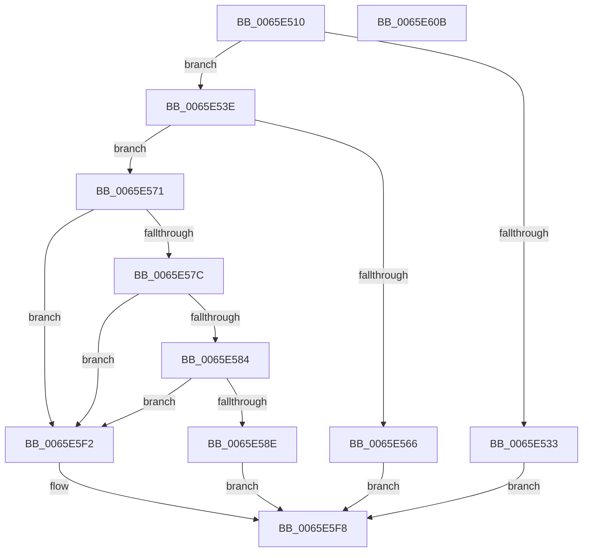

# WheaAddHwErrorReportSectionDeviceDriver

- RVA: `0x0065E510`–`0x0065E60C` (길이 `252` bytes)
- VA: `0x000000014065E510`
- 실행 섹션: `.text`
- PDB 이름 있음: `예`; PDB Function 태그: `아니요`
- unwind 정보 RVA: `0x00060BC4`
- 디코드: `71`개 명령, `252/252` bytes 표시
- 미해석 바이트: `0` (있으면 어셈블리에 `.byte`로 보존)

> 이 문서는 커널 이미지의 기계어와 PDB 기호를 분석해 생성했습니다. 4번과 5번은 함수 원형과 자료형을 바이너리 사용 방식에서 추정한 C 해석이며 원본 소스 복구 결과는 아닙니다.

## 1. Dependencies

- 직접 호출 지점: **3**; 고유 호출 대상: **3**
- 직접 호출자로 확인된 함수: **2**
- RIP 상대 이미지 참조: **1**

### Outgoing calls
- `0x0065E52A` → [WheapErrorHandleIsValid](WheapErrorHandleIsValid_function_0065EC3C.md) (function, `0x0065EC3C`)
- `0x0065E548` → [WheapGetErrorSource](../49/WheapGetErrorSource_function_0049554C.md) (function, `0x0049554C`)
- `0x0065E55D` → [WheapErrDescIsDeviceDriver](WheapErrDescIsDeviceDriver_function_0065EC24.md) (function, `0x0065EC24`)

### Direct callers
- [WheaReportFatalHwErrorDeviceDriverEx](WheaReportFatalHwErrorDeviceDriverEx_function_0065E910.md) at `0x0065E9A0`
- [WheaReportHwErrorDeviceDriverEx](WheaReportHwErrorDeviceDriverEx_function_0065EA30.md) at `0x0065EABF`

### Static image references
- `0x0065E541` → RVA `0x00EEF018` (`.data`; read)

## 2. Other-region calls and transfers

- 다른 실행 섹션으로 향하는 call: **0**
- 별도 외부 분기/꼬리 이동을 확인하지 못했습니다.

## 3. Assembly (complete function range)

```asm
0065E510  48 89 5C 24 08                  mov qword ptr [rsp + 8], rbx
0065E515  48 89 74 24 10                  mov qword ptr [rsp + 0x10], rsi
0065E51A  57                              push rdi
0065E51B  48 83 EC 20                     sub rsp, 0x20
0065E51F  49 8B F0                        mov rsi, r8
0065E522  8B FA                           mov edi, edx
0065E524  48 8B D9                        mov rbx, rcx
0065E527  45 33 DB                        xor r11d, r11d
0065E52A  E8 0D 07 00 00                  call 0x14065ec3c
0065E52F  84 C0                           test al, al
0065E531  75 0B                           jne 0x14065e53e
0065E533  41 BB 08 00 00 C0               mov r11d, 0xc0000008
0065E539  E9 BA 00 00 00                  jmp 0x14065e5f8
0065E53E  8B 51 0C                        mov edx, dword ptr [rcx + 0xc]
0065E541  48 8D 0D D0 0A 89 00            lea rcx, [rip + 0x890ad0]
0065E548  E8 FF 6F E3 FF                  call 0x14049554c
0065E54D  48 8D 48 60                     lea rcx, [rax + 0x60]
0065E551  48 F7 D8                        neg rax
0065E554  48 1B D2                        sbb rdx, rdx
0065E557  48 23 D1                        and rdx, rcx
0065E55A  48 8B CA                        mov rcx, rdx
0065E55D  E8 C2 06 00 00                  call 0x14065ec24
0065E562  84 C0                           test al, al
0065E564  75 0B                           jne 0x14065e571
0065E566  41 BB B6 02 00 C0               mov r11d, 0xc00002b6
0065E56C  E9 87 00 00 00                  jmp 0x14065e5f8
0065E571  8B 82 8C 00 00 00               mov eax, dword ptr [rdx + 0x8c]
0065E577  39 43 04                        cmp dword ptr [rbx + 4], eax
0065E57A  73 76                           jae 0x14065e5f2
0065E57C  3B BA 88 00 00 00               cmp edi, dword ptr [rdx + 0x88]
0065E582  77 6E                           ja 0x14065e5f2
0065E584  8B 4B 08                        mov ecx, dword ptr [rbx + 8]
0065E587  03 CF                           add ecx, edi
0065E589  3B 4A 40                        cmp ecx, dword ptr [rdx + 0x40]
0065E58C  77 64                           ja 0x14065e5f2
0065E58E  48 8B 53 10                     mov rdx, qword ptr [rbx + 0x10]
0065E592  8B 02                           mov eax, dword ptr [rdx]
0065E594  8D 48 10                        lea ecx, [rax + 0x10]
0065E597  33 C8                           xor ecx, eax
0065E599  81 E1 F0 3F 00 00               and ecx, 0x3ff0
0065E59F  33 C8                           xor ecx, eax
0065E5A1  89 0A                           mov dword ptr [rdx], ecx
0065E5A3  48 8B 53 18                     mov rdx, qword ptr [rbx + 0x18]
0065E5A7  8B 43 34                        mov eax, dword ptr [rbx + 0x34]
0065E5AA  89 42 10                        mov dword ptr [rdx + 0x10], eax
0065E5AD  48 8D 4A 48                     lea rcx, [rdx + 0x48]
0065E5B1  66 C7 42 14 00 03               mov word ptr [rdx + 0x14], 0x300
0065E5B7  48 8D 42 2C                     lea rax, [rdx + 0x2c]
0065E5BB  89 7A 18                        mov dword ptr [rdx + 0x18], edi
0065E5BE  48 89 46 18                     mov qword ptr [rsi + 0x18], rax
0065E5C2  48 8D 42 17                     lea rax, [rdx + 0x17]
0065E5C6  48 89 56 10                     mov qword ptr [rsi + 0x10], rdx
0065E5CA  80 4A 16 02                     or byte ptr [rdx + 0x16], 2
0065E5CE  FF 43 04                        inc dword ptr [rbx + 4]
0065E5D1  48 89 46 20                     mov qword ptr [rsi + 0x20], rax
0065E5D5  48 8D 04 39                     lea rax, [rcx + rdi]
0065E5D9  48 89 4E 04                     mov qword ptr [rsi + 4], rcx
0065E5DD  89 7E 0C                        mov dword ptr [rsi + 0xc], edi
0065E5E0  48 89 43 18                     mov qword ptr [rbx + 0x18], rax
0065E5E4  8D 47 48                        lea eax, [rdi + 0x48]
0065E5E7  01 43 08                        add dword ptr [rbx + 8], eax
0065E5EA  C7 06 01 00 00 00               mov dword ptr [rsi], 1
0065E5F0  EB 06                           jmp 0x14065e5f8
0065E5F2  41 BB 9A 00 00 C0               mov r11d, 0xc000009a
0065E5F8  48 8B 5C 24 30                  mov rbx, qword ptr [rsp + 0x30]
0065E5FD  41 8B C3                        mov eax, r11d
0065E600  48 8B 74 24 38                  mov rsi, qword ptr [rsp + 0x38]
0065E605  48 83 C4 20                     add rsp, 0x20
0065E609  5F                              pop rdi
0065E60A  C3                              ret
0065E60B  CC                              int3
```

## 4. C-style interpretation (structured pseudocode)

```c
__int64 __fastcall WheaAddHwErrorReportSectionDeviceDriver(__int64 a1, int a2, __int64 a3)
{
    __int64 result;
    __int64 v_r11;
    __int64 v_rsp;
    unsigned __int64 v_stack_p10;
    unsigned __int64 v_stack_p8;

    v_stack_p8 = v_rbx;
    v_stack_p10 = v_rsi;
    v_rsp = (v_rsp) - (32);
    v_r11 = 0;
    result = WheapErrorHandleIsValid(a1, a2, a3, a4);
    if ((unsigned __int8)(result) != 0) goto loc_0065E53E;
    goto loc_0065E5F8;
loc_0065E53E:
    result = WheapGetErrorSource(v_rip + 8981200, (unsigned int)(*(unsigned int *)(a1 + 12)), a3, a4);
    result = -(result);
    a2 = ((unsigned int)(*(unsigned int *)(a1 + 12))) & (result + 96);
    result = WheapErrDescIsDeviceDriver(a2, a2, a3, a4);
    if ((unsigned __int8)(result) != 0) goto loc_0065E571;
    goto loc_0065E5F8;
loc_0065E571:
    if ((*(unsigned int *)(a1 + 4)) >= ((unsigned int)((unsigned int)(*(unsigned int *)(a2 + 140))))) goto loc_0065E5F2;
    if (((unsigned int)((unsigned int)(a2))) > (*(unsigned int *)(a2 + 136))) goto loc_0065E5F2;
    a1 = (unsigned int)(((unsigned int)(*(unsigned int *)(a1 + 8))) + ((unsigned int)((unsigned int)(a2))));
    if (((unsigned int)(a1)) > (*(unsigned int *)(a2 + 64))) goto loc_0065E5F2;
    a1 = (unsigned int)(((unsigned int)(*(unsigned int *)(*(unsigned __int64 *)(a1 + 16))) + 16) ^ ((unsigned int)((unsigned int)(*(unsigned int *)(*(unsigned __int64 *)(a1 + 16))))));
    a1 = (unsigned int)((a1) & (0x3FF0ULL));
    a1 = (unsigned int)((a1) ^ ((unsigned int)((unsigned int)(*(unsigned int *)(*(unsigned __int64 *)(a1 + 16))))));
    *(unsigned int *)(*(unsigned __int64 *)(a1 + 16)) = (unsigned int)(a1);
    *(unsigned int *)(*(unsigned __int64 *)(a1 + 24) + 16) = (unsigned int)((unsigned int)(*(unsigned int *)(a1 + 52)));
    *(unsigned __int16 *)(*(unsigned __int64 *)(a1 + 24) + 20) = 768;
    *(unsigned int *)(*(unsigned __int64 *)(a1 + 24) + 24) = (unsigned int)((unsigned int)(a2));
    *(unsigned __int64 *)(a3 + 24) = *(unsigned __int64 *)(a1 + 24) + 44;
    *(unsigned __int64 *)(a3 + 16) = *(unsigned __int64 *)(a1 + 24);
    *(unsigned __int64 *)(a3 + 32) = *(unsigned __int64 *)(a1 + 24) + 23;
    *(unsigned __int64 *)(a3 + 4) = *(unsigned __int64 *)(a1 + 24) + 72;
    *(unsigned int *)(a3 + 12) = (unsigned int)((unsigned int)(a2));
    *(unsigned __int64 *)(a1 + 24) = *(unsigned __int64 *)(a1 + 24) + 72 + (unsigned int)(a2) * 1;
    *(unsigned int *)(a3) = 1;
    goto loc_0065E5F8;
loc_0065E5F2:
loc_0065E5F8:
    v_rsp = (v_rsp) + (32);
    return (unsigned int)((unsigned int)((unsigned int)(0xC000009AULL)));
}
```

## 5. (Beta) C Style

```c
int64_t WheaAddHwErrorReportSectionDeviceDriver(void *Arg1, int32_t Arg2, void *Arg3)
{
    uint8_t *arg1 = (uint8_t *)Arg1;
    uint8_t *arg3 = (uint8_t *)Arg3;

    int64_t result;
    int64_t local_r11;
    int64_t local_rsp;
    uint64_t v_stack_p10;
    uint64_t v_stack_p8;

    v_stack_p8 = local_rbx;
    v_stack_p10 = local_rsi;
    local_rsp = (local_rsp) - (32);
    local_r11 = 0;
    result = WheapErrorHandleIsValid(Arg1, Arg2, Arg3, a4);
    if ((uint8_t)(result) != 0) goto loc_0065E53E;
    goto loc_0065E5F8;
loc_0065E53E:
    result = WheapGetErrorSource(v_rip + 8981200, (uint32_t)(*(uint32_t *)(arg1 + 0xC)), Arg3, a4);
    result = -(result);
    Arg2 = ((uint32_t)(*(uint32_t *)(arg1 + 0xC))) & (result + 96);
    result = WheapErrDescIsDeviceDriver(Arg2, Arg2, Arg3, a4);
    if ((uint8_t)(result) != 0) goto loc_0065E571;
    goto loc_0065E5F8;
loc_0065E571:
    if ((*(uint32_t *)(arg1 + 0x4)) >= ((uint32_t)((uint32_t)(*(uint32_t *)(Arg2 + 0x8C))))) goto loc_0065E5F2;
    if (((uint32_t)((uint32_t)(Arg2))) > (*(uint32_t *)(Arg2 + 0x88))) goto loc_0065E5F2;
    Arg1 = (uint32_t)(((uint32_t)(*(uint32_t *)(arg1 + 0x8))) + ((uint32_t)((uint32_t)(Arg2))));
    if (((uint32_t)(Arg1)) > (*(uint32_t *)(Arg2 + 0x40))) goto loc_0065E5F2;
    Arg1 = (uint32_t)(((uint32_t)(*(uint32_t *)(*(uint64_t *)(arg1 + 0x10))) + 16) ^ ((uint32_t)((uint32_t)(*(uint32_t *)(*(uint64_t *)(arg1 + 0x10))))));
    Arg1 = (uint32_t)((Arg1) & (0x3FF0ULL));
    Arg1 = (uint32_t)((Arg1) ^ ((uint32_t)((uint32_t)(*(uint32_t *)(*(uint64_t *)(arg1 + 0x10))))));
    *(uint32_t *)(*(uint64_t *)(arg1 + 0x10)) = (uint32_t)(Arg1);
    *(uint32_t *)(*(uint64_t *)(arg1 + 0x18) + 0x10) = (uint32_t)((uint32_t)(*(uint32_t *)(arg1 + 0x34)));
    *(uint16_t *)(*(uint64_t *)(arg1 + 0x18) + 0x14) = 768;
    *(uint32_t *)(*(uint64_t *)(arg1 + 0x18) + 0x18) = (uint32_t)((uint32_t)(Arg2));
    *(uint64_t *)(arg3 + 0x18) = *(uint64_t *)(arg1 + 0x18) + 44;
    *(uint64_t *)(arg3 + 0x10) = *(uint64_t *)(arg1 + 0x18);
    *(uint64_t *)(arg3 + 0x20) = *(uint64_t *)(arg1 + 0x18) + 23;
    *(uint64_t *)(arg3 + 0x4) = *(uint64_t *)(arg1 + 0x18) + 72;
    *(uint32_t *)(arg3 + 0xC) = (uint32_t)((uint32_t)(Arg2));
    *(uint64_t *)(arg1 + 0x18) = *(uint64_t *)(arg1 + 0x18) + 72 + (uint32_t)(Arg2) * 1;
    *(uint32_t *)(arg3) = 1;
    goto loc_0065E5F8;
loc_0065E5F2:
loc_0065E5F8:
    local_rsp = (local_rsp) + (32);
    return (uint32_t)((uint32_t)((uint32_t)(0xC000009AULL)));
}
```

### 관측된 메모리 오프셋

구조체 형식이 확인되지 않은 접근은 인자 기준의 오프셋으로만 기록했습니다.

| 기준 인자 | 오프셋 표현 | 폭 (bit) | 접근 |
|---|---:|---:|---|
| `Arg1` | `+ 0x4` | `32` | `R` |
| `Arg1` | `+ 0x4` | `32` | `R/W` |
| `Arg1` | `+ 0x8` | `32` | `R` |
| `Arg1` | `+ 0x8` | `32` | `R/W` |
| `Arg1` | `+ 0x10` | `64` | `R` |
| `Arg1` | `+ 0x18` | `64` | `R` |
| `Arg1` | `+ 0x18` | `64` | `W` |
| `Arg1` | `+ 0x34` | `32` | `R` |
| `Arg3` | `+ 0x0` | `32` | `W` |
| `Arg3` | `+ 0x4` | `64` | `W` |
| `Arg3` | `+ 0xC` | `32` | `W` |
| `Arg3` | `+ 0x10` | `64` | `W` |
| `Arg3` | `+ 0x18` | `64` | `W` |
| `Arg3` | `+ 0x20` | `64` | `W` |

## 6. Execution-region graph

[열기: 2D/3D 그래프와 함수 탐색 컨트롤 패널](../../../control-panel.html?section=text&rva=0x0065E510&view=graph)

- 2D 그래프는 위에서 아래로 흐르고, 3D 그래프는 빈 공간을 드래그해 회전합니다. Shift+드래그는 이동, 휠은 확대·축소, 함수 노드 선택은 대상 보고서 이동입니다.

### Static fallback


