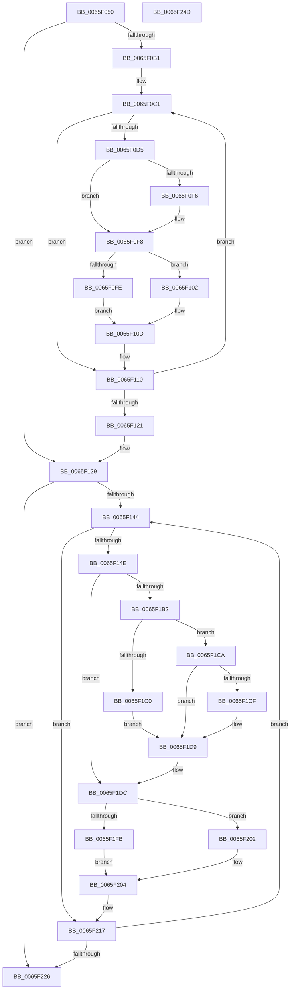

# WheaAttemptRowOffline

- RVA: `0x0065F050`–`0x0065F24E` (길이 `510` bytes)
- VA: `0x000000014065F050`
- 실행 섹션: `.text`
- PDB 이름 있음: `예`; PDB Function 태그: `아니요`
- unwind 정보 RVA: `0x000D3DE4`
- 디코드: `144`개 명령, `510/510` bytes 표시
- 미해석 바이트: `0` (있으면 어셈블리에 `.byte`로 보존)

> 이 문서는 커널 이미지의 기계어와 PDB 기호를 분석해 생성했습니다. 4번과 5번은 함수 원형과 자료형을 바이너리 사용 방식에서 추정한 C 해석이며 원본 소스 복구 결과는 아닙니다.

## 1. Dependencies

- 직접 호출 지점: **9**; 고유 호출 대상: **9**
- 직접 호출자로 확인된 함수: **2**
- RIP 상대 이미지 참조: **3**

### Outgoing calls
- `0x0065F0C9` → [MmGetPageBadStatus](../67/MmGetPageBadStatus_function_0067A9B0.md) (function, `0x0067A9B0`)
- `0x0065F0EA` → [MmMarkPhysicalMemoryAsBad](../67/MmMarkPhysicalMemoryAsBad_function_0067AA50.md) (function, `0x0067AA50`)
- `0x0065F134` → [WheapCallInUsePageNotificationCallbacks](../../page/7D/WheapCallInUsePageNotificationCallbacks_function_007D7C28.md) (function, `0x007D7C28`)
- `0x0065F19E` → [WheaLogInternalEvent](../66/WheaLogInternalEvent_function_006605B0.md) (function, `0x006605B0`)
- `0x0065F1C3` → [WheaPersistBadPageToBcd](WheaPersistBadPageToBcd_function_0065F3D0.md) (function, `0x0065F3D0`)
- `0x0065F1D4` → [WheaPersistBadPageToRegistry](WheaPersistBadPageToRegistry_function_0065F58C.md) (function, `0x0065F58C`)
- `0x0065F1F0` → [WheaAddressTranslateAndAddToDefectList](../../page/7D/WheaAddressTranslateAndAddToDefectList_function_007D71EC.md) (function, `0x007D71EC`)
- `0x0065F212` → [WheapLogPageOfflineAttemptEvent](../../page/7D/WheapLogPageOfflineAttemptEvent_function_007D857C.md) (function, `0x007D857C`)
- `0x0065F22D` → [_security_check_cookie](../6A/_security_check_cookie_function_006AC640.md) (function, `0x006AC640`)

### Direct callers
- [WheapOfflineRow](../../page/7D/WheapOfflineRow_function_007D8108.md) at `0x007D82EE`
- [WheapExecuteRowFailureCheck](../../page/7D/WheapExecuteRowFailureCheck_function_007D8ED8.md) at `0x007D90CD`

### Static image references
- `0x0065F06C` → RVA `0x00E0A740` (`.data`; read)
- `0x0065F1A3` → RVA `0x00E095C8` (`.data`; read)
- `0x0065F1B2` → RVA `0x00E09788` (`.data`; read)

## 2. Other-region calls and transfers

- 다른 실행 섹션으로 향하는 call: **3**
  - `0x0065F134` → [WheapCallInUsePageNotificationCallbacks](../../page/7D/WheapCallInUsePageNotificationCallbacks_function_007D7C28.md) (`.text` → `PAGE`)
  - `0x0065F1F0` → [WheaAddressTranslateAndAddToDefectList](../../page/7D/WheaAddressTranslateAndAddToDefectList_function_007D71EC.md) (`.text` → `PAGE`)
  - `0x0065F212` → [WheapLogPageOfflineAttemptEvent](../../page/7D/WheapLogPageOfflineAttemptEvent_function_007D857C.md) (`.text` → `PAGE`)
- 별도 외부 분기/꼬리 이동을 확인하지 못했습니다.

## 3. Assembly (complete function range)

```asm
0065F050  48 89 5C 24 18                  mov qword ptr [rsp + 0x18], rbx
0065F055  55                              push rbp
0065F056  56                              push rsi
0065F057  57                              push rdi
0065F058  41 54                           push r12
0065F05A  41 55                           push r13
0065F05C  41 56                           push r14
0065F05E  41 57                           push r15
0065F060  48 8D 6C 24 D9                  lea rbp, [rsp - 0x27]
0065F065  48 81 EC 90 00 00 00            sub rsp, 0x90
0065F06C  48 8B 05 CD B6 7A 00            mov rax, qword ptr [rip + 0x7ab6cd]
0065F073  48 33 C4                        xor rax, rsp
0065F076  48 89 45 17                     mov qword ptr [rbp + 0x17], rax
0065F07A  48 83 65 C7 00                  and qword ptr [rbp - 0x39], 0
0065F07F  49 8D 79 31                     lea rdi, [r9 + 0x31]
0065F083  33 C0                           xor eax, eax
0065F085  45 8B E0                        mov r12d, r8d
0065F088  44 89 65 CF                     mov dword ptr [rbp - 0x31], r12d
0065F08C  0F 57 C0                        xorps xmm0, xmm0
0065F08F  48 89 55 DF                     mov qword ptr [rbp - 0x21], rdx
0065F093  4D 8B F1                        mov r14, r9
0065F096  48 89 45 07                     mov qword ptr [rbp + 7], rax
0065F09A  4C 8B EA                        mov r13, rdx
0065F09D  66 89 45 0F                     mov word ptr [rbp + 0xf], ax
0065F0A1  4C 8B F9                        mov r15, rcx
0065F0A4  0F 11 45 E7                     movups xmmword ptr [rbp - 0x19], xmm0
0065F0A8  0F 11 45 F7                     movups xmmword ptr [rbp - 9], xmm0
0065F0AC  45 85 C0                        test r8d, r8d
0065F0AF  74 78                           je 0x14065f129
0065F0B1  48 8B F1                        mov rsi, rcx
0065F0B4  4D 8B E9                        mov r13, r9
0065F0B7  48 C1 E6 0C                     shl rsi, 0xc
0065F0BB  49 F7 D5                        not r13
0065F0BE  48 8B DF                        mov rbx, rdi
0065F0C1  48 8D 4D C7                     lea rcx, [rbp - 0x39]
0065F0C5  48 89 75 C7                     mov qword ptr [rbp - 0x39], rsi
0065F0C9  E8 E2 B8 01 00                  call 0x14067a9b0
0065F0CE  89 43 F7                        mov dword ptr [rbx - 9], eax
0065F0D1  85 C0                           test eax, eax
0065F0D3  75 3B                           jne 0x14065f110
0065F0D5  48 83 4D C7 01                  or qword ptr [rbp - 0x39], 1
0065F0DA  48 8D 55 D7                     lea rdx, [rbp - 0x29]
0065F0DE  48 8D 4D C7                     lea rcx, [rbp - 0x39]
0065F0E2  48 C7 45 D7 00 10 00 00         mov qword ptr [rbp - 0x29], 0x1000
0065F0EA  E8 61 B9 01 00                  call 0x14067aa50
0065F0EF  85 C0                           test eax, eax
0065F0F1  0F 94 C0                        sete al
0065F0F4  79 02                           jns 0x14065f0f8
0065F0F6  B0 FF                           mov al, 0xff
0065F0F8  88 03                           mov byte ptr [rbx], al
0065F0FA  84 C0                           test al, al
0065F0FC  74 04                           je 0x14065f102
0065F0FE  B0 C0                           mov al, 0xc0
0065F100  EB 0B                           jmp 0x14065f10d
0065F102  4A 8D 04 2B                     lea rax, [rbx + r13]
0065F106  42 C6 04 30 00                  mov byte ptr [rax + r14], 0
0065F10B  B0 40                           mov al, 0x40
0065F10D  88 43 FF                        mov byte ptr [rbx - 1], al
0065F110  48 81 C6 00 10 00 00            add rsi, 0x1000
0065F117  48 83 C3 18                     add rbx, 0x18
0065F11B  49 83 EC 01                     sub r12, 1
0065F11F  75 A0                           jne 0x14065f0c1
0065F121  44 8B 65 CF                     mov r12d, dword ptr [rbp - 0x31]
0065F125  4C 8B 6D DF                     mov r13, qword ptr [rbp - 0x21]
0065F129  4D 8B CE                        mov r9, r14
0065F12C  45 8B C4                        mov r8d, r12d
0065F12F  33 D2                           xor edx, edx
0065F131  49 8B CF                        mov rcx, r15
0065F134  E8 EF 8A 17 00                  call 0x1407d7c28
0065F139  33 DB                           xor ebx, ebx
0065F13B  45 85 E4                        test r12d, r12d
0065F13E  0F 84 E2 00 00 00               je 0x14065f226
0065F144  83 7F F7 00                     cmp dword ptr [rdi - 9], 0
0065F148  0F 8C C9 00 00 00               jl 0x14065f217
0065F14E  8A 07                           mov al, byte ptr [rdi]
0065F150  48 8D 4D E7                     lea rcx, [rbp - 0x19]
0065F154  83 65 F3 00                     and dword ptr [rbp - 0xd], 0
0065F158  88 45 0B                        mov byte ptr [rbp + 0xb], al
0065F15B  41 8D 04 1F                     lea eax, [r15 + rbx]
0065F15F  89 45 0C                        mov dword ptr [rbp + 0xc], eax
0065F162  C7 45 E7 57 68 4C 67            mov dword ptr [rbp - 0x19], 0x674c6857
0065F169  C7 45 EB 01 00 00 00            mov dword ptr [rbp - 0x15], 1
0065F170  C7 45 EF 2A 00 00 00            mov dword ptr [rbp - 0x11], 0x2a
0065F177  C7 45 FB 06 00 00 80            mov dword ptr [rbp - 5], 0x80000006
0065F17E  C7 45 F7 4B 52 4E 4C            mov dword ptr [rbp - 9], 0x4c4e524b
0065F185  C7 45 FF 02 00 00 00            mov dword ptr [rbp - 1], 2
0065F18C  C7 45 03 0A 00 00 00            mov dword ptr [rbp + 3], 0xa
0065F193  C7 45 07 01 00 00 00            mov dword ptr [rbp + 7], 1
0065F19A  C6 45 10 01                     mov byte ptr [rbp + 0x10], 1
0065F19E  E8 0D 14 00 00                  call 0x1406605b0
0065F1A3  48 8B 05 1E A4 7A 00            mov rax, qword ptr [rip + 0x7aa41e]
0065F1AA  45 32 F6                        xor r14b, r14b
0065F1AD  44 38 30                        cmp byte ptr [rax], r14b
0065F1B0  74 2A                           je 0x14065f1dc
0065F1B2  48 8B 05 CF A5 7A 00            mov rax, qword ptr [rip + 0x7aa5cf]
0065F1B9  8B 08                           mov ecx, dword ptr [rax]
0065F1BB  83 F9 01                        cmp ecx, 1
0065F1BE  75 0A                           jne 0x14065f1ca
0065F1C0  49 8B CF                        mov rcx, r15
0065F1C3  E8 08 02 00 00                  call 0x14065f3d0
0065F1C8  EB 0F                           jmp 0x14065f1d9
0065F1CA  83 F9 02                        cmp ecx, 2
0065F1CD  75 0A                           jne 0x14065f1d9
0065F1CF  8B CB                           mov ecx, ebx
0065F1D1  49 03 CF                        add rcx, r15
0065F1D4  E8 B3 03 00 00                  call 0x14065f58c
0065F1D9  41 B6 01                        mov r14b, 1
0065F1DC  8B F3                           mov esi, ebx
0065F1DE  48 8D 4D C7                     lea rcx, [rbp - 0x39]
0065F1E2  49 03 F7                        add rsi, r15
0065F1E5  49 8B D5                        mov rdx, r13
0065F1E8  48 C1 E6 0C                     shl rsi, 0xc
0065F1EC  48 89 75 C7                     mov qword ptr [rbp - 0x39], rsi
0065F1F0  E8 F7 7F 17 00                  call 0x1407d71ec
0065F1F5  8A 07                           mov al, byte ptr [rdi]
0065F1F7  3C FF                           cmp al, 0xff
0065F1F9  74 07                           je 0x14065f202
0065F1FB  84 C0                           test al, al
0065F1FD  0F 94 C2                        sete dl
0065F200  EB 02                           jmp 0x14065f204
0065F202  B2 FF                           mov dl, 0xff
0065F204  45 8A CE                        mov r9b, r14b
0065F207  C6 44 24 20 00                  mov byte ptr [rsp + 0x20], 0
0065F20C  45 33 C0                        xor r8d, r8d
0065F20F  48 8B CE                        mov rcx, rsi
0065F212  E8 65 93 17 00                  call 0x1407d857c
0065F217  FF C3                           inc ebx
0065F219  48 83 C7 18                     add rdi, 0x18
0065F21D  41 3B DC                        cmp ebx, r12d
0065F220  0F 82 1E FF FF FF               jb 0x14065f144
0065F226  48 8B 4D 17                     mov rcx, qword ptr [rbp + 0x17]
0065F22A  48 33 CC                        xor rcx, rsp
0065F22D  E8 0E D4 04 00                  call 0x1406ac640
0065F232  48 8B 9C 24 E0 00 00 00         mov rbx, qword ptr [rsp + 0xe0]
0065F23A  48 81 C4 90 00 00 00            add rsp, 0x90
0065F241  41 5F                           pop r15
0065F243  41 5E                           pop r14
0065F245  41 5D                           pop r13
0065F247  41 5C                           pop r12
0065F249  5F                              pop rdi
0065F24A  5E                              pop rsi
0065F24B  5D                              pop rbp
0065F24C  C3                              ret
0065F24D  CC                              int3
```

## 4. C-style interpretation (structured pseudocode)

```c
__int64 __fastcall WheaAttemptRowOffline(__int64 a1, __int64 a2, int a3, __int64 a4)
{
    __int64 result;
    __int64 v_r12;
    __int64 v_r13;
    __int64 v_r14;
    __int64 v_rbx;
    __int64 v_rdi;
    __int64 v_rsi;
    __int64 v_rsp;
    unsigned __int64 v_stack_m48;
    unsigned __int8 v_stack_m4F;
    unsigned __int16 v_stack_m50;
    unsigned int v_stack_m53;
    unsigned __int8 v_stack_m54;
    unsigned __int64 v_stack_m58;
    unsigned int v_stack_m5C;
    unsigned __int64 v_stack_m5F;
    unsigned int v_stack_m60;
    unsigned int v_stack_m64;
    unsigned __int64 v_stack_m68;
    unsigned int v_stack_m6C;
    unsigned int v_stack_m70;
    unsigned int v_stack_m74;
    unsigned __int64 v_stack_m78;
    unsigned __int64 v_stack_m80;
    unsigned __int64 v_stack_m88;
    unsigned int v_stack_m90;
    unsigned __int64 v_stack_m98;
    unsigned __int8 v_stack_mA8;
    unsigned __int64 v_stack_p18;

    v_stack_p18 = v_rbx;
    v_rsp = (v_rsp) - (144);
    result = (*(unsigned __int64 *)(v_rip + 8042189)) ^ (v_rsp);
    v_stack_m48 = result;
    result = 0;
    v_stack_m90 = (unsigned int)((unsigned int)(a3));
    v_stack_m80 = a2;
    v_stack_m58 = 0;
    v_stack_m50 = 0;
    v_stack_m78 = v_xmm0;
    v_stack_m68 = v_xmm0;
    if (a3 == 0) goto loc_0065F129;
    v_rsi = (a1) << (12);
    v_r13 = ~(a4);
loc_0065F0C1:
    v_stack_m98 = v_rsi;
    result = MmGetPageBadStatus(v_stack_m98, a2, a3, a4);
    *(unsigned int *)(a4 + 49 - 9) = (unsigned int)(result);
    if ((unsigned int)(result) != 0) goto loc_0065F110;
    v_stack_m88 = 0x1000ULL;
    result = MmMarkPhysicalMemoryAsBad(v_stack_m98, v_stack_m88, a3, a4);
    result = ((unsigned int)(result) == 0) ? 1 : 0;
    if (sign_flag) {
        result = 255;
    }
    *(unsigned __int8 *)(a4 + 49) = (unsigned __int8)(result);
    if ((unsigned __int8)(result) == 0) goto loc_0065F102;
    goto loc_0065F10D;
loc_0065F102:
    *(unsigned __int8 *)(a4 + 49 + v_r13 * 1 + a4 * 1) = 0;
loc_0065F10D:
    *(unsigned __int8 *)(a4 + 49 - 1) = 64;
loc_0065F110:
    v_rsi = (v_rsi) + (0x1000ULL);
    v_rbx = (a4 + 49) + (24);
    v_r12 = ((unsigned int)(a3)) - (1);
    if (condition_is_not_equal) goto loc_0065F0C1;
loc_0065F129:
    a2 = 0;
    result = WheapCallInUsePageNotificationCallbacks(a1, a2, (unsigned int)((unsigned int)((unsigned int)(v_stack_m90))), a4);
    v_rbx = 0;
    if ((unsigned int)((unsigned int)(v_stack_m90)) == 0) goto loc_0065F226;
loc_0065F144:
    if ((*(unsigned int *)(a4 + 49 - 9)) < 0) goto loc_0065F217;
    v_stack_m54 = (unsigned __int8)(*(unsigned __int8 *)(a4 + 49));
    v_stack_m53 = (unsigned int)(a1 + v_rbx * 1);
    v_stack_m78 = 0x674C6857ULL;
    v_stack_m74 = 1;
    v_stack_m70 = 42;
    v_stack_m64 = 0x80000006ULL;
    v_stack_m68 = 0x4C4E524BULL;
    v_stack_m60 = 2;
    v_stack_m5C = 10;
    v_stack_m58 = 1;
    v_stack_m4F = 1;
    result = WheaLogInternalEvent(v_stack_m78, a2, (unsigned int)((unsigned int)((unsigned int)(v_stack_m90))), a4);
    v_r14 = 0;
    if ((*(unsigned __int8 *)(*(unsigned __int64 *)(v_rip + 8037406))) == 0) goto loc_0065F1DC;
    if (((unsigned int)((unsigned int)(*(unsigned int *)(*(unsigned __int64 *)(v_rip + 8037839))))) != 1) goto loc_0065F1CA;
    result = WheaPersistBadPageToBcd(a1, a2, (unsigned int)((unsigned int)((unsigned int)(v_stack_m90))), a4);
    goto loc_0065F1D9;
loc_0065F1CA:
    if (((unsigned int)(a1)) == 2) {
        a1 = 0;
        a1 = (a1) + (a1);
        result = WheaPersistBadPageToRegistry(a1, a2, (unsigned int)((unsigned int)((unsigned int)(v_stack_m90))), a4);
    }
loc_0065F1DC:
    v_rsi = (0) + (a1);
    v_rsi = (v_rsi) << (12);
    v_stack_m98 = v_rsi;
    result = WheaAddressTranslateAndAddToDefectList(v_stack_m98, v_stack_m80, (unsigned int)((unsigned int)((unsigned int)(v_stack_m90))), a4);
    if (((unsigned __int8)(*(unsigned __int8 *)(a4 + 49))) == 255) goto loc_0065F202;
    a2 = ((unsigned __int8)(*(unsigned __int8 *)(a4 + 49)) == 0) ? 1 : 0;
    goto loc_0065F204;
loc_0065F202:
loc_0065F204:
    v_stack_mA8 = 0;
    a3 = 0;
    result = WheapLogPageOfflineAttemptEvent(v_rsi, 255, a3, 1);
loc_0065F217:
    v_rbx = (unsigned int)((v_rbx) + 1);
    v_rdi = (a4 + 49) + (24);
    if (((unsigned int)(v_rbx)) < ((unsigned int)((unsigned int)(v_stack_m90)))) goto loc_0065F144;
loc_0065F226:
    a1 = (v_stack_m48) ^ (v_rsp);
    result = _security_check_cookie(a1, 255, a3, 1);
    v_rsp = (v_rsp) + (144);
    return result;
}
```

## 5. (Beta) C Style

```c
int64_t WheaAttemptRowOffline(void *Arg1, int64_t Arg2, int32_t Arg3, void *Arg4)
{
    uint8_t *arg1 = (uint8_t *)Arg1;
    uint8_t *arg4 = (uint8_t *)Arg4;

    int64_t result;
    int64_t local_r12;
    int64_t local_r13;
    int64_t local_r14;
    int64_t local_rbx;
    int64_t local_rdi;
    int64_t local_rsi;
    int64_t local_rsp;
    uint64_t v_stack_m48;
    uint8_t v_stack_m4F;
    uint16_t v_stack_m50;
    uint32_t v_stack_m53;
    uint8_t v_stack_m54;
    uint64_t v_stack_m58;
    uint32_t v_stack_m5C;
    uint64_t v_stack_m5F;
    uint32_t v_stack_m60;
    uint32_t v_stack_m64;
    uint64_t v_stack_m68;
    uint32_t v_stack_m6C;
    uint32_t v_stack_m70;
    uint32_t v_stack_m74;
    uint64_t v_stack_m78;
    uint64_t v_stack_m80;
    uint64_t v_stack_m88;
    uint32_t v_stack_m90;
    uint64_t v_stack_m98;
    uint8_t v_stack_mA8;
    uint64_t v_stack_p18;

    v_stack_p18 = local_rbx;
    local_rsp = (local_rsp) - (144);
    result = (*(uint64_t *)(v_rip + 0x7AB6CD)) ^ (local_rsp);
    v_stack_m48 = result;
    result = 0;
    v_stack_m90 = (uint32_t)((uint32_t)(Arg3));
    v_stack_m80 = Arg2;
    v_stack_m58 = 0;
    v_stack_m50 = 0;
    v_stack_m78 = v_xmm0;
    v_stack_m68 = v_xmm0;
    if (Arg3 == 0) goto loc_0065F129;
    local_rsi = (Arg1) << (12);
    local_r13 = ~(Arg4);
loc_0065F0C1:
    v_stack_m98 = local_rsi;
    result = MmGetPageBadStatus(v_stack_m98, Arg2, Arg3, Arg4);
    *(uint32_t *)(arg4 + 0x31 - 0x9) = (uint32_t)(result);
    if ((uint32_t)(result) != 0) goto loc_0065F110;
    v_stack_m88 = 0x1000ULL;
    result = MmMarkPhysicalMemoryAsBad(v_stack_m98, v_stack_m88, Arg3, Arg4);
    result = ((uint32_t)(result) == 0) ? 1 : 0;
    if (sign_flag) {
        result = 255;
    }
    *(uint8_t *)(arg4 + 0x31) = (uint8_t)(result);
    if ((uint8_t)(result) == 0) goto loc_0065F102;
    goto loc_0065F10D;
loc_0065F102:
    *(uint8_t *)(arg4 + 0x31 + local_r13 * 1 + arg4 * 1) = 0;
loc_0065F10D:
    *(uint8_t *)(arg4 + 0x31 - 0x1) = 64;
loc_0065F110:
    local_rsi = (local_rsi) + (0x1000ULL);
    local_rbx = (Arg4 + 49) + (24);
    local_r12 = ((uint32_t)(Arg3)) - (1);
    if (condition_is_not_equal) goto loc_0065F0C1;
loc_0065F129:
    Arg2 = 0;
    result = WheapCallInUsePageNotificationCallbacks(Arg1, Arg2, (uint32_t)((uint32_t)((uint32_t)(v_stack_m90))), Arg4);
    local_rbx = 0;
    if ((uint32_t)((uint32_t)(v_stack_m90)) == 0) goto loc_0065F226;
loc_0065F144:
    if ((*(uint32_t *)(arg4 + 0x31 - 0x9)) < 0) goto loc_0065F217;
    v_stack_m54 = (uint8_t)(*(uint8_t *)(arg4 + 0x31));
    v_stack_m53 = (uint32_t)(Arg1 + local_rbx * 1);
    v_stack_m78 = 0x674C6857ULL;
    v_stack_m74 = 1;
    v_stack_m70 = 42;
    v_stack_m64 = 0x80000006ULL;
    v_stack_m68 = 0x4C4E524BULL;
    v_stack_m60 = 2;
    v_stack_m5C = 10;
    v_stack_m58 = 1;
    v_stack_m4F = 1;
    result = WheaLogInternalEvent(v_stack_m78, Arg2, (uint32_t)((uint32_t)((uint32_t)(v_stack_m90))), Arg4);
    local_r14 = 0;
    if ((*(uint8_t *)(*(uint64_t *)(v_rip + 0x7AA41E))) == 0) goto loc_0065F1DC;
    if (((uint32_t)((uint32_t)(*(uint32_t *)(*(uint64_t *)(v_rip + 0x7AA5CF))))) != 1) goto loc_0065F1CA;
    result = WheaPersistBadPageToBcd(Arg1, Arg2, (uint32_t)((uint32_t)((uint32_t)(v_stack_m90))), Arg4);
    goto loc_0065F1D9;
loc_0065F1CA:
    if (((uint32_t)(Arg1)) == 2) {
        Arg1 = 0;
        Arg1 = (Arg1) + (Arg1);
        result = WheaPersistBadPageToRegistry(Arg1, Arg2, (uint32_t)((uint32_t)((uint32_t)(v_stack_m90))), Arg4);
    }
loc_0065F1DC:
    local_rsi = (0) + (Arg1);
    local_rsi = (local_rsi) << (12);
    v_stack_m98 = local_rsi;
    result = WheaAddressTranslateAndAddToDefectList(v_stack_m98, v_stack_m80, (uint32_t)((uint32_t)((uint32_t)(v_stack_m90))), Arg4);
    if (((uint8_t)(*(uint8_t *)(arg4 + 0x31))) == 255) goto loc_0065F202;
    Arg2 = ((uint8_t)(*(uint8_t *)(arg4 + 0x31)) == 0) ? 1 : 0;
    goto loc_0065F204;
loc_0065F202:
loc_0065F204:
    v_stack_mA8 = 0;
    Arg3 = 0;
    result = WheapLogPageOfflineAttemptEvent(local_rsi, 255, Arg3, 1);
loc_0065F217:
    local_rbx = (uint32_t)((local_rbx) + 1);
    local_rdi = (Arg4 + 49) + (24);
    if (((uint32_t)(local_rbx)) < ((uint32_t)((uint32_t)(v_stack_m90)))) goto loc_0065F144;
loc_0065F226:
    Arg1 = (v_stack_m48) ^ (local_rsp);
    result = _security_check_cookie(Arg1, 255, Arg3, 1);
    local_rsp = (local_rsp) + (144);
    return result;
}
```

### 관측된 메모리 오프셋

구조체 형식이 확인되지 않은 접근은 인자 기준의 오프셋으로만 기록했습니다.

| 기준 인자 | 오프셋 표현 | 폭 (bit) | 접근 |
|---|---:|---:|---|
| `Arg1` | `+ 0x0 + rbx*1` | `32` | `R` |
| `Arg4` | `- 0x9` | `32` | `R` |
| `Arg4` | `- 0x9` | `32` | `W` |
| `Arg4` | `- 0x1` | `8` | `W` |
| `Arg4` | `+ 0x0` | `8` | `R` |
| `Arg4` | `+ 0x0` | `8` | `W` |
| `Arg4` | `+ 0x0 + r13*1` | `64` | `R` |
| `Arg4` | `+ 0x0 + r14*1` | `8` | `W` |
| `Arg4` | `+ 0x31` | `64` | `R` |

## 6. Execution-region graph

[열기: 2D/3D 그래프와 함수 탐색 컨트롤 패널](../../../control-panel.html?section=text&rva=0x0065F050&view=graph)

- 2D 그래프는 위에서 아래로 흐르고, 3D 그래프는 빈 공간을 드래그해 회전합니다. Shift+드래그는 이동, 휠은 확대·축소, 함수 노드 선택은 대상 보고서 이동입니다.

### Static fallback


