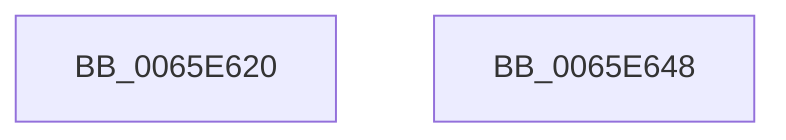

# WheaCreateHwErrorReportDeviceDriver

- RVA: `0x0065E620`–`0x0065E649` (길이 `41` bytes)
- VA: `0x000000014065E620`
- 실행 섹션: `.text`
- PDB 이름 있음: `예`; PDB Function 태그: `아니요`
- unwind 정보 RVA: `0x0005CF00`
- 디코드: `13`개 명령, `41/41` bytes 표시
- 미해석 바이트: `0` (있으면 어셈블리에 `.byte`로 보존)

> 이 문서는 커널 이미지의 기계어와 PDB 기호를 분석해 생성했습니다. 4번과 5번은 함수 원형과 자료형을 바이너리 사용 방식에서 추정한 C 해석이며 원본 소스 복구 결과는 아닙니다.

## 1. Dependencies

- 직접 호출 지점: **1**; 고유 호출 대상: **1**
- 직접 호출자로 확인된 함수: **2**
- RIP 상대 이미지 참조: **0**

### Outgoing calls
- `0x0065E632` → [WheapInitErrorReportDeviceDriver](WheapInitErrorReportDeviceDriver_function_0065ED88.md) (function, `0x0065ED88`)

### Direct callers
- [WheaReportFatalHwErrorDeviceDriverEx](WheaReportFatalHwErrorDeviceDriverEx_function_0065E910.md) at `0x0065E941`
- [WheaReportHwErrorDeviceDriverEx](WheaReportHwErrorDeviceDriverEx_function_0065EA30.md) at `0x0065EA61`

### Static image references
- 디코드된 RIP-relative 메모리 참조가 없습니다.

## 2. Other-region calls and transfers

- 다른 실행 섹션으로 향하는 call: **0**
- 별도 외부 분기/꼬리 이동을 확인하지 못했습니다.

## 3. Assembly (complete function range)

```asm
0065E620  40 53                           push rbx
0065E622  48 83 EC 20                     sub rsp, 0x20
0065E626  33 DB                           xor ebx, ebx
0065E628  48 8D 54 24 40                  lea rdx, [rsp + 0x40]
0065E62D  48 89 5C 24 40                  mov qword ptr [rsp + 0x40], rbx
0065E632  E8 51 07 00 00                  call 0x14065ed88
0065E637  85 C0                           test eax, eax
0065E639  48 0F 49 5C 24 40               cmovns rbx, qword ptr [rsp + 0x40]
0065E63F  48 8B C3                        mov rax, rbx
0065E642  48 83 C4 20                     add rsp, 0x20
0065E646  5B                              pop rbx
0065E647  C3                              ret
0065E648  CC                              int3
```

## 4. C-style interpretation (structured pseudocode)

```c
__int64 __fastcall WheaCreateHwErrorReportDeviceDriver(void)
{
    __int64 result;
    __int64 v_rbx;
    __int64 v_rsp;
    unsigned __int64 v_stack_p18;

    v_rsp = (v_rsp) - (32);
    v_rbx = 0;
    v_stack_p18 = 0;
    result = WheapInitErrorReportDeviceDriver(a1, v_stack_p18, a3, a4);
    if (!sign_flag) { v_rbx = v_stack_p18; }
    v_rsp = (v_rsp) + (32);
    return v_rbx;
}
```

## 5. (Beta) C Style

```c
void WheaCreateHwErrorReportDeviceDriver(void)
{
    int64_t result;
    int64_t local_rbx;
    int64_t local_rsp;
    uint64_t v_stack_p18;

    local_rsp = (local_rsp) - (32);
    local_rbx = 0;
    v_stack_p18 = 0;
    result = WheapInitErrorReportDeviceDriver(a1, v_stack_p18, a3, a4);
    if (!sign_flag) { local_rbx = v_stack_p18; }
    local_rsp = (local_rsp) + (32);
    return local_rbx;
}
```

## 6. Execution-region graph

[열기: 2D/3D 그래프와 함수 탐색 컨트롤 패널](../../../control-panel.html?section=text&rva=0x0065E620&view=graph)

- 2D 그래프는 위에서 아래로 흐르고, 3D 그래프는 빈 공간을 드래그해 회전합니다. Shift+드래그는 이동, 휠은 확대·축소, 함수 노드 선택은 대상 보고서 이동입니다.

### Static fallback


