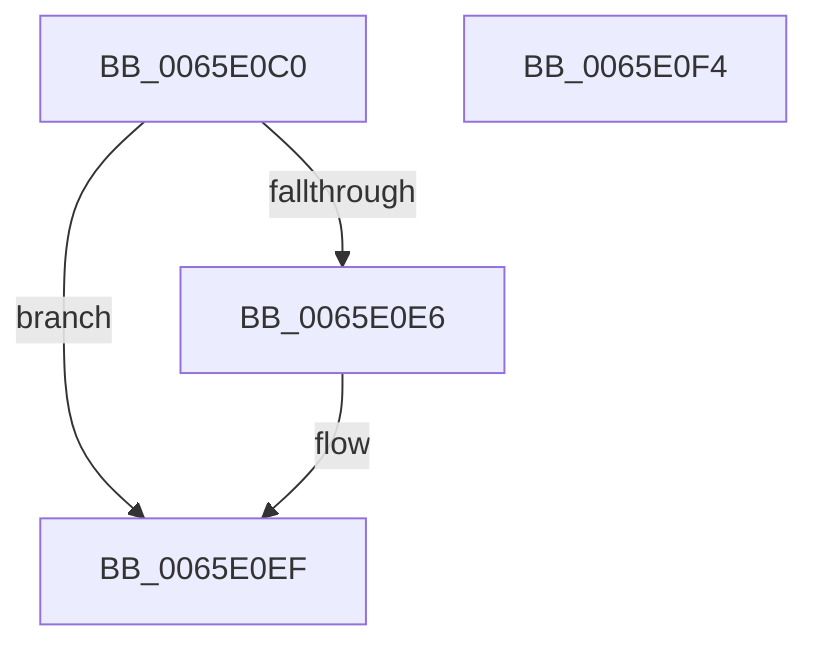

# WheaErrorSourceGetState

- RVA: `0x0065E0C0`–`0x0065E0F5` (길이 `53` bytes)
- VA: `0x000000014065E0C0`
- 실행 섹션: `.text`
- PDB 이름 있음: `예`; PDB Function 태그: `아니요`
- unwind 정보 RVA: `0x0005C788`
- 디코드: `16`개 명령, `53/53` bytes 표시
- 미해석 바이트: `0` (있으면 어셈블리에 `.byte`로 보존)

> 이 문서는 커널 이미지의 기계어와 PDB 기호를 분석해 생성했습니다. 4번과 5번은 함수 원형과 자료형을 바이너리 사용 방식에서 추정한 C 해석이며 원본 소스 복구 결과는 아닙니다.

## 1. Dependencies

- 직접 호출 지점: **1**; 고유 호출 대상: **1**
- 직접 호출자로 확인된 함수: **0**
- RIP 상대 이미지 참조: **1**

### Outgoing calls
- `0x0065E0CD` → [WheapGetErrorSource](../49/WheapGetErrorSource_function_0049554C.md) (function, `0x0049554C`)

### Direct callers
- 이 함수 시작 RVA로 연결되는 직접 call은 확인되지 않았습니다. 간접 호출은 완전히 역산할 수 없습니다.

### Static image references
- `0x0065E0C6` → RVA `0x00EEF018` (`.data`; read)

## 2. Other-region calls and transfers

- 다른 실행 섹션으로 향하는 call: **0**
- 별도 외부 분기/꼬리 이동을 확인하지 못했습니다.

## 3. Assembly (complete function range)

```asm
0065E0C0  48 83 EC 28                     sub rsp, 0x28
0065E0C4  8B D1                           mov edx, ecx
0065E0C6  48 8D 0D 4B 0F 89 00            lea rcx, [rip + 0x890f4b]
0065E0CD  E8 7A 74 E3 FF                  call 0x14049554c
0065E0D2  48 8D 48 60                     lea rcx, [rax + 0x60]
0065E0D6  48 F7 D8                        neg rax
0065E0D9  B8 03 00 00 00                  mov eax, 3
0065E0DE  48 1B D2                        sbb rdx, rdx
0065E0E1  48 23 D1                        and rdx, rcx
0065E0E4  74 09                           je 0x14065e0ef
0065E0E6  8B 4A 0C                        mov ecx, dword ptr [rdx + 0xc]
0065E0E9  83 F9 04                        cmp ecx, 4
0065E0EC  0F 45 C1                        cmovne eax, ecx
0065E0EF  48 83 C4 28                     add rsp, 0x28
0065E0F3  C3                              ret
0065E0F4  CC                              int3
```

## 4. C-style interpretation (structured pseudocode)

```c
__int64 __fastcall WheaErrorSourceGetState(int a1)
{
    __int64 result;
    __int64 v_rsp;

    v_rsp = (v_rsp) - (40);
    result = WheapGetErrorSource(v_rip + 8982347, (unsigned int)(a1), a3, a4);
    result = -(result);
    a2 = ((unsigned int)(a1)) & (result + 96);
    result = 3;
    if (!(condition_is_equal)) {
        a1 = *(unsigned int *)(a2 + 12);
        result = 3;
        if (a1 != 4) { result = a1; }
    }
    v_rsp = (v_rsp) + (40);
    return result;
}
```

## 5. (Beta) C Style

```c
int64_t WheaErrorSourceGetState(int32_t Arg1)
{
    int64_t result;
    int64_t local_rsp;

    local_rsp = (local_rsp) - (40);
    result = WheapGetErrorSource(v_rip + 8982347, (uint32_t)(Arg1), a3, a4);
    result = -(result);
    a2 = ((uint32_t)(Arg1)) & (result + 96);
    result = 3;
    if (!(condition_is_equal)) {
        Arg1 = *(uint32_t *)(a2 + 0xC);
        result = 3;
        if (Arg1 != 4) { result = Arg1; }
    }
    local_rsp = (local_rsp) + (40);
    return result;
}
```

## 6. Execution-region graph

[열기: 2D/3D 그래프와 함수 탐색 컨트롤 패널](../../../control-panel.html?section=text&rva=0x0065E0C0&view=graph)

- 2D 그래프는 위에서 아래로 흐르고, 3D 그래프는 빈 공간을 드래그해 회전합니다. Shift+드래그는 이동, 휠은 확대·축소, 함수 노드 선택은 대상 보고서 이동입니다.

### Static fallback


