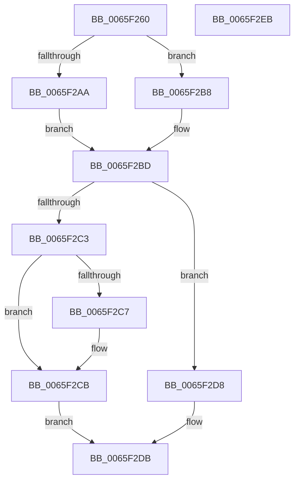

# WheaGetCurrentProcessName

- RVA: `0x0065F260`–`0x0065F2EC` (길이 `140` bytes)
- VA: `0x000000014065F260`
- 실행 섹션: `.text`
- PDB 이름 있음: `예`; PDB Function 태그: `아니요`
- unwind 정보 RVA: `0x000794E0`
- 디코드: `39`개 명령, `140/140` bytes 표시
- 미해석 바이트: `0` (있으면 어셈블리에 `.byte`로 보존)

> 이 문서는 커널 이미지의 기계어와 PDB 기호를 분석해 생성했습니다. 4번과 5번은 함수 원형과 자료형을 바이너리 사용 방식에서 추정한 C 해석이며 원본 소스 복구 결과는 아닙니다.

## 1. Dependencies

- 직접 호출 지점: **2**; 고유 호출 대상: **2**
- 직접 호출자로 확인된 함수: **2**
- RIP 상대 이미지 참조: **1**

### Outgoing calls
- `0x0065F29B` → [RtlInitAnsiString](../47/RtlInitAnsiString_function_00470F40.md) (function, `0x00470F40`)
- `0x0065F2D1` → [memcpy](../6C/memcpy_function_006C6840.md) (function, `0x006C6840`)

### Direct callers
- [KiMcheckAlternateReturn](../5C/KiMcheckAlternateReturn_function_005CB180.md) at `0x005CB31E`
- [WheaTerminateProcess](../../page/7D/WheaTerminateProcess_function_007D7810.md) at `0x007D783E`

### Static image references
- `0x0065F2AA` → RVA `0x006D0710` (` ?? ::FNODOBFM::`string'`; read)

## 2. Other-region calls and transfers

- 다른 실행 섹션으로 향하는 call: **0**
- 별도 외부 분기/꼬리 이동을 확인하지 못했습니다.

## 3. Assembly (complete function range)

```asm
0065F260  48 89 5C 24 08                  mov qword ptr [rsp + 8], rbx
0065F265  48 89 74 24 10                  mov qword ptr [rsp + 0x10], rsi
0065F26A  57                              push rdi
0065F26B  48 83 EC 30                     sub rsp, 0x30
0065F26F  8B 1A                           mov ebx, dword ptr [rdx]
0065F271  48 8B FA                        mov rdi, rdx
0065F274  65 48 8B 04 25 88 01 00 00      mov rax, qword ptr gs:[0x188]
0065F27D  48 8B F1                        mov rsi, rcx
0065F280  0F 57 C0                        xorps xmm0, xmm0
0065F283  48 8D 4C 24 20                  lea rcx, [rsp + 0x20]
0065F288  0F 11 44 24 20                  movups xmmword ptr [rsp + 0x20], xmm0
0065F28D  48 8B 90 B8 00 00 00            mov rdx, qword ptr [rax + 0xb8]
0065F294  48 81 C2 38 03 00 00            add rdx, 0x338
0065F29B  E8 A0 1C E1 FF                  call 0x140470f40
0065F2A0  48 8B 54 24 28                  mov rdx, qword ptr [rsp + 0x28]
0065F2A5  48 85 D2                        test rdx, rdx
0065F2A8  75 0E                           jne 0x14065f2b8
0065F2AA  48 8D 15 5F 14 07 00            lea rdx, [rip + 0x7145f]
0065F2B1  B8 0A 00 00 00                  mov eax, 0xa
0065F2B6  EB 05                           jmp 0x14065f2bd
0065F2B8  0F B7 44 24 20                  movzx eax, word ptr [rsp + 0x20]
0065F2BD  89 07                           mov dword ptr [rdi], eax
0065F2BF  85 DB                           test ebx, ebx
0065F2C1  74 15                           je 0x14065f2d8
0065F2C3  3B C3                           cmp eax, ebx
0065F2C5  76 04                           jbe 0x14065f2cb
0065F2C7  89 1F                           mov dword ptr [rdi], ebx
0065F2C9  8B C3                           mov eax, ebx
0065F2CB  48 8B 0E                        mov rcx, qword ptr [rsi]
0065F2CE  44 8B C0                        mov r8d, eax
0065F2D1  E8 6A 75 06 00                  call 0x1406c6840
0065F2D6  EB 03                           jmp 0x14065f2db
0065F2D8  48 89 16                        mov qword ptr [rsi], rdx
0065F2DB  48 8B 5C 24 40                  mov rbx, qword ptr [rsp + 0x40]
0065F2E0  48 8B 74 24 48                  mov rsi, qword ptr [rsp + 0x48]
0065F2E5  48 83 C4 30                     add rsp, 0x30
0065F2E9  5F                              pop rdi
0065F2EA  C3                              ret
0065F2EB  CC                              int3
```

## 4. C-style interpretation (structured pseudocode)

```c
__int64 __fastcall WheaGetCurrentProcessName(__int64 a1, __int64 a2)
{
    __int64 result;
    __int64 v_rsp;
    unsigned __int64 v_stack_m10;
    unsigned __int64 v_stack_m18;
    unsigned __int64 v_stack_p10;
    unsigned __int64 v_stack_p8;

    v_stack_p8 = v_rbx;
    v_stack_p10 = v_rsi;
    v_rsp = (v_rsp) - (48);
    v_stack_m18 = v_xmm0;
    a2 = (*(unsigned __int64 *)(*(unsigned __int64 *)(gs_base + (0 + 392)) + 184)) + (824);
    result = RtlInitAnsiString(v_stack_m18, a2, a3, a4);
    if (v_stack_m10 != 0) goto loc_0065F2B8;
    goto loc_0065F2BD;
loc_0065F2B8:
loc_0065F2BD:
    *(unsigned int *)(a2) = (unsigned int)(v_stack_m18);
    if ((unsigned int)((unsigned int)(*(unsigned int *)(a2))) == 0) goto loc_0065F2D8;
    result = v_stack_m18;
    if (((unsigned int)(v_stack_m18)) >= = ((unsigned int)((unsigned int)(*(unsigned int *)(a2))))) {
        *(unsigned int *)(a2) = (unsigned int)((unsigned int)(*(unsigned int *)(a2)));
        result = (unsigned int)((unsigned int)(*(unsigned int *)(a2)));
    }
    result = memcpy(*(unsigned __int64 *)(a1), v_rip + 463967, (unsigned int)((unsigned int)(result)), a4);
    goto loc_0065F2DB;
loc_0065F2D8:
    *(unsigned __int64 *)(a1) = v_rip + 463967;
loc_0065F2DB:
    v_rsp = (v_rsp) + (48);
    return result;
}
```

## 5. (Beta) C Style

```c
int64_t WheaGetCurrentProcessName(void *Arg1, void *Arg2)
{
    uint8_t *arg1 = (uint8_t *)Arg1;
    uint8_t *arg2 = (uint8_t *)Arg2;

    int64_t result;
    int64_t local_rsp;
    uint64_t v_stack_m10;
    uint64_t v_stack_m18;
    uint64_t v_stack_p10;
    uint64_t v_stack_p8;

    v_stack_p8 = local_rbx;
    v_stack_p10 = local_rsi;
    local_rsp = (local_rsp) - (48);
    v_stack_m18 = v_xmm0;
    Arg2 = (*(uint64_t *)(*(uint64_t *)(gs_base + (0 + 0x188)) + 0xB8)) + (824);
    result = RtlInitAnsiString(v_stack_m18, Arg2, a3, a4);
    if (v_stack_m10 != 0) goto loc_0065F2B8;
    goto loc_0065F2BD;
loc_0065F2B8:
loc_0065F2BD:
    *(uint32_t *)(arg2) = (uint32_t)(v_stack_m18);
    if ((uint32_t)((uint32_t)(*(uint32_t *)(arg2))) == 0) goto loc_0065F2D8;
    result = v_stack_m18;
    if (((uint32_t)(v_stack_m18)) >= = ((uint32_t)((uint32_t)(*(uint32_t *)(arg2))))) {
        *(uint32_t *)(arg2) = (uint32_t)((uint32_t)(*(uint32_t *)(arg2)));
        result = (uint32_t)((uint32_t)(*(uint32_t *)(arg2)));
    }
    result = memcpy(*(uint64_t *)(arg1), v_rip + 463967, (uint32_t)((uint32_t)(result)), a4);
    goto loc_0065F2DB;
loc_0065F2D8:
    *(uint64_t *)(arg1) = v_rip + 463967;
loc_0065F2DB:
    local_rsp = (local_rsp) + (48);
    return result;
}
```

### 관측된 메모리 오프셋

구조체 형식이 확인되지 않은 접근은 인자 기준의 오프셋으로만 기록했습니다.

| 기준 인자 | 오프셋 표현 | 폭 (bit) | 접근 |
|---|---:|---:|---|
| `Arg1` | `+ 0x0` | `64` | `R` |
| `Arg1` | `+ 0x0` | `64` | `W` |
| `Arg2` | `+ 0x0` | `32` | `R` |
| `Arg2` | `+ 0x0` | `32` | `W` |

## 6. Execution-region graph

[열기: 2D/3D 그래프와 함수 탐색 컨트롤 패널](../../../control-panel.html?section=text&rva=0x0065F260&view=graph)

- 2D 그래프는 위에서 아래로 흐르고, 3D 그래프는 빈 공간을 드래그해 회전합니다. Shift+드래그는 이동, 휠은 확대·축소, 함수 노드 선택은 대상 보고서 이동입니다.

### Static fallback


